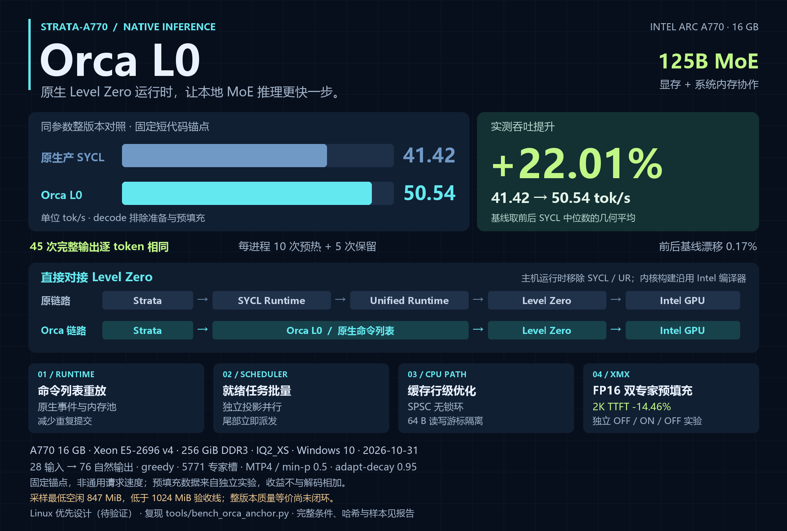
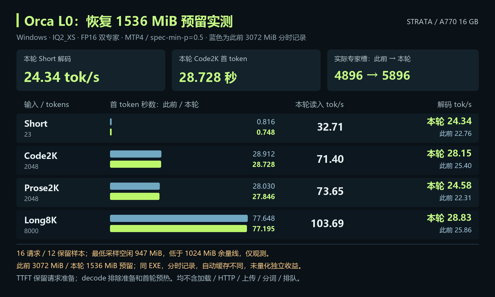

<div align="center">
  <h1>Strata-A770</h1>
  <p><strong>一张 Intel Arc A770 16 GB，配合系统内存，在本地运行 125B MoE 模型。</strong></p>
  <p>Qwen3.8-Flash-Next · 原生 Level Zero 后端 · 网页聊天与 OpenAI / Anthropic 兼容 API</p>
  <p><a href="#在-windows-上开始运行">开始运行</a> · <a href="#速度有多快">性能实测</a> · <a href="#继续了解">文档</a> · <a href="README.upstream.md">Upstream / English</a> · <a href="LICENSE">MIT</a></p>
</div>

[](bench/results/a770/orca-anchor50-2026-10-31.md)

**原生产 SYCL → Orca L0，同参数实测 41.42 → 50.54 tok/s（+22.01%）。** 固定短代码锚点，三个独立进程 SYCL／Orca／SYCL、每进程十次预热后保留五次，45 次完整输出逐 token 一致；decode 排除准备与预填充。这是整版本后端对照，日常仍用平衡参数。[同等条件复现、锚定参数与边界](bench/results/a770/orca-anchor50-2026-10-31.md) · [完整样本与哈希](sycl/orca/anchor50-a770-windows-2026-10-31.json)

Strata-A770 基于 [Strata](https://github.com/Niko1221/Strata)，针对 Intel Arc A770 优化专家缓存、计算内核和任务提交。常用专家保留在显存，其余专家由系统内存承载；你可以通过网页聊天，也可以让已有应用调用本机 API。

**当前 Intel 默认后端为 Orca L0。** 本分支的原生引擎已在 Windows / A770 16 GB 上完成真实模型与服务验证；Linux 提供构建入口，编译与 GPU 运行尚未验证。NVIDIA / AMD 用户可从[上游使用说明](README.upstream.md)开始。

| 你想做什么 | 从这里开始 |
| --- | --- |
| 在 A770 上运行模型、使用网页聊天 | [Windows 安装与启动](#在-windows-上开始运行) |
| 接入聊天客户端、代码工具或自己的应用 | [API 接入](#接入你的应用) |
| 判断短输入和长输入的实际表现 | [性能实测与适用条件](#速度有多快) |
| 复用原生 Level Zero 运行时 | [独立 orca-l0 库](orca-l0/README.md) |

<a id="how-does-it-work"></a>

## 这个分支好在哪里

| 能力 | 实际用途与边界 |
| --- | --- |
| **显存与系统内存协作** | 查询实际显存余量，预留运行空间，让热点专家优先驻留显存。16 GB 是显卡容量，完整模型仍需要系统内存与磁盘。 |
| **原生 Level Zero 推理** | Orca 管理设备、内存、队列、事件与命令回放。原生推理运行时无需 SYCL、Unified Runtime 或 oneMKL；构建内核仍需要 Intel 编译器。 |
| **A770 计算与调度优化** | 调整专家换入、量化与激活融合、subgroup 和 XMX 矩阵计算路径；MTP 推测解码可在一次验证中接受多个 token。逐项收益见[性能记录](docs/A770_PERFORMANCE.md)。 |
| **本地服务与应用接入** | 沿用 Strata 网页界面，以及 OpenAI Chat Completions、Responses 和 Anthropic Messages 兼容接口。 |
| **会话与可选批量执行** | 原生路径已验证会话保存、恢复及继续生成，以及 2 / 4 / 8 槽位批量。批量槽位占用专家缓存，默认关闭；磁盘会话当前要求关闭多请求批量。 |
| **可单独使用的运行时** | `orca-l0/` 可独立构建，提供模块加载、内存池、命令回放等接口；Strata 集成位于 `sycl/orca/`。 |

完整功能、检查入口和限制见 [Orca 原生引擎](sycl/orca/README.md)。不同 Arc 型号与其他模型包的速度需要分别验证。

<a id="install"></a>

## 在 Windows 上开始运行

当前 A770 路径需要从源码构建引擎，再由安装程序准备模型和服务。

### 1. 准备环境

| 项目 | 要求或参考 |
| --- | --- |
| 显卡与驱动 | 本分支已验证 Intel Arc A770 16 GB，Windows 驱动 32.0.101.9034。 |
| 操作系统与 CPU | 已测系统为 Windows 10 22H2；使用支持 AVX2 的 x86-64 CPU。 |
| 系统内存 | 需容纳模型和专家镜像。IQ2_XS 可参考[上游 48–64 GB 的选型建议](docs/MODELS.md#pick-by-ram)；本分支测机为 256 GiB DDR3，较小内存配置尚未在此验证。 |
| 磁盘 | 为模型下载、pack 和编译产物预留空间；上游安装建议约 80 GB 空闲，优先使用 SSD。 |
| 构建工具 | VS Build Tools 的 x64 C++ 开发环境、Windows SDK、Intel oneAPI 2025.3 编译器、Level Zero SDK、CMake 3.24+、Ninja、Python 3.10+。 |

在已初始化 VS x64 与 oneAPI 2025.3 工具链的终端中操作。下面使用 PowerShell 语法，Level Zero SDK 路径按实际安装位置修改。

### 2. 构建引擎

```powershell
git clone https://github.com/orca-zhang/Strata-A770.git
cd Strata-A770
cmake -S . -B build-strata-orca -G Ninja -DSTRATA_ENABLE_ORCA=ON -DCMAKE_C_COMPILER=icx -DCMAKE_CXX_COMPILER=icx -DCMAKE_BUILD_TYPE=Release "-DORCA_L0_SDK=C:/Program Files/LevelZeroSDK/1.33.1"
cmake --build build-strata-orca -j 1
ctest --test-dir build-strata-orca --output-on-failure
```

引擎输出为 `build-strata-orca/orca/strata.exe`，内核包位于同目录的 `images/`。两者必须来自同一次构建。GPU 检查需要可用的 A770 驱动与运行环境。

A770 不使用 B 系列的 `bmg-*` AOT 目标。其他构建位置、Linux 命令与 SYCL 对照方式见[原生引擎文档](sycl/orca/README.md)。

### 3. 准备模型并启动

在仓库根目录运行：

```powershell
python setup.py --backend orca --model IQ2_XS --context 8192
```

安装程序会发现上一步的引擎，按提示下载和准备模型、pack 与 MTP 文件，生成本机配置和启动脚本，并启动服务。切换已有 Intel 配置的后端时，会备份旧配置并保留模型参数。

安装完成后，浏览器打开 [http://127.0.0.1:8080](http://127.0.0.1:8080)。以后可使用安装程序生成的脚本启动；默认 Qwen IQ2_XS 对应：

```powershell
.\run-iq2_xs.bat
```

在另一个 PowerShell 窗口检查服务：

```powershell
Invoke-RestMethod http://127.0.0.1:8080/health
Invoke-RestMethod http://127.0.0.1:8080/v1/models
```

健康检查返回 `status: ok`、`loaded: true` 后即可使用。默认监听 `127.0.0.1`；需要对外提供服务时，必须设置 `--api-key`。

<details>
<summary>手动启动与自定义引擎路径</summary>

安装程序生成的配置包含本机模型、pack、MTP 和可执行文件路径，不能直接照搬其他机器的配置。需要手动启动时，使用安装生成的 Python 环境：

```powershell
.\.venv\Scripts\python.exe sycl/serve/server_intel.py --engine strata --config strata-iq2_xs.json --host 127.0.0.1 --port 8080
```

自定义构建位置可通过 `sycl/setup_intel.py` 的 `--orca-engine` 和 `--orca-images` 指定；编译器数学库 DLL 不在 `PATH` 时，可加 `--orca-lib-dir`。原生配置使用 `backend: orca`，并通过 `STRATA_ORCA_IMAGES` 指向匹配的内核包。见[完整安装说明](sycl/orca/README.md)。

</details>

## 接入你的应用

| 使用方式 | 地址或设置 |
| --- | --- |
| 浏览器聊天 | `http://127.0.0.1:8080` |
| OpenAI 兼容客户端 | Base URL：`http://127.0.0.1:8080/v1`；模型列表：`GET /v1/models` |
| Chat Completions | `POST http://127.0.0.1:8080/v1/chat/completions` |
| Responses API | `POST http://127.0.0.1:8080/v1/responses` |
| Anthropic Messages | `POST http://127.0.0.1:8080/v1/messages` |

模型名可填 `strata`；服务接受兼容客户端传入的模型名，不会据此自动切换模型。未启用认证时，要求填写 API Key 的客户端可填任意非空值；启用认证后使用配置的密钥。

用 PowerShell 发送一次聊天请求：

```powershell
$body = '{"model":"strata","messages":[{"role":"user","content":"Say hello in one sentence."}],"max_tokens":128,"reasoning_effort":"none"}'
Invoke-RestMethod http://127.0.0.1:8080/v1/chat/completions -Method Post -ContentType "application/json" -Body $body
```

启用认证后，为请求加上配置的密钥，例如 `-Headers @{ Authorization = "Bearer <你的密钥>" }`。流式输出、工具调用及 API 参数见[技术说明](docs/DETAILS.md#using-it)。

## 速度有多快

以下结果均来自 **A770 16 GB + Xeon E5-2696 v4 + 256 GiB DDR3 + Windows 10 22H2**，使用 Qwen3.8-Flash-Next IQ2_XS，测量日期为 **2026-10-31**。生成速度用 tok/s 表示；首 token 延迟（TTFT）与完整请求耗时越低越好。

### 同参数整版本对照：原生产 SYCL → Orca L0

固定 28-token Fibonacci 输入、76-token 自然输出，5771 专家槽、MTP4／`spec-min-p=0.5`、`adapt-decay=0.95`。三臂独立进程、每臂十次预热／五次保留，得到 **41.46 → 50.54 → 41.39 tok/s**，前后基线漂移 **0.17%**；以两次 SYCL 中位数的几何平均 41.42 为基线，吞吐提升 **22.01%**。Orca 五次保留样本为 **50.31～50.59 tok/s**，45 次请求完整输出与 57／57 草稿计数一致。

这是固定短代码热态锚点，包含命令重放、调度与内核实现差异，不能作为纯 API 独立收益或通用请求速度。decode 排除准备、预填充与 HTTP；日常平衡配置保持 `auto` 缓存、`short-read=1024`、`adapt-decay=0.5`，锚定配置单独使用。最低采样空闲显存 **847 MiB**，未过此前 1024 MiB 余量线；没有新 PPL 或整版本质量等价结论，Linux 尚未验证。[参数、构建身份、全部样本与同等条件复现](bench/results/a770/orca-anchor50-2026-10-31.md)。以下混合请求及历史实验继续保留各自协议。

**历史短提示解码实测 48.94 tok/s。** 这是 28-token Fibonacci 编程提示、自然输出 76 tokens 的结果：MTP4、`spec-min-p=0.5`、5771 专家槽，预热十次后取五次中位数。旧 SYCL → Orca → 旧 SYCL 为 **42.99 → 48.94 → 43.13 tok/s**，45 次请求输出与草稿计数一致；首次冷请求仅 20.27 tok/s。[完整条件与原始记录](bench/results/a770/orca-regression-2026-10-31.md)

### 混合请求：Orca 1536 MiB 预留实测

恢复 **1536 MiB 显存预留**后，实际为 **5896 专家槽／8093 MiB 缓存**。FP16 双专家、MTP4／`spec-min-p=0.5`、自动缓存、8192 context／prefill、adapt32／PCIe fraction 0.16 保留。单进程交错执行四场景，每场景一次预热、三个保留样本，共 16 请求、1024 个输出 tokens、12 个保留样本。 自动定容最初估算 6590 槽，写入后的引擎空闲查询为 201 MiB，随后自动收缩到实际 5896 槽；不是固定槽数上限。

| 场景（输入 token） | Orca decode（tok/s） | TTFT（秒） | 完整请求（秒） |
| --- | ---: | ---: | ---: |
| Short（23） | **24.34** | 0.748 | 3.329 |
| Code2K（2048） | **28.15** | 28.728 | 30.957 |
| Prose2K（2048） | **24.58** | 27.846 | 30.399 |
| Long8K（8000） | **28.83** | 77.195 | 79.381 |



decode 使用请求准备完成后的引擎计时，排除首轮图预热；TTFT 与完整请求保留每请求准备。模型加载、上传、模板、分词、HTTP 和服务排队不计入。表内为保留样本耗时中位数，非跨进程置信区间。

1 Hz 独立显存采样共 616 次，最低空闲 **947.051 MiB**；采样不能排除间隔内更短暂的低点。启动报告空闲 1649 MiB。全部请求生成 64 tokens、输出非全零且无 prompt 复用，进程正常退出；原生模块审计、EXE／images／配置／输入完整性检查通过，12 个长输入均记录双专家执行。 **未通过此前 1024 MiB 显存余量校验线。** 原始验证失败状态与全部样本保留；以下只报告已完成的性能观测，不作为显存余量验收通过的证据。

本轮仅重测当前 Orca，没有新的同期 SYCL 对照，也没有新质量评分。历史 SYCL 和 3072 MiB 预留结果分别保留原始参数；分时记录受自动缓存容量、显存状态及生成轨迹影响，不能据此计算纯运行时或显存预留的独立收益。原始 PPL 回退与整版本质量等价尚未闭环；Linux 尚未验证。 [完整样本与复现](bench/results/a770/orca-reserve1536-2026-10-31.md) · [原始数据与哈希](sycl/orca/restored-reserve1536-a770-windows-2026-10-31.json)

**连续重复同一 Short 的补测为 38.54 tok/s。** 同一当前 EXE／images、23-token 输入、完整 64-token 输出与 37／50 草稿接受计数；当前完整配置连续重复十次预热后取五次中位数，实际自动缓存 5949 槽。上面的四场景交错结果是另一种请求分布；排除准备和首轮图预热不等于专家缓存已达到连续重复的热状态。两种结果分别保留，具体缓存适配、PCIe 访存与预热的贡献尚未单独量化。

| Short23／64 协议 | 实际专家槽 | decode（tok/s） |
| --- | ---: | ---: |
| 四场景交错，每场景一次预热／三次保留 | 5896 | 24.34 |
| 连续同提示，旧参数，十次预热／五次保留 | 5771 | **38.42** |
| 连续同提示，当前完整配置，十次预热／五次保留 | 5949 | **38.54** |

[协议差异、全部样本与机制核对](bench/results/a770/orca-short-workloads-2026-10-31.md)。

<details>
<summary>原生产 SYCL 历史参考：0.8／1536 MiB，非同期对照</summary>

| 场景 | 历史 SYCL decode（tok/s） | TTFT（秒） | 完整请求（秒） |
| --- | ---: | ---: | ---: |
| Short | 23.39 | 0.804 | 3.488 |
| Code2K | 24.54 | 21.635 | 24.193 |
| Prose2K | 22.43 | 20.935 | 23.747 |
| Long8K | 23.16 | 57.580 | 60.293 |

历史表来自先前成功的 A/B/A；当前默认参数、缓存容量与测量时段均不同，不能与新表拼成一次同期 A/B。旧 Orca 表的长输入 TTFT +45.96%～+51.44%、用户输入目标原始 PPL +6.94%和完整样本保留在[历史报告](bench/results/a770/orca-l0-2026-10-31.md)，未据此宣称这些问题已经修复。

</details>

### 已默认启用：FP16 双专家预填充

同一候选 EXE 做 OFF／ON／OFF，固定 5771 专家槽、8192 context／prefill、MTP4／`spec-min-p=0.5`，关闭缓存适应和 PCIe 分担。每臂每场景两个样本，12 条完整 64-token 输出及草稿计数一致；TTFT 基线漂移小于 0.08%。

| 场景 | TTFT 关闭 → 开启 | TTFT 耗时变化 | prefill 吞吐变化 |
| --- | ---: | ---: | ---: |
| Code2K | 33.001 → 28.230 秒 | **−14.46%** | +16.93% |
| Long8K | 84.178 → 76.296 秒 | **−9.36%** | +10.34% |

decode 单独排除准备和首轮预热，未确认生成提速。尾部单个专家立即走原路径；另行拆批筛查也未改善 TTFT。已在 A770 原生 XMX 专家链上默认启用，显式 `STRATA_PREFILL_FP16_PAIR=0` 可回退；默认门槛保留 0.5。此前 3072 MiB 预留配置通过 11 请求／704 tokens 的 OFF／ON／AUTO 验收，1 Hz 采样最低空闲显存 1675 MiB；本机预留现已恢复为 1536 MiB。[默认采用证据](sycl/orca/prefill-pair-default-a770-windows-2026-10-31.json)。原整版本的长输入回退尚未证明全部消除。[结果、计时口径与复现](bench/results/a770/orca-prefill-2026-10-31.md)

<details>
<summary>同源码对照、批量执行与历史记录</summary>

- **同源码后端对照：** 72 次请求、4608 个输出 token 和草稿工作量一致。Orca 的生成吞吐提升 2.89%～5.56%，完整请求吞吐提升 2.54%～3.87%；MTP4 的 decode 基线漂移最高 2.44%。这是另一组配置下的补充实验，收益不与整版本结果相加。[测量报告](bench/results/a770/orca-l0-2026-10-31.md)
- **四请求批量 MTP：** 相同四槽预分配下，整组吞吐中位数提升 10.13%，输出逐 token 一致。另一组自动缓存实验中，两个槽位占用 701 MiB 专家缓存，单请求 decode 回退 3.49%～5.06%，因此服务批量保持可选。[批量样本](sycl/orca/batch-groups-mtp-a770-windows-2026-10-31.json) · [槽位成本](sycl/orca/batch-memory-a770-windows-2026-10-31.json)
- **增量输入 demo：** 相同分块、人工延后第二块 30 秒的实验中，TTFT 降低 23.48%；输入一次到齐时，分块反而增加 16.31%，且有一个输出 token 不同。当前为引擎 demo，尚未接入 HTTP 或设为默认。[方法与边界](sycl/orca/README.md#incremental-input-demo)
- **历史速度、HTTP 实验与优化时间线：** 参数、采样、采用与未采用的结果保存在[性能记录](docs/A770_PERFORMANCE.md)及对应原始报告中。

当前默认实测为 `spec-min-p=0.5`；历史测量保持各自原始配置。不同提示、预热、缓存和输出长度会影响结果，需按各自协议复现。

</details>

<a id="something-went-wrong"></a>

## 常见问题

**16 GB 显存能装下完整模型吗？** 完整模型由显存、系统内存与磁盘共同承载。16 GB 指 A770 显存容量，系统内存仍需按模型选择，见[模型与内存说明](docs/MODELS.md)。

**可以直接用上游安装包吗？** A770 / Orca 路径需要本地构建的引擎与配套内核包；完成构建后使用 `--backend orca` 安装。需要对照旧 SYCL 路径时使用 `--backend sycl`。

**Linux 或其他 Arc 显卡能用吗？** Orca 有 Linux 构建入口，Linux 是后续部署方向；本分支尚无 Linux 编译或 GPU 验证，其他 Arc 型号也没有本轮 Orca 性能数据。上游 SYCL 的社区验证情况见 [Intel Arc 文档](docs/INTEL_ARC.md)。

**启动失败或长输入很慢，先看哪里？** 核对引擎与 `images/` 是否来自同一构建、配置中的模型路径是否有效，以及内存和显存余量。保留 `strata-<model>.log`；已知性能边界见上表，其他排查见[故障处理](docs/TROUBLESHOOTING.md)。

## 继续了解

| 想了解什么 | 文档 |
| --- | --- |
| 每项优化、测量条件与历史结果 | [A770 性能记录](docs/A770_PERFORMANCE.md) |
| 原生引擎构建、功能与检查 | [Orca 集成说明](sycl/orca/README.md) |
| 可独立复用的 Level Zero 运行时 | [orca-l0](orca-l0/README.md) |
| Intel 平台支持与 SYCL 背景 | [Intel Arc](docs/INTEL_ARC.md) |
| 模型选择与系统内存 | [模型指南](docs/MODELS.md) |
| API、参数与引擎结构 | [技术说明](docs/DETAILS.md) |
| 安装自动化与 MCP 管理 | [AI 安装指南](docs/AI_SETUP.md) · [MCP Server](docs/MCP_SERVER.md) |
| NVIDIA / AMD 安装与其他语言 | [上游 English](README.upstream.md) · [简体中文](README.zh-CN.md) |

开发者可先运行无需 GPU 的安装检查；GPU 检查使用前面的 CTest 命令，性能测试需串行运行并固定模型、缓存与预热条件：

```powershell
python tools/test_setup_sycl.py
python tools/bench_a770.py --self-test
```

## 致谢与许可证

感谢 [Strata](https://github.com/Niko1221/Strata) 作者与贡献者、最初的 Intel SYCL 移植作者 maxfridbe、Qwen 团队，以及 [llama.cpp / ggml](https://github.com/ggml-org/llama.cpp) 和 Intel oneAPI。

项目沿用 [MIT License](LICENSE)。第三方代码及模型遵循各自许可证，原有版权与出处保留。
