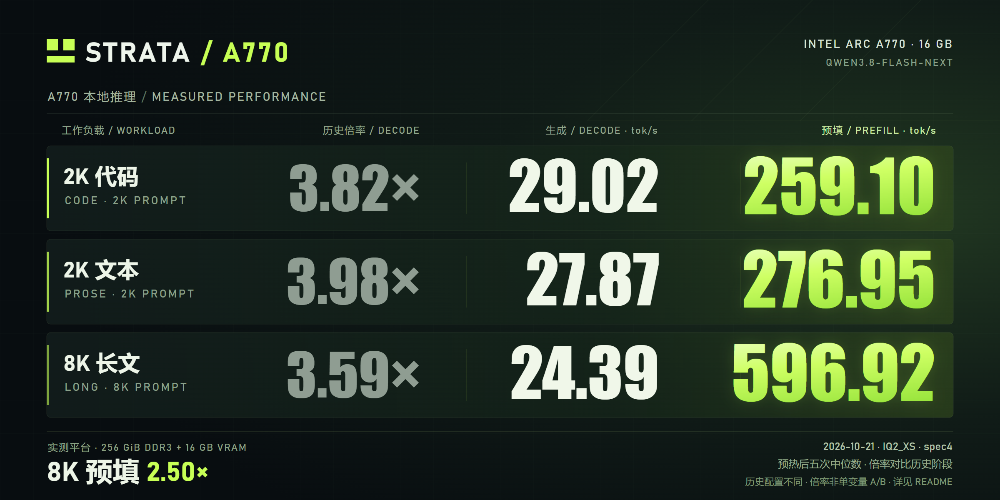

# Strata-A770

**一张 A770 16 GB，把 125B MoE 模型跑在本地。**

Strata-A770 让 Intel Arc A770 配合系统内存运行 **Qwen3.8-Flash-Next**。热点专家留在显存，其余权重借助系统内存承载，让大模型在这张 16 GB 显卡上运行起来。

最新测试中，**2K 代码输入下生成约 29.0 tok/s，8K 输入下生成约 24.4 tok/s、预填约 597 tok/s**。数据来自 A770 16 GB + Xeon E5-2696 v4 + **256 GiB DDR3** 的 Windows 测试机；实际内存需求取决于所选模型包。

[看速度](#速度有多快) · [看优化](#这个分支好在哪里) · [开始运行](#在-windows-上开始运行) · [查看完整测量](docs/A770_PERFORMANCE.md)



*2026-10-21 · IQ2_XS · 预热后五次保留样本的中位数。生成与预填分别计时；图中倍率对比历史阶段，基线与完整范围见下表。*

## 这个分支好在哪里

[Strata-A770](https://github.com/orca-zhang/Strata-A770) 基于 [Strata](https://github.com/Niko1221/Strata)，专注 Windows、A770 和 Intel oneAPI。它保留上游的本地服务与 API，把优化集中在这张卡实际执行的计算和数据搬运上。

| 你关心的事 | 这个分支做了什么 |
| --- | --- |
| **把有限显存用在热点上** | 查询实际显存余量，为运行预留空间；结合系统内存与专家缓存，把更常用、搬运成本更高的专家优先留在显存。 |
| **减少生成时的等待** | 减少无效专家换入，融合重复的激活与量化调用；用 MTP 推测解码在一次验证中接受多个 token，减少逐个生成的开销。 |
| **为 A770 优化计算路径** | 围绕实际量化格式优化 SYCL 算子，调整 subgroup、数据复用与归约；对常用形状做特化，并为其他输入保留通用路径。 |
| **接入已有工作流** | 沿用 Strata 的网页界面和 OpenAI / Anthropic 兼容 API，可供聊天客户端、代码工具和本地应用调用。 |

这些优化既有端到端测量，也有独立算子校验。例如，固定缓存下把每次专家换入上限从 64 降到 32，测得 **4.30% 的整模型吞吐收益**；IQ2_S GU16/SG16 调整测得 **16.67% 的算子吞吐收益**。两者的测量范围不同，分别记录在[性能证据](docs/A770_PERFORMANCE.md#主要调整的证据范围)中。

## 速度有多快

**生成（decode）**是模型输出回复的速度；**预填（prefill）**是模型处理输入提示的速度。以下为当前保留优化的隔离测试构建的实测，单位均为 tok/s。

| 场景 | decode 中位数 | decode 范围 | fresh prefill 中位数 | prefill 范围 |
| --- | ---: | ---: | ---: | ---: |
| Short 28 | 41.85 | 41.56–42.04 | 30.56 | 30.31–30.93 |
| Code 2K | 29.02 | 28.73–29.04 | 259.10 | 258.36–259.41 |
| Prose 2K | 27.87 | 27.73–27.88 | 276.95 | 276.09–277.60 |
| Long 8K | 24.39 | 24.30–24.41 | 596.92 | 595.12–597.76 |

从记录中的起始阶段到本次测量，**2K 代码生成达到起始的 3.82 倍，8K 预填达到 2.50 倍**。倍率为最新吞吐除以历史基线；生成基线为最初开启 MTP 的配置，预填基线为显存预算修正阶段。各阶段配置不同，Short 输入也由 36 变为 28 tokens；这些是历史阶段倍率。

| 指标 | 历史基线 tok/s | 最新 tok/s | 吞吐倍率 |
| --- | ---: | ---: | ---: |
| Short 生成（36 → 28 tokens） | 5.8 | 41.85 | **7.22×** |
| Code 2K 生成 | 7.6 | 29.02 | **3.82×** |
| Prose 2K 生成 | 7.0 | 27.87 | **3.98×** |
| Long 8K 生成 | 6.8 | 24.39 | **3.59×** |
| Long 8K 预填 | 239.2 | 596.92 | **2.50×** |

每次请求都重新预填，提示缓存关闭。Short 输入为 28 tokens，其余输入分别为 2048 / 2048 / 8000 tokens；Short 自然结束于 76 个输出，其余最多生成 128 个输出。计时不包含模型加载，也不是 HTTP 客户端首字延迟。

正式测速的 **39 次输出全部匹配历史参考**。同一构建通过 GDN 跨层、窗口、融合提交与 CPU 参考检查；数据和校验摘要见[最新测量](bench/results/a770/refresh-2026-10-21.json)。

<details>
<summary>展开测试平台、参数与测量边界</summary>

| 项目 | 本机配置 |
| --- | --- |
| GPU | 单张 Intel Arc A770，16 GB 显存 |
| CPU | Intel Xeon E5-2696 v4 |
| 内存 | 256 GiB DDR3 |
| 系统 | Windows 10 22H2 |
| 显卡驱动 | 32.0.101.9034 |
| 编译与数学库 | Intel oneAPI DPC++ 2025.3.2、oneMKL 2025.3 |
| GPU 后端 | Level Zero |
| 主要测试模型 | Qwen3.8-Flash-Next，IQ2_XS pack |
| 常用测试设置 | 8192 上下文、temperature 0、关闭 thinking、最多生成 128 tokens；fresh prefill 关闭提示缓存 |

IQ2_XS 是模型包名称。实际专家 gate/up 为 34 层 IQ2_S、11 层 IQ2_XXS、3 层 IQ1_M，down 全部为 Q2_0；算子按实际张量格式选择。

专家缓存请求 5500，实际 **5771 slots**。Short 先预热十次，其余场景各三次，再各保留五次；表格为五个保留值的中位数和完整范围。输入为 28 / 2048 / 2048 / 8000 tokens，输出为 76 / 128 / 128 / 128 tokens。使用 spec4、完整 248320 行草稿词表、GDN/QSA Q8 tail、quiet 和 prompt cache 0。每次重新预填，专家缓存仍随请求调整；原生 DONE 计时不含模型加载，范围不是置信区间。

正式组 39 次请求的输出哈希全部与历史参考一致。同一构建通过 71 项完整状态回归、42 项跨层检查、156 项窗口检查、44 项融合提交检查和 CPU 参考自检。构建合入保留的 GDN 跨层、QSA 索引批量提交、GDN Xe 预填充与 Q6_K 寄存器优化。

本表报告 10-21 测试构建的绝对速度。本轮未完成等条件的新旧构建 A/B/A，历史表格的差异不能直接作为独立软件优化收益。

相对 **10-20 正式复测**，按两日各自的中位数计算：

| 场景 | decode 倍率 | fresh prefill 倍率 |
| --- | ---: | ---: |
| Short 28 | 1.010× | 1.016× |
| Code 2K | 1.019× | 1.018× |
| Prose 2K | 1.025× | 1.018× |
| Long 8K | 1.019× | 1.079× |

以上是跨日期的吞吐比值，本轮未完成等条件的新旧构建 A/B/A，不能将倍率作为单项优化的独立收益。

逐次计时与测试设置见[10-21 数值摘要](bench/results/a770/refresh-2026-10-21.json)。

</details>

## 在 Windows 上开始运行

如果你有 A770 16 GB、能容纳所选模型包的系统内存，并愿意从源码构建，可以从这里开始。当前 A770 路径以源码构建为主。

### 1. 构建引擎

准备 VS Build Tools 的 x64 开发环境、Windows SDK、Intel oneAPI 2025.3 / oneMKL 2025.3、CMake 3.24+、Ninja 和 Python。在已经初始化好 **2025.3** 工具链的终端中执行：

```text
git clone https://github.com/orca-zhang/Strata-A770.git
cd Strata-A770
cmake -S sycl -B build-a770 -G Ninja -DCMAKE_C_COMPILER=icx -DCMAKE_CXX_COMPILER=icx -DCMAKE_BUILD_TYPE=Release
cmake --build build-a770 --target strata -j 1
```

这里使用 SPIR-V / JIT 构建；不要套用 B 系列的 `bmg-*` AOT 目标。编译、头文件、库和运行时应来自同一代工具链，避免混用 2025.3 与 2026.1 的 SYCL ABI。

### 2. 准备模型并启动服务

准备模型、pack 和 MTP 文件后，按自己的路径生成配置，再启动本地服务。模型与 API 说明见 [AI_SETUP](docs/AI_SETUP.md)、[DETAILS](docs/DETAILS.md) 和 [Intel Arc](docs/INTEL_ARC.md)。服务入口为：

```text
python sycl/serve/server_intel.py --engine strata --config strata-iq2_xs.json --host 127.0.0.1 --port 8080
```

`strata-iq2_xs.json` 是本机生成的配置，需要填写自己的模型、pack、MTP 和可执行文件路径。默认监听 `127.0.0.1`；需要对外提供服务时必须设置 `--api-key`。

### 3. 接入你的应用

浏览器打开 `http://127.0.0.1:8080` 使用网页界面；支持 OpenAI 兼容接口的客户端可将 API 地址设为 `http://127.0.0.1:8080/v1`。模型名使用服务配置中的名称。完整 API 与设置见 [DETAILS](docs/DETAILS.md)。

## 继续了解

| 想看什么 | 从这里进入 |
| --- | --- |
| 每项优化的测量、验证与适用范围 | [A770 性能记录](docs/A770_PERFORMANCE.md) |
| 最新逐次计时、预热样本与输出哈希 | [10-21 数值摘要](bench/results/a770/refresh-2026-10-21.json) |
| Intel Arc 的平台支持与构建背景 | [Intel Arc 文档](docs/INTEL_ARC.md) |
| 引擎结构、API 和参数 | [技术说明](docs/DETAILS.md) |

<details>
<summary>展开历史性能阶段与优化时间线</summary>

### 整模型速度的历史阶段

下面汇总优化过程中的**历史阶段与 10-15 部署 EXE 复测**，单位 tok/s。每行采用该阶段的实测中位数；源码中的 WG128 尚未进入 10-15 冻结 EXE。

| 阶段 | Short 解码 | Code 2K 解码 | Prose 2K 解码 | Long 8K 解码 | Long 8K fresh prefill |
| --- | ---: | ---: | ---: | ---: | ---: |
| 最初配置，MTP 开启 | 5.8 | 7.6 | 7.0 | 6.8 | — |
| 实际显存预算、EAGER、2048 MiB 预留 | 14.8 | 14.1 | 13.3 | 13.8 | 239.2 |
| 2025.3 EAGER、SG16、异步 commit、缓存调优 | 30.8 | 19.7 | 18.8 | 18.0 | 509.8 |
| 10-15 当日部署 EXE，完整词表、GDN/QSA Q8 tail | **40.46** | **28.25** | **26.95** | **22.89** | **497.85** |

前三阶段的 Short 输入为 36 tokens，最新一行为 28 tokens，提示不同。最新一行取充分预热后五次复测的中位数，同时测得 Code/Prose fresh prefill **242.86 / 262.73 tok/s**。8K 的预填成绩不代表所有提示长度都能达到 500 tok/s。以上是热机阶段结果，首次 JIT、模型加载和冷启动请求另计。

不同阶段调整过 prefill 分块、浮点舍入、显存缓存容量和运行时，不能把整张表当作一次相同输出、单变量的累计 A/B。原始最初配置到显存预算修正阶段完成了完整输出对照；后续每项的证据范围见[性能记录](docs/A770_PERFORMANCE.md)。

### 性能优化大事记

按实验记录中的日期及阶段顺序整理；同日多条属于不同实验，不代表每条都在上一条基础上测量。“模型”指整模型测量，“算子”指对应计算链的测量。

| 日期 / 阶段 | 调整与发现 | 实测结果与采用情况 |
| --- | --- | --- |
| 10-08 · 起点 | 保留原始配置和输出基线，先定位显存压力 | MTP 开启时四场景解码 5.8 / 7.6 / 7.0 / 6.8 tok/s |
| 10-08 · 显存预算 | 去掉固定伪报的可用显存，查询实际余量，保留 2048 MiB | 模型解码升至 14.8 / 14.1 / 13.3 / 13.8；12/12 输出一致 |
| 10-08～09 · 稳定运行 | 修正跨队列计时等待；增加首次 prefill 初始化与状态重置，保留 EAGER | 冷启动七场景输出对齐；失败 graph 路径未作为默认 |
| 10-08～09 · 大块预填 | prefill chunk 提高到 8192 | 一组 fresh 8K prefill 中位数 555.9；分块改变数值路径，单独保留对照 |
| 10-09 · SG16 与运行时 | GDN SG16、IQ4_XS 两列 SG16；比较 2025.3 / 2026.1，重叠 commit/draft | GDN 微基准 4.853 → 2.247 ms/window；解码优先配置选 2025.3 |
| 10-09 · 热点缓存 | NO_HOST 路由反馈驱动换入，补齐镜像与 residency 状态；调整换入频率 | 2025.3 阶段四场景 30.8 / 19.7 / 18.8 / 18.0 tok/s |
| 10-09 · 验证窗口修复 | resident_plan 容量 64 → 128，覆盖 8 行 × Top10 的 80 项 | 修复宽窗口错误输出，32 项计划检查通过；更宽窗口未稳定提速 |
| 10-09 · 访问成本拆解 | 比较 VRAM、mapped RAM、CPU 与串行 DMA | IQ2_S 专家每层 0.418 / 1.619 / 0.686 / 1.682 ms；优先保住显存驻留 |
| 10-10 · 激活融合 | Verify 的 Q8_1 与 BF16 激活准备融合 | 模型三场景 +1.52% / +1.09% / +1.10%；23/23 输出与用量一致 |
| 10-10 · 成本加权 | 按专家访问成本调整缓存换入优先级 | 模型 +1.580%；换入次数减少约 6.1%，采用 |
| 10-10 · 少搬运 | adaptive swaps 128 → 96 → 64 → 32 | 64 → 32 的受控模型对照 +4.302%；128 → 32 扫描中换入次数减少约 70.7% |
| 10-10 · MTP 归一化 | pooled RMS 改为四个 HC 流各自 RMS | 固定缓存 ABBA 模型 +2.543%，每 128 tokens 少两个 Verify 窗口，输出一致 |
| 10-10～11 · 显存余量复调 | 预留改为 1536 MiB，PCIe fraction 固定 0.16 | 正式五次 A/B/A 模型几何均值 +2.84%，三个场景均改善 |
| 10-11 · 去掉常驻计时 | 正常服务关闭 DECODE_TIMING | 模型几何均值 +1.798%，输出哈希一致 |
| 10-11 · 少算无效草稿 | spec4 最后一步草稿阈值设为 0.6 | 正式五次 A/B/A 模型 +1.238%，45 个保留输出一致 |
| 10-12 · 共享专家与 QSA | 融合 SwiGLU/Q8_1；radix 提前退出、原生 subgroup scan、保留不适合形状的回退 | 保留通过算子检查的路径；一组共享专家/QSA 组合模型对照 -0.794%，未据此宣称模型提速 |
| 10-13 · IQ2_S SG16 | GU16 切换物理 SG16，保持逻辑求和顺序 | VRAM 专家算子 +16.672%；独立记录，不换算成等比例解码收益 |
| 10-13 · Router | 原生 subgroup max/min，保留较小 ID 的 tie 规则 | Router 算子 +45.653%；固定缓存模型仅约 +0.0056% |
| 10-13 · HC 组合 | owned-stream static3 norm、prefetch8、WG512/SG16 down | 完整 HC 算子 +10.418%；与 Router 的组合模型仅 +0.0747%，不足以确认模型提速 |
| 10-13 · 单条专家组 | singleton group 直达已有 aligned Multi<1> | VRAM 专家算子 T1 +4.718%、T4 +0.585%，几何均值 +2.631%；已验证部署 |
| 10-13 · HC 后续 | 跳过尾部无效 subgroup；reduce 改 SG16；prefetch16/WG64；up 固定四流寻址 | 各自 HC 对照 +1.563%、+7.039%、+3.489%、+1.492%；生产头文件下 reduce 复验 +6.414% |
| 10-13 · 算子集成 | 将确认正收益的 Router、HC、IQ2_S、共享专家与 QSA 路径汇入统一构建 | 按算子收益采用；单项百分比不累加成统一模型提速 |
| 10-14 · 配对 gate/up | 同一个 SG16 计算一对 gate/up，共用激活读取 | 48 层专家链 VRAM 吞吐独立确认 +1.153%；源码采用 |
| 10-14 · 提交与等待实验 | HC eventless 提交、运行时 batch64、graph event wait | 分别测到排队吞吐或等待收益；保留独立开关，默认关闭或不写入默认配置 |
| 10-15 · 精度换吞吐探索 | Top9/Top8 与按层 SER 专家省略 | 按层实验固定 token 工作 +6.889%，参考 PPL +0.614%；生成提速未通过漂移检查，默认关闭 |
| 10-15 · MTP 权重探索 | Q2_0 有符号尺度细化、BF16 输入投影 | 重建误差降低或提高权重精度未转化为接受率收益；均未采用 |
| 10-15 · 固定输入宽度 | 对配对 IQ2_S 路径特化宽度 2560，其他宽度回退 | 48 层专家链 VRAM 吞吐独立确认 +0.832%；源码采用 |
| 10-15 · GU 访存探索 | 固定更多布局字段、SLM 码表、显式向量读取 | 专家链 VRAM 筛选分别 -0.092% / -14.615% / -0.486%；均未采用，未进行通过筛选后的独立确认 |
| 10-15 · 草稿词表 | Python 标准库扩展 106299 → 112038 行，随后改用 248320 行完整词表，共享目标输出头 | 完整词表十五例 MTP 接受率 73.47% → 76.24%，节省约 145.74 MiB 子集输出头及映射；当前配置已选，尚未证明稳定吞吐收益 |
| 10-15 · 草稿注意力窗口 | 完整词表下比较 1024 / 512 / 768 | 两个短窗口均未通过筛选，保留 1024 |
| 10-15 · GDN Q8 尾部融合 | 在递推与归一化尾部直接生成 Q8_1，省去一次独立量化调用，保留未融合路径 | 源码已合入，本轮测速配置开启；推送前 window 检查 156 例、0 失败；未单独量化整模型收益 |
| 10-15 · QSA gate + Q8_1 融合 | gate 输出直接量化，可跳过 FP32 中间输出；接入 Verify 与 MTP，保留原路径 | 源码已合入，本轮测速配置开启；推送前 Q8 检查 T=1/2/4/8、0 失败；未单独量化整模型收益 |
| 10-15 · 配对 GU 工作组 | 宽度 2560 使用 WG128 / 八对行，保持 SG16 和每行运算顺序，其他宽度保留 WG256 | 干净独立确认 VRAM 专家链 +1.006%，最大基线漂移 1.241%；源码已采用，未进入测出 40.46 tok/s 的 EXE，未据此宣称整模型提速 |
| 10-15 · 最新版本复测 | 冻结部署 EXE，完整词表、Q8 tail，充分预热后独占测量；复验 batch64 与 MTP 阈值 0.55 | 四场景解码 40.46 / 28.25 / 26.95 / 22.89 tok/s；两个候选均无整体正收益，保留原设置 |
| 10-15 · ezpp 复核 | 修正 Windows 计时换算；五组时钟校验及同一分析 EXE 的 OFF/ON/OFF 对照 | 时钟最大差 0.362 ms；输出一致，最大基线漂移 0.474%，聚合耗时开销约 +1.067%；生产关闭分析 |
| 10-20 · 最新整模型复测 | 最新源码构建完成 39 次预定请求，输出一致 | 四场景 decode / fresh prefill 的中位数和范围见最新表；不作为等条件的软件增益对照 |
| 10-21 · 组合构建与访存筛选 | 保留已验证优化，五项访存候选均未通过收益门槛 | 39 次整模型输出一致；decode / prefill 主表更新至 10-21 |
| 10-21 · GDN 跨层提交 | 同一阶段 36 层的融合提交合并为一次启动 | 相对当前逐层融合实现，提交阶段耗时降低 **27.89%–42.29%**；[对照与验证](docs/A770_PERFORMANCE.md#2026-10-21-gdn-跨层批量提交) |
| 10-21 · QSA 批量提交 | 按设备接受位置合并逐 token 追加，六槽窗口每层六次降为一次 | 四/六槽提交阶段保守比较至少降低 **56.79% / 66.98%**；[方法、漂移与验证](docs/A770_PERFORMANCE.md#2026-10-21-qsa-索引批量提交) |
| 10-21 · GDN 融合提交 | 历史更新与 ESIMD 状态回放合并，每层少一次内核启动 | 相对上一轮 ESIMD，提交阶段耗时降低 **37.90%–41.73%**；[测量与验证](docs/A770_PERFORMANCE.md#2026-10-21-gdn-历史与状态融合提交) |
| 10-21 · GDN ESIMD 与候选复测 | 256 GRF 四/六 token 状态提交已落源码；四场景输出匹配 | 独立确认阶段耗时降低：T4 **16.44%–27.08%**、T6 **20.66%–28.15%**；[方法与未采用项复测](docs/A770_PERFORMANCE.md#2026-10-21-gdn-esimd-落地与未采用方案复测) |

</details>

<details>
<summary>展开开发者检查入口</summary>

可复用的检查入口：

```text
python tools/bench_a770.py --self-test
python tools/test_setup_sycl.py
python tools/test_mtp_rt.py
cmake --build build-a770 --target native_grouped_parity gr_parity quantize_act_parity -j 1
ctest --test-dir build-a770 -R "native_iq2s_sg16_parity|gr_parity|quantize_act_parity" --output-on-failure
```

GPU 检查需要 A770 与可用运行时。重新比较性能时固定模型和实际缓存容量，完成预热、输出对照与漂移检查，并串行运行 GPU 测试。

源码包含 `sycl/` 和仓库内修改过的 DPCT helper；oneAPI、oneMKL、驱动与模型作为外部依赖准备。性能分析、可选实验及其默认状态见[完整记录](docs/A770_PERFORMANCE.md#可选实验与默认状态)。

</details>

## 致谢与许可证

上游介绍与安装说明见 [Strata 上游文档](README.upstream.md)。

感谢 [Strata](https://github.com/Niko1221/Strata) 作者与贡献者、最初的 Intel SYCL 移植作者 maxfridbe、Qwen 团队，以及 [llama.cpp / ggml](https://github.com/ggml-org/llama.cpp) 和 Intel oneAPI。

项目沿用 [MIT License](LICENSE)。第三方代码及模型遵循各自许可证，原有版权与出处保留。
