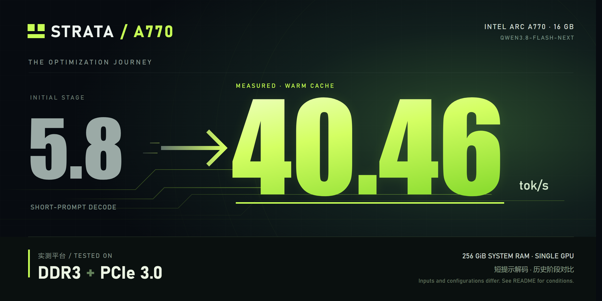

# Strata-A770



*头图为历史阶段对比：最初 Short 36 为 5.8 tok/s，本轮 Short 28 热缓存复测中位数为 40.46 tok/s；输入与配置不同，非等输出、单变量 A/B。测试平台使用 DDR3 内存和 PCIe 3.0。*

在 **Intel Arc A770 16 GB + 系统内存**上运行 Qwen3.8-Flash-Next。

[Strata-A770](https://github.com/orca-zhang/Strata-A770) 基于 [Strata](https://github.com/Niko1221/Strata)，集中维护 Windows、A770 和 Intel oneAPI 下的适配、稳定性修复与性能优化。

我们单独维护这个分支，是因为不少改动依赖 A770 的 subgroup、实际量化格式、Windows 驱动行为和主机传输条件，难以直接用于其他显卡。分支保留 Strata 的通用引擎、服务与 API；特化路径保留对应的通用回退，但性能结论目前只覆盖本文列出的机器和测试条件。

本文记录截至 **2026-10-15** 的工作。整模型速度、算子吞吐和默认关闭的实验分别注明，所有百分比均对应各自的对照基线。

## 当前版本调整了什么

- **显存与专家缓存**：按实际显存余量分配，保留运行空间；补齐专家镜像和换入状态，使用路由反馈更新热点，按访问成本调整换入优先级，减少无效搬运。
- **Windows 稳定性**：保留经过验证的 EAGER 路径；首次批量预填前执行短窗口初始化并重置状态，规避已复现的冷启动停滞；限制会触发停滞的可选 GPU 计时。
- **MTP 推测解码**：按四个 HC 流分别归一化隐藏输入；重叠独立的 commit/draft 工作；修复 8 行验证窗口的专家计划容量。当前配置使用完整的 248320 行草稿词表，与目标模型共享输出头。
- **A770 专家算子**：IQ2_S GU16 使用物理 SG16；单条专家分组直接走已有 Multi<1>；gate/up 配对复用激活读取，并对输入宽度 2560 保留编译期特化。
- **HC、Router 与注意力选择**：优化四流访问、分片归约、预取和有效行处理；Router 使用原生 subgroup max/min；QSA 保留经过选择一致性检查的 radix 和 scan 优化。
- **融合与工具链兼容**：融合激活准备、共享专家的 SwiGLU/Q8_1；本机配置启用 GDN/QSA 的 Q8 tail 路径。保留 FP32 舍入要求，以及仓库内 DPCT helper 对 oneAPI 2025.3 的兼容修改。

下文记录源码采用情况和部署测速版本。最新 WG128 路径尚未进入本次测速 EXE，其算子收益单独报告。

**配置核对：**历史版本的 `STRATA_MTP_LAST_DRAFT_MIN_P=0.6` 曾有正收益，但当前测试 EXE 不识别这个键。现源码的 `STRATA_MTP_LAST_MIN_P` 只作用于五行 MTP 窗口，当前 spec4 也用不到；因此不能把历史最后一步草稿优化写成当前生效的默认项。

## 测试硬件与软件

| 项目 | 本机配置 |
| --- | --- |
| GPU | 单张 Intel Arc A770，16 GB 显存 |
| CPU | Intel Xeon E5-2696 v4，22 核 / 44 线程，标称 2.20 GHz |
| 内存 | DDR3，256 GiB，8 × 32 GiB；系统报告配置速率约 1866 MT/s（DDR3 类型由机主确认） |
| 主板 | HUANANZHI X99-T8 |
| 系统 | Windows 10 专业版，版本 22H2，Build 19045 |
| 显卡驱动 | 32.0.101.9034 |
| 编译与数学库 | Intel oneAPI DPC++ 2025.3.2、oneMKL 2025.3 |
| GPU 后端 | Level Zero |
| 主要测试模型 | Qwen3.8-Flash-Next，IQ2_XS pack |
| 常用测试设置 | 8192 上下文、temperature 0、关闭 thinking、最多生成 128 tokens；fresh prefill 关闭提示缓存 |

IQ2_XS 是模型包名称。实际专家 gate/up 为 **34 层 IQ2_S、11 层 IQ2_XXS、3 层 IQ1_M**，down 全部为 Q2_0，专家形状为 2560 / 640。算子选择依据实际张量格式。

### PCIe 与 H2D：目前能确认的边界

**本轮 H2D 三次独立启动探测的最高值均为 5.7 GB/s，全部 12 次计时范围为 4.8–5.7 GB/s。** 历史曾测到 5.8–6.2 GB/s，不作为本轮结果。引擎探针从普通主机内存拷贝 256 MiB，预热后测四次并取最快值；本轮保留所有样本与三次启动结果。这是该软件路径的有效传输速度，不是 A770 的规格带宽。

原计划将测试条件写为“PCIe x8”，但 2026-10-15 通过 Level Zero Sysman 重新读取，驱动报告的当前链路是 **PCIe 3.0 ×16**，设备最大支持 **PCIe 4.0 ×16**。历史测速没有同时保存足以核对整条上游链路的快照，因此目前不能把这些成绩正式标成“已确认 x8”，也不能由 6.2 GB/s 反推链路宽度。

下一步用同一插槽换卡对照，核对 GPU 与上游端口的实际协商状态，并复测 H2D。当前数据不足以判断显卡故障；恢复更宽或更快的链路后能提升多少，也需要重新测量。

## 当前 EXE 的独立复测

2026-10-15 重新采集当前部署 EXE（SHA256 前缀 `42b96bcf3823`），使用完整草稿词表、GDN/QSA Q8 tail、生产 quiet 配置和自动缓存，实际 **6316 slots**。Short 先预热十次，其他场景各三次，再各保留五次；每次都重新预填，提示复用为零。下表为五次保留值的中位数及完整范围，单位 tok/s。

| 场景 | 解码中位数 | 解码范围 | fresh prefill 中位数 |
| --- | ---: | ---: | ---: |
| Short 28 | 40.46 | 40.35–40.49 | 29.92 |
| Code 2K | 28.25 | 27.95–28.32 | 242.86 |
| Prose 2K | 26.95 | 26.77–26.99 | 262.73 |
| Long 8K | 22.89 | 22.60–23.54 | 497.85 |

Short 输入为 28 tokens，自然结束于 76 个输出；其余三个场景均输出 128 tokens。Short 与历史的 Short 36 提示不同。重复请求仍会调整专家缓存；预热后范围收窄不代表消除了所有工作负载波动，范围也不是统计置信区间。短提示 prefill 的固定开销使 tok/s 偏低。这些是引擎原生协议计时，不包含加载模型，也不是 HTTP 客户端首字延迟。

本轮基线未检测到被跟踪的 GPU 测试或编译竞争，全部 39 次请求（含 19 次预热）保留数值记录。此前另一 EXE 的两组测量遭遇外部编译/GPU 工作，已整组排除，不与本轮合并。最新 WG128 调整仅合入源码，未进入这个冻结 EXE；本表覆盖所标明的部署版本。逐次计时与实验对照见[最新数值摘要](bench/results/a770/refresh-2026-10-15.json)。

## 整模型速度的历史阶段

下面汇总优化过程中的**历史阶段与最新部署 EXE 复测**，单位 tok/s。每行采用该阶段的实测中位数；最新源码中的 WG128 尚未进入本轮测速 EXE。

| 阶段 | Short 解码 | Code 2K 解码 | Prose 2K 解码 | Long 8K 解码 | Long 8K fresh prefill |
| --- | ---: | ---: | ---: | ---: | ---: |
| 最初配置，MTP 开启 | 5.8 | 7.6 | 7.0 | 6.8 | — |
| 实际显存预算、EAGER、2048 MiB 预留 | 14.8 | 14.1 | 13.3 | 13.8 | 239.2 |
| 2025.3 EAGER、SG16、异步 commit、缓存调优 | 30.8 | 19.7 | 18.8 | 18.0 | 509.8 |
| 10-15 当前部署 EXE，完整词表、GDN/QSA Q8 tail | **40.46** | **28.25** | **26.95** | **22.89** | **497.85** |

前三阶段的 Short 输入为 36 tokens，最新一行为 28 tokens，提示不同。最新一行取充分预热后五次复测的中位数，同时测得 Code/Prose fresh prefill **242.86 / 262.73 tok/s**。8K 的预填成绩不代表所有提示长度都能达到 500 tok/s。以上是热机阶段结果，首次 JIT、模型加载和冷启动请求另计。

不同阶段调整过 prefill 分块、浮点舍入、显存缓存容量和运行时，不能把整张表当作一次相同输出、单变量的累计 A/B。原始最初配置到显存预算修正阶段完成了完整输出对照；后续每项的证据范围见[性能记录](docs/A770_PERFORMANCE.md)。

## 性能优化大事记

按实验记录中的日期及阶段顺序整理；同日多条属于不同实验，不代表每条都在上一条基础上测量。“模型”指整模型测量，“算子”指对应计算链的测量。

| 日期 / 阶段 | 调整与发现 | 实测结果与采用情况 |
| --- | --- | --- |
| 10-08 · 起点 | 保留原始配置和输出基线，先定位显存压力 | MTP 开启时四场景解码 5.8 / 7.6 / 7.0 / 6.8 tok/s |
| 10-08 · 显存预算 | 去掉固定伪报的可用显存，查询实际余量，保留 2048 MiB | 模型解码升至 14.8 / 14.1 / 13.3 / 13.8；12/12 输出一致 |
| 10-08～09 · 稳定运行 | 修正跨队列计时等待；增加首次 prefill 初始化与状态重置，保留 EAGER | 冷启动七场景输出对齐；失败 graph 路径未作为默认 |
| 10-08～09 · 大块预填 | prefill chunk 提高到 8192 | 一组 fresh 8K prefill 中位数 555.9；分块改变数值路径，单独保留对照 |
| 10-09 · SG16 与运行时 | GDN SG16、IQ4_XS 两列 SG16；比较 2025.3 / 2026.1，重叠 commit/draft | GDN 微基准 4.853 → 2.247 ms/window；解码优先配置选 2025.3 |
| 10-09 · 热点缓存 | NO_HOST 路由反馈驱动换入，补齐镜像与 residency 状态；调整换入频率 | 2025.3 阶段四场景 30.8 / 19.7 / 18.8 / 18.0 tok/s |
| 10-09 · 验证窗口修复 | resident_plan 容量 64 → 128，覆盖 8 行 × Top10 的 80 项 | 修复宽窗口错误输出，32 项计划检查通过；更宽窗口未稳定提速 |
| 10-09 · 访问成本拆解 | 比较 VRAM、mapped RAM、CPU 与串行 DMA | IQ2_S 专家每层 0.418 / 1.619 / 0.686 / 1.682 ms；优先保住显存驻留 |
| 10-10 · 激活融合 | Verify 的 Q8_1 与 BF16 激活准备融合 | 模型三场景 +1.52% / +1.09% / +1.10%；23/23 输出与用量一致 |
| 10-10 · 成本加权 | 按专家访问成本调整缓存换入优先级 | 模型 +1.580%；换入次数减少约 6.1%，采用 |
| 10-10 · 少搬运 | adaptive swaps 128 → 96 → 64 → 32 | 64 → 32 的受控模型对照 +4.302%；128 → 32 扫描中换入次数减少约 70.7% |
| 10-10 · MTP 归一化 | pooled RMS 改为四个 HC 流各自 RMS | 固定缓存 ABBA 模型 +2.543%，每 128 tokens 少两个 Verify 窗口，输出一致 |
| 10-10～11 · 显存余量复调 | 预留改为 1536 MiB，PCIe fraction 固定 0.16 | 正式五次 A/B/A 模型几何均值 +2.84%，三个场景均改善 |
| 10-11 · 去掉常驻计时 | 正常服务关闭 DECODE_TIMING | 模型几何均值 +1.798%，输出哈希一致 |
| 10-11 · 少算无效草稿 | spec4 最后一步草稿阈值设为 0.6 | 正式五次 A/B/A 模型 +1.238%，45 个保留输出一致 |
| 10-12 · 共享专家与 QSA | 融合 SwiGLU/Q8_1；radix 提前退出、原生 subgroup scan、保留不适合形状的回退 | 保留通过算子检查的路径；一组共享专家/QSA 组合模型对照 -0.794%，未据此宣称模型提速 |
| 10-13 · IQ2_S SG16 | GU16 切换物理 SG16，保持逻辑求和顺序 | VRAM 专家算子 +16.672%；独立记录，不换算成等比例解码收益 |
| 10-13 · Router | 原生 subgroup max/min，保留较小 ID 的 tie 规则 | Router 算子 +45.653%；固定缓存模型仅约 +0.0056% |
| 10-13 · HC 组合 | owned-stream static3 norm、prefetch8、WG512/SG16 down | 完整 HC 算子 +10.418%；与 Router 的组合模型仅 +0.0747%，不足以确认模型提速 |
| 10-13 · 单条专家组 | singleton group 直达已有 aligned Multi<1> | VRAM 专家算子 T1 +4.718%、T4 +0.585%，几何均值 +2.631%；已验证部署 |
| 10-13 · HC 后续 | 跳过尾部无效 subgroup；reduce 改 SG16；prefetch16/WG64；up 固定四流寻址 | 各自 HC 对照 +1.563%、+7.039%、+3.489%、+1.492%；生产头文件下 reduce 复验 +6.414% |
| 10-13 · 算子集成 | 将确认正收益的 Router、HC、IQ2_S、共享专家与 QSA 路径汇入统一构建 | 按算子收益采用；单项百分比不累加成统一模型提速 |
| 10-14 · 配对 gate/up | 同一个 SG16 计算一对 gate/up，共用激活读取 | 48 层专家链 VRAM 吞吐独立确认 +1.153%；源码采用 |
| 10-14 · 提交与等待实验 | HC eventless 提交、运行时 batch64、graph event wait | 分别测到排队吞吐或等待收益；保留独立开关，默认关闭或不写入默认配置 |
| 10-15 · 精度换吞吐探索 | Top9/Top8 与按层 SER 专家省略 | 按层实验固定 token 工作 +6.889%，参考 PPL +0.614%；生成提速未通过漂移检查，默认关闭 |
| 10-15 · MTP 权重探索 | Q2_0 有符号尺度细化、BF16 输入投影 | 重建误差降低或提高权重精度未转化为接受率收益；均未采用 |
| 10-15 · 固定输入宽度 | 对配对 IQ2_S 路径特化宽度 2560，其他宽度回退 | 48 层专家链 VRAM 吞吐独立确认 +0.832%；源码采用 |
| 10-15 · GU 访存探索 | 固定更多布局字段、SLM 码表、显式向量读取 | 专家链 VRAM 筛选分别 -0.092% / -14.615% / -0.486%；均未采用，未进行通过筛选后的独立确认 |
| 10-15 · 草稿词表 | Python 标准库扩展 106299 → 112038 行，随后改用 248320 行完整词表，共享目标输出头 | 完整词表十五例 MTP 接受率 73.47% → 76.24%，节省约 145.74 MiB 子集输出头及映射；当前配置已选，尚未证明稳定吞吐收益 |
| 10-15 · 草稿注意力窗口 | 完整词表下比较 1024 / 512 / 768 | 两个短窗口均未通过筛选，保留 1024 |
| 10-15 · GDN Q8 尾部融合 | 在递推与归一化尾部直接生成 Q8_1，省去一次独立量化调用，保留未融合路径 | 源码已合入，本轮测速配置开启；推送前 window 检查 156 例、0 失败；未单独量化整模型收益 |
| 10-15 · QSA gate + Q8_1 融合 | gate 输出直接量化，可跳过 FP32 中间输出；接入 Verify 与 MTP，保留原路径 | 源码已合入，本轮测速配置开启；推送前 Q8 检查 T=1/2/4/8、0 失败；未单独量化整模型收益 |
| 10-15 · 配对 GU 工作组 | 宽度 2560 使用 WG128 / 八对行，保持 SG16 和每行运算顺序，其他宽度保留 WG256 | 干净独立确认 VRAM 专家链 +1.006%，最大基线漂移 1.241%；源码已采用，未进入测出 40.46 tok/s 的 EXE，未据此宣称整模型提速 |
| 10-15 · 最新版本复测 | 冻结部署 EXE，完整词表、Q8 tail，充分预热后独占测量；复验 batch64 与 MTP 阈值 0.55 | 四场景解码 40.46 / 28.25 / 26.95 / 22.89 tok/s；两个候选均无整体正收益，保留原设置 |
| 10-15 · ezpp 复核 | 修正 Windows 计时换算；五组时钟校验及同一分析 EXE 的 OFF/ON/OFF 对照 | 时钟最大差 0.362 ms；输出一致，最大基线漂移 0.474%，聚合耗时开销约 +1.067%；生产关闭分析 |
| 10-15 · 链路复核 | 重新查询 PCIe，完成三次独立 H2D 启动探测，准备同插槽换卡对照 | 当前驱动报告 Gen3 ×16；三次 H2D 最高值均为 5.7 GB/s，全部样本 4.8–5.7，无法确认 x8 |

## 保留的可选实验

| 项目 | 结果与边界 | 默认状态 |
| --- | --- | --- |
| `STRATA_SYCL_HC_BATCH_SUBMIT` | 早期有效确认完整 HC 连续排队吞吐 +32.144%；逐次等待不成立，开关版本后续确认受竞争负载干扰 | CMake 选项 OFF |
| `UR_L0_BATCH_SIZE=64` | 历史 eventful HC 连续提交 +2.836%；最新固定 5771 slots 整模型 A/B/A 为 -0.322%，Code 2K -2.687%，未通过筛选 | 不写入默认配置 |
| MTP `spec_min_p=0.55` | 最新同进程交错对照整体 -0.265%；Long +3.159%，Code/Prose -2.473%/-1.392%，输出一致，未通过筛选 | 保留 0.50 |
| `STRATA_SYCL_VERIFY_GRAPH_EVENT_WAIT` | 独立 HC 逐次等待吞吐 +0.724%；完整引擎未按此候选重新部署 | CMake 选项 OFF |
| `STRATA_VERIFY_L0_EVENTS` | host-planned 路线一组模型 +3.87%，同时 PPL +0.324%，与默认专家执行路线不同 | 运行时 opt-in |
| `STRATA_MTP_Q8_EXPERTS` | 一组 MTP 接受率 71.59% → 72.51%，额外专家权重 1875 MiB，部分任务回退 | OFF |
| 专家省略 / SER | 会改变输出；小规模参考 PPL 和固定工作量测量不能代替完整质量评估 | 隔离候选，OFF |

也保留没有胜出的路线结论：本机 Q2_0 整模型解码、盲目增加专家缓存、全层 DMA staging、DeepGEMM swapAB 的直接移植、低功耗 barrier 等均未成为性能默认设置。

## ezpp：辅助定位耗时

[ezpp](https://github.com/ez8-co/ezpp) 是单头文件 C++ 作用域分析器。我们用它查看 `verify.run`、`verify.commit`、`mtp.draft` 和缓存调整等阶段，辅助决定先优化哪里。

它记录的是主机经过时间，`verify.run` 包含等待 GPU。报告不能直接解释为 CPU 计算占比或 GPU kernel 独占耗时，最终性能以关闭分析后的整模型复测为准。Windows 原版计时换算曾丢失不足一秒的部分，本地分析头文件已修正；详见[计时边界与复测](docs/A770_PERFORMANCE.md#ezpp-的用途与计时边界)。

本轮同一分析 EXE 的 OFF/ON/OFF 对照中，实际缓存均为 5771 slots，输出一致，最大基线漂移 0.474%。开启分析后的三场景吞吐几何均值降低 1.055%，换算耗时增加约 **1.067%**；单场景有正有负，不应把这个数当作固定开销。五组 Windows 时钟校验全部通过。它适合定位较大的阶段，生产运行继续关闭。

源码通过条件编译保留分析标记，生产 EXE 未编入 ezpp。分析构建使用 `STRATA_EZPP=1` 开启、`STRATA_EZPP_OUT` 指定报告，关闭应删除变量；`STRATA_EZPP=0` 仍算开启。原始报告带源码路径和线程信息，仅留本地。

## 源码、SYCL 与 oneAPI

发布内容包括引擎、服务、测试、`sycl/`、构建脚本，以及 `sycl/include/dpct/` 内修改过的 helper。DPCT helper 是仓库内的代码，必须随分支提交。

oneAPI 编译器、oneMKL 和显卡驱动作为外部依赖安装。当前兼容修改位于仓库内；无需将本机的 oneAPI 安装目录、DLL、编译缓存或模型权重加入 Git。工具链版本、关键选项和脱敏后的数值证据见[性能记录](docs/A770_PERFORMANCE.md)。

Windows 构建需要 VS Build Tools 的 x64 开发环境、Windows SDK、Intel oneAPI 2025.3 / oneMKL 2025.3、CMake 3.24+、Ninja 和 Python。在已经初始化好 **2025.3** 工具链的终端中执行：

```text
git clone https://github.com/orca-zhang/Strata-A770.git
cd Strata-A770
cmake -S sycl -B build-a770 -G Ninja -DCMAKE_C_COMPILER=icx -DCMAKE_CXX_COMPILER=icx -DCMAKE_BUILD_TYPE=Release
cmake --build build-a770 --target strata -j 1
```

这里使用 SPIR-V / JIT 构建；不要套用 B 系列的 `bmg-*` AOT 目标。编译、头文件、库和运行时应来自同一代工具链，避免混用 2025.3 与 2026.1 的 SYCL ABI。

模型准备、API 和原有平台说明见 [AI_SETUP](docs/AI_SETUP.md)、[DETAILS](docs/DETAILS.md) 和 [Intel Arc](docs/INTEL_ARC.md)。上游的一键安装与预编译发布说明不等同于本分支已经提供 A770 专用安装包。本分支的本地服务入口为：

```text
python sycl/serve/server_intel.py --engine strata --config strata-iq2_xs.json --host 127.0.0.1 --port 8080
```

`strata-iq2_xs.json` 是本机生成的配置，需要填写自己的模型、pack、MTP 和可执行文件路径。默认监听 `127.0.0.1`；需要对外提供服务时必须设置 `--api-key`。

可复用的检查入口：

```text
python tools/bench_a770.py --self-test
python tools/test_setup_sycl.py
python tools/test_mtp_rt.py
cmake --build build-a770 --target native_grouped_parity gr_parity quantize_act_parity -j 1
ctest --test-dir build-a770 -R "native_iq2s_sg16_parity|gr_parity|quantize_act_parity" --output-on-failure
```

GPU 检查需要 A770 与可用运行时。重新比较性能时固定模型和实际缓存容量，完成预热、输出对照与漂移检查，并串行运行 GPU 测试。

## 致谢与许可证

感谢 [Strata](https://github.com/Niko1221/Strata) 作者与贡献者、最初的 Intel SYCL 移植作者 maxfridbe、Qwen 团队，以及 [llama.cpp / ggml](https://github.com/ggml-org/llama.cpp) 和 Intel oneAPI。

项目沿用 [MIT License](LICENSE)。第三方代码及模型遵循各自许可证，原有版权与出处保留。
