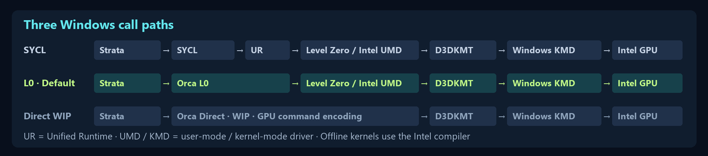

<div align="center">
  <h1>Strata-A770</h1>
  <p><strong>English</strong> · <a href="README.zh-CN.md">简体中文</a></p>
  <p><strong>Run a 125B MoE model locally with one Intel Arc A770 16 GB and system RAM.</strong></p>
  <p>Qwen3.8-Flash-Next · U4 N16 + M16 / Orca L0 · Orca Direct (WIP alternative) · Web chat and compatible APIs</p>
  <p><a href="#getting-started-on-windows">Get started</a> · <a href="#performance">Benchmarks</a> · <a href="#runtime-call-paths">Call paths</a> · <a href="#documentation">Docs</a> · <a href="README.upstream.md">Upstream</a> · <a href="LICENSE">MIT</a></p>
</div>

<!-- ponytail: Keep this homepage order: call paths → current default vs SYCL → historical SYCL vs original mainline → HC256 comparison. Put later individual optimization charts after these. -->
<a id="runtime-call-paths"></a>

## L0 and native Direct call paths

<!-- ponytail: Keep the call-path diagram independently of benchmark charts; retain it when updating performance data. -->
[](docs/media/orca-runtime-paths.svg)

**Current default, L0:** `Strata → Orca L0 → Level Zero / Intel GPU user-mode driver → D3DKMT → Windows kernel driver → GPU`.

**Native Direct (WIP alternative):** `Strata → Orca Direct (GPU command encoding) → D3DKMT → Windows kernel driver → GPU`. Direct execution requires no SYCL, UR, Level Zero or Intel GPU user-mode driver. GPU kernels are still built offline with the Intel compiler. The diagram shows the Windows execution path.

This diagram retains the original call paths independently of benchmark data. Run `python tools/render_orca_current.py --paths-only` to redraw the PNG/SVG; add `--check-only` to verify all three paths offline, without a GPU. [L0 submission](orca-l0/src/runtime.cpp) · [Direct submission](orca-l0/src/wddm/runtime.cpp) · [Backend selection](sycl/orca_queue.hpp).

[](#current-default-versus-sycl)

**Current default versus SYCL:** Code2K **26.82 → 37.76–37.82 tok/s (+40.78%–41.01%)**, Prose2K **25.46 → 37.96–38.01 tok/s (+49.12%–49.31%)**. SYCL is the corrected native FP16 M4 build from November 4; the current U4 / HC SG16 / spec6 configuration is from November 8. This compares whole-version rates from separate measurement cohorts on the same machine. Ranges come from the current default's two test orders. [Conditions and data](#current-default-versus-sycl).

<a id="sycl-original-mainline"></a>

**SYCL versus the original mainline: historical results (archived 2026-10-21)**

| Metric | Early original mainline (tok/s) | Optimized SYCL, October 21 (tok/s) | Historical throughput ratio |
| --- | ---: | ---: | ---: |
| Short decode | 5.8 | 41.85 | **7.22×** |
| Code2K decode | 7.6 | 29.02 | **3.82×** |
| Prose2K decode | 7.0 | 27.87 | **3.98×** |
| Long8K decode | 6.8 | 24.39 | **3.59×** |
| Long8K prefill | 239.2 | 596.92 | **2.50×** |

The original-mainline figures use the earliest archived stage with MTP enabled; the 8K prefill baseline comes from the VRAM-budget correction stage. SYCL uses the fully optimized source test build from October 21: 39 requests, five retained per scenario. Historical configurations and reference outputs differ, including a Short input change from 36 to 28 tokens. This SYCL version is distinct from the corrected November 4 build in the chart above. Do not multiply their ratios. [Archived JSON](bench/results/a770/refresh-2026-10-21.json) · [Historical conditions](docs/A770_PERFORMANCE.md#sycl-original-mainline-history).

**Current default versus original HC256: direct measurements in both orders**

[](#performance)

**Latest measurement (2026-11-08): decode throughput improves by 21.21%–21.64% for Code2K and 22.89%–23.27% for Prose2K versus original HC256, across both orders.** Net generation rates are **37.76–37.82 / 37.96–38.01 tok/s**, respectively, with fixed 2048-token inputs and 128-token outputs. Both pass the 20% target. [Conditions and data](#performance).

**Full-request throughput gains are separate: Code2K 4.30%–4.38%, Prose2K 4.15%–5.19%.** All 42 requests / 4704 output tokens match across independent forward and reverse trials. Maximum absolute decode control drift is **0.150%**, and all six engine processes exit normally. Net decode speed excludes prefill, HTTP and process startup.

**Short28 records above 60 tok/s:** the frozen L0 baseline reaches **60.01 tok/s** in one retained request (**59.57 tok/s** median in that process); a separate 256 GRF test reaches **60.71 tok/s** as the geometric mean of two process medians. The 256 GRF setting subsequently passed U4 service validation and was adopted for L0. [Short results and adoption history](#short-results). **Startup optimization:** the latest validated startup candidate reaches **7.904 s to READY**, with the OS file cache warm. [Startup measurements](#startup-optimizations).

**Preferred configuration on the test machine: U4 N16 + M16 / Orca L0, HC SG16, spec6, confidence 0.6 and within-layer expert ordering.** It retains the 6200 cache budget (6509 actual slots), adapt16, 8K context, U4N16 data and RAM checks / native fallback. The SYCL chart is a cross-cohort reference; the HC256 chart directly compares the complete current configuration in both orders. Individual gains are not compounded. [Adoption and validation](docs/A770_PERFORMANCE.md).

**Model repositories: [Hugging Face](https://huggingface.co/orca-zhang/Qwen3.8-Flash-Next-U4-N16) · [ModelScope](https://modelscope.cn/models/orcazhang/Qwen3.8-Flash-Next-U4-N16).** See [Model downloads](#model-downloads) for the U4 weights, IQ2_XS main model and calibrated Q2 MTP draft model. The installer below still prepares native IQ2_XS and does not automatically reproduce the local U4 configuration. [Adoption and required resources](bench/results/a770/orca-u4-m16-combined-2026-11-05.md).

**Orca Direct remains a WIP alternative.** Its U4/M16 combination also has measurements in both orders, but the existing intermittent 8K failure remains open. Linux GPU execution awaits validation. The local launcher retains available-RAM checks and a native-configuration fallback.

Strata-A770 is based on [Strata](https://github.com/Niko1221/Strata), with expert-cache, compute-kernel and submission optimizations for Intel Arc A770. Frequently used experts stay in VRAM; system RAM holds the rest. Use the web chat or connect existing apps to the local API.

**Use Orca L0 as the preferred path; Direct is a WIP alternative.** L0 submits through Level Zero. Direct encodes GPU commands and submits to the Windows kernel driver through D3DKMT. Real-model and service-adapter checks have passed on Windows / A770 16 GB. Linux has build and CPU-check records; GPU execution remains unvalidated. [Native backend coverage](docs/ORCA_NATIVE_BACKEND_STATUS.md). NVIDIA / AMD users can start with the [upstream guide](README.upstream.md).

| What you want to do | Start here |
| --- | --- |
| Run the model and web chat on A770 | [Windows setup](#getting-started-on-windows) |
| Download U4, IQ2_XS and MTP draft weights | [Model downloads](#model-downloads) |
| Connect chat clients, coding tools or your own app | [Connect your apps](#connect-your-apps) |
| Assess short- and long-input performance | [Benchmarks and conditions](#performance) |
| Check startup optimizations and Short28 results | [Startup](#startup-optimizations) · [Short28 above 60 tok/s](#short-results) |
| Reuse the Direct or Level Zero runtime | [Standalone orca-l0 library](orca-l0/README.md) |

<a id="how-does-it-work"></a>

## What this branch offers

| Feature | Use and limits |
| --- | --- |
| **VRAM and system RAM together** | Queries actual free VRAM, reserves working space and prioritizes hot experts in VRAM. The card has 16 GB; the complete model still needs system RAM and disk space. |
| **Orca L0 (recommended)** | Manages devices, memory, queues and events through Level Zero. This is the preferred native path for the validated model and service features. |
| **U4 N16 + M16 prefill (preferred)** | The local Orca L0 configuration uses four-way weight loading, a 16-row threshold and HC SG16. The additional U4 weight payload is about 24.21 GiB and needs sufficient system RAM. [Model files](#model-downloads) · [Measurements and adoption limits](docs/A770_PERFORMANCE.md). |
| **Orca Direct (WIP alternative)** | Manages memory, queues, dependencies, command encoding and replay, using D3DKMT to reach the Windows kernel driver. Execution requires no Level Zero, Intel GPU user-mode runtime, SYCL, UR or oneMKL. Offline kernel compilation still needs the Intel compiler. Linux DRM GPU validation is pending. |
| **A770 compute and scheduling optimizations** | Tunes expert swapping, quantization/activation fusion, subgroup execution and XMX matrix paths. MTP speculative decoding can accept multiple tokens per verification. Individual results are in the [performance record](docs/A770_PERFORMANCE.md). |
| **Local service and app integration** | Retains Strata's web interface and compatible OpenAI Chat Completions, Responses and Anthropic Messages APIs. |
| **Sessions and optional batching** | Orca L0 has validated session save, restore and continued generation, plus 2 / 4 / 8-slot batching. Batch slots consume expert-cache capacity; batching is off by default. Disk sessions currently require multi-request batching to be disabled. See the native backend guide for Direct coverage. |
| **Reusable standalone runtime** | `orca-l0/` builds independently and includes Orca L0 and Orca Direct (internal target `Orca::DG2`), with module loading, memory pools and command replay. Strata integration lives in `sycl/orca/`. |

See the [Orca native engine guide](sycl/orca/README.md) for features, checks and limits. Other Arc models and model packages need their own performance validation.

## Model downloads

Both mirrors use the repository name **Qwen3.8-Flash-Next-U4-N16**. **All 19 files on each platform have been uploaded and verified.**

| Component | Repository path | Hugging Face | ModelScope |
| --- | --- | --- | --- |
| U4 N16 expert weights | `U4N16/u4n16-expanded-assets.tar` | [Weight archive](https://huggingface.co/orca-zhang/Qwen3.8-Flash-Next-U4-N16/blob/main/U4N16/u4n16-expanded-assets.tar) | [Weight archive](https://modelscope.cn/models/orcazhang/Qwen3.8-Flash-Next-U4-N16/files?version=master&fileName=U4N16%2Fu4n16-expanded-assets.tar) |
| IQ2_XS main model (both GGUF shards) | `IQ2_XS/` | [Main model](https://huggingface.co/orca-zhang/Qwen3.8-Flash-Next-U4-N16/tree/main/IQ2_XS) | [Main model](https://modelscope.cn/models/orcazhang/Qwen3.8-Flash-Next-U4-N16/files?version=master&fileName=IQ2_XS) |
| Activation-calibrated Q2 MTP draft model | `mtp/rt-q2-activation-calibrated-20261105/` | [MTP draft weights](https://huggingface.co/orca-zhang/Qwen3.8-Flash-Next-U4-N16/tree/main/mtp/rt-q2-activation-calibrated-20261105) | [MTP draft weights](https://modelscope.cn/models/orcazhang/Qwen3.8-Flash-Next-U4-N16/files?version=master&fileName=mtp%2Frt-q2-activation-calibrated-20261105) |

For MTP, download all three files together: `dense.bin`, `dense.txt` and `experts.bin` (about 0.767 GiB total). Point `--mtp` to their directory. The repositories also contain `packs/iq2_xs/` (dense pack and tokenizer), `profiles/` and `manifest.json` with file sizes and SHA-256 checksums. The complete download is about 89.81 GiB; extracting U4 needs another 24.21 GiB. U4 weights work alongside the IQ2_XS main model and a matching Strata engine / `images/` build; see the model repository README for extraction and path settings.

<a id="install"></a>

## Getting started on Windows

The recommended **Orca L0 setup** builds the engine from source, then uses the installer to prepare the model and service. **Orca Direct is a WIP alternative with a separate build and configuration**, requiring matching offline zebin kernels, the native memory module and the runtime environment. [Tested Direct build and reproduction](bench/results/a770/orca-direct-vs-sycl-2026-11-04.md) · [Native backend guide](docs/ORCA_NATIVE_BACKEND_STATUS.md).

### 1. Prepare the environment

| Item | Requirement or reference |
| --- | --- |
| GPU and driver | Validated on Intel Arc A770 16 GB, Windows driver 32.0.101.9034. |
| OS and CPU | Tested on Windows 10 22H2; use an x86-64 CPU with AVX2. |
| System RAM | Must hold the model and expert images. For native IQ2_XS, see the [upstream 48–64 GB guidance](docs/MODELS.md#pick-by-ram). The local U4 launcher requires at least **63.23 GiB of available physical RAM** before startup, and falls back to the native configuration if RAM is insufficient or the query fails. This is a preparation budget, not a measured minimum. The test machine has 256 GiB DDR3; smaller RAM configurations have not been validated here. |
| Disk | Reserve space for model downloads, packs and build output. Upstream setup recommends about 80 GB free, preferably on SSD. |
| Build tools | VS Build Tools with x64 C++ support, Windows SDK, Intel oneAPI 2025.3 compiler, Level Zero SDK, CMake 3.24+, Ninja and Python 3.10+. |

Use a terminal initialized with the VS x64 and oneAPI 2025.3 toolchains. Commands below use PowerShell. Adjust the Level Zero SDK path to your installation.

### 2. Build the engine

```powershell
git clone https://github.com/orca-zhang/Strata-A770.git
cd Strata-A770
cmake -S . -B build-strata-orca -G Ninja -DSTRATA_ENABLE_ORCA=ON -DCMAKE_C_COMPILER=icx -DCMAKE_CXX_COMPILER=icx -DCMAKE_BUILD_TYPE=Release "-DORCA_L0_SDK=C:/Program Files/LevelZeroSDK/1.33.1"
cmake --build build-strata-orca -j 1
ctest --test-dir build-strata-orca --output-on-failure
```

The engine is `build-strata-orca/orca/strata.exe`, with its kernel package in the adjacent `images/` directory. Both must come from the same build. GPU checks need a working A770 driver and runtime environment.

A770 does not use B-series `bmg-*` AOT targets. See the [native engine guide](sycl/orca/README.md) for other build locations, Linux commands and SYCL comparisons.

### 3. Prepare the model and start

Run from the repository root:

```powershell
python setup.py --backend orca --model IQ2_XS --context 8192
```

The installer finds the engine built above, prompts for model, pack and MTP downloads/preparation, writes local configuration and launch scripts, and starts the service. When switching the backend of an existing Intel configuration, it backs up the old configuration and preserves model parameters.

After setup, open [http://127.0.0.1:8080](http://127.0.0.1:8080). For later starts, use the generated launch script; the default Qwen IQ2_XS script is:

```powershell
.\run-iq2_xs.bat
```

Check the service from another PowerShell window:

```powershell
Invoke-RestMethod http://127.0.0.1:8080/health
Invoke-RestMethod http://127.0.0.1:8080/v1/models
```

The service is ready when health returns `status: ok` and `loaded: true`. It listens on `127.0.0.1` by default. Set `--api-key` before exposing it beyond localhost.

**If you already have the local U4 resources:** the current `run-iq2_xs.bat` selects the validated U4 configuration or retained native fallback based on the RAM budget, preserving the model name and port 8080. This launcher and its configuration depend on local paths; the installer above does not generate this U4 setup automatically. See [Model downloads](#model-downloads), the [U4 adoption record](bench/results/a770/orca-u4-m16-combined-2026-11-05.md) and [HC SG16 service validation](docs/A770_PERFORMANCE.md#hc-sg16-default) for matching resources and versions.

<details>
<summary>Manual startup and custom engine paths</summary>

Generated configurations contain local model, pack, MTP and executable paths. Do not copy another machine's configuration unchanged. For manual startup, use the Python environment created by setup:

```powershell
.\.venv\Scripts\python.exe sycl/serve/server_intel.py --engine strata --config strata-iq2_xs.json --host 127.0.0.1 --port 8080
```

For custom build locations, use `sycl/setup_intel.py` options `--orca-engine` and `--orca-images`. Add `--orca-lib-dir` if compiler math-library DLLs are missing from `PATH`. Native configurations use `backend: orca` and `STRATA_ORCA_IMAGES` to select matching kernels. See the [full setup guide](sycl/orca/README.md).

</details>

## Connect your apps

| Client or API | Address or setting |
| --- | --- |
| Browser chat | `http://127.0.0.1:8080` |
| OpenAI-compatible client | Base URL: `http://127.0.0.1:8080/v1`; models: `GET /v1/models` |
| Chat Completions | `POST http://127.0.0.1:8080/v1/chat/completions` |
| Responses API | `POST http://127.0.0.1:8080/v1/responses` |
| Anthropic Messages | `POST http://127.0.0.1:8080/v1/messages` |

Use `strata` as the model name. The service accepts model names sent by compatible clients; the name does not switch the loaded model. Without authentication, clients that require an API key can use any nonempty value. With authentication enabled, use the configured key.

Send a chat request with PowerShell:

```powershell
$body = '{"model":"strata","messages":[{"role":"user","content":"Say hello in one sentence."}],"max_tokens":128,"reasoning_effort":"none"}'
Invoke-RestMethod http://127.0.0.1:8080/v1/chat/completions -Method Post -ContentType "application/json" -Body $body
```

With authentication enabled, include your configured key, for example `-Headers @{ Authorization = "Bearer <your-api-key>" }`. See the [technical guide](docs/DETAILS.md#using-it) for streaming, tool calls and API parameters.

## Performance

Results below use **A770 16 GB + Xeon E5-2696 v4 + 256 GiB DDR3 + Windows 10 22H2**, running Qwen3.8-Flash-Next IQ2_XS. Each experiment identifies its date and protocol. Generation rates are in tok/s; lower time to first token (TTFT) and full-request duration are better.

### Current default versus SYCL

The SYCL chart retains the earlier three-way table's baseline: the corrected native FP16 paired-M4 build from November 4, with 5771 actual slots / spec4. The current side is the adopted November 8 configuration: U4 / HC SG16 / 6509 slots / spec6 / confidence 0.6 / within-layer profile. Both use 2K input / 128 output, measured after warmup.

| Task | SYCL net decode (tok/s) | Current net decode (tok/s) | Decode throughput gain | Prefill throughput gain | Full-request throughput gain |
| --- | ---: | ---: | ---: | ---: | ---: |
| Code2K | 26.82 | 37.76–37.82 | **+40.78%–41.01%** | +54.35%–54.55% | +51.91%–52.02% |
| Prose2K | 25.46 | 37.96–38.01 | **+49.12%–49.31%** | +52.72%–54.42% | +52.05%–53.46% |

SYCL durations are geometric means of the two native-control summaries in the original native / U4 / U2 / native cohort. Current durations come from the independent forward/reverse HC256 comparisons. Percentages are `SYCL duration / current duration − 1`; no new concurrent SYCL / current / SYCL bracket was run. Versions, cache capacity and MTP policies differ. These cross-cohort ratios do not isolate an API or kernel, or establish output or broad quality equivalence between versions. Ranges are not confidence intervals. [SYCL source](sycl/orca/lowbit-fp16-m4-a770-windows-2026-11-04.json) · [Current source](sycl/orca/default-hc256-a770-windows-2026-11-08.json) · [SYCL chart SVG](docs/media/orca-current-vs-sycl.svg).

The five historical SYCL/original-mainline metrics remain in the [homepage table](#sycl-original-mainline). They use the October 21 archive, separately from this section's November 4 SYCL build.

### Latest default: both orders versus original HC256 (2026-11-08)

The current Orca L0 default is directly compared with original HC256: fixed 2048 input / 128 output, greedy generation, prompt-cache0. Forward order is original / current / original; reverse order is current / original / current. Each process runs Short16, then three alternating Code/Prose cycles. The first cycle warms up; the last two provide medians. Outer control durations use geometric means.

| Task | Original HC256 net decode (tok/s) | Current net decode (tok/s) | Decode throughput gain (forward / reverse) | Full-request throughput gain (forward / reverse) |
| --- | ---: | ---: | ---: | ---: |
| Code2K | 31.09–31.15 | **37.76–37.82** | **+21.642% / +21.212%** | +4.379% / +4.299% |
| Prose2K | 30.84–30.89 | **37.96–38.01** | **+23.267% / +22.889%** | +5.191% / +4.154% |

| Current default | Prefill | TTFT | Full request |
| --- | ---: | ---: | ---: |
| Code2K | 15.08–15.10 s | 15.11–15.13 s | 18.47–18.48 s |
| Prose2K | 14.50–14.66 s | 14.53–14.69 s | 17.87–18.03 s |

Net decode is `128000 / decode_ms`. Full-request time includes prefill and excludes HTTP and process startup. Ranges summarize the two orders; they are not confidence intervals. Forward/reverse decode control drift is **−0.084% / −0.150%** for Code and **+0.112% / −0.016%** for Prose, all below 3%. All 42 requests / 4704 output tokens, all eight fields, source hashes and independent raw-protocol checks pass, with no crashes.

This round changes no default settings. It measures the combined effect of existing HC SG16, calibrated Q2 MTP, spec6 / confidence 0.6 and within-layer profiles, without attributing the result to one GEMV kernel. Earlier timing rounds and occasional Prose output divergence remain documented. The cause of timing changes is not isolated, and no fix for earlier divergence is claimed. The existing low-VRAM flag at 8K remains. Current settings and earlier first/repeated 8K and HTTP validation are below; this round adds fixed-2K timing. [Full report](bench/results/a770/orca-mtp-confidence40x40-2026-11-07.md#11-08-再次复测当前默认对原hc256双向达到20) · [Public JSON and raw protocol](sycl/orca/default-hc256-a770-windows-2026-11-08.json).

<a id="startup-optimizations"></a>

### Startup optimizations (November 5–6)

On the A770 test machine above, three validated Orca L0 startup changes reduce the time from creating a fresh engine process to receiving READY. Each row uses its own remeasured baseline and the median of three processes per version.

| Change | Date | Baseline → candidate READY | Time reduction |
| --- | --- | ---: | ---: |
| Reuse the complete host expert mirror to fill the GPU cache, avoiding duplicate file reads | 2026-11-05 | 27.377 → 25.332 s | **7.47%** |
| Use Windows overlapped file I/O and overlap mirror reads with chunk allocation | 2026-11-06 | 26.577 → 10.668 s | **59.86%** |
| Overlap mirror loading with initialization; pool projection allocations and batch weight uploads | 2026-11-06 | 10.587 → 7.904 s | **25.34%** |

These measure **warm OS file-cache startup**, with U4 / M16 / HC Q8 SG16, MTP4, 5771 expert-cache slots, a complete 33.02 GiB host mirror and an 8K context. The full mirror, GPU cache fill and graph preparation finish before READY. Both test orders pass their preset gain and 3% control-drift limits; each stage's model validation matches all 12 requests / 1200 output tokens. Percentages apply to separate rounds and are not compounded into a total.

The source retains these changes. The measurements use isolated builds with frozen matching Host/math components; those trials did not replace the deployed default executable, kernels or launch configuration. The 7.904 s figure measures engine startup with cached files; cold-disk and complete Python-service startup need separate measurements. [Mirror reuse](bench/results/a770/orca-ready-startup-2026-11-05.md) · [Overlapped reads](bench/results/a770/orca-ready50-startup-2026-11-06.md) · [Initialization and uploads](bench/results/a770/orca-ready20-startup-2026-11-06.md) · [Latest startup JSON](sycl/orca/ready20-startup-a770-windows-2026-11-06.json).

<a id="short-results"></a>

### Short28 results above 60 tok/s

The archived Short28 tests use a **28-token Fibonacci input and natural 76-token output**, with ten warmups and five retained requests per process. Rates use net decode time from the engine's DONE record and exclude loading, request preparation, prefill and HTTP.

| Orca L0 build / test | Net decode (tok/s) | Statistic |
| --- | ---: | --- |
| Frozen baseline, 2026-11-04 | **60.0079 peak / 59.5705 median** | Fastest retained request and five-request median from the same L0 process in the reverse-order trial |
| HC fused Q8 with 256 GRF, 2026-11-05 | **60.7077** | Geometric mean of two five-request medians: **60.7029 / 60.7126** in forward / reverse order |

The first row is the **60.01 tok/s peak / 59.57 tok/s median** result. The separate 256 GRF test improves L0 over its matched 128 GRF control from **59.5751 → 60.7077 tok/s (+1.901%)**. All 120 requests across both backends and GRF settings match complete outputs and draft counters; L0 control drift is +0.031% / +0.016%.

These use the frozen generic FP16 M16 Host/kernel package, MTP4, confidence 0.5, 5771 slots, a 1536 MiB VRAM reserve and prompt-cache0. At the Short test stage, the 256 GRF variant was isolated. Later on November 5, it passed 42 current-U4 benchmark requests and 18 mixed-history / real HTTP generation requests, then became the default L0 HC256 configuration. The later HC SG16 path retains 256 GRF for L0; Direct's source default changed to 128 GRF on November 6 following a separate comparison and acceptance of its small gains. [U4 validation and adoption](bench/results/a770/orca-hc1-q8-grf-u4-adoption-2026-11-05.md) · [Later L0/Direct GRF defaults](bench/results/a770/orca-hc-sg16-grf-adoption-2026-11-06.md).

The archives contain no same-protocol Short28 retest of the current U4 / HC SG16 / spec6 default, so 60.71 tok/s remains tied to the frozen test build. Peak, per-process median and two-process summary are reported separately. [Baseline report](bench/results/a770/orca-direct-idle-audit-2026-11-04.md) · [Baseline samples](sycl/orca/direct-idle-audit-a770-windows-2026-11-04.json) · [256 GRF report](bench/results/a770/orca-hc1-q8-grf-model-2026-11-05.md) · [256 GRF samples](sycl/orca/hc1-q8-grf-model-a770-windows-2026-11-05.json).

### Historical decode: Direct and L0 versus SYCL (November 4–5)

**Short fixed-code example, in tok/s; higher is better.** A 28-token Fibonacci input produces a natural 76-token output. Each process runs ten warmups and retains five requests. Complete outputs and 57/57 draft counts match. Decode uses only net generation time from the engine's DONE record, excluding prefill, preparation and HTTP.

| Task | SYCL | Orca L0 | L0 versus SYCL | Orca Direct | Direct versus SYCL |
| --- | ---: | ---: | ---: | ---: | ---: |
| **Short** | **42.05** | **59.38** | **+41.21%** | **58.48** | **+39.07%** |

This uses **frozen November 4 builds**, fixed 5771 slots, 1536 MiB reserve, read256, decay0.95, MTP4, FP16 KV and prompt-cache0. The SYCL / Direct / SYCL processes measure **41.8502 → 58.4840 → 42.2598 tok/s**, with a SYCL geometric baseline of 42.0545. L0's 59.3843 comes from a separate matched-policy L0 / Direct / L0 group; **L0/SYCL percentages are cross-cohort references only**. These figures include whole-version kernel, scheduling and cache-policy differences and do not measure Short on the current local U4 configuration. [Direct/SYCL bracket](bench/results/a770/orca-direct-vs-sycl-2026-11-04.md) · [L0 measurements in both orders](bench/results/a770/orca-direct-idle-audit-2026-11-04.md).

**Historical 2K decode:** fixed 2048 input / 128 output. These retain independent measurements of the November 4–5 builds; configurations and sources follow the prefill table.

| Task | SYCL | Orca L0 | L0 versus SYCL | Orca Direct | Direct versus SYCL |
| --- | ---: | ---: | ---: | ---: | ---: |
| Code2K | 26.82 | 30.58–30.90 | +14.01%–15.20% | 29.82–29.93 | +11.18%–11.60% |
| Prose2K | 25.46 | 30.45–30.69 | +19.61%–20.57% | 29.60–29.82 | +16.26%–17.15% |

### Historical prefill: Direct and L0 versus SYCL (November 4–5)

**Input processing speed, in tok/s; higher is better.** Calculated as `2048 / prefill seconds`, separately from decode and full-request time.

| Task | SYCL | Orca L0 | L0 versus SYCL | Orca Direct | Direct versus SYCL |
| --- | ---: | ---: | ---: | ---: | ---: |
| Code2K | 87.88 | 134.76–139.01 | +53.35%–58.18% | 150.50–151.90 | +71.26%–72.85% |
| Prose2K | 91.47 | 139.99–142.53 | +53.05%–55.82% | 155.57–156.89 | +70.08%–71.53% |

Both **2K tables** use 5771 actual expert slots, MTP4, FP16 KV and prompt-cache0. Three interleaved cycles follow initialization; the first is excluded. **Builds are corrected SYCL native FP16 paired-M4 (November 4), L0 U4/min16/M16/HC256 (November 5), and optional Direct U4/min32/M16/HC128 (November 5).** SYCL uses the geometric baseline of two native-control summaries. L0/Direct ranges come from their respective forward/reverse candidate summaries; chart bars use forward results.

Percentages are `backend rate / SYCL rate − 1`. These are **measured cross-cohort ratios, not a concurrent three-backend bracket**, and include version, numerical-path and configuration differences. They cannot be attributed solely to removing an API. L0 reverse-order Code prefill control drift is **−3.56%**. Ranges are not confidence intervals. Direct's intermittent 8K issue remains open. [SYCL data and fix](bench/results/a770/lowbit-fp16-m4-2026-11-04.md) · [L0 raw measurements](bench/results/a770/orca-hc1-q8-grf-u4-2026-11-05.md) · [Direct measurements in both orders](bench/results/a770/orca-u4-m16-combined-2026-11-05.md).

### Current configuration and earlier adoption steps

The local configuration is U4 N16 / M16 / HC SG16, spec6, minimum and cumulative confidence 0.6, MTP window 1024, accepted-row-only recomputation, within-layer expert profile, cache6200 (6509 slots), adapt16 and 8K context. HC SG16 alone previously improved decode over HC256 by **5.60%–5.61%** for Code and **5.97%–6.15%** for Prose; 42 full-model and 18 service generation requests passed comparison. The **1336.047 MiB** minimum free VRAM across 169 samples at 1 Hz belongs to that earlier configuration and does not represent current headroom. [Adoption and review](docs/A770_PERFORMANCE.md#hc-sg16-default).

**November 8 configuration update:** only within-layer expert ordering changes, retaining spec6 / confidence 0.6 / budget6200 / 6509 slots / 8K context. It is selected as the default for the next start. Compared with the previous default, forward/reverse decode gains are **+2.905% / +3.369%** for Code2K and **+8.085% / +7.748%** for Prose2K. Maximum absolute control drift is 0.644%; full outputs and protocol checks pass for 42 benchmark requests and 27 mixed-8K / real HTTP requests. The current candidate's measured minimum free VRAM is only **295.234 MiB**, below the original 1 GiB headroom threshold. This flag remains under the user's choice to keep 8K. The 1336 MiB figure above belongs to the earlier HC SG16 stage. Gains are not compounded with history; full-request gains are listed separately. U4N16 and fallback support remain. [Measurements, headroom and fallback](bench/results/a770/orca-mtp-confidence40x40-2026-11-07.md#11-08-固定各层缓存份额的专家排序备选).

<details>
<summary>Retained earlier retest: Code +14.729%, Prose +17.739%; below 20% in that round</summary>

An earlier direct forward-order test of the same default measured Code/Prose decode **+14.729% / +17.739%**, with control drift **+0.035% / +0.265%**. All 21 requests / 2352 output tokens and independent review passed, but gains were below 20%; no reverse trial was run. Default prefill was 24.855 / 24.346 s and full-request time 28.445 / 27.876 s, slower than that round's original control at 19.333 / 18.900 s. Still earlier prefill samples near 69 s also remain archived. The cause of timing changes is not isolated; these rounds are not merged with the latest two-order data. The CJK draft-vocabulary candidate failed the Prose 0.5% threshold and was not adopted. [Earlier rounds and evidence](bench/results/a770/orca-mtp-confidence40x40-2026-11-07.md#11-08-用户要求重新测试当前默认直接对照原hc256).

</details>

Earlier HC256 observations follow. Ranges summarize forward/reverse candidates, not confidence intervals. Both rows still use 2048 input / 128 output.

| Task | Prefill | Full request | Net decode |
| --- | ---: | ---: | ---: |
| Code2K | 14.73–15.20 s | 18.88–19.38 s | 30.58–30.90 tok/s |
| Prose2K | 14.37–14.63 s | 18.54–18.83 s | 30.45–30.69 tok/s |

**These HC256 durations are historical observations only.** Reverse-order Code prefill / full-request control drift was **−3.56% / −3.08%**, exceeding 3%. All samples are retained, without publishing new prefill or full-request speedups from these columns. HC256 decode passed both-order thresholds: versus the then-current U4/min16/M16 HC128, Code/Prose throughput improved by **+1.349%–1.932% / +1.730%–4.415%**. Reverse-order variation between rounds was substantial, and cross-day stability was not established. [HC256 raw samples and methodology](bench/results/a770/orca-hc1-q8-grf-u4-2026-11-05.md).

An earlier independent comparison of min16 versus min32 in both orders found prefill throughput gains of **1.99%–3.04% / 2.08%–2.53%** and full-request gains of **1.49%–2.35% / 1.45%–1.74%** for Code/Prose. Baselines differ between steps. Percentages are not added, and current durations are not combined with earlier data to calculate a total gain. [min16 comparison](bench/results/a770/orca-u4-threshold-m16-2026-11-05.md).

Aggregate PPL across min16's 256 fixed targets increased by **0.3101%** versus native. Some outputs and MTP counts changed; this is a limited quality check. At that stage, HC256 passed first-8K, mixed-request and real Chat / Messages / Responses service validation: complete outputs and draft counts matched across 18 generation requests. Minimum free VRAM sampled at 1 Hz was **1390.508 MiB**; sampling cannot exclude lower instantaneous values. HC256 was adopted as default then, and its fallback configuration remains. [Historical service validation and adoption](bench/results/a770/orca-hc1-q8-grf-u4-adoption-2026-11-05.md).

The retained **9,402 U4 experts carry about 24.21 GiB of weights**. The RAM preparation budget before startup is **67,891,552,256 bytes (63.23 GiB)**. MTP currently uses the adopted activation-calibrated Q2 runtime. Q5 improved acceptance on fixed tasks, but after accounting for reduced cache capacity it did not provide consistent full-request gains. [Q5 tradeoff](bench/results/a770/mtp-q5-2026-11-05.md) · [Q2 measurements](bench/results/a770/mtp-q2-optimization-2026-11-05.md).

Orca L0 source also enables known MTP metadata preparation and batched refill of persistent images by default, taking effect after rebuilding. Each can independently be set to 0 to revert. Earlier gains were small and are excluded from the whole-version data above. [Adoption scope, combined checks and reproduction](bench/results/a770/orca-preparation-defaults-2026-11-06.md) are documented separately. This source change did not replace the locally deployed HC SG16 package.

<details>
<summary>Historical short input: SYCL, L0 and Direct (2026-11-04)</summary>

### Historical short-input comparison: Orca L0 (2026-11-04)

[](bench/results/a770/orca-direct-vs-sycl-2026-11-04.md)

The matched-policy comparison below was measured in both orders on November 4 after rebuilding the full frontend. Each process runs ten warmups and retains five requests. Each flanking reference is the geometric mean of the two process medians.

| Test order | Orca L0 (tok/s) | Direct (WIP, tok/s) | Direct versus L0 |
| --- | ---: | ---: | ---: |
| L0 → Direct → L0 | **59.3843** | 58.3180 | −1.7956% |
| Direct → L0 → Direct | **59.5705** | 58.3002 | −2.1324% |

Across both trials, all 90 requests match the 28-token input, natural 76-token output and 57/57 draft counts; `reused=resume=0`. Fixed 5771 slots / 7922 MiB cache, 1536 MiB reserve, `short-read=256`, `adapt-decay=0.95`, MTP4, cumulative / last-draft thresholds 0 / 0.5. [Conditions, samples and reproduction](bench/results/a770/orca-direct-idle-audit-2026-11-04.md).

Against the independently measured original production SYCL baseline of **42.0545 tok/s**, L0's **59.3843 tok/s** is **41.2079%** faster. This is a cross-cohort reference, not a concurrent L0/SYCL bracket. [Source and calculation](bench/results/a770/orca-direct-vs-sycl-2026-11-04.md).

### Historical Orca Direct comparison: WIP alternative

The independent SYCL / Direct / SYCL bracket measures **41.8502 → 58.4840 → 42.2598 tok/s**, putting Direct **39.0672%** above the geometric SYCL baseline. Complete outputs and draft counts match across 45 requests. This compares whole versions, including numerical kernels, scheduling and cache policies; it does not isolate the API. [Record and call paths](bench/results/a770/orca-direct-vs-sycl-2026-11-04.md).

With matched policies, L0 remains faster and Direct is not the preferred path. See the [context-test record](bench/results/a770/orca-direct-current-contexts-2026-11-04.md) for 2K/8K comparisons with the current frontend and known long-input issues.

</details>

### Interpreting these numbers

Net decode uses the engine's DONE timing, excluding loading, request preparation, prefill and HTTP. Prefill and full-request rates use their respective stage / wall-clock durations. The first long U4 request includes lazy weight loading; warm results above do not describe cold startup. `temperature=0` selects greedy sampling, without response caching. Tests explicitly disable prompt caching, but repeated inputs still warm the expert cache. Warm fixed-input speed does not represent mixed requests or long contexts. GPU clocks are not locked; one sample range is not a cross-machine guarantee.

FP16 paired-expert prefill, cache scheduling, command replay and their individual experiments remain in the [A770 performance record](docs/A770_PERFORMANCE.md) and [native backend status](docs/ORCA_NATIVE_BACKEND_STATUS.md). The Short example, current U4 and earliest historical results each identify their builds and protocols. Gains across groups are not added.

Redraw the SYCL chart with `python tools/render_orca_current.py --sycl`. Add `--check-only` to verify the current raw protocol, SYCL control summaries, cross-cohort rates and original-mainline historical ratios offline. The [SYCL SVG](docs/media/orca-current-vs-sycl.svg) is available for export. Omit `--sycl` to generate the separate [current/HC256 chart](docs/media/orca-current-default.svg). Each chart retains its own sources and needs no GPU or local weights. The historical three-way chart still uses `tools/render_orca_u4.py`; its [SVG](docs/media/orca-u4-optimization.svg) retains the original data. All README charts are rendered in English.

<a id="something-went-wrong"></a>

## FAQ

**Does the complete model fit in 16 GB VRAM?** The model uses VRAM, system RAM and disk together. 16 GB is the A770's VRAM capacity; choose system RAM for the model using the [model and memory guide](docs/MODELS.md).

**Where can I download U4 and MTP draft weights?** [Model downloads](#model-downloads) links both HF and ModelScope mirrors, including the IQ2_XS main model and calibrated Q2 MTP runtime files. The installer above still prepares the native IQ2_XS configuration; U4 requires the matching engine, kernels and local path settings.

**Can I use the upstream installer directly?** A770 / Orca needs a locally built engine and matching kernels. Build first, then install with `--backend orca`. Use `--backend sycl` to compare the older SYCL path.

**What about Linux or other Arc cards?** Orca Direct has Linux build and CPU-check records; Linux GPU execution and model performance remain unvalidated. Other Arc cards have no performance data from this round. See [native backend coverage](docs/ORCA_NATIVE_BACKEND_STATUS.md) and upstream SYCL community reports in the [Intel Arc guide](docs/INTEL_ARC.md).

**Where should I look if startup fails or long inputs are slow?** Check that the engine and `images/` come from the same build, model paths are valid, and RAM/VRAM headroom is sufficient. Keep `strata-<model>.log`. See the [context-test record](bench/results/a770/orca-direct-current-contexts-2026-11-04.md) for known performance limits and [troubleshooting](docs/TROUBLESHOOTING.md) for other issues.

## Documentation

| Topic | Guide |
| --- | --- |
| Individual optimizations, measurement conditions and historical results | [A770 performance record](docs/A770_PERFORMANCE.md) |
| Native engine builds, features and checks | [Orca integration](sycl/orca/README.md) |
| Direct native backend coverage, measurements and limits | [Native backend status](docs/ORCA_NATIVE_BACKEND_STATUS.md) |
| Reusable Direct / Level Zero runtime | [orca-l0](orca-l0/README.md) |
| Intel platform support and SYCL background | [Intel Arc](docs/INTEL_ARC.md) |
| Model selection and system RAM | [Model guide](docs/MODELS.md) |
| APIs, parameters and engine architecture | [Technical guide](docs/DETAILS.md) |
| Automated setup and MCP management | [AI setup guide](docs/AI_SETUP.md) · [MCP Server](docs/MCP_SERVER.md) |
| NVIDIA / AMD setup and other languages | [Upstream English](README.upstream.md) · [Upstream Chinese](README.upstream.zh-CN.md) |

Some detailed A770 guides and benchmark reports are in Chinese. The branch README is available in [English](README.md) and [Simplified Chinese](README.zh-CN.md).

Developers can start with GPU-free setup checks. GPU checks use the CTest command above. Run performance tests serially with fixed model, cache and warmup conditions:

```powershell
python tools/test_setup_sycl.py
python tools/bench_a770.py --self-test
```

## Credits and license

Thanks to the authors and contributors of [Strata](https://github.com/Niko1221/Strata), maxfridbe for the original Intel SYCL port, the Qwen team, [llama.cpp / ggml](https://github.com/ggml-org/llama.cpp) and Intel oneAPI.

The project retains the [MIT License](LICENSE). Third-party code and models retain their own licenses, copyrights and attribution.
