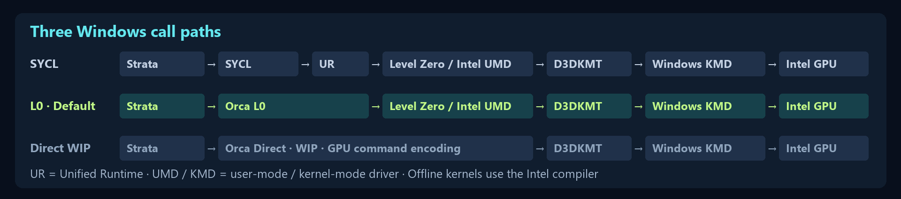
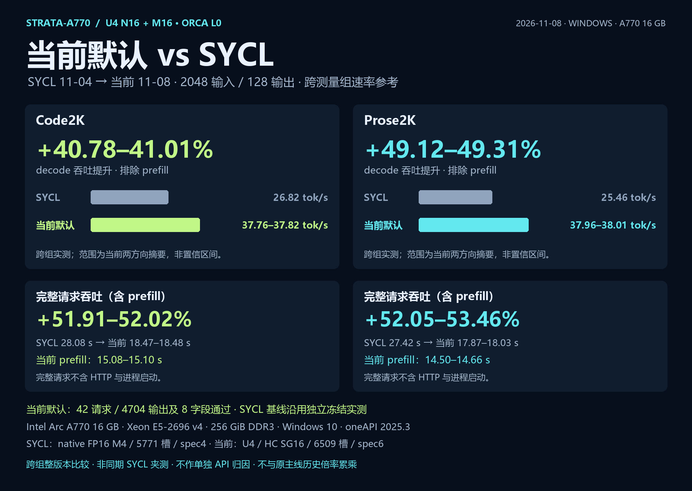
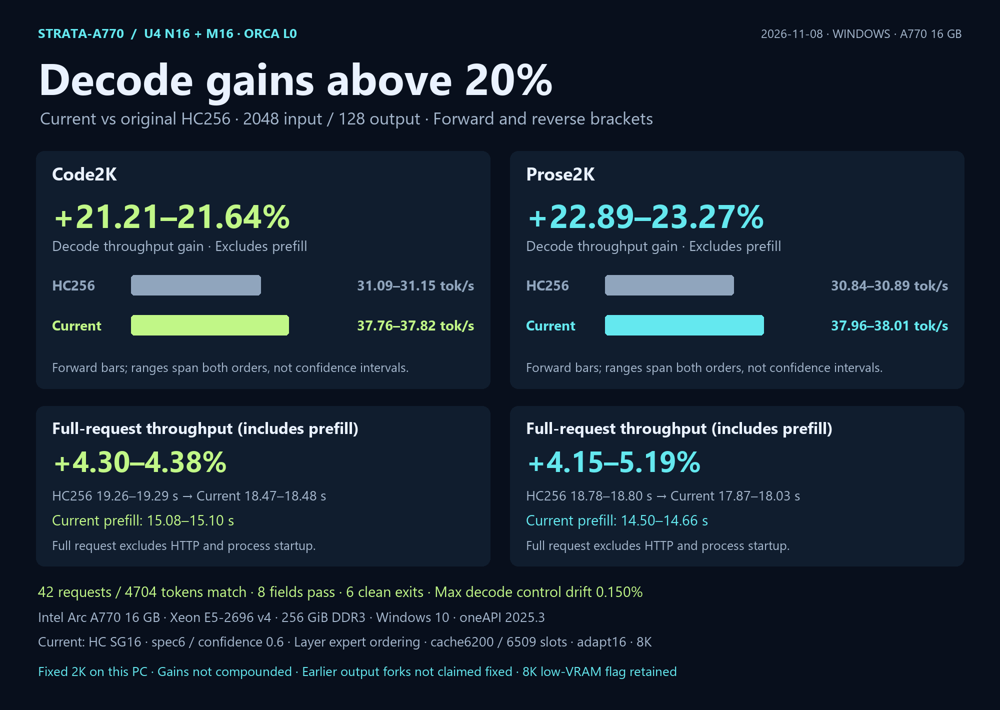
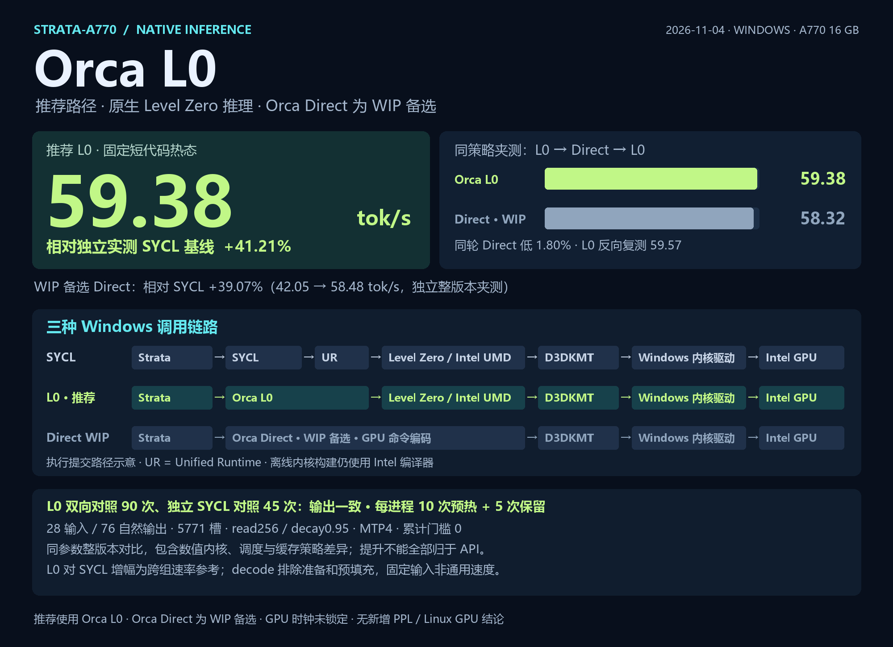

<div align="center">
  <h1>Strata-A770</h1>
  <p><a href="README.md">English (default)</a> · <strong>简体中文</strong></p>
  <p><strong>一张 Intel Arc A770 16 GB，配合系统内存，在本地运行 125B MoE 模型。</strong></p>
  <p>Qwen3.8-Flash-Next · 主推 U4 N16 + M16 / Orca L0 · Orca Direct（WIP／备选）· 网页聊天与兼容 API</p>
  <p><a href="#在-windows-上开始运行">开始运行</a> · <a href="#速度有多快">性能实测</a> · <a href="#runtime-call-paths">调用链路</a> · <a href="#继续了解">文档</a> · <a href="README.upstream.md">上游说明</a> · <a href="LICENSE">MIT</a></p>
</div>

<!-- ponytail: 首页长期保留此顺序：调用链路图 → 当前默认 vs SYCL → SYCL vs 原主线历史数据 → HC256 对照；后续单项优化图放在这些内容之后。 -->
<a id="runtime-call-paths"></a>

## L0 与原生 Direct 的调用链路

<!-- ponytail: 调用链路单独保留，后续替换或更新测速图时不要移除。 -->
[](docs/media/orca-runtime-paths.svg)

**当前默认L0：** `Strata → Orca L0 → Level Zero / Intel GPU用户态驱动 → D3DKMT → Windows内核驱动 → GPU`。

**原生Direct（WIP／备选）：** `Strata → Orca Direct（GPU命令编码）→ D3DKMT → Windows内核驱动 → GPU`。Direct执行时无需SYCL、UR、Level Zero或Intel GPU用户态驱动，GPU内核仍通过Intel编译器离线生成；图中展示Windows执行期链路。

图示沿用原链路图，独立于测速数据保留。`python tools/render_orca_current.py --paths-only`可重画PNG／SVG，加 `--check-only`离线核对三条路径，无需GPU。[L0提交实现](orca-l0/src/runtime.cpp) · [Direct提交实现](orca-l0/src/wddm/runtime.cpp) · [后端选择](sycl/orca_queue.hpp)。

[](#当前默认对比-sycl)

**当前默认对比 SYCL：** Code2K **26.82 → 37.76–37.82 tok/s（+40.78%–41.01%）**，Prose2K **25.46 → 37.96–38.01 tok/s（+49.12%–49.31%）**。SYCL为11-04的native FP16 M4修复版，当前为11-08的U4／HC SG16／spec6配置；这是同机跨测量组的整版本速率参考，范围来自当前默认的两方向摘要。[完整口径与数据](#当前默认对比-sycl)。

<a id="sycl-original-mainline"></a>

**SYCL 对比原主线：历史阶段数据（2026-10-21归档）**

| 指标 | 原主线早期记录（tok/s） | SYCL优化版10-21（tok/s） | 历史吞吐倍率 |
| --- | ---: | ---: | ---: |
| Short生成 | 5.8 | 41.85 | **7.22×** |
| Code2K生成 | 7.6 | 29.02 | **3.82×** |
| Prose2K生成 | 7.0 | 27.87 | **3.98×** |
| Long8K生成 | 6.8 | 24.39 | **3.59×** |
| Long8K预填 | 239.2 | 596.92 | **2.50×** |

原主线沿用仓库归档的最早已开启MTP阶段，8K预填基线来自显存预算修正阶段；SYCL端为10-21完整源码优化测试构建，39次请求、每场景五次保留。历史配置和输出参考不同，Short输入36→28 token；该SYCL版本与上方SYCL对照图的11-04修复版分别保留身份，倍率不相乘。[归档JSON](bench/results/a770/refresh-2026-10-21.json) · [历史条件](docs/A770_PERFORMANCE.md#sycl-original-mainline-history)。

**当前默认对原 HC256：本轮直接双向验证**

[](#速度有多快)

**最新实测（2026-11-08）：当前默认相对原 HC256，Code2K／Prose2K 的 decode 吞吐双向提升 21.21%–21.64%／22.89%–23.27%。** 净生成速度分别为 **37.76–37.82／37.96–38.01 tok/s**，固定2048-token输入、128-token输出，两项均通过20%目标。[完整条件与数据](#速度有多快)。

**完整请求吞吐提升另计：Code2K 4.30%–4.38%，Prose2K 4.15%–5.19%。** 本轮独立正反序共42请求／4704输出token全部匹配，最大绝对decode控制漂移 **0.150%**，六个引擎正常退出；净decode提速不包含prefill、HTTP或进程启动。

**Short28 已有超过 60 tok/s 的记录：** 冻结 L0 基线单次保留样本达到 **60.01 tok/s**，同一进程中位数 **59.57 tok/s**；独立 256 GRF 试验的两个进程中位数几何均值为 **60.71 tok/s**。256 GRF 随后通过 U4 服务验收并用于 L0 默认配置。[短测数据与采用过程](#short-results)。**启动优化：** 最新已验证启动候选在系统文件缓存已热时，**7.904 秒到达 READY**。[启动实测](#startup-optimizations)。

**本机主推配置：U4 N16 + M16／Orca L0、HC SG16、spec6、置信度0.6及层内专家排序。** 保留6200缓存预算（实际6509槽）、adapt16、8K上下文、U4N16数据与RAM／原生回退。SYCL图保留跨组参考，HC256图保留当前完整配置的直接双向对照，各步骤收益不累乘。[采用与验证](docs/A770_PERFORMANCE.md)。

**模型仓库：[Hugging Face](https://huggingface.co/orca-zhang/Qwen3.8-Flash-Next-U4-N16) · [ModelScope](https://modelscope.cn/models/orcazhang/Qwen3.8-Flash-Next-U4-N16)。** U4 权重、IQ2_XS 主模型和校准 Q2 MTP 草稿模型的入口见[模型下载](#模型下载)。安装程序仍按下文准备原生 IQ2_XS，不会自动获得本机 U4 配置。[采用记录与资源范围](bench/results/a770/orca-u4-m16-combined-2026-11-05.md)。

**Orca Direct 继续作为 WIP／备选。** Direct 的 U4/M16 组合也有双向测量，但既有 8K 间歇故障仍未关闭；Linux GPU 运行尚待验证。本机主入口保留可用 RAM 检查和原生配置回退。

Strata-A770 基于 [Strata](https://github.com/Niko1221/Strata)，针对 Intel Arc A770 优化专家缓存、计算内核和任务提交。常用专家保留在显存，其余专家由系统内存承载；你可以通过网页聊天，也可以让已有应用调用本机 API。

**优先使用 Orca L0，Direct 作为 WIP 备选。** L0 通过 Level Zero 提交任务；Direct 自行编码 GPU 命令，经 Windows D3DKMT 向内核驱动提交。Windows / A770 16 GB 已完成真实模型与服务适配器检查，Linux 已有构建与 CPU 检查记录，GPU 运行尚未验证。[原生后端覆盖范围](docs/ORCA_NATIVE_BACKEND_STATUS.md)。NVIDIA / AMD 用户可从[上游使用说明](README.upstream.md)开始。

| 你想做什么 | 从这里开始 |
| --- | --- |
| 在 A770 上运行模型、使用网页聊天 | [Windows 安装与启动](#在-windows-上开始运行) |
| 下载 U4、IQ2_XS 与 MTP 草稿模型 | [模型下载](#模型下载) |
| 接入聊天客户端、代码工具或自己的应用 | [API 接入](#接入你的应用) |
| 判断短输入和长输入的实际表现 | [性能实测与适用条件](#速度有多快) |
| 查看启动优化和 Short28 短测 | [启动优化](#startup-optimizations) · [Short28 超过 60 tok/s 的记录](#short-results) |
| 复用 Direct 或 Level Zero 运行时 | [独立 orca-l0 库](orca-l0/README.md) |

<a id="how-does-it-work"></a>

## 这个分支好在哪里

| 能力 | 实际用途与边界 |
| --- | --- |
| **显存与系统内存协作** | 查询实际显存余量，预留运行空间，让热点专家优先驻留显存。16 GB 是显卡容量，完整模型仍需要系统内存与磁盘。 |
| **Orca L0（推荐）** | 通过 Level Zero 管理设备、内存、队列与事件，支持已验证的模型和服务功能，是当前优先使用的原生路径。 |
| **U4 N16 + M16 预填充（主推）** | 已在本机 Orca L0 采用四路权重加载、16 行门槛及 HC SG16。额外 U4 权重载荷约 24.21 GiB，需充足系统内存。[模型文件](#模型下载) · [测量与采用边界](docs/A770_PERFORMANCE.md)。 |
| **Orca Direct（WIP／备选）** | 自行管理内存、队列、依赖、命令编码与回放，经 D3DKMT 对接 Windows 内核驱动。执行无需 Level Zero、Intel GPU 用户态运行库、SYCL、UR 或 oneMKL；离线构建内核仍需要 Intel 编译器。Linux DRM 路径尚待 GPU 验证。 |
| **A770 计算与调度优化** | 调整专家换入、量化与激活融合、subgroup 和 XMX 矩阵计算路径；MTP 推测解码可在一次验证中接受多个 token。逐项收益见[性能记录](docs/A770_PERFORMANCE.md)。 |
| **本地服务与应用接入** | 沿用 Strata 网页界面，以及 OpenAI Chat Completions、Responses 和 Anthropic Messages 兼容接口。 |
| **会话与可选批量执行** | Orca L0 路径已验证会话保存、恢复及继续生成，以及 2 / 4 / 8 槽位批量。批量槽位占用专家缓存，默认关闭；磁盘会话当前要求关闭多请求批量。Direct 的功能覆盖见原生后端说明。 |
| **可单独使用的运行时** | `orca-l0/` 可独立构建，包含 Orca L0 与 Orca Direct（内部目标 `Orca::DG2`），提供模块加载、内存池、命令回放等接口；Strata 集成位于 `sycl/orca/`。 |

完整功能、检查入口和限制见 [Orca 原生引擎](sycl/orca/README.md)。不同 Arc 型号与其他模型包的速度需要分别验证。

## 模型下载

两个平台的仓库名均为 **Qwen3.8-Flash-Next-U4-N16**。**两个平台的全部 19 个文件均已上传并校验通过。**

| 组件 | 仓库内路径 | Hugging Face | ModelScope |
| --- | --- | --- | --- |
| U4 N16 专家权重 | `U4N16/u4n16-expanded-assets.tar` | [权重归档](https://huggingface.co/orca-zhang/Qwen3.8-Flash-Next-U4-N16/blob/main/U4N16/u4n16-expanded-assets.tar) | [权重归档](https://modelscope.cn/models/orcazhang/Qwen3.8-Flash-Next-U4-N16/files?version=master&fileName=U4N16%2Fu4n16-expanded-assets.tar) |
| IQ2_XS 主模型（两份 GGUF 分片都需要） | `IQ2_XS/` | [主模型](https://huggingface.co/orca-zhang/Qwen3.8-Flash-Next-U4-N16/tree/main/IQ2_XS) | [主模型](https://modelscope.cn/models/orcazhang/Qwen3.8-Flash-Next-U4-N16/files?version=master&fileName=IQ2_XS) |
| 激活校准 Q2 MTP 草稿模型 | `mtp/rt-q2-activation-calibrated-20261105/` | [MTP 草稿权重](https://huggingface.co/orca-zhang/Qwen3.8-Flash-Next-U4-N16/tree/main/mtp/rt-q2-activation-calibrated-20261105) | [MTP 草稿权重](https://modelscope.cn/models/orcazhang/Qwen3.8-Flash-Next-U4-N16/files?version=master&fileName=mtp%2Frt-q2-activation-calibrated-20261105) |

MTP 需一起下载 `dense.bin`、`dense.txt` 和 `experts.bin` 三个文件，合计约 0.767 GiB，再将 `--mtp` 指向该目录。仓库还包含 `packs/iq2_xs/`（dense pack 与 tokenizer）、`profiles/`，以及记录文件大小和 SHA-256 的 `manifest.json`。完整下载约 89.81 GiB，U4 解压另需约 24.21 GiB。U4 权重需与 IQ2_XS 主模型及同一构建的 Strata 引擎／`images/` 配套使用；解压方式与路径设置见模型仓库 README。

<a id="install"></a>

## 在 Windows 上开始运行

下面是推荐的 **Orca L0 安装流程**：从源码构建引擎，再由安装程序准备模型和服务。**Orca Direct 为 WIP 备选，使用独立构建与配置**，需要匹配的离线 zebin 内核包、原生内存模块和运行时环境。[Direct 实测版本与复现](bench/results/a770/orca-direct-vs-sycl-2026-11-04.md) · [原生后端说明](docs/ORCA_NATIVE_BACKEND_STATUS.md)。

### 1. 准备环境

| 项目 | 要求或参考 |
| --- | --- |
| 显卡与驱动 | 本分支已验证 Intel Arc A770 16 GB，Windows 驱动 32.0.101.9034。 |
| 操作系统与 CPU | 已测系统为 Windows 10 22H2；使用支持 AVX2 的 x86-64 CPU。 |
| 系统内存 | 需容纳模型和专家镜像。原生 IQ2_XS 可参考[上游 48–64 GB 的选型建议](docs/MODELS.md#pick-by-ram)；本机 U4 启动器要求启动前至少 **63.23 GiB 可用物理内存**，不足或查询失败则回退原生配置。这是准备预算，不是实测最低要求；本分支测机为 256 GiB DDR3，较小内存配置尚未在此验证。 |
| 磁盘 | 为模型下载、pack 和编译产物预留空间；上游安装建议约 80 GB 空闲，优先使用 SSD。 |
| 构建工具 | VS Build Tools 的 x64 C++ 开发环境、Windows SDK、Intel oneAPI 2025.3 编译器、Level Zero SDK、CMake 3.24+、Ninja、Python 3.10+。 |

在已初始化 VS x64 与 oneAPI 2025.3 工具链的终端中操作。下面使用 PowerShell 语法，Level Zero SDK 路径按实际安装位置修改。

### 2. 构建引擎

```powershell
git clone https://github.com/orca-zhang/Strata-A770.git
cd Strata-A770
cmake -S . -B build-strata-orca -G Ninja -DSTRATA_ENABLE_ORCA=ON -DCMAKE_C_COMPILER=icx -DCMAKE_CXX_COMPILER=icx -DCMAKE_BUILD_TYPE=Release "-DORCA_L0_SDK=C:/Program Files/LevelZeroSDK/1.33.1"
cmake --build build-strata-orca -j 1
ctest --test-dir build-strata-orca --output-on-failure
```

引擎输出为 `build-strata-orca/orca/strata.exe`，内核包位于同目录的 `images/`。两者必须来自同一次构建。GPU 检查需要可用的 A770 驱动与运行环境。

A770 不使用 B 系列的 `bmg-*` AOT 目标。其他构建位置、Linux 命令与 SYCL 对照方式见[原生引擎文档](sycl/orca/README.md)。

### 3. 准备模型并启动

在仓库根目录运行：

```powershell
python setup.py --backend orca --model IQ2_XS --context 8192
```

安装程序会发现上一步的引擎，按提示下载和准备模型、pack 与 MTP 文件，生成本机配置和启动脚本，并启动服务。切换已有 Intel 配置的后端时，会备份旧配置并保留模型参数。

安装完成后，浏览器打开 [http://127.0.0.1:8080](http://127.0.0.1:8080)。以后可使用安装程序生成的脚本启动；默认 Qwen IQ2_XS 对应：

```powershell
.\run-iq2_xs.bat
```

在另一个 PowerShell 窗口检查服务：

```powershell
Invoke-RestMethod http://127.0.0.1:8080/health
Invoke-RestMethod http://127.0.0.1:8080/v1/models
```

健康检查返回 `status: ok`、`loaded: true` 后即可使用。默认监听 `127.0.0.1`；需要对外提供服务时，必须设置 `--api-key`。

**已有本机 U4 资源时：** 当前 `run-iq2_xs.bat` 会按 RAM 预算选择已验证的 U4 配置或保留的原生回退，模型名与 8080 端口保留。该入口和配置依赖本机路径，不属于上述安装程序自动生成的 U4 安装流程。资源与版本对应关系见[模型下载](#模型下载)、[U4 采用记录](bench/results/a770/orca-u4-m16-combined-2026-11-05.md)和[HC SG16 服务验收](docs/A770_PERFORMANCE.md#hc-sg16-default)。

<details>
<summary>手动启动与自定义引擎路径</summary>

安装程序生成的配置包含本机模型、pack、MTP 和可执行文件路径，不能直接照搬其他机器的配置。需要手动启动时，使用安装生成的 Python 环境：

```powershell
.\.venv\Scripts\python.exe sycl/serve/server_intel.py --engine strata --config strata-iq2_xs.json --host 127.0.0.1 --port 8080
```

自定义构建位置可通过 `sycl/setup_intel.py` 的 `--orca-engine` 和 `--orca-images` 指定；编译器数学库 DLL 不在 `PATH` 时，可加 `--orca-lib-dir`。原生配置使用 `backend: orca`，并通过 `STRATA_ORCA_IMAGES` 指向匹配的内核包。见[完整安装说明](sycl/orca/README.md)。

</details>

## 接入你的应用

| 使用方式 | 地址或设置 |
| --- | --- |
| 浏览器聊天 | `http://127.0.0.1:8080` |
| OpenAI 兼容客户端 | Base URL：`http://127.0.0.1:8080/v1`；模型列表：`GET /v1/models` |
| Chat Completions | `POST http://127.0.0.1:8080/v1/chat/completions` |
| Responses API | `POST http://127.0.0.1:8080/v1/responses` |
| Anthropic Messages | `POST http://127.0.0.1:8080/v1/messages` |

模型名可填 `strata`；服务接受兼容客户端传入的模型名，不会据此自动切换模型。未启用认证时，要求填写 API Key 的客户端可填任意非空值；启用认证后使用配置的密钥。

用 PowerShell 发送一次聊天请求：

```powershell
$body = '{"model":"strata","messages":[{"role":"user","content":"Say hello in one sentence."}],"max_tokens":128,"reasoning_effort":"none"}'
Invoke-RestMethod http://127.0.0.1:8080/v1/chat/completions -Method Post -ContentType "application/json" -Body $body
```

启用认证后，为请求加上配置的密钥，例如 `-Headers @{ Authorization = "Bearer <你的密钥>" }`。流式输出、工具调用及 API 参数见[技术说明](docs/DETAILS.md#using-it)。

## 速度有多快

以下结果来自 **A770 16 GB + Xeon E5-2696 v4 + 256 GiB DDR3 + Windows 10 22H2**，使用 Qwen3.8-Flash-Next IQ2_XS。各实验分别注明日期与协议。生成速度用 tok/s 表示；首 token 延迟（TTFT）与完整请求耗时越低越好。

### 当前默认对比 SYCL

SYCL对照图沿用此前三方表的SYCL基线：11-04的native FP16 paired-M4修复版，实际5771槽／spec4；当前端为11-08已采用的U4／HC SG16／6509槽／spec6／置信度0.6／层内profile。两端均为2K输入／128输出，预热后统计。

| 任务 | SYCL净decode（tok/s） | 当前默认净decode（tok/s） | decode速率增幅 | prefill速率增幅 | 完整请求速率增幅 |
| --- | ---: | ---: | ---: | ---: | ---: |
| Code2K | 26.82 | 37.76–37.82 | **+40.78%–41.01%** | +54.35%–54.55% | +51.91%–52.02% |
| Prose2K | 25.46 | 37.96–38.01 | **+49.12%–49.31%** | +52.72%–54.42% | +52.05%–53.46% |

SYCL耗时取原native／U4／U2／native测量组两端native摘要的几何均值；当前耗时取独立HC256对照的正／反序默认摘要。百分比直接按 `SYCL耗时 / 当前耗时 − 1` 计算，未做新的同期SYCL／当前／SYCL夹测。版本、缓存容量及MTP策略不同，跨组比值不作纯API或单个内核归因，也不构成两版本输出／广泛质量等价结论；范围不是置信区间。[SYCL来源](sycl/orca/lowbit-fp16-m4-a770-windows-2026-11-04.json) · [当前来源](sycl/orca/default-hc256-a770-windows-2026-11-08.json) · [SYCL对照图SVG](docs/media/orca-current-vs-sycl.svg)。

SYCL对原主线的五项历史阶段数据长期保留在[首页表格](#sycl-original-mainline)，使用10-21归档版本，与本节11-04的SYCL分别计量。

### 最新默认：对原 HC256 的双向实测（2026-11-08）

当前 Orca L0 默认配置与原 HC256 直接对照；固定2048输入／128输出、贪心生成、prompt-cache0。正序为原HC256／当前／原HC256，反序为当前／原HC256／当前；每进程Short16后交替三轮Code／Prose，首轮预热，后两轮取中位数，两端控制耗时取几何均值。

| 任务 | 原HC256净decode（tok/s） | 当前默认净decode（tok/s） | decode吞吐提升（正／反） | 整请求吞吐提升（正／反） |
| --- | ---: | ---: | ---: | ---: |
| Code2K | 31.09–31.15 | **37.76–37.82** | **+21.642%／+21.212%** | +4.379%／+4.299% |
| Prose2K | 30.84–30.89 | **37.96–38.01** | **+23.267%／+22.889%** | +5.191%／+4.154% |

| 当前默认 | prefill耗时 | TTFT | 完整请求耗时 |
| --- | ---: | ---: | ---: |
| Code2K | 15.08–15.10秒 | 15.11–15.13秒 | 18.47–18.48秒 |
| Prose2K | 14.50–14.66秒 | 14.53–14.69秒 | 17.87–18.03秒 |

净decode速率按 `128000 / decode_ms` 计算；完整请求包括prefill，不包括HTTP与进程启动。范围为两种顺序的摘要，不是置信区间。正／反序控制decode耗时漂移分别为Code **−0.084%／−0.150%**、Prose **+0.112%／−0.016%**，均低于3%；42请求／4704输出、全部8字段、来源哈希及独立原始协议复核通过，无崩溃。

本轮未改默认参数，包含HC SG16、校准Q2 MTP、spec6／置信度0.6和层内profile等既有策略的总效果，不归因于单个GEMV内核。旧耗时轮次及Prose偶发分叉证据保留，未隔离耗时变化原因，也未宣称旧分叉已修复；原8K低显存余量标记保持。当前配置、首次／重复8K与HTTP的既有验收见下文，本轮新增的是固定2K测速。[完整双向报告](bench/results/a770/orca-mtp-confidence40x40-2026-11-07.md#11-08-再次复测当前默认对原hc256双向达到20) · [公开JSON与原始协议](sycl/orca/default-hc256-a770-windows-2026-11-08.json)。

<a id="startup-optimizations"></a>

### 启动优化（11-05／11-06）

在上述 A770 测机上，三项已验证的 Orca L0 启动改动缩短了从创建新引擎进程到收到 READY 的时间。每行使用该轮重新测得的基线，按每个版本三个进程的中位数汇总。

| 改动 | 日期 | 原版 → 候选 READY | 耗时减少 |
| --- | --- | ---: | ---: |
| 复用完整主机专家镜像填充 GPU 缓存，省去重复文件读取 | 2026-11-05 | 27.377 → 25.332 s | **7.47%** |
| Windows 重叠文件 I/O，镜像读取与分块内存分配并行 | 2026-11-06 | 26.577 → 10.668 s | **59.86%** |
| 镜像加载与初始化并行，投影合并分配并批量上传权重 | 2026-11-06 | 10.587 → 7.904 s | **25.34%** |

测量范围为**系统文件缓存已热的新进程启动**，配置为 U4／M16／HC Q8 SG16、MTP4、5771 个专家缓存槽、完整 33.02 GiB 主机镜像及 8K 上下文。完整镜像、GPU 缓存填充和计算图准备均在 READY 前完成。每轮两个顺序都通过各自预设收益门和 3% 控制漂移门；各阶段的模型验证均为 12 请求／1200 输出 token 全部匹配。三行分属独立轮次，百分比不累乘为总收益。

源码保留这些改动；实测使用冻结、匹配的 Host／数学组件及隔离构建，未在这些试验中替换已部署的默认 EXE、内核包或启动配置。7.904 秒对应文件缓存已热的引擎启动，冷盘及完整 Python 服务启动需另外测量。[镜像复用](bench/results/a770/orca-ready-startup-2026-11-05.md) · [重叠读取](bench/results/a770/orca-ready50-startup-2026-11-06.md) · [初始化与上传](bench/results/a770/orca-ready20-startup-2026-11-06.md) · [最新启动 JSON](sycl/orca/ready20-startup-a770-windows-2026-11-06.json)。

<a id="short-results"></a>

### Short28 超过 60 tok/s 的记录

归档 Short28 使用 **28-token Fibonacci 输入、自然结束于 76-token 输出**，每个进程先预热十次，再保留五次。速度取引擎 DONE 的净 decode 时间，排除加载、请求准备、prefill 和 HTTP。

| Orca L0 版本／测试 | 净 decode（tok/s） | 统计方式 |
| --- | ---: | --- |
| 冻结基线，2026-11-04 | **60.0079 峰值／59.5705 中位数** | 反序试验中同一 L0 进程的最快保留请求及五次中位数 |
| HC 融合 Q8 使用 256 GRF，2026-11-05 | **60.7077** | 两个进程的五次中位数取几何均值；正／反序分别为 **60.7029／60.7126** |

第一行就是 **60.01 tok/s 单次峰值／59.57 tok/s 同组中位数**。独立 256 GRF 试验相对同条件 128 GRF 控制，将 L0 从 **59.5751 → 60.7077 tok/s（+1.901%）**；两个后端、两种 GRF 设置共 120 请求的完整输出与草稿计数全部匹配，L0 控制漂移为 +0.031%／+0.016%。

两组均使用冻结的通用 FP16 M16 Host／内核包、MTP4、置信度 0.5、5771 槽、1536 MiB 显存预留和 prompt-cache0。Short 试验阶段，256 GRF 仍为隔离候选；同日后续完成 42 次当前 U4 测速及 18 次混合历史／真实 HTTP 生成请求验收后，已将 HC256 设为 L0 默认配置。之后 HC SG16 路径仍为 L0 保留 256 GRF；Direct 则在另一组对照及用户接受小幅收益后，于 11-06 将源码默认改为 128 GRF。[U4 验收与采用](bench/results/a770/orca-hc1-q8-grf-u4-adoption-2026-11-05.md) · [后续 L0／Direct GRF 默认值](bench/results/a770/orca-hc-sg16-grf-adoption-2026-11-06.md)。

这些归档中尚无当前 U4／HC SG16／spec6 默认的同口径 Short28 复测，60.71 tok/s 仍对应那套冻结测试构建。单次峰值、进程内中位数及两个进程汇总分别列出。[基线报告](bench/results/a770/orca-direct-idle-audit-2026-11-04.md) · [基线样本](sycl/orca/direct-idle-audit-a770-windows-2026-11-04.json) · [256 GRF 报告](bench/results/a770/orca-hc1-q8-grf-model-2026-11-05.md) · [256 GRF 样本](sycl/orca/hc1-q8-grf-model-a770-windows-2026-11-05.json)。

### 历史 decode：Direct、L0 对照 SYCL（11-04／11-05）

**先看 Short 固定短代码，单位 tok/s，越高越好。** 28-token Fibonacci 输入、76-token 自然输出；每进程十次预热、五次保留，完整输出与 57／57 草稿计数一致。decode 仅按引擎 DONE 的净生成时间计算，排除预填充、准备和 HTTP。

| 任务 | SYCL | Orca L0 | L0 相对 SYCL | Orca Direct | Direct 相对 SYCL |
| --- | ---: | ---: | ---: | ---: | ---: |
| **Short** | **42.05** | **59.38** | **+41.21%** | **58.48** | **+39.07%** |

该组来自 **2026-11-04 冻结版本**，固定 5771 槽、1536 MiB 预留、read256、decay0.95、MTP4、FP16 KV、prompt-cache0。SYCL／Direct／SYCL 三个进程为 **41.8502 → 58.4840 → 42.2598 tok/s**，SYCL 几何基线为 42.0545；L0 59.3843 来自独立的同策略 L0／Direct／L0 组，**L0／SYCL 百分比仅作跨组参考**。它们包含整版本内核、调度和缓存策略差异，不代表本机当前 U4 配置的 Short 测速。[Direct／SYCL 夹测](bench/results/a770/orca-direct-vs-sycl-2026-11-04.md) · [L0 双向测量](bench/results/a770/orca-direct-idle-audit-2026-11-04.md)。

**历史2K decode 补充：** 固定2048输入、128输出；以下保留11-04／11-05各版本的独立测量结果，配置与来源见prefill表后。

| 任务 | SYCL | Orca L0 | L0 相对 SYCL | Orca Direct | Direct 相对 SYCL |
| --- | ---: | ---: | ---: | ---: | ---: |
| Code2K | 26.82 | 30.58–30.90 | +14.01%–15.20% | 29.82–29.93 | +11.18%–11.60% |
| Prose2K | 25.46 | 30.45–30.69 | +19.61%–20.57% | 29.60–29.82 | +16.26%–17.15% |

### 历史 prefill：Direct、L0 对照 SYCL（11-04／11-05）

**处理输入的速度，单位 tok/s，越高越好。** 按 `2048 / 预填充秒数` 计算；不与 decode 或完整请求耗时混算。

| 任务 | SYCL | Orca L0 | L0 相对 SYCL | Orca Direct | Direct 相对 SYCL |
| --- | ---: | ---: | ---: | ---: | ---: |
| Code2K | 87.88 | 134.76–139.01 | +53.35%–58.18% | 150.50–151.90 | +71.26%–72.85% |
| Prose2K | 91.47 | 139.99–142.53 | +53.05%–55.82% | 155.57–156.89 | +70.08%–71.53% |

以上两张 **2K 表**均使用 5771 实际专家槽、MTP4、FP16 KV、prompt-cache0；初始化后交错三轮，首轮不计。**版本分别为 SYCL native FP16 paired-M4 修复版（11-04）、L0 U4/min16/M16/HC256（11-05）、Direct U4/min32/M16/HC128（11-05，可选配置）**。SYCL 取两个 native 控制摘要的几何基线；L0／Direct 区间为各自正反序候选摘要，图中条形取正序。

2K 表中百分比为 `后端速率 / SYCL速率 − 1`，均属于**跨组实测比值，非同期三方夹测**，包含版本、数值路径和配置差异；不能归因给单独移除某个 API。L0 反序 Code prefill 控制漂移 **−3.56%**，区间不是置信区间。Direct 的既有 8K 间歇问题仍未关闭。[SYCL 数据与修复](bench/results/a770/lowbit-fp16-m4-2026-11-04.md) · [L0 原始测量](bench/results/a770/orca-hc1-q8-grf-u4-2026-11-05.md) · [Direct 双向测量](bench/results/a770/orca-u4-m16-combined-2026-11-05.md)。

### 当前配置与此前采用步骤

本机当前为U4 N16／M16／HC SG16、spec6、最小及累计置信度0.6、MTP窗口1024、仅补算已采纳行、层内专家profile、cache6200（6509槽）、adapt16和8K上下文。HC SG16这一项此前相对HC256的独立decode收益为Code **5.60%–5.61%**、Prose **5.97%–6.15%**；42次完整模型及18次服务生成请求核对通过。当时169个1Hz样本的最低空闲显存 **1336.047 MiB** 属于较早配置，不能作为当前余量。[该步骤采用与复核](docs/A770_PERFORMANCE.md#hc-sg16-default)。

**11-08 当前配置更新：** 在现有spec6／置信度0.6／6200预算／6509槽及8K上下文下，仅替换层内专家排序，已设默认、下次启动生效。相对切换前默认，Code2K双向decode吞吐 **+2.905%／+3.369%**，Prose2K **+8.085%／+7.748%**；最大绝对控制漂移0.644%，42次测速及27次8K混合／实际HTTP请求的完整输出和协议核对通过。当前候选实测最低空闲显存仅 **295.234 MiB**，原1GiB余量线未通过，按用户保留8K的选择保留该标记；上段1336MiB属于较早HC SG16阶段。收益不累乘历史数据，整请求收益另列，U4N16与回退支持保留。[测量、余量及回退记录](bench/results/a770/orca-mtp-confidence40x40-2026-11-07.md#11-08-固定各层缓存份额的专家排序备选)。

<details>
<summary>保留的较早复测：Code +14.729%、Prose +17.739%，当轮未达20%</summary>

同一默认配置较早的直接正序为Code／Prose decode **+14.729%／+17.739%**，控制漂移 **+0.035%／+0.265%**；21请求／2352输出及独立复核通过，当轮未达20%，未反序。该轮默认prefill为24.855／24.346秒，完整请求28.445／27.876秒，慢于当轮原对照19.333／18.900秒。更早约69秒prefill样本也完整保留，耗时变化原因未隔离，不与最新双向数据合并。CJK草稿词表候选未过Prose0.5%门槛，未采用。[旧轮次与证据](bench/results/a770/orca-mtp-confidence40x40-2026-11-07.md#11-08-用户要求重新测试当前默认直接对照原hc256)。

</details>

此前 HC256 阶段的观测如下。范围为正反序候选摘要，不是置信区间；两行仍为 2048 输入、128 输出。

| 任务 | 预填充耗时 | 完整请求耗时 | 净 decode |
| --- | ---: | ---: | ---: |
| Code2K | 14.73–15.20 秒 | 18.88–19.38 秒 | 30.58–30.90 tok/s |
| Prose2K | 14.37–14.63 秒 | 18.54–18.83 秒 | 30.45–30.69 tok/s |

**这组 HC256 耗时仅作历史观测。** HC256 反序 Code 的 prefill／完整请求控制漂移为 **−3.56%／−3.08%**，超出 3%；保留全部样本，不以这些列发布新的 prefill 或完整请求提速。HC256 的 decode 双向对照通过门槛：相对当时 U4/min16/M16 的 HC128，Code／Prose 吞吐分别 **+1.349%–1.932%／+1.730%–4.415%**，但反序轮间波动明显，未建立跨日稳定性。[HC256 原始样本与口径](bench/results/a770/orca-hc1-q8-grf-u4-2026-11-05.md)。

此前 min16 相对 min32 的独立双向对照，prefill 吞吐分别提升 **1.99%–3.04%／2.08%–2.53%**，完整请求吞吐提升 **1.49%–2.35%／1.45%–1.74%**。各步骤基线不同，百分比不相加，也不将上表当前耗时与较早数据拼接计算总提升。[min16 对照](bench/results/a770/orca-u4-threshold-m16-2026-11-05.md)。

min16 的 256 个固定目标合计 PPL 相对 native 增幅 **0.3101%**，部分输出及 MTP 计数改变，属于有限质量检查。HC256 当时通过首次 8K、混合请求与真实 Chat／Messages／Responses 服务验收，共 18 次生成请求完整输出和草稿计数一致；1 Hz 采样最低空闲显存 **1390.508 MiB**，采样不能排除瞬时更低值。该阶段曾设为默认，HC256 回退配置继续保留。[历史服务验收与采用](bench/results/a770/orca-hc1-q8-grf-u4-adoption-2026-11-05.md)。

保留 **9,402 个 U4 专家、约 24.21 GiB 权重载荷**；启动前 RAM 准备预算为 **67,891,552,256 字节（63.23 GiB）**。MTP当前使用已采用的激活校准Q2运行时；Q5虽提高固定任务的接受率，但计入缓存缩减后未获得一致的完整请求收益。[Q5取舍](bench/results/a770/mtp-q5-2026-11-05.md) · [Q2测量](bench/results/a770/mtp-q2-optimization-2026-11-05.md)。

Orca L0 源码另默认采用已知 MTP 元数据提前准备与持久镜像批量回填，重建后生效；两项均可独立设0回退。旧实验收益较小，未计入上方整版数据；[采用范围、组合检查与复现](bench/results/a770/orca-preparation-defaults-2026-11-06.md)单列。本机现有HC SG16部署包未由这次源码变更替换。

<details>
<summary>历史短输入：SYCL、L0、Direct（2026-11-04）</summary>

### 历史短输入对照：Orca L0（2026-11-04）

[](bench/results/a770/orca-direct-vs-sycl-2026-11-04.md)

2026-11-04，完整前端重建后的同策略双向对照如下。每个进程十次预热、五次保留；两侧参考取两个进程中位数的几何均值。

| 对照顺序 | Orca L0（tok/s） | Direct（WIP，tok/s） | Direct 相对 L0 |
| --- | ---: | ---: | ---: |
| L0 → Direct → L0 | **59.3843** | 58.3180 | −1.7956% |
| Direct → L0 → Direct | **59.5705** | 58.3002 | −2.1324% |

两轮共 90 次请求，28-token 输入、76-token 自然输出、57／57 草稿计数均一致，`reused=resume=0`。固定 5771 槽／7922 MiB 缓存、预留 1536 MiB、`short-read=256`、`adapt-decay=0.95`、MTP4、累计／末草稿门槛 0／0.5。[完整条件、样本与复现](bench/results/a770/orca-direct-idle-audit-2026-11-04.md)。

相对独立实测的原生产 SYCL 基线 **42.0545 tok/s**，L0 **59.3843 tok/s** 的速率增幅为 **41.2079%**。这是跨组参考，不是 L0／SYCL 同期夹测。[数据来源与计算](bench/results/a770/orca-direct-vs-sycl-2026-11-04.md)。

### 历史 Orca Direct 对照：WIP／备选

独立的 SYCL／Direct／SYCL 夹测为 **41.8502 → 58.4840 → 42.2598 tok/s**，Direct 相对 SYCL 几何基线提升 **39.0672%**。45 次完整输出及草稿计数一致；这是包含数值内核、调度与缓存策略差异的整版本对照，不是纯 API 消融。[本轮记录与调用链](bench/results/a770/orca-direct-vs-sycl-2026-11-04.md)。

同策略下 L0 仍更快，Direct 暂不作为优先路径。当前前端的 2K／8K 对照和长输入的已知问题见[上下文测试记录](bench/results/a770/orca-direct-current-contexts-2026-11-04.md)。

</details>

### 如何理解这些数字

净decode速度取引擎DONE的净解码时间，排除加载、请求准备、预填充与HTTP；prefill和完整请求分别按各自阶段／墙钟时间计算。U4首次长请求包含惰性权重加载，上表预热后结果不代表冷启动。`temperature=0`选择贪心采样，不启用回答缓存；测试显式关闭prompt缓存，但重复同一输入仍会预热专家缓存。固定输入的热态速度不代表混合请求或长上下文的速度。GPU时钟未锁定，单组样本范围不代表跨机器保证。

当前的 FP16 双专家预填充、缓存调度和命令回放优化及其独立实验，统一保留在 [A770 性能记录](docs/A770_PERFORMANCE.md)和[原生后端状态](docs/ORCA_NATIVE_BACKEND_STATUS.md)中。Short 示例、当前 U4 与最早历史分别注明构建和协议，各组收益不相加。

SYCL对照图可用 `python tools/render_orca_current.py --sycl` 重画；加 `--check-only` 离线核对当前原始协议、SYCL控制摘要、跨组速率和原主线历史倍率。[SYCL对照SVG](docs/media/orca-current-vs-sycl.svg)可用于导出。去掉 `--sycl` 生成独立的[当前／HC256双向图](docs/media/orca-current-default.svg)，两图分别保留来源，无需GPU或本机权重。历史三方图仍由 `tools/render_orca_u4.py` 生成，[历史SVG](docs/media/orca-u4-optimization.svg)保留原数据。

<a id="something-went-wrong"></a>

## 常见问题

**16 GB 显存能装下完整模型吗？** 完整模型由显存、系统内存与磁盘共同承载。16 GB 指 A770 显存容量，系统内存仍需按模型选择，见[模型与内存说明](docs/MODELS.md)。

**U4 和 MTP 草稿权重在哪里下载？** [模型下载](#模型下载)列出了 HF 与 ModelScope 两个平台的入口，包含 IQ2_XS 主模型和校准 Q2 MTP 运行时文件。上面的安装程序仍准备原生 IQ2_XS 配置；U4 需要匹配的引擎、内核包和本机路径设置。

**可以直接用上游安装包吗？** A770 / Orca 路径需要本地构建的引擎与配套内核包；完成构建后使用 `--backend orca` 安装。需要对照旧 SYCL 路径时使用 `--backend sycl`。

**Linux 或其他 Arc 显卡能用吗？** Orca Direct 已有 Linux 构建和 CPU 检查记录，Linux GPU 运行与模型性能尚待验证；其他 Arc 型号没有本轮性能数据。具体覆盖范围见[原生后端说明](docs/ORCA_NATIVE_BACKEND_STATUS.md)，上游 SYCL 的社区验证情况见 [Intel Arc 文档](docs/INTEL_ARC.md)。

**启动失败或长输入很慢，先看哪里？** 核对引擎与 `images/` 是否来自同一构建、配置中的模型路径是否有效，以及内存和显存余量。保留 `strata-<model>.log`；已知性能边界见[上下文测试记录](bench/results/a770/orca-direct-current-contexts-2026-11-04.md)，其他排查见[故障处理](docs/TROUBLESHOOTING.md)。

## 继续了解

| 想了解什么 | 文档 |
| --- | --- |
| 每项优化、测量条件与历史结果 | [A770 性能记录](docs/A770_PERFORMANCE.md) |
| 原生引擎构建、功能与检查 | [Orca 集成说明](sycl/orca/README.md) |
| Direct 原生后端覆盖、实测与限制 | [原生后端状态](docs/ORCA_NATIVE_BACKEND_STATUS.md) |
| 可独立复用的 Direct / Level Zero 运行时 | [orca-l0](orca-l0/README.md) |
| Intel 平台支持与 SYCL 背景 | [Intel Arc](docs/INTEL_ARC.md) |
| 模型选择与系统内存 | [模型指南](docs/MODELS.md) |
| API、参数与引擎结构 | [技术说明](docs/DETAILS.md) |
| 安装自动化与 MCP 管理 | [AI 安装指南](docs/AI_SETUP.md) · [MCP Server](docs/MCP_SERVER.md) |
| NVIDIA / AMD 安装与其他语言 | [上游 English](README.upstream.md) · [上游简体中文](README.upstream.zh-CN.md) |

开发者可先运行无需 GPU 的安装检查；GPU 检查使用前面的 CTest 命令，性能测试需串行运行并固定模型、缓存与预热条件：

```powershell
python tools/test_setup_sycl.py
python tools/bench_a770.py --self-test
```

## 致谢与许可证

感谢 [Strata](https://github.com/Niko1221/Strata) 作者与贡献者、最初的 Intel SYCL 移植作者 maxfridbe、Qwen 团队，以及 [llama.cpp / ggml](https://github.com/ggml-org/llama.cpp) 和 Intel oneAPI。

项目沿用 [MIT License](LICENSE)。第三方代码及模型遵循各自许可证，原有版权与出处保留。
