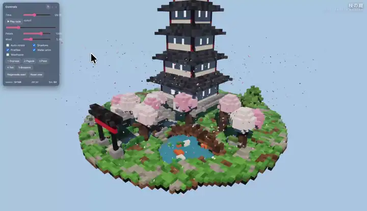
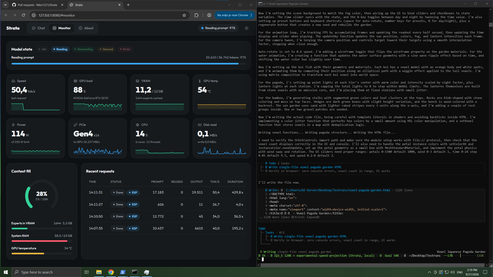
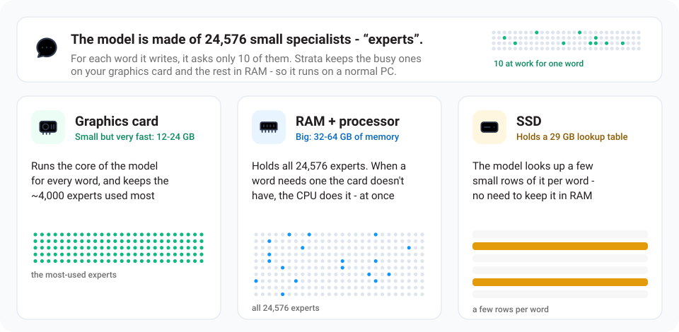
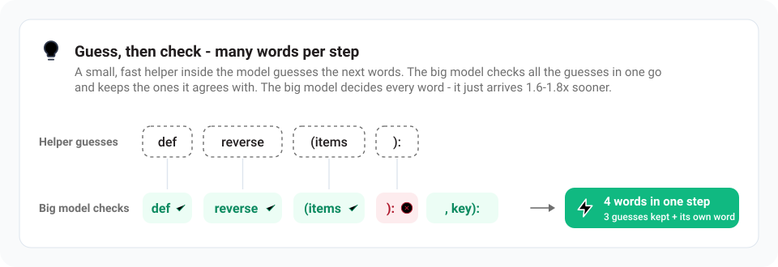

<h1 align="center">Strata</h1>

[English](README.upstream.md) · **简体中文** · [日本語](README.ja.md) · [Deutsch](README.de.md) · [Français](README.fr.md) · [Español](README.es.md) · [Português](README.pt-BR.md)

<p align="center"><b>在你自己的游戏电脑上运行 1250 亿参数的 AI 模型</b><br>
NVIDIA 或 AMD 显卡（12 GB 及以上）· Windows 或 Linux · 免费开源</p>

<p align="center"><a href="https://github.com/Niko1221/Strata/releases/download/v0.1.10/Pagoda.mp4"></a><br>
<sub>体素宝塔花园，一次提示生成，在 RTX 5070 上用 Strata 运行（IQ3_S，128K 上下文）·
<a href="https://github.com/Niko1221/Strata/releases/download/v0.1.10/Pagoda.mp4">完整视频（49 秒）</a></sub></p>

Strata 能在普通电脑上运行 **[Qwen3.8-Flash-Next](https://huggingface.co/Qwen/Qwen3.8-Flash-Next)**。这是一个又大又聪明的
AI 模型，通常要用服务器才能跑。它能聊天、写代码、看图片，还能配合你的应用和编程智能体一起工作。所有数据都留在你的电脑上。

## 速度有多快？

我们在两台普通的游戏电脑上做了测试。一个 token 大约相当于 ¾ 个英文单词。

- **写回答：** 短对话中回复出现的速度。每秒 60 个 token 已经比你的阅读速度还快。
- **读提示：** 读入你发送内容的速度（这里是一份 32K token 的文档、代码或聊天记录）。

<table>
<tr><th>NVIDIA：RTX 5070（12 GB）、Ryzen 5 7600、64 GB 内存</th><th>AMD：RX 9070 XT（16 GB）、Ryzen 9 3900X、47 GB 内存</th></tr>
<tr><td>

| 规格 | 写回答 | 读提示 |
| --- | ---: | ---: |
| **Q2_0** | 94 tokens/s | 2,650 tokens/s |
| **IQ2_XS** | 79 tokens/s | 2,090 tokens/s |
| **IQ3_XXS** | 62 tokens/s | 1,750 tokens/s |
| **IQ3_S** | 53 tokens/s | 1,620 tokens/s |
| **Coder** | 55 tokens/s | 2,180 tokens/s |

</td><td>

| 规格 | 写回答 | 读提示 |
| --- | ---: | ---: |
| **Q2_0** | 60 tokens/s | 1,160 tokens/s |
| **IQ2_XS** | 52 tokens/s | 1,110 tokens/s |
| **Coder** | 44 tokens/s | 1,420 tokens/s |

</td></tr>
</table>

NVIDIA：Q2_0 用的是引擎 0.1.36，其他各行用的是 0.1.26（4K 回答，32K 提示）。完整表格见
[DETAILS.md](docs/DETAILS.md#speed-measured)。显存越大的显卡越快：RTX 3090（24 GB）写回答应该能达到每秒约
100-140 个 token。长对话和其他显卡的数据：[各模型的速度](docs/MODELS.md#how-fast-is-each-size)、
[社区测试结果](docs/COMMUNITY_BENCHMARKS.md)。

**同参数原生产 SYCL → Orca L0（2026-10-31）：41.42 → 50.54 tok/s，吞吐 +22.01%。** 固定 28-token 短代码／76-token 自然输出、5771 槽、MTP4／min-p=0.5／decay=0.95；SYCL／Orca／SYCL 三个独立进程，每臂十次预热／五次保留，前后基线漂移 0.17%，45 次完整输出与草稿计数相同。decode 排除准备与预填充；整版本后端对照不等于纯 API 收益，也不代表所有输入速度。日常保留平衡参数，锚定另存；最低空闲 847 MiB 未过 1024 MiB 余量线，无新质量等价或 Linux 结论。[仓库主图](docs/media/orca-l0-hero.png) · [同等条件复现与完整证据](bench/results/a770/orca-anchor50-2026-10-31.md)。

**本分支混合请求 Intel A770 数据（2026-10-31）：** 1536 MiB 预留、5896 槽的实测：Short **24.34 tok/s**，Code2K TTFT **28.728 秒**，Long8K **77.195 秒**。16 请求／1024 输出 tokens、12 个保留样本，最低采样空闲显存 947 MiB。**未通过此前 1024 MiB 显存余量校验线。** 原始验证失败状态与全部样本保留；以下只报告已完成的性能观测，不作为显存余量验收通过的证据。这组混合请求为当前 Orca 性能观测，无同期混合请求 SYCL 或质量等价结论。[混合请求主表](README.md#速度有多快) · [完整记录](bench/results/a770/orca-reserve1536-2026-10-31.md)。

**连续重复同一 Short 的补测为 38.54 tok/s。** 同一当前 EXE／images、23-token 输入、完整 64-token 输出与 37／50 草稿接受计数；当前完整配置连续重复十次预热后取五次中位数，实际自动缓存 5949 槽。上面的四场景交错结果是另一种请求分布；排除准备和首轮图预热不等于专家缓存已达到连续重复的热状态。两种结果分别保留，具体缓存适配、PCIe 访存与预热的贡献尚未单独量化。 [完整核对](bench/results/a770/orca-short-workloads-2026-10-31.md)。


历史 Short 协议另行复测为旧 SYCL 42.99／43.13、Orca **48.94 tok/s**，输出及草稿计数一致；28-token Fibonacci 提示、自然输出 76、5771 专家槽、MTP4 / `spec-min-p=0.5`，十次预热后取五次中位数。[历史 41 的复现记录](bench/results/a770/orca-regression-2026-10-31.md)。本机默认门槛已改回 **0.5**，此前 0.8 旧表保留在历史报告。独立 KV 质量筛查中，K8/V8 原始 PPL +0.129%、K8/V4 −0.039%，分别有 4／9 个 top1 变化；小样本 PPL 下降不代表量化无损，[条件与原始评分](bench/results/a770/orca-kv-2026-10-31.md)。

长输入提交策略筛查未发现尾部等凑满：固定 5771 槽、`min-p=0.5`，关闭八专家批量等待使 2K／8K TTFT 增加约 4.91%／2.21%，绕过专家链也未改善。每臂每场景一个样本，前后基线漂移小于 0.4%，输出及草稿计数一致；未改默认。[TTFT 排查与证据](bench/results/a770/orca-prefill-2026-10-31.md)。

同一候选 EXE 的 FP16 双专家 OFF／ON／OFF 补测保持 `min-p=0.5`、5771 槽和 8192-token prefill：Code2K TTFT **33.001 → 28.230 秒（−14.46%）**，Long8K **84.178 → 76.296 秒（−9.36%）**。12 条完整输出及草稿计数一致，TTFT 漂移小于 0.08%；每臂每场景两个样本。decode 排除准备和首轮预热后未确认收益。已在 A770 原生 XMX 专家链上默认启用，`STRATA_PREFILL_FP16_PAIR=0` 可回退；此前 3072 MiB 预留配置的 11 请求／704 tokens 验收输出一致，最低采样空闲显存 1675 MiB。本机主配置保留门槛 0.5，预留现已恢复为 1536 MiB，下次启动生效。[默认采用证据](sycl/orca/prefill-pair-default-a770-windows-2026-10-31.json)。原整版本回退尚未证明全部消除。[详细结果与复现](bench/results/a770/orca-prefill-2026-10-31.md#优化验证)。

本机 IQ2_XS 主配置现采用双专家 Orca，保留自动缓存、8192-token prefill、MTP4 / `spec-min-p=0.5`，显存预留已按用户要求恢复为 1536 MiB，下次正常启动生效；恢复后的实测为 5896 槽／8093 MiB，详见上表。原 SYCL 配置保留备份。多请求批量 MTP 的独立四请求实验整组吞吐中位数提升 10.13%；槽位占用专家缓存，服务批量保持可选。Linux 是后续主要部署方向，尚无 Linux 编译或 GPU 实测。[Orca 构建与功能范围](sycl/orca/README.md)。

<details>
<summary>历史 A770 HTTP 测试（2026-10-24～26）</summary>

本分支的 Windows / Intel Arc A770 数据见 [A770 主 README](README.md#速度有多快)。10-24 使用 IQ2_XS 生产引擎、本地 Anthropic API 测得：28 / 76-token 短代码请求完整响应中位数 **2.716 秒**，等效 prefill **31.04 tok/s**、decode **42.28 tok/s**；36 / 256-token 流式请求完整响应 **9.725 秒**、首正文 **1.246 秒**。硬件为 A770 16 GB、Xeon E5-2696 v4、Windows，关闭提示缓存。最近事件转换优化的 HTTP 差异在噪音范围内，未确认提速；这些短输入结果不代表长上下文性能。[测量条件与原始记录](bench/results/a770/anthropic-e2e-2026-10-24.md)。

10-25 本机配置已将 `--short-read 256` 调至 `1024`，规避短工具输入进入异常慢的批量预填充路径。原始 258-token 请求在旧阈值下再次于 180 秒超时；10-24 晚间的新阈值复测 **6/6 次完成**，完整响应中位数 **22.016 秒**，输出 276 tokens，等效 prefill **22.13 tok/s**、decode **27.49 tok/s**。10-25 的[异常定位](bench/results/a770/prefill-root-2026-10-25.md)确认生产批量路径反复使用 oneMKL mixed-input → FP32 GEMM，独立跟踪显示额外主机搬运、临时分配和等待。这项阈值调整只规避短输入。[完整记录与回归命令](bench/results/a770/short-read-fix-2026-10-24.md)。

10-25 的生产对象 XMX 私有构建复测保留 32 MiB 工作区、FP16 KV、MTP4、`--short-read 1024`，固定 5771 个专家缓存槽位。1,038 / 23-token 检索请求 **3/3 返回正确 JSON**，HTTP 完整响应中位数 **28.595 秒**，等效 prefill **38.05 tok/s**、decode **17.91 tok/s**；旧生产 EXE 的同一请求在 **180 秒超时**。短工具 A/B/A 的 18 次完整结果一致，吞吐差异 −0.79%～+0.55%，按噪音处理，没有确认 decode 提升，也不计算超时加速倍率。实际自动缓存 6399 slots 的原工具和长检索检查也已通过，本机启动配置已切至新 EXE 并启用 XMX，下次启动服务生效。[完整数据、启用状态与限制](bench/results/a770/production-xmx-2026-10-25.md)。

10-25 后续 XMX 尾块补齐优化将所测 2K 形状的补齐空间从 40.47 MiB 降至 160 KiB。独立固定容量 A/B/A 确认中，2,069 / 25-token 请求的 HTTP 配对基线 **55.608 秒**，候选中位数 **41.443 秒**，耗时下降 **25.47%**；等效 prefill 从 **38.34 提升至 51.90 tok/s（+35.34%）**，decode 15.90 tok/s，未确认 decode 提升。1K HTTP 吞吐变化 −0.22%，按噪音处理；长输入 HTTP / prefill 基线漂移绝对值最大 0.56%，全部采用门槛通过。此前 1728 项检查的冻结证据已复核，本轮 27 次正式响应一致、49 次 HTTP 请求全部通过，包含实际自动缓存 6319 slots 的兼容检查。**本机生产启动配置已切换至尾块优化 EXE，下次启动服务生效**，其余设置保留原值。[完整数据、切换状态与限制](bench/results/a770/xmx-tail-production-2026-10-25.md)。

**10-25 历史生产版：HC inject XMX。** 相对[专家链批量提交版](bench/results/a770/xmx-batch-production-2026-10-25.md)，固定 5771 slots 的 HTTP A/B/A 中，1K 从 **23.348 降至 17.466 秒（−25.19%）**，2K 从 **36.135 降至 24.753 秒（−31.50%）**；等效 prefill 为 **64.75 / 89.57 tok/s（+37.04% / +49.74%）**。工具 decode 为 **26.36 → 26.26 tok/s（−0.39%，按噪音处理）**，未确认 decode 提升；短检索 decode 仅作描述。2647 项检查、27 次正式响应一致性及全部 49 次 HTTP 请求通过，受控指标最大基线漂移 0.520%；自动缓存 6392 slots 的兼容检查也通过。仅重编译 GEMM，保留 BF16 输入、FP32 累加和 32 MiB 工作区；修正 HC 尾块预算后显式启用该路径。[完整数据与切换记录](bench/results/a770/hc-production-2026-10-25.md)。

后续将专家等待间隔从 8 扩至 32 的候选未采用：464 项独立检查通过，但 2K HTTP 预热返回错误输出，候选正式计时未开始。另行 12 次正确性重放通过，异常未复现，根因仍未确定；未确认新的 prefill / decode 收益。生产保持上述 HC inject 8 专家版。[失败证据与独立定位](bench/results/a770/batch32-production-2026-10-25.md)。

随后重新运行[完整 HTTP A/B/A](bench/results/a770/batch32-rerun-2026-10-25.md)，45/45 次请求正确，27 次正式响应一致；候选 1K / 2K 等效 prefill 为 **74.52 / 98.53 tok/s**。但前后生产基线的 prefill 时间漂移达 **8.65% / 6.28%**，超过 3% 门槛，收益未获确认；工具 decode 配对变化 **+0.14%**，按噪音处理。保留首次异常记录，生产未切换。

保持 8 专家等待的[锁页专家 DMA 事件精简候选](bench/results/a770/copy-event-2026-10-25.md)也已完成检查：48 项双队列检查、45 次 HTTP 请求通过，27 次正式响应一致。候选 1K / 2K 等效 prefill 为 **70.51 / 94.43 tok/s**，但前后生产基线的 prefill 耗时漂移为 **−9.90% / −9.03%**，未确认收益；工具 decode 配对变化 **+0.18%**，按噪音处理。频率与温度记录已保留，漂移原因仍未确定，生产未切换。

10-26 使用相同 EXE 和流程[再次复测](bench/results/a770/copy-event-rerun-2026-10-26.md)：45 次请求通过，27 次正式响应一致；候选 1K / 2K HTTP 为 **17.43 / 24.70 秒**，等效 prefill 为 **65.04 / 89.75 tok/s**。生产 prefill 耗时仍漂移 **−7.34% / −5.28%**，未确认端到端收益；工具 decode **26.11 → 26.32 tok/s（+0.79%，按噪音处理）**，生产保持不变。

</details>

<p align="center"><a href="https://buymeacoffee.com/strataengine"></a><br>
<sub>Strata 是免费的。如果它在你的电脑上跑得不错，请我喝杯咖啡，让这个项目继续下去。</sub></p>

## 你需要什么

| | |
| --- | --- |
| **显卡** | **NVIDIA** GeForce RTX 20、30、40 或 50 系列，或 **AMD** Radeon RX 7900 XT / XTX、RX 7800 XT / 7700 XT、RX 9060 XT、RX 9070 / 9070 XT、Radeon AI PRO R9700 或 RX 6800 / 6900 系列。需要 **12 GB 或以上显存**。 |
| **内存** | 32 GB 或以上。内存大小决定能装下[哪个模型](#该选哪个模型)。64 GB 可以运行所有规格。 |
| **硬盘** | 约 80 GB 可用空间。尽量用 SSD：第一次启动会快很多。 |
| **系统** | Windows 10 / 11 或 Linux，以及 NVIDIA 或 AMD 的最新显卡驱动。 |

其他的都由安装程序搞定。两到三张显卡可以分担同一个模型（[多 GPU](docs/MULTI_GPU.md)）。

实验性支持，由社区成员在自己的机器上编写和测试：

- **较老的显卡**（Tesla P40 / V100、GTX 10、Radeon VII / MI50、RX 6700 XT、RX 5500 XT）：[较老的 GPU](docs/OLDER_GPUS.md)。
- **Intel Arc**，在 Linux / Windows 上从源码构建：[Intel Arc](docs/INTEL_ARC.md)；本分支的 [A770 Windows 启动步骤](README.md#在-windows-上开始运行)。
- **AMD Ryzen AI Max（Strix Halo）**，在 Linux 上从源码构建：[Strix Halo](docs/STRIX_HALO.md)。
- **不支持 AVX2 的老处理器**：能用，但很慢。[较老的 CPU](docs/INSTALL.md#older-cpus-experimental)。

完整列表：[docs/INSTALL.md](docs/INSTALL.md#what-you-need)。

## 安装

### 让你的 AI 帮你装

你在用 AI 编程助手吗（Claude Code、Cursor、Codex、GitHub Copilot 等）？把下面这段粘贴给它：

```text
Set up Strata on this PC for me: https://github.com/Niko1221/Strata - follow docs/AI_SETUP.md in that repository.
```

它会检查你的显卡、内存和硬盘，选出合适的模型。然后安装并启动它，再告诉你怎么连接你的应用。AI 工具也可以通过
Strata 的 [MCP 服务器](docs/MCP_SERVER.md)来安装、启动和停止 Strata。

### 或者自己动手

[下载 Strata](https://github.com/Niko1221/Strata/archive/refs/heads/main.zip) 并解压（或者用 `git clone`）。
**Windows：** 双击 **`START-HERE.bat`**。**Linux：** 在 Strata 文件夹里运行 **`./setup.sh`**。

NVIDIA 和 AMD 的步骤完全一样。安装程序会识别你的显卡，并装好对应的引擎。它会问你几个问题：

- 用哪个模型、哪个规格，
- 上下文多大（模型能记住多少文字），
- 是否要识别图片。

每次直接按回车就是推荐选项。之后它会下载模型（约 70 GB）并启动。如果下载中断了，再运行一次即可：它会从中断的地方继续。
浏览器会打开 Strata 应用，地址是 `http://127.0.0.1:8080`。

> **模型启动时，你的电脑可能会变慢或卡住 1-3 分钟**（第一次最久）。
> Strata 会把 35-55 GB 加载到内存，并为显卡锁定其中一部分。这是正常的。请耐心等待，不要关闭窗口。
> 窗口里会显示 Strata 正在做什么。

**下次使用时**，再运行一次 `START-HERE.bat`（或 `./setup.sh`）。它会马上启动，已下载的东西不会重复下载。关闭它的窗口就能停止模型。
`UPDATE.bat`（`./update.sh`）只更新 Strata，不启动。更新、Docker、多张显卡、文件存放位置以及所有选项：
[docs/INSTALL.md](docs/INSTALL.md)。

## 该选哪个模型

安装程序会根据你的内存推荐一个。同一个模型有几种规格，压缩程度不同。规格越小越快，越大越聪明一些。

| 你的内存 | 选择 | 原因 |
| --- | --- | --- |
| **32 GB** | **Coder** | 32 GB 装得下，而且专为代码打造（如果显卡是 24 GB，Q2_0 和 IQ2_XS 也能跑） |
| **48 GB** | **IQ2_XS**（或 Q2_0，最快） | 更大的规格装不下 |
| **64 GB** | **IQ2_XS**（推荐），或 IQ3_XXS / IQ3_S | 所有规格都装得下；IQ3_S 最好，也最慢 |
| **96 GB 或以上** | **IQ3_S**，或 Unsloth 的 UD-IQ4_XS（约 4-bit） | 开着其他程序也能放下最大的规格 |

- **[Coder](docs/MODELS.md#coder)：** 编程版本，去掉了一半专家。它达到完整模型 SWE-bench Verified 分数的 91%（由其作者测得），
  32 GB 内存就能装下。代码以外的能力较弱，包括中文和其他中日韩文本（#438）。这类用途请选 Q2_0、IQ2_XS 或 IQ3_S，
  它们保留了所有专家。
- **[Swift 1.5](docs/MODELS.md#swift-15)：** 一个微调版本，回答前思考的时间短得多。你能更早拿到答案，质量基本不变。
- **[Unsloth UD-IQ4_XS](docs/MODELS.md#unsloth-ud-iq4_xs)：** Unsloth 的约 4-bit 版本，质量介于 IQ3_S 和 UD-Q4_K_XL 之间。
  下载 94 GB。内存少于约 80 GB 时，Strata 回答时要从 SSD 读取其中一部分，所以会更慢（NVMe SSD 有帮助）。
- **[Unsloth UD-Q4_K_XL](docs/MODELS.md#unsloth-ud-q4_k_xl-experimental)**（实验性）：最接近完整模型。但 Strata
  回答时要从 SSD 读取其中大部分内容，所以在 64 GB 的电脑上每秒只能写 7-8.5 个 token。
- **[OrcaRouter 的 Uncensored IQ3_XXS](docs/MODELS.md#orcarouter-uncensored-iq3_xxs)：** 需要手动设置，不在安装程序的菜单里。

规格、下载以及各配置能装下什么：[docs/MODELS.md](docs/MODELS.md)。以后想再添加模型，运行
`SETUP.bat`（Linux：`./setup.sh --setup`）。

## 使用方法

<p align="center"><br>
<sub>Strata 应用的 <b>Monitor</b>（左），编程智能体正在写视频里的宝塔花园（右）</sub></p>

- **在浏览器里：** 打开 `http://127.0.0.1:8080`。里面有 **Chat**（聊天）、实时 **Monitor**（监控模型和你的
  GPU/CPU/内存），以及 **About**（设置和地址）。
- **你的应用和编程智能体：** 添加一个“OpenAI 兼容”的提供商，base URL 填 **`http://127.0.0.1:8080/v1`**。
  API key 和模型名随便填都行。
  - 使用 Anthropic API 的应用：`http://127.0.0.1:8080/v1/messages`（Claude Code：
    `ANTHROPIC_BASE_URL=http://127.0.0.1:8080`）。
  - Codex CLI 和其他使用 OpenAI Responses API 的应用：`/v1/responses`
    （[设置方法](docs/DETAILS.md#the-responses-api-and-codex-cli)）。
- **思考：** 在聊天菜单或应用的“reasoning effort”里选择 **off、low、medium 或 high**。off 最快，
  high 最适合难题。
- **图片：** 在安装时对“Images?”选是。然后在聊天里点 **Picture**，或在你的应用里附上图片。
  AMD 显卡在 Linux 上通过处理器识别图片；在 Windows 上暂时还不行。
- **从手机或另一台电脑访问：** `START-HERE.bat --setup --host 0.0.0.0 --api-key <secret>`。一定要设置 key。
- **一次处理一个请求：** 默认情况下 Strata 一次只回答一个请求，其他请求排队等待。想同时回答多个，
  设置 `"parallel": 2`（[BATCHING.md](docs/BATCHING.md)）。在 12 GB 显卡上，这会让每个回答变慢。
- **长提示：** Strata 会完整读入对话的第一条消息，大约每 30,000 个 token 需要 1 分钟。之后的消息几秒内就开始回答。

更多：[聊天记录存在哪里](docs/INSTALL.md#where-things-are-stored)、[API](docs/DETAILS.md#using-it)。

## 出问题了？

- **Strata 第一次启动时电脑卡死了。** 加载模型时这是正常的。请耐心等待，不要关闭窗口。
  10 分钟后还卡着？重启电脑，关掉其他程序再试一次，或者换一个更小的规格。
- **下载或安装时中断了。** 再运行一次 `START-HERE.bat`（或 `./setup.sh`）。它会从中断的地方继续。
- **非常慢，硬盘灯一直闪，或者提示“the engine stopped unexpectedly”。** 你的电脑可用内存不够。
  关掉其他程序（浏览器很占内存），或者换一个更小的规格（Q2_0 或 IQ2_XS）。
- **提示 8080 端口已被占用。** Strata 已经在运行了。找一下它的窗口。

更多问题和解决办法：[docs/TROUBLESHOOTING.md](docs/TROUBLESHOOTING.md)。还是解决不了？提交一个
[issue](https://github.com/Niko1221/Strata/issues)，并附上 Strata 文件夹里的 `strata-<model>.log`。发现了安全问题？
请私下报告：[SECURITY.md](SECURITY.md)。

## 它是怎么工作的？

这类模型通常运行在拥有数百 GB 显存的服务器上。而你的显卡只有 12-24 GB。Strata 让模型装得下的办法是
**把工作分摊到整台电脑上**。可以想象一个厨房：常用的东西放在台面上，其余的放在储藏室里。

<p align="center"></p>

- **这个模型是由 24,576 个小专家（“experts”）组成的团队。** 每个词只需要其中 10 个。
- **你的显卡** 存放最常用的几千个专家。**你的内存** 存放全部专家，
  **你的处理器** 同时处理其余的部分。**你的 SSD** 存放一张大查找表。

<p align="center"></p>

- **先猜，再检查：** 一个小助手先猜接下来的几个词，大模型再一次性检查它们。答案完全一样，但快 1.6-1.8 倍。
- **长文本分大块读入**（每次最多 8,192 个 token），速度超过每秒 1,000 个 token。

更详细的解释：[docs/HOW_IT_WORKS.md](docs/HOW_IT_WORKS.md)。每个部分及其数据：
[详细说明](docs/DETAILS.md#how-it-works)和[论文](docs/paper/Strata-Paper.pdf)。

## 致谢与许可证

模型是 Qwen 团队的 [Qwen3.8-Flash-Next](https://huggingface.co/Qwen/Qwen3.8-Flash-Next)。它由
[ISTA-DASLab](https://huggingface.co/ISTA-DASLab/Qwen3.8-Flash-Next-GSQ-RCO-GGUF)、UkisAI（Swift 1.5）
和 Unsloth 压缩。Strata 使用了 [llama.cpp / ggml](https://github.com/ggml-org/llama.cpp) 的部分代码。完整致谢：
[docs/HOW_IT_WORKS.md](docs/HOW_IT_WORKS.md#credits)。Strata 以 [MIT 许可证](LICENSE)开源。少数部分和每个模型
有各自的许可证（[具体是哪些](docs/HOW_IT_WORKS.md#license)）。

## 支持 Strata

Strata 免费且开源。如果它对你有用，欢迎支持它的开发：

<p align="center"><a href="https://buymeacoffee.com/strataengine"></a></p>
