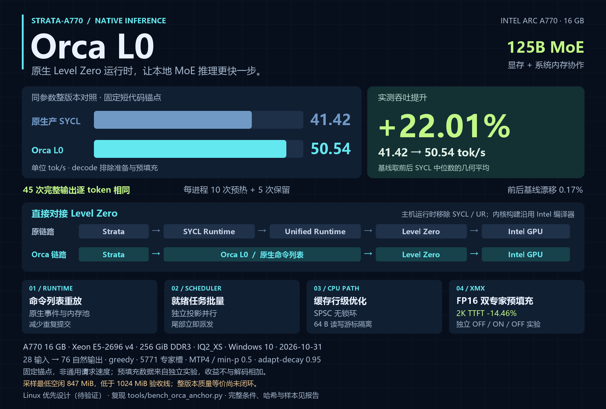

# Orca L0 仓库主图：同参数 41.42 → 50.54 tok/s

2026-10-31，Windows / Intel Arc A770 16 GB，在固定 Fibonacci 短代码请求上，原生产 SYCL → 当前 Orca L0 → 原生产 SYCL 的三个独立进程得到 **41.46 → 50.54 → 41.39 tok/s**。以两个 SYCL 中位数的几何平均 **41.4248 tok/s** 为基线，Orca 解码吞吐提升 **22.0090%**，前后基线耗时漂移 **0.1691%**。Orca 五次保留样本均超过 50 tok/s。

[](../../../docs/media/orca-l0-hero.svg)

这是**同参数整版本后端对照**：模型 CLI 参数、实际专家容量、输入和完整输出一致，原 SYCL 使用生产 EAGER 路径，Orca 使用命令列表重放及当前调度和内核实现。22.01% 包含这些差异，不能归为纯 Level Zero API 的独立收益，也不能与另行测出的预填充或参数调优收益相加。

## 测量结果

| 独立进程 | 保留样本中位数 tok/s | 五次保留样本范围 tok/s | 完整请求数 |
| --- | ---: | ---: | ---: |
| 原生产 SYCL，前臂 | 41.4598 | 41.0478～41.5187 | 15 |
| 当前 Orca L0 | **50.5420** | **50.3078～50.5925** | 15 |
| 原生产 SYCL，后臂 | 41.3898 | 41.1813～41.5210 | 15 |

每个进程连续发送同一请求十次预热，再保留五次；中间不插入其他输入。共 45 次请求、3420 个实际输出 tokens，全部 76-token 输出逐 token 一致、自然结束，草稿接受／提供均为 57／57，prompt reuse 为零，三个引擎均正常退出。摘要使用 `median(1000 * generated / decode_ms)`；配对基线为 `sqrt(SYCL_before * SYCL_after)`，吞吐变化为 `Orca / baseline - 1`。前后基线漂移以 decode 耗时之比计算。五次样本范围不是跨机器置信区间。

**计时只使用引擎 DONE 的 decode_ms**，排除模型加载、请求准备、预填充、分词、HTTP 与服务排队；十次预热也不进入摘要。`max_new=128`，实际自然输出为 76，不能按 128 计算吞吐。首次冷请求和混合请求不能套用这里的热态速度。

1 Hz 物理显存采样共 241 次，最低空闲 **847.4805 MiB**，**未通过此前 1024 MiB 余量线**；监视器退出码 1 与原始 `headroom_passed=false` 保留。性能测量完成、文件和 images 未改变、模块审计通过，与显存余量验收是分别记录的状态。本报告不是全面验收通过，也没有新 PPL 评分。历史 PPL 回退与整版本质量等价尚未闭环；相同短输出不能替代质量评估。

## 固定条件与版本身份

硬件为 A770 16 GB、Xeon E5-2696 v4、256 GiB DDR3、PCIe 3.0；Windows 10 22H2，Intel 驱动 **32.0.101.9034**，Intel oneAPI **2025.3**。模型为 Qwen3.8-Flash-Next 125B MoE IQ2_XS，FP16 KV，实际专家缓存 **5771 槽／7922 MiB**。

| 构建 | SHA256 |
| --- | --- |
| Orca `build-orca-default-pair-20261031/strata.exe` | `7be641375e905b0ceb64424ab4875afcdf9f7f6f1e2c60d6b0fcff4ece5ff4b5` |
| 原生产 SYCL `strata-unified-all-operators.exe` | `820d23e6771ced1ba18817b8863c9cb39413369d86b707d5156a7563f7bc56b3` |
| 初始专家 profile `data/expert-profile.bin` | `8f59b4aa8873209dff11c11e37bcda9529a1335b724a1afeea37bf6388975baf` |
| 固定输入／预期输出 fixture | `0c7d7a1436a5f412d5c552ff8950fe7117dd3c15dafd6d72672782c0c8dc0a62` |

全部 EXE、images 清单、配置、测试脚本和加载模块哈希，以及全部 45 次原始 DONE／输出，保留在[公开数据](../../../sycl/orca/anchor50-a770-windows-2026-10-31.json)。SYCL 进程真实加载 SYCL／UR，Orca 进程未加载 SYCL／UR／oneMKL 主机运行时。构建内核仍使用 Intel 编译器，设备驱动及其编译器仍然需要。

两个后端的 `args` 完全相同，后端环境分别保留在数据的 `runs[].config.env`。原 SYCL 有 `STRATA_VERIFY_EAGER=1` 和原编译选项；Orca 有 `STRATA_ORCA_READY_OPS=1`、`STRATA_PREFILL_FP16_PAIR=1` 等原生设置。不能把这些实现差异称为单一 API 消融。诊断时间戳代码后加在源码中，**不在本次测速的生产 EXE 中**。

## 同等条件复现

固定输入 IDs、完整预期输出 IDs、参数和预热协议由 [short-anchor-v1.json](../../../sycl/orca/short-anchor-v1.json) 定义。复测脚本会检查固定参数、运行时 5771 槽／verify6／MTP4、每次完整输出／草稿计数及模块依赖，保留全部预热与正式样本。脚本记录实际 EXE SHA，但不自动拒绝不同构建，**复测者需核对上述哈希**；换构建后应单独登记结果。

本机已保留独立 `strata-iq2_xs-anchor50.json`，日常主配置仍是平衡参数。安装生成的配置包含机器路径，被 git 忽略；其他机器先按[安装说明](../../../README.md#在-windows-上开始运行)生成本机 Orca 配置，再在仓库根目录执行以下 Python，生成单独的锚定配置：

```python
import json
from pathlib import Path

source = Path('strata-iq2_xs.json')
target = Path('strata-iq2_xs-anchor50.json')
cfg = json.loads(source.read_text(encoding='utf-8-sig'))
fixture = json.loads(Path('sycl/orca/short-anchor-v1.json').read_text(encoding='utf-8'))
assert cfg.get('backend') == 'orca', '需要安装生成的 Orca 配置'
args = cfg['args']
for key, value in fixture['parameters'].items():
    assert args.count(key) <= 1, key
    if key in args:
        args[args.index(key) + 1] = value
    else:
        args.extend([key, value])
for flag in fixture['required_flags']:
    if flag not in args:
        args.append(flag)
cfg['log'] = str(target.with_suffix('.log').resolve())
with target.open('x', encoding='utf-8') as out:
    json.dump(cfg, out, ensure_ascii=False, indent=2)
```

目标文件已存在时会停止，避免覆盖已有锚定配置；主配置不会被写入。保留同一模型／pack／MTP 目录、初始专家 profile 和后端环境；模型目录内容哈希未在本轮采集，不能据此承诺跨下载版本复现。公开数据含实测机器路径，其他机器需要替换路径并核对资产。相同 CLI 参数还需要匹配公开数据中的环境、实际容量、构建与预热历史。当前只在这一台机器复测，**没有跨机器、跨驱动或 Linux 的速度保证**。

离线检查及单后端复测：

```powershell
python -X utf8 tools/bench_orca_anchor.py --self-check
python -X utf8 tools/render_orca_hero.py --check-only
python -X utf8 tools/bench_orca_anchor.py --config strata-iq2_xs-anchor50.json --out build-anchor-50-repeat
```

`--out` 必须是新目录。正式测试通过共享 GPU 锁串行执行。可用 `--monitor <monitor.exe>` 保留 Sysman 1 Hz 物理显存采样；不传监视器的复测不能作为显存余量证据。

本轮实际 A/B/A 命令如下，依赖本机保留的原 SYCL 及独立配置。SYCL 配置来自历史生产备份，只在这个固定短请求上做对照；不是当前推荐的 SYCL 恢复配置，也不能用于宣称旧版本长请求问题已解决。

```powershell
python -X utf8 tools/bench_orca_anchor.py --config strata-iq2_xs-anchor50.json --baseline-config build-orca-default-pair-20261031/anchor50-sycl.json --monitor build-sycl-a770-cache6824-current-20261028/monitor.exe --out build-orca-default-pair-20261031/anchor50-sycl-orca-sycl
```

## 日常配置与锚定配置

| 参数 | 日常平衡 | 固定短代码锚点 |
| --- | --- | --- |
| `--expert-cache` | `auto`，随显存状态定容 | `5500`，本次实际 5771 槽 |
| `--short-read` | `1024` | `256` |
| `--adapt-decay` | `0.5` | `0.95` |
| `--spec-min-p` | `0.5` | `0.5` |
| 显存预留／context／prefill | 1536 MiB／8192／8192 | 1536 MiB／8192／8192 |

`--expert-cache 5500` 是历史槽位预算参数，不是 5500 MiB。其他固定参数以 fixture 为准，包括 PCIe fraction 0.16、adapt-every 1／swaps 32、MTP window 1024／hnorm stream、prompt-cache 0、stream-experts、prefill-borrow。

独立 Orca 参数 A/B/A 中，仅将 decay 0.5 → 0.95 → 0.5，得到 **47.78 → 50.67 → 47.73 tok/s**，配对提升 **6.11%**、前后基线耗时漂移 **0.10%**。另两次独立 decay0.95 进程为 **50.44、50.54 tok/s**。早期 45.13 → 50.44 → 47.78 的基线漂移约 5.9%，不用于声称稳定 12% 收益。

这项调参对其他提示没有普遍改善：Sky23／64 的 decay0.95 为 **38.83 tok/s**；日常完整配置连续重复为 **38.54 tok/s**，四场景混合请求仍保留[原表](orca-reserve1536-2026-10-31.md)的 24.34／28.15／24.58／28.83。50.54 不能替代这些不同分布的数据。历史 **48.94** 与 **42.99／43.13** 仍在[原实验](orca-regression-2026-10-31.md)，不与本次跨实验计算倍率。

## 主图中的优化亮点

- **运行时**：原生 Level Zero 设备／队列／事件／内存池与命令列表重放，编译期提取内核 ABI；移除 SYCL／UR 主机派发链，`orca-l0/` 可独立成库。
- **调度**：就绪任务批量、独立投影并行，尾部立即派发；这是算子调度，不代表默认开启多用户请求批量，也不承诺任意算子可自动改写为大矩阵。
- **CPU 路径**：Disruptor 风格 SPSC 环、64 B 缓存行隔离、缓存对端游标；不是完整 MPMC Disruptor，也不表示整个运行时完全无锁。
- **预填充**：XMX FP16 双专家独立 OFF／ON／OFF 实验中，Code2K TTFT **33.001 → 28.230 秒（−14.46%）**，Long8K **84.178 → 76.296 秒（−9.36%）**。已默认采用，单专家尾部回退保留；该实验与主图 decode 对照分别测量，收益不叠加。[证据与复现](orca-prefill-2026-10-31.md)。

后续重点是 Linux 编译与 GPU 验证、HC／专家访存和混合请求缓存策略。新的纯 decode 时间戳诊断已在 Windows A770 检查，但开启诊断会添加同步；不能用其运行速度替代正式测量。

[公开原始数据与补充实验](../../../sycl/orca/anchor50-a770-windows-2026-10-31.json) · [固定请求](../../../sycl/orca/short-anchor-v1.json) · [复测脚本](../../../tools/bench_orca_anchor.py) · [主图生成器](../../../tools/render_orca_hero.py)
