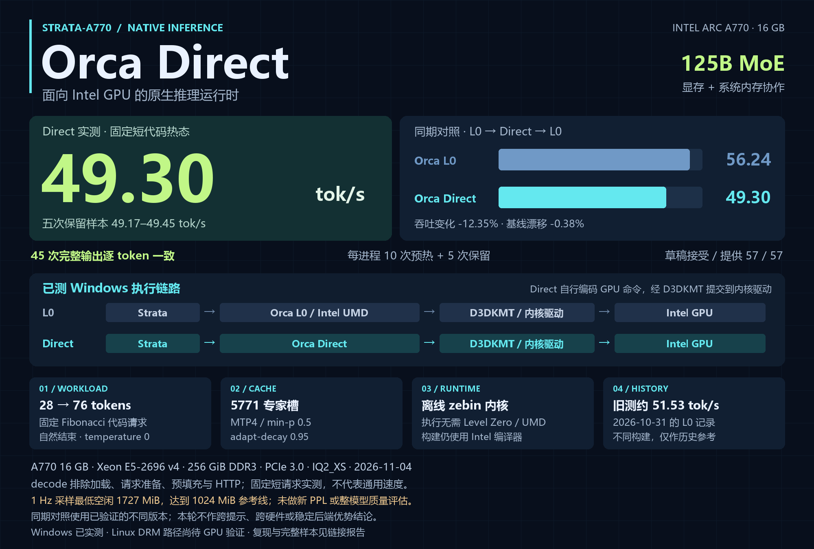

# Orca Direct：旧 51 tok/s 短代码协议复测

2026-11-04，在 Windows / Intel Arc A770 16 GB 上，以旧 51 tok/s 记录的固定输入、CLI 参数和预热协议复测已验证的 **Orca Direct** 版本。三个独立进程 **Orca L0 → Orca Direct → Orca L0** 得到 **56.13 → 49.30 → 56.35 tok/s**。前后 L0 中位数的几何平均为 **56.2402 tok/s**，Direct 本轮吞吐变化 **−12.3469%**，基线耗时漂移 **−0.3767%**。

Direct 的五次保留样本为 **49.17～49.45 tok/s**，本轮没有重现约 51 tok/s。旧 51.53 记录来自不同构建的 Level Zero／Intel 用户态驱动路径，不能将其改名为 Direct，也不能跨日期与本次计算配对收益。

后续[差距诊断](orca-direct-gap-2026-11-04.md)排除了回答缓存和定时器精度解释，将 MTP 的主要额外耗时定位到专家补入与草稿的调度干扰。诊断及候选均单独保留，本记录与主图不变。

[](../../../docs/media/orca-direct-hero.svg)

## 测量结果

| 独立进程 | decode 中位数 tok/s | 五次保留范围 tok/s | TTFT 中位数 ms |
| --- | ---: | ---: | ---: |
| Orca L0，前臂 | 56.1341 | 56.0018～56.2963 | 890.186 |
| Orca Direct | **49.2962** | **49.1687～49.4534** | 904.708 |
| Orca L0，后臂 | 56.3464 | 56.0513～56.4552 | 890.221 |

每个新进程连续请求同一输入，十次预热后保留五次。共 **45 次请求、15 个保留样本、3420 个实际输出 tokens**；每次均为 28-token 输入、76-token 完整自然输出，草稿接受／提供 57／57，prompt reuse 和 resume 均为零，全部进程正常退出。所有预热和保留样本都检查完整 token 序列。

摘要取 `median(1000 * generated / decode_ms)`；L0 参考值为 `sqrt(L0_before * L0_after)`，吞吐变化为 `Direct / reference - 1`，基线耗时漂移为 `L0_before_rate / L0_after_rate - 1`。计时采用引擎 DONE 的 `decode_ms`，排除模型加载、请求准备、预填充、分词、HTTP 和服务排队。TTFT 为协议首个 token 的主机观察值，单列记录，不并入 decode。

这是**本机已验证版本对照**。两个程序使用相同 CLI 参数和内核包，但包含不同的主机实现；不能将差值归因于单一 Level Zero API 层。单台机器、未锁定 GPU 时钟、一组 A/B/A；样本范围不是跨进程或跨机器置信区间。

## 固定条件与构建身份

A770 16 GB、Xeon E5-2696 v4、256 GiB DDR3、PCIe 3.0 x16、Windows 10 22H2、Intel 驱动 32.0.101.9034；模型为 Qwen3.8-Flash-Next IQ2_XS。FP16 KV，实际专家缓存 **5771 槽／7922 MiB**，context／prefill 8192，显存预留 1536 MiB，MTP4／`spec-min-p=0.5`，`short-read=256`，`adapt-decay=0.95`，PCIe fraction 0.16。

输入、完整预期输出、CLI 和协议继续使用 [short-anchor-v1.json](../../../sycl/orca/short-anchor-v1.json)。本次显式设置 `STRATA_MTP_CUM_MIN_P=0`、`STRATA_MTP_LAST_MIN_P=0.5` 和 `STRATA_WARM_GRAPHS=1`。旧配置中未使用的 `STRATA_MTP_LAST_DRAFT_MIN_P` 拼写被移除。本机日常配置仍为累计／末草稿阈值 0.5／0.5、自动缓存、`short-read=1024`、`adapt-decay=0.5`；本测试不是这些日常参数的吞吐测量，也不读取或保存学习 profile。

| 资产 | SHA256 |
| --- | --- |
| Direct `build-orca-lease-pool-20261103/native.exe` | `2b6018e3687de6dba6354c561a704d101ab94a3ec0c1ffda4545bb7ba94b89e4` |
| L0 `build-orca-accepted-20261103/l0.exe` | `46ef6400622c9cd88498df03dff4ea0b316e1f3fbab4beb5c0670a80ca9ecdfa` |
| 原始专家 profile `data/expert-profile.bin` | `8f59b4aa8873209dff11c11e37bcda9529a1335b724a1afeea37bf6388975baf` |
| 固定 fixture | `0c7d7a1436a5f412d5c552ff8950fe7117dd3c15dafd6d72672782c0c8dc0a62` |

程序来自已验证的[运行时池采用记录](native-lease-pool-2026-11-03.json)及[已验证配置记录](accepted-configurations-2026-11-03.json)，没有重建整个当前工作区或混入未采用试验。共用 `build-orca-accepted-20261103/images`，全部 **1341 个文件**的 SHA256 在前后保持一致；Direct 另使用固定 `memory.zebin`。模型／GGUF／pack 内容没有重新计算全量哈希，路径和完整配置保留在公开数据中。

启动及负载结束的模块审计均通过：L0 实际加载 `ze_loader.dll`、`ze_intel_gpu64.dll` 及 Intel 用户态编译组件；Direct 未加载 Level Zero、Intel GPU 用户态驱动／编译器、SYCL、UR、oneMKL 或 OpenCL 运行库。Direct 执行依靠 Windows 内核驱动与 D3DKMT，离线生成内核仍需 Intel 编译器，不能描述成“无需驱动”。

1 Hz 独立显存采样共 **228 次**，整组最低空闲 **1727.434 MiB**，达到 1024 MiB 参考线；采样间隔仍可能遗漏更短低点。监视器由测试脚本显式终止，退出码 1 保留在原始数据中。主配置、两份后端配置和原始专家 profile 的哈希全部不变。

本次只验证固定输出一致，没有新 PPL 或整模型质量等价结论；没有 Linux GPU 测量。Linux 构建和 CPU 检查属于其他报告的覆盖范围，不与本次 Windows 吞吐混用。

## 复现与离线核对

[完整公开数据](../../../sycl/orca/direct-anchor-a770-windows-2026-11-04.json)包含三臂全部 token／DONE／耗时、配置、运行库清单、EXE／内核包／脚本／原始日志哈希和物理显存摘要。原始日志保留在 `build-orca-direct-anchor-20261104/l0-direct-l0/`，冻结测试脚本保留在其上级实验目录。

本机独立配置命令如下；输出目录必须未存在，正式测试使用共享 GPU 锁。其他机器需先准备对应程序、匹配的离线 zebin 内核及模型路径，再根据公开数据的 `runs[].config` 生成独立配置，不能直接照抄机器路径。

```powershell
python -X utf8 tools/bench_orca_anchor.py --self-check
python -X utf8 tools/bench_orca_anchor.py --config build-orca-direct-anchor-20261104/direct.json --runtime direct --baseline-config build-orca-direct-anchor-20261104/l0.json --baseline-runtime l0 --monitor build-sycl-a770-cache6824-current-20261028/monitor.exe --out build-orca-direct-anchor-20261104/l0-direct-l0-repeat
python -X utf8 tools/render_orca_hero.py --direct --check-only
python -X utf8 tools/render_orca_hero.py --direct
```

历史 [50.54 主图实验](orca-anchor50-2026-10-31.md)和 [51.53 Level Zero／DDI 实验](../../../orca-l0/demo/native-windows-2026-10-31.json)保持各自原始名称、参数、结果与边界。
