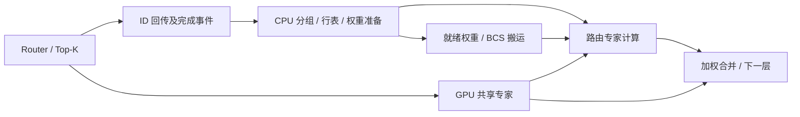

# Orca：共享专家计算期间，提前准备路由专家

2026-11-04，Windows 10 22H2，Intel Arc A770 16 GB，驱动 `32.0.101.9034`，oneAPI 2025.3。

现有 PLE 双缓冲和 Stager 已提前读取已知数据。本轮进一步拆开预填充 MoE 的等待点：
原先在共享专家之后回传路由 ID，再等待整条计算队列；候选将 ID 回传移到路由之后，
先提交独立的共享专家，再仅等待更早的 ID 回传事件。CPU 随后能分组、生成行表、安排专家 staging，
这些准备无需等待共享专家的输出。专家数学、行顺序、最终合并及跨层依赖保持原样。



这里仍使用同一条有序计算队列；没有宣称共享与路由专家在多个物理计算引擎上同时运行。
提前进行的是 CPU 准备及可用的复制工作。缓冲区仍等待最后读者释放，不能提前覆盖。
路由未知前不能准备对应的精确路由计划。fused 路径保持原来的 GPU 分组，不额外回传 ID；
打开旧 profiling 时仍保留整队列等待，避免读取未完成的诊断标记。

## 先校验事件与所有权

每个后端只重编一个 prefill Host TU，复用其它 Host 对象、运行时和相同数学 pack。
单独检查在回传之后故意阻塞 GPU 的共享尾部，先等回传事件：验证 CPU 已收到完整数据并生成计划，
共享尾部此时仍未完成；随后解除阻塞，再验证 GPU 输出。Direct／L0 各通过 24 组，
包含 pageable staging 和映射 host 两种目标，共 **48 组**。
这证明该事件边界允许提前准备；它不是实测的整模型引擎利用率时间线。

测试端也将准备前移：从缓存结果读取 token 输入、精确输出参考和两套配置，
用 `--prepare` 在等 GPU 锁时先生成小型 CPU 准备文件；正式测试复用并核对它。
模型运行、编译和重度归档依旧持有共享 GPU 锁。

## 整模型开／关对照

顺序为 **Direct 关 → Direct 开 → Direct 关 → L0 开**。Direct 三组使用同一个 EXE、数学 pack、
模型与参数，只切换 `STRATA_PREFILL_EARLY_ROUTE=0/1`；L0 开启组仅作输出安全检查，**不参与性能比较**。
每进程 15 次 Short（丢弃前 10 次，保留 5 次），随后 2K／8K 各一次；共 **68 次请求**的完整 tokens、
generated、accepted/offered、reuse/resume 和 finish 全部匹配。
长请求各进程只有一次，尚未建立稳态、跨日重复性或新的 PPL 结论，也不关闭原有 Direct 8K 间歇异常。

下表使用每进程保留样本的中位数，两侧关控制取几何均值；百分比为“开／关 − 1”。
负的耗时变化代表更短，正的 decode 吞吐变化代表更快。decode 使用引擎的净 decode 时间，排除初始化、准备与预填充。

| 输入 | Prefill ms：关／开／关 | Prefill 变化 | TTFT ms：关／开／关 | TTFT 变化 | 净 decode tok/s：关／开／关 | decode 变化 | 关漂移：Prefill／decode |
| --- | ---: | ---: | ---: | ---: | ---: | ---: | ---: |
| Short28 | 911.400／909.100／913.800 | -0.383% | 952.685／947.758／952.070 | -0.485% | 57.031／56.835／56.963 | -0.284% | +0.263%／-0.120% |
| Code2K | 23869.000／24038.500／24009.200 | +0.416% | 23921.890／24093.802／24062.861 | +0.423% | 18.716／18.637／18.481 | +0.211% | +0.587%／-1.259% |
| Long8K | 70348.200／69936.700／69898.500 | -0.266% | 70404.980／69992.407／69953.779 | -0.266% | 18.549／18.563／18.652 | -0.205% | -0.639%／+0.557% |

这些是该有限请求历史下的观察，应同时看控制漂移，不能把单轮小幅变化当作稳定收益。
该试验仍隔离保留，默认策略没有改变；这不是 Direct 对 L0 的性能胜负对照，
也不能把它与此前依赖合并、BCS、M16 pair 的收益直接相加。

## 条件和复现

固定实际 5,771 专家槽、reserve1,536MiB、read256、decay0.95、margin1.5、MTP4、step/last min-p0.5、
cumulative0、suffix0、cost-window0、prompt-cache0，无前缀复用。数学 pack 为既有 M16 双专家版本，通用 FP16 仍为 M4。
生产 EXE 和配置未替换；Linux GPU 尚未校验，Orca L0 仍为推荐路径。

```powershell
python -X utf8 build-orca-slm-async-20261104/early_route_build.py --verify
python -X utf8 build-orca-slm-async-20261104/early_route_contexts.py r1 --verify
python -X utf8 build-orca-slm-async-20261104/publish_early_route.py --check
```

新的测试选择未存在的 r2 等目录，先执行 `early_route_contexts.py r2 --prepare`，再执行 `early_route_contexts.py r2`。
既有成功与失败产物均不覆盖。同条件复现需要相同模型、冻结 EXE／数学模块、驱动、初始 profile、参数及请求历史。
归档保留补丁、原始生成源、构建／链接命令、CPU 准备文件、完整协议、所有请求和 SHA-256；不分发模型／EXE。

[精确 JSON](../../../sycl/orca/direct-early-route-a770-windows-2026-11-04.json) ·
原始证据 (`direct-early-route-a770-windows-2026-11-04.json.gz`, raw capture retained locally)
