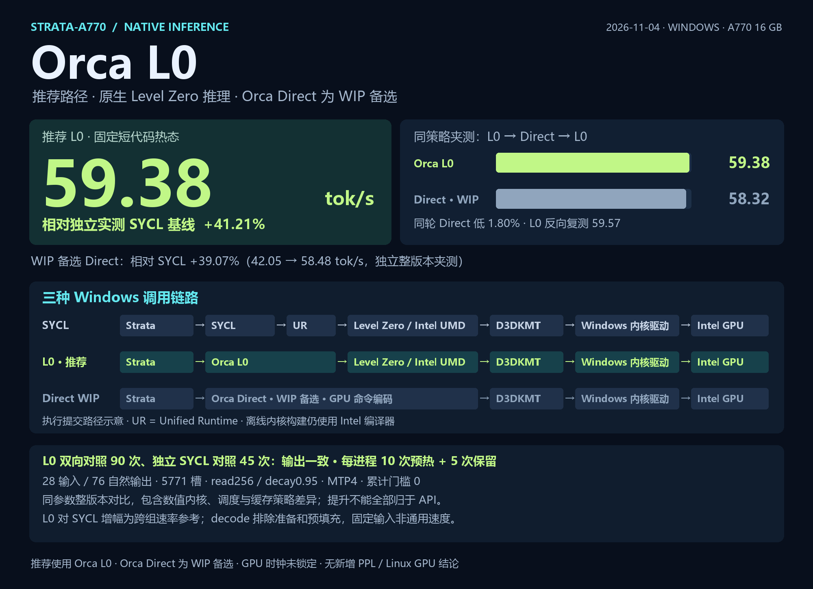

# Orca Direct（WIP／备选）对原生产 SYCL：42.05 → 58.48 tok/s（+39.07%）

**当前推荐 Orca L0，Direct 标为 WIP／备选。** 同策略双向对照中的 L0 为 **59.38／59.57 tok/s**，
高于各自同期 Direct。下列 Direct／SYCL 测量保留其独立身份。

2026-11-04，Windows 10 22H2，Intel Arc A770 16 GB，驱动 `32.0.101.9034`。
固定短代码请求的 SYCL／Direct／SYCL 三个独立进程得到 **41.8502／58.4840／42.2598 tok/s**。
以两侧 SYCL 中位数的几何均值 **42.0545 tok/s** 为基线，Direct 吞吐提升 **39.0672%**，
SYCL 前后耗时漂移 **−0.9692%**。

[](../../../docs/media/orca-direct-optimization.svg)

图中 L0 **59.3843 tok/s** 相对本轮独立 SYCL 基线 **42.0545 tok/s** 的速率增幅为
`100 × (59.3842934775 / 42.0545047811 − 1)`，即 **41.2079%**。
两项来自同机、相同 CLI／MTP 设置和固定输入的不同测量组，**这是跨组速率参考，不是 L0／SYCL 同期夹测**。
L0 的原始数据来自[空闲双向对照](orca-direct-idle-audit-2026-11-04.md)，图表生成器从两份原始数据重新计算该比例。

## 本轮测量

| 独立进程 | decode 中位数 tok/s | 五次保留范围 tok/s |
| --- | ---: | ---: |
| 原生产 SYCL，前侧 | 41.8502 | 41.4034–42.0819 |
| 当前完整重建 Direct | **58.4840** | 58.1796–58.6963 |
| 原生产 SYCL，后侧 | 42.2598 | 41.9611–42.3682 |

每个进程连续发送同一输入，丢弃十次预热、保留五次。全部 **45 次请求、3420 个输出 token**
逐次匹配：28-token 输入、76-token 自然输出、57／57 草稿、`stop`、`reused=resume=0`；进程正常退出。
decode 取引擎 DONE 的净解码时间，排除加载、初始化、图准备、预填充、HTTP 和排队。
GPU 时钟未锁定，样本范围和基线漂移不是置信区间。

两边 CLI 完全相同：实际 **5771 专家槽／7922 MiB**、预留 1536 MiB、FP16 KV、
context／prefill 8192、MTP4、step／last min-p 0.5、累计门槛 0、
`short-read=256`、`adapt-decay=0.95`、`prompt-cache=0`。
两边显式设置相同的累计／末草稿门槛与 `STRATA_WARM_GRAPHS=1`，移除旧配置中已废弃的末草稿键。
固定初始专家 profile，不读取或保存新的学习 profile。

SYCL 使用原生产 EAGER 构建，Direct 使用[完整前端重建后的同策略候选](orca-direct-current-frontend-2026-11-04.md)。
**这是同 CLI／MTP 设置的整版本对照**，包含数值内核、调度、命令重放和专家缓存替换策略差异，
不能把 39.07% 全部解释为移除某一 API 的收益，也不代表日常参数、随机输入或长上下文的速度。
新图中的 L0 数字来自[另一组双向复测](orca-direct-idle-audit-2026-11-04.md)，不与本轮拼接收益。

## 三种 Windows 调用链路

图中画的是本机选用 Level Zero 的 SYCL 执行提交路径：

- **SYCL**：Strata → SYCL → Unified Runtime（UR）→ Level Zero／Intel 用户态驱动 → D3DKMT → Windows 内核驱动 → GPU。
- **Orca L0**：Strata → Orca L0 → Level Zero／Intel 用户态驱动 → D3DKMT → Windows 内核驱动 → GPU。
- **Orca Direct**：Strata → Orca Direct 自行编码 GPU 命令 → D3DKMT → Windows 内核驱动 → GPU。

这三条链路都需要 Windows 内核驱动。Direct 负载启动及结束的模块审计确认没有加载
SYCL、UR、Level Zero 或 Intel GPU 用户态运行库；SYCL 进程实际加载了 SYCL、UR 和 Level Zero。
离线构建 Direct 内核仍使用 Intel 编译器；链路层数不构成独立的性能因果证明。

## 数据和复现

[公开数据](../../../sycl/orca/direct-vs-sycl-a770-windows-2026-11-04.json)包含全部请求、实际配置、EXE／
内核包／profile 哈希、加载模块和原始日志，以及测量脚本与配置的字节归档。
Direct 使用与前述完整前端检查匹配的数值包；SYCL 使用原生产 EXE 内的数值实现。
GGUF 和权重 pack 保留路径，本轮没有重新计算全部模型内容的哈希。
生产配置、已部署 EXE 和初始 profile 均未修改；没有新增 PPL、通用质量等价或 Linux GPU 结论。

本机复测使用同样的 EXE、外部资产、配置、容量和预热协议，输出目录必须尚不存在：

```powershell
python -X utf8 tools/bench_orca_anchor.py --config build-orca-direct-sycl-20261104/direct.json --runtime direct --baseline-config build-orca-direct-sycl-20261104/sycl.json --baseline-runtime sycl --out build-orca-direct-sycl-repeat
```

公开数据的 `runs[0].config` 和 `runs[1].config` 分别保存上述 SYCL 与 Direct 配置；
其他机器需要重建匹配版本并映射本机路径。测量使用共享 GPU 锁串行执行，编译在计时前结束。
本机离线核对数据与原始证据、重画 PNG／SVG：

```powershell
python -X utf8 build-orca-direct-sycl-20261104/publish.py --check
python -X utf8 tools/render_orca_optimization.py --check-only
python -X utf8 tools/render_orca_optimization.py
```
