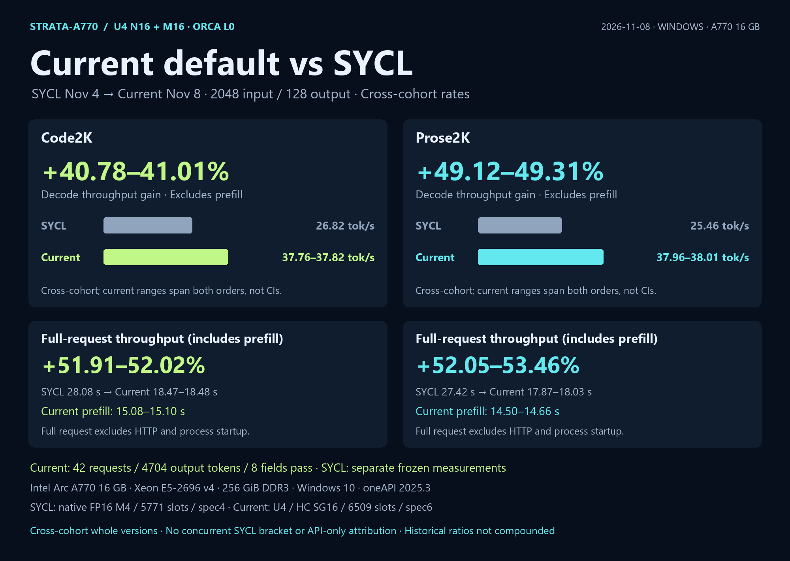
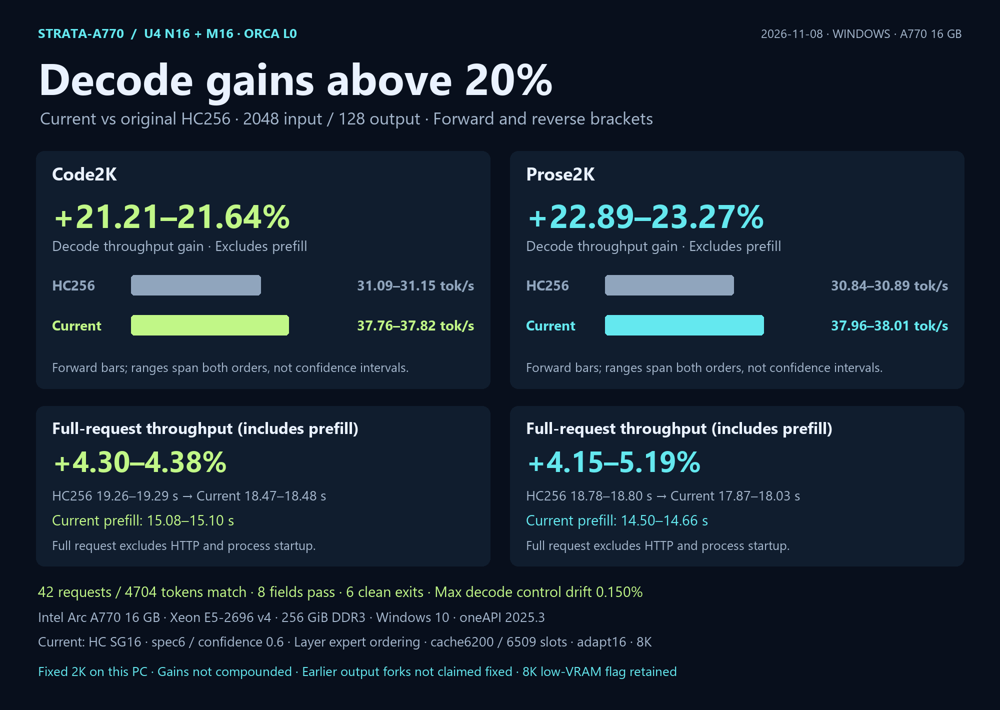
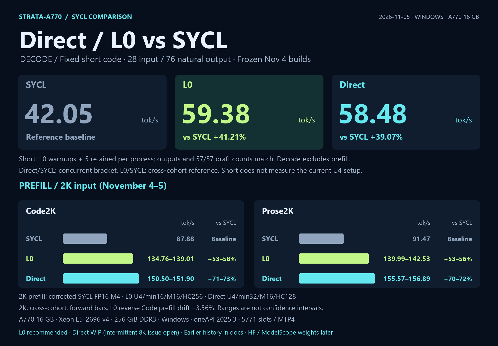

# A770 性能记录：结果、方法与证据

**11-08 提前提交 commit 尚无性能结论：** 候选的可逆补丁、依赖顺序、错误路径检查及单 Host 单元编译通过，但只运行到未改的基线：首个 Code2K 的 128 输出／八字段一致，prefill 474695.8ms、decode 21997.0ms；第二个请求被预设 600 秒看门狗终止，候选 GPU 请求为 0。一次等待栈落在反量化 `parallel_for→iq_dequant_f16→Prefill::run`，Owner 采样于 `WaitOnAddress`；非原子线程快照不能证明死锁或根因。独立冻结 CPU 探针 2112 项通过，空闲后 worker 中位 23.00–26.85µs，未见同量级异常。失败及所有计时单独保留，不计正常吞吐、不改变默认。[终止记录、栈证据及 CPU 复核](../bench/results/a770/orca-direct-early-commit-2026-11-08.md)。

**11-08 适应任务复用执行器未通过双向性能门：** 只重编请求入口一个Host单元，以`std::async`及两处`get`替换每窗口线程启动／join；CPU实测256次任务复用线程及TLS，未自建线程池。原生内部正／反序共102请求／7836输出及八字段全部一致、退出0，Short吞吐为 **+0.377%／−1.097%**，decode控制漂移−0.368%／+2.100%；TTFT耗时+0.207%／+1.159%、整请求−0.181%／+1.101%。漂移与质量检查通过，双向收益门失败，不追加取好样本、不采用。两侧保留相同的关闭ETW诊断代码；独立5243槽配置，不是L0对照或5771槽锚定成绩。线程复用成立，模型收益未成立；默认L0与Linux待测状态保持。[完整六窗口、负控与归档复核](../bench/results/a770/orca-direct-adapt-future-2026-11-08.md)。

**11-08 等待之外的Host阶段归属：** 仅重编请求入口一个Host单元，36请求／2868输出及八字段全部匹配、追踪零丢失，控制decode漂移0.356%。带阶段追踪的29个窗口中，Owner及全部wait之外的GPU／队列空隙共7.018ms：验证后路由计数／接受判断／适应线程准备占3.460ms，验证调用内1.657ms，收尾1.084ms。当前配置每窗口都创建适应线程，是下一项隔离候选，尚未证明其单独成本。两个活动context均为计算节点；verify内DMA只见一个，draft阶段出现另一个，并非“计算＋复制”。CPU阶段可覆盖异步工作，分区不等于可回收收益；独立5243槽诊断不改默认。[完整阶段、等待与context对应](../bench/results/a770/orca-direct-decode-stages-2026-11-08.md)。

**11-08 完成等待定位：** 独立5243槽Direct三窗口诊断，36请求／2868输出及八字段全部匹配，追踪零丢失。带追踪decode实际进入`NativeCompletion::wait`128次、注册99次、OS等待101次；`wait_sequence`及`wait_fence`均未进入。两次OS超时来自正常50ms等待切片，不是请求失败。Owner之外且无DMA／未完成队列包的17.086ms中，9.434ms位于OS等待内、0.326ms在其它完成等待代码、7.326ms在已标记等待之外。OS等待总时长包含GPU工作，不能当作唤醒延迟或可回收收益；控制窗口存在约3.8%漂移，本轮不作速度结论、不改默认。后续优先查实际completion通知路径及等待之外的工作。[完整配对、分区与复核](../bench/results/a770/orca-direct-wait-trace-2026-11-08.md)。

**11-08 真实decode Owner交接：** Direct内部三窗口对照，36请求／2868输出一致、追踪零丢失。带追踪decode中实际只有128次跨线程交接，均来自同一Owner的replay调用点；发布到执行中位48.10µs、结束到返回23.05µs，两个交接区间合计9.403ms。其中与“无DMA且无未完成队列包”重叠4.897ms；该空隙共17.902ms，另2.176ms在Owner任务本体，10.829ms在Owner区间之外。三个Direct窗口均涉及两个活动GPU context。这定位了交接的范围，未证明可回收收益或剩余空隙的根因；CPU微测试不能直接外推，也没有采用CallerOwner。独立5243槽诊断，不是L0对照或正常测速，默认及Linux待测状态保持。[完整事件、失败记录与复核](../bench/results/a770/orca-direct-owner-handoff-2026-11-08.md)。

**11-08 空闲后Owner交接CPU诊断：** 六个交替worker／caller窗口，2112次返回值／owner作用域检查通过，完整保留192次预热和1920次正式样本。实际空闲约16／31–32／63ms后，worker交接中位22.55–52.05µs，caller直接执行1.60–3.10µs；连续热调用分别0.90–1.50／0.20µs。这里没有模型或GPU请求，不能用单次差值乘DMA空隙数解释模型差距；先前CallerOwner整模型实验未建立稳定收益，默认保持。[全部窗口、真实睡眠及原始样本](../bench/results/a770/orca-direct-owner-idle-2026-11-08.md)。

**11-08 decode阶段ETW拆分：** 在原d0／decode_ms语句两侧仅增加两个Host阶段标记，数学／运行时对象复用，97个实际编译工作区头文件核对通过。36请求／2868输出全部一致，零追踪丢失，标记区间与原计时最大相差0.051ms；两端decode均128个DMA段。相对两侧L0算术均值，Direct decode多25.823ms：DMA区间内多14.551ms、区间间空隙多11.272ms；无DMA且无未完成队列包为14.089ms，L0为2.867／2.483ms，有未完成队列包时的空隙接近。这把准备／prefill与decode分开，但未证明具体Host交接、锁、context或kernel为根因；仍为独立5243槽带追踪诊断，不是正常提速成绩。默认和生产保持，Linux GPU待测。[原始阶段事件、完整配对、失败及复核](../bench/results/a770/orca-direct-etw-phases-2026-11-08.md)。

**11-08 Short整请求ETW定位：** matched-L0／Direct／matched-L0共36请求／2868输出全部匹配，三份追踪零事件／缓冲丢失，完整提交／DMA配对通过。Direct的work DMA段153个，L0为240个；提交到首次DMA等待中位数35.2µs，L0为64.15／71.55µs，但本进程无DMA空隙22.478ms，L0为10.299／11.316ms。尚不支持“Direct主要慢在驱动排队”的解释；整请求包含准备／prefill，仍需阶段归属，不能据此宣称净decode根因或正常提速。沿用独立5243槽诊断条件，默认和生产保留。[完整事件与边界](../bench/results/a770/orca-direct-etw-scheduler-2026-11-08.md)；[JSON数字键复核勘误](../bench/results/a770/orca-direct-etw-scheduler-check-2026-11-08.md)，正确离线命令为`python -X utf8 build-orca-etw-scheduler-20261108/check.py`，原失败和全部样本保留。

**11-08 相同Q2准入源码诊断：** 60请求／4780输出全部匹配，实际5243槽／7201MiB；统一cache预算5000、关闭短提示热度准备、reserve1536保留，与原5771槽及当前spec6生产成绩分开。新L0的完整Verifier／shared-expert源码文本与Direct相同；Short为old-L0 50.505、新L0 50.822、Direct 49.918 tok/s，新准入+0.628%，Direct相对新L0仍−1.779%。两种L0控制漂移均通过3%门；仅一个预设嵌套顺序，无独立反序，没有生产采用。其它适配层及完整动态工作尚未证明一致，不能把差值归因于API／锁。[全部条件与原始协议](../bench/results/a770/orca-direct-policy-parity-2026-11-08.md)。

**11-08 完整窗口回放通过功能检查：** 仅恢复PLE的首次诊断在QSA状态检查处拒绝；完整恢复PLE／QSA／GDN的5771槽尝试随后在READY实际5757槽、0条GEN处停止，两个失败保留。复用已编译程序另做功能验证，L0／Direct实际5748／5771槽；20条Short／1400输出全部匹配，20次额外真实T4窗口回放的完整GDN／QSA状态、PLE历史、历史快照、全部logits和采样ID均逐字节一致。全状态恢复和回读会改变缓存，且容量不满足原同条件对照；没有新的速度结论、生产采用或Short根因判断，Linux GPU仍待测。[完整条件、失败与原始协议](../bench/results/a770/orca-direct-whole-window-functional-2026-11-08.md)。

**11-08 当前合格运行时对照：** 复用通过19项检查、与已采用源码一致的纯Direct对象，L0使用全局驻留统计修正版；保持原HC128／MTP4／min-p0.5／reserve1536及14请求历史，不带内存审计包装和新增GPU计时。84请求／7272输出全部匹配；Direct相对L0的Short decode吞吐-1.686%／-2.058%，重复8K为-0.442%／+0.466%。Short TTFT耗时-9.732%／-10.186%，整请求耗时-2.215%／-2.147%。质量、容量和控制漂移门通过，无回退门未通过。首轮因遗漏oneAPI链接环境而缺少libircmt.lib，在任何GPU请求前停止；本轮仅修正该环境并保留首轮。与当前spec6生产参数分开；部署／推荐L0及Linux GPU待测状态保留。[完整条件、原始协议与归档](../bench/results/a770/orca-direct-qualified-contexts-r2-2026-11-08.md)。离线复核使用`python -X utf8 build-orca-qualified-contexts-r2-20261108/publish.py check`；原报告复制的命令指向首次失败目录，以此勘误，原始证据保留。

**11-08 当前运行时对照的首次链接失败：** 因遗漏已有oneAPI链接环境而缺少libircmt.lib，保留失败`AssertionError(('link', 1104))`；未启动引擎、0条GPU请求，没有进入容量、数值或性能检查。首次报告的泛用门槛描述不适用于这一实际错误；失败和归档完整保留。[首次记录](../bench/results/a770/orca-direct-qualified-contexts-2026-11-08.md)。

**11-08 当前默认对原HC256再次复测，双向达到20%：** 同机A770／Windows、当前层内profile／spec6／0.6、6200预算／6509槽及8K配置保持，另建新目录完成正／反序各21请求。Code2K decode吞吐为 **+21.642%／+21.212%**，Prose2K为 **+23.267%／+22.889%**；最大绝对控制decode漂移 **0.150%**，全部42请求／4704输出、8字段、来源及独立原始协议复核通过，六个引擎退出0。整请求吞吐分别为Code **+4.379%／+4.299%**、Prose **+5.191%／+4.154%**，与decode分开报告。本轮固定2K输入／128输出的双场景20%目标通过，默认未改；旧轮次和Prose分叉证据保留，未隔离耗时变化原因，也不宣称旧分叉已修复。原8K低余量标记保留。[完整双向计时与范围](../bench/results/a770/orca-mtp-confidence40x40-2026-11-07.md#11-08-再次复测当前默认对原hc256双向达到20)。

**11-08 Direct 大窗口优先录图：** 仅倒序既有录图循环，冻结HC128／MTP4／min-p0.5／reserve1536，线程池344→332MiB，避免分配12MiB；两块旧private池仍占98.25MiB。八条完整模型请求／850输出及另12条同5771槽Short／840输出，全部token、8字段和独立原始协议复核通过。Short正序decode吞吐表观−0.213%，两端decode耗时漂移+0.780%；幅度可能是噪声，未建立提速，按预先条件不反序、不重试、不采用。没有新的Direct／L0速度或PPL结论；部署和默认保持，Linux GPU待测。[完整表、门槛与原始协议](../bench/results/a770/orca-direct-warm-order-2026-11-08.md)。

**11-08 Prose两次旧分叉与最小分差位置对应：** 同机部署引擎另测Short／Code／Prose共3请求／272输出、全部8字段及独立协议复核通过，退出0；仅Prose开启已有top2 logprob读回。当前匹配输出的128个位置中，39／69前两名分差最小，分别0.016649／0.020220；两次旧默认失败在相同输入、相同此前缀下，分别选中了本次分布的第二名ID2144／9166，旧原始协议及冻结哈希已交叉复核。失败当时没有logits记录，不能据此判定原因或修复；读回改变同步，没有新增速度或采用结论。[完整分差及范围](../bench/results/a770/orca-mtp-confidence40x40-2026-11-07.md#11-08-部署引擎prose前两名分差与历史分叉复核)。

**11-08 默认逐层路由复核完成：** 同机A770／Windows、当前0.6／层内profile／spec6及6509槽，隔离Host构建仅在既有同步点写出完整prefill路由ID，未增加GPU读回／等待或改变数学／images。ready开／关／开21请求／2352输出、全部8字段及独立协议复核通过，三个引擎均退出0；18个长请求共864份逐层记录、17,686,080个ID按任务全部一致，三个路由文件逐字节相同。此前token39失败没有逐层记录，ID相同也不能证明激活／logits相同；此次未复现不等于修复，没有新增速度或默认采用结论，20%目标保持。[完整范围及复核](../bench/results/a770/orca-mtp-confidence40x40-2026-11-07.md#11-08-逐层prefill路由诊断)。

**11-08 Direct／L0 核间同步追踪：** 离线逐条核对并追完L0的129次batch链跳转；32次up尾部在捕获边界后仍有两条PIPE_CONTROL，同提交norm路径也仍有CS stall。边界前没有屏障不代表提交内没有等待。Direct多出的尾部普通屏障已在旧版完整试验中移除过，未建立收益，本轮不重复。七项损坏／不支持路径负控及精确归档检查通过；未运行GPU、改运行时／默认或新增速度结论。[完整路径与原始证据](../bench/results/a770/orca-direct-hc-ordering-paths-2026-11-08.md)。

**11-08 固定三条目GU对照失败，另测默认21请求全部匹配：** 同机A770／Windows、当前0.6／层内profile／spec6，仅为IQ2_S GU增加固定3条目尾项，替代2＋1权重解码。20进程原生完整链及7请求／784输出资格通过，SG16／128GRF／零spill保持，指令段61,824→75,200字节。正式完成17请求／1840输出后，末尾默认控制组Prose从第39个token分叉，69个token不同，接受／提供64／72而非58／66；候选7请求全部匹配，三个引擎均退出0，无崩溃。独立原始协议与失败后锁内来源复核通过；没有有效性能结论、不反序、不采用。随后当前默认ready开／关／开诊断完成21请求／2352输出，全部8字段及独立协议复核通过，三个引擎均退出0，来源保持；此次未复现不代表已修复，也不恢复GU3性能结论。失败Prose的prefill工作计数与本次九个Prose不同，仍仅为排查线索。默认与20%目标保持。[失败证据及诊断结果](../bench/results/a770/orca-mtp-confidence40x40-2026-11-07.md#11-08-固定三条目gu正式对照默认prose第39个token分叉)。

**11-08 Direct 安全回收旧线程池：** 显式 `Runtime::trim_thread_memory()` 保护所有队列当前绑定及录图引用，仅在空闲健康且活动录制为空、打开时回收旧池。Host／本地GPU两种生命周期检查、原19项CTest，以及冻结HC128／MTP4／min-p0.5／reserve1536的八条整模型完整输出与8协议字段全部通过；重录后精确回收 **73.5MiB**，线程池344→270.625MiB、描述面0.25→0.125MiB，仍被旧图引用的49.125MiB保留。实际5707槽，不通过原5771槽性能条件，没有新速度或PPL结论。首轮Host对齐预期及首次链接目录失败保留；Linux编译／CPU检查通过，GPU待测。重录和模型自动回收未默认开启，部署EXE及参数保留。[完整检查、原始协议及归档](../bench/results/a770/orca-direct-thread-trim-2026-11-08.md)。

**11-08 按用户要求复测同大小专家跨层缓存排序：** 同机A770／Windows、同一候选及当前默认，新正序21请求／2352输出、全部8字段、原始协议独立复核及三个引擎退出0均通过，无崩溃。Code／Prose decode吞吐为 **−0.303%／+0.156%**，两端耗时漂移 **+0.355%／+1.305%**；本轮漂移合格，但收益未达0.2%／0.5%，不反序、不采用。热态prefill两端约25.09／24.56秒与25.09／24.71秒，未重现上轮约70秒的热态耗时；不能据此认定此前变化原因。旧失败记录保留，默认6200／adapt16／8K、U4N16及回退保持，原HC256双场景20%目标仍未完成。[复测数据与证据](../bench/results/a770/orca-mtp-confidence40x40-2026-11-07.md#11-08-用户要求复测同字节类别缓存排序)。

**11-08 Direct 线程池引用核查：** 重录前八池344MiB全部被录图保留，其中当前绑定221.5MiB、旧池122.5MiB，不能直接释放。另一次READY重录观察使旧池0／2／3共73.375MiB不再有队列绑定或录图引用，旧池5的49.125MiB仍被引用；尚未回收，总量仍344MiB。两次实际5413／5586槽，无GEN，不通过原5771槽性能条件，也没有新速度结论；此前只重录未建立稳定收益，默认不开启。[原引用表](../bench/results/a770/orca-direct-thread-pools-2026-11-08.md) · [重录后的原始记录](../bench/results/a770/orca-direct-pool-recapture-2026-11-08.md)。

**11-08 相同大小专家跨层调整缓存份额：** 同机A770／Windows、当前0.6／spec6／6200预算／6509槽／8K，只在相同对齐blob字节类别内使用冻结learned顺序，每个缓存前缀字节保持，前6509槽替换223个专家。7请求资格及21请求正序全部输出、8字段、独立协议与来源复核通过，无崩溃；Code／Prose表观decode吞吐为 **+0.462%／+2.483%**，两端耗时漂移 **−2.781%／−3.653%**。Prose漂移超过3%，不确认稳定收益、不反序、不采用；prefill两端由约70／69秒变为25／24秒，整请求配对也不作为收益。默认、U4N16及原8K低余量标记保持，原HC256双场景20%目标未完成。[完整数据及失败记录](../bench/results/a770/orca-mtp-confidence40x40-2026-11-07.md#11-08-相同字节类别内调整层间缓存份额正序漂移未通过不采用)。

**11-08 Direct 初始化显存归类：** 同机冻结HC128／MTP4／min-p0.5／reserve1536，仅启动到READY、不发送GEN。原生内部本地GPU分配合计 **351.875MiB**，其中八个scratch／private线程池 **344MiB**；ISA4MiB、模块数据1.625MiB、scratch描述面0.25MiB、参数镜像2MiB。五次查询全部分配句柄与字节分区守恒，归一化测试打印块后恢复合格源码，精确归档已复核。实际5569槽，仅为独立容量诊断，不通过或放宽原5771槽性能条件；未采集对应L0内部类别，不能把344MiB全算作相对L0额外占用，也不能归因为Short decode差距。[分配表、参考缓存及原始源码](../bench/results/a770/orca-direct-memory-inventory-2026-11-08.md)。

**11-08 当前原生运行时整模型通过：** 将通过19项独立检查的原生Host分配／页面导入运行时接入冻结HC128／MTP4／min-p0.5模型，八条2K／8K／Short／Prose2K完整输出与8项协议字段全部匹配，退出0；动态模块未加载SYCL、UR、Level Zero、IGC或GMM。实际5577槽，仅作功能验证。首次析构汇总因模型使用`_Exit`而未写出，原缺口保留；修正测试观察器后另测2K／8K两条，实际5567槽，输出匹配，记录1143次成功原生分配、零调用者页面／标准分配调用。本次模型没有触发新增的外部导入或大于2GiB自有Host路径，补齐这些能力不能解释旧Short差距。没有新增速度或PPL结论，也未通过原5771槽性能条件；部署配置、推荐L0后端及Linux GPU待验证状态保留。[完整模型、分配计数与精确归档](../bench/results/a770/orca-direct-native-import-model-2026-11-08.md)。

**11-08 Q8复用完整模型实测完成：** 同机A770／Windows、当前层内profile／spec6／置信度0.6、6200预算／6509槽及8K上下文下，仅启用已有共享／路由Q8复用开关。7请求资格及21请求正式正序的全部输出、8字段与独立原始协议复核通过，无崩溃；Code／Prose decode吞吐为 **+0.438%／+0.357%**，两端耗时漂移 **+0.105%／+0.951%**。Prose未达0.5%收益线，不反序、不追加重复、不采用；默认、U4N16及原8K低余量失败标记保持。图节点减少不代表验收通过。[完整实测与原始证据](../bench/results/a770/orca-mtp-confidence40x40-2026-11-07.md#11-08-共享及路由专家q8复用完整模型通过数值检查收益未达门槛)。

**11-08 显存统计修正：** 冻结 L0 内部 `have_sysman=0`，启动 INFO 仅返回 DXGI 进程预算余量，比独立全局查询高约623～644MiB。已为 Windows L0 源码补上与 Direct 相同的全局驻留约束，缓存拓扑、刷新驻留量；六类查询故障／恢复及八条2K／8K／Short／Prose2K完整输出检查通过。严格5771槽检查实际得到5734槽，保留为失败；随后仅功能验证实际5673槽，不能计作同槽性能对照。配置的reserve1536未降低，部署EXE及吞吐标题未改。此项修正不代表decode提速。[查询分项、失败与采用证据](../bench/results/a770/orca-direct-memory-budget-2026-11-08.md)。

**先看实测结果，再判断哪项优化适合你的机器。** 首页介绍[使用价值与最新速度](../README.md)，这里给出参数、验证与对照，把整模型表现和单项改动的收益连起来。

**11-08 原生 Host 导入已移入源码：** 八次实际驱动校准覆盖至4GiB＋64KiB，全量CPU内容、基址查询及调用者所有权通过，未提交GPU命令。C++序列化器与适用范围内七份实测描述逐字节一致，包含2GiB边界；另两份更大厂商描述明确不在其每段范围。全部九份动态token语义检查及19项注册CTest通过，覆盖4GiB＋64KiB自有／借用内存全量内容、跨2GiB／4GiB的GPU读写和5处失败清理。通过检查的精确源码已移入Windows Direct，以最多2GiB分段替换外部导入及大块自有内存，源码中不再有StandardAllocation路径；其他未改源码亦与检查快照逐字节一致。原准备／参考结构长度／日志解码失败保留，部署包及参数未替换；没有新增速度或PPL结论。[校准、采用源码与范围](../bench/results/a770/orca-direct-native-import-2026-11-08.md)。

**11-08 层内专家排序已设为本机默认：** 同机A770／Windows、spec6／置信度0.6／窗口1024、6200预算／6509槽及8K上下文下，只改profile路径。相对切换前默认，Code2K正／反序decode吞吐为 **+2.905%／+3.369%**，Prose2K为 **+8.085%／+7.748%**，最大绝对decode控制漂移0.644%；42次完整请求及独立原始协议复核通过。整请求吞吐变化分别为Code **−0.167%／+0.685%**、Prose **+0.448%／+1.246%**，不与decode混算，也不累乘历史增量。

另27次8K混合／实际HTTP请求全部输出及8字段匹配，无崩溃。正式同场最低空闲显存为默认 **488.230MiB**、候选 **295.234MiB**，原1024MiB余量检查均未通过；按用户保留8K的选择保留真实失败标记，不宣称显存余量过线。永久profile与测速文件逐字节一致，旧配置、原profile、U4N16及回退支持保留，下一次启动生效。[完整数据、低余量与采用记录](../bench/results/a770/orca-mtp-confidence40x40-2026-11-07.md#11-08-固定各层缓存份额的专家排序备选)。

**11-08 按用户要求重新测试默认／原HC256：** 新正序21请求／2352输出、三个引擎退出0及原始协议独立复核通过，Code／Prose decode吞吐 **+14.729%／+17.739%**，控制耗时漂移 **+0.035%／+0.265%**，两项20%目标仍未达，本轮不反序。当前prefill为 **24.855／24.346秒**，原HC256为 **15.215／14.743秒**；完整请求为 **28.445／27.876秒**，原对照 **19.333／18.900秒**，仍有退步。原正序+11.168%／+14.856%及约69秒prefill样本保留，不挑选或混合两轮计时，环境变化原因未隔离。当前0.6及层内排序上的CJK词表候选正序为Code+0.329%／Prose+0.227%，最大绝对decode漂移0.251%；Prose未达0.5%门槛，不采用、不反序。默认和原8K低显存余量失败标记保持。[复测、候选失败及完整记录](../bench/results/a770/orca-mtp-confidence40x40-2026-11-07.md#11-08-用户要求重新测试当前默认直接对照原hc256)。

**11-08 原生 Host 分配验证：** 同一Direct后端的84次模型诊断中，首次2K TTFT耗时下降 **15.16%／17.42%**，整请求下降 **13.20%／15.07%**；热态Short decode耗时为 **+0.04%／−0.97%**，没有稳定提速。输出和端到端漂移／回退门通过；U4分配分段漂移超过3%，只用于定位。底层通过30份实测描述匹配、2GiB全字节读写、6处失败清理和920次真实GPU传输重放，独立执行无SYCL／UR／L0／Intel UMD／GMM依赖。

另完成 **84次无额外诊断计时的L0／原生Host对照**，固定HC128／MTP4／min-p0.5／实际5771槽／1536MiB预留。原生Short为 **51.57／51.65 tok/s**，L0为 **52.76／52.75**，原生低 **2.25%／2.08%**；重复8K低 **1.36%／0.31%**，落后幅度缩小 **0.90／1.77个百分点**。原生Short TTFT下降 **10.59%／10.43%**，整请求下降 **2.24%／2.15%**；重复2K／8K的TTFT下降 **15.99%～16.44%／8.18%～8.42%**。输出全部一致，最大控制漂移2.232%；因decode仍回退，整体无回退门未通过，L0仍为推荐后端。该计时使用冻结运行时；当前源码首轮因5763／5771槽不一致而中止，失败保留，不能混算。合格Host路径已移入Windows Direct源码，重新构建后18项注册CTest全部通过，包括全字节／所有权、6处失败清理及920次GPU传输重放；这些检查不代表当前源码整模型性能通过。部署包未替换，Linux GPU未验证。[完整数据、失败记录与源码归档](../bench/results/a770/orca-direct-native-host-2026-11-08.md)。

**11-07 U4 首次加载定位与流水线实验：** 同机冻结HC128／MTP4／min-p0.5／5771槽下，Direct的Host分配为5.62秒，L0两侧均值2.09秒；读取与校验反而略快，[分段诊断](../bench/results/a770/orca-direct-u4-load-profile-2026-11-07.md)保留完整边界。将逐层分配与最多4个读取任务重叠后，同Direct正／反序首次2K TTFT观察为−18.30%／−19.11%，整请求−15.67%／−16.51%；准备仍计入TTFT，102次输出和草稿计数完全一致。反序重复2K的decode控制漂移达13.81%，原3%漂移门和1%回退门失败，因此保留隔离候选，不修改默认源码或部署包；没有把该结果记为decode或当前spec6配置的收益。[完整对照、失败路径检查与复现证据](../bench/results/a770/orca-direct-u4-load-pipeline-2026-11-07.md)。

波动出现在反序首臂的第二次2K：decode为4.087秒，其余五臂同位置为3.506～3.523秒；六臂均接受73／提供90个草稿，全部输出相同。未采集足以归因的系统调度记录，不能认定是加载排程或其他软件造成；保留该样本，不补测取通过。

**11-06 源码默认补充：** 用户接受较小收益后，Orca L0 默认提前准备已知 MTP 位置元数据，并对持久镜像批量回填专家槽。开关、回退与组合检查见[采用记录](../bench/results/a770/orca-preparation-defaults-2026-11-06.md)。旧实验中的微小变化不作为本轮整版提速，也不与下方百分比相加；本机HC SG16部署包未替换。

**本机配置另已采用 MTP 已采纳行补算：** 开启现有 `STRATA_MTP_ACCEPTED_ONLY=1`，下次启动生效。Code2K正／反序净decode观察为+0.964%／+0.499%，Prose2K为+0.767%／+0.102%；原0.5%反序门仍记失败，按用户接受小幅改善的要求单独采用。18次8K混合请求及真实HTTP检查通过，采样门槛保持0.5；TTFT及整请求未全部改善，不累加成整版收益。[完整数据、余量与回退](../bench/results/a770/orca-mtp-accepted-only-adoption-2026-11-06.md)。

**本机随后采用最大MTP窗口6：** 仅将 `--spec 4` 改为6，下次启动生效。Code2K正／反序decode为+1.205%／+0.287%，Prose2K为+1.231%／+1.013%，均通过0.2%／0.5%及漂移3%门槛。9次独立资格和18次正式8K混合／HTTP请求通过；候选全部阶段采样显存最低352.738MiB，原1024MiB标志仍为失败。新原HC256直接总对照为Code+19.218%／Prose+16.705%，20%目标未完成，不累乘增量。[完整测量、显存及回退](../bench/results/a770/orca-mtp-spec6-adoption-2026-11-06.md)。

**11-07 后续试验：** spec6下将逐token及累计置信度门槛同时从0.5降至0.4，正序Code／Prose decode吞吐为−3.467%／−1.312%；仅扩大窗口至8为+2.117%／−1.748%。两组漂移均在3%内，完整输出和协议通过，性能均未通过，不采用、不测反序。当前默认仍为spec6、0.5/0.5。[完整测量](../bench/results/a770/orca-mtp-confidence40x40-2026-11-07.md)。

**同日草稿词表筛选：** 复用已有106,299-token CJK草稿子集，主模型保持完整词表；Code／Prose名义decode增益+4.328%／+2.652%，但漂移−3.403%／−4.685%超3%，不采用、不测反序。Prefill漂移超过50%，不把大幅整请求耗时变化记作优化收益；后续只读频率诊断另记，不计性能成绩。[数据与限制](../bench/results/a770/orca-mtp-confidence40x40-2026-11-07.md#现有cjk草稿词表名义增益通过漂移未通过)。

**同日默认配置主机诊断：** 7请求／784输出及来源核对通过，262.238秒原生ETW无丢事件。
引擎36次硬缺页共446.5KiB，均来自运行库DLL；CPU样本94.173%落在系统内核、NTDLL和Level Zero模块。
按文件名汇总的模型磁盘读取为第二GGUF分片54.113MiB，不能视作引擎独占I/O或等待时长。
未解释此前漂移，未测GPU分页，不作为提速或采用数据；默认仍为spec6与完整草稿词表。

**同日尾事件等待筛选：** A770上以32MiB填充、1／8／64／512次提交比较列表等待与尾事件等待，正反序未通过预设筛选门槛。两进程的2880次主机输出、40次完整缓冲检查及6轮超时／复用检查通过；这不是模型吞吐测试，未接入生产等待路径。[测量与限制](../bench/results/a770/orca-mtp-confidence40x40-2026-11-07.md#尾事件等待机制筛选)。

**同日GDN单列候选：** 报告spill1440→0，原生完整输出通过；完整模型资格最后一轮Prose2K在第69个输出token分叉，正常退出但候选拒绝。扩大原生输入精度的独立诊断仍逐位一致，原因未定位；未测性能、未采用。[资格与诊断](../bench/results/a770/orca-mtp-confidence40x40-2026-11-07.md#gdn-alphabeta单列候选完整模型资格失败)。

**随后GDN固定循环次数候选：** 仅两处`break→continue`，spill1440→1408，扩大精度的原生检查及完整模型资格通过。正式正序Code／Prose decode为−0.982%／−1.017%，两端漂移+1.846%／+1.228%；全部输出、8字段和协议通过，性能拒绝，不采用、不测反序。[完整数据](../bench/results/a770/orca-mtp-confidence40x40-2026-11-07.md#gdn固定循环次数候选性能失败)。

**随后GDN显式8累加器候选：** 保留权重复用与输出阶段，spill1440→1248，原生及完整模型资格通过；正式正序Code／Prose decode为+0.074%／+0.213%，两端漂移+0.321%／−0.104%。21请求全部输出、8字段和协议通过，收益未达0.2%／0.5%，不采用、不测反序、不补测。[完整数据](../bench/results/a770/orca-mtp-confidence40x40-2026-11-07.md#gdn显式8累加器候选正收益未达到门槛)。

**当前spec6正常调度分段诊断：** 同机A770保留GDN独立投影和shared／routed调度，ON／OFF各7请求，1568个输出token及8字段／原始协议全部通过。带578个设备标记的验证窗口中，Code／Prose的GU＋Down约占51.615%／43.991%，attention整段约29.440%／34.158%；包含shared工作、阶段拆分、标记及同步，不能当作纯kernel时间或提速。默认及20%目标成绩不变。[范围与数据](../bench/results/a770/orca-mtp-confidence40x40-2026-11-07.md#当前spec6正常调度分段诊断)。

**随后attention细分：** 扩充至902个标记后，另14请求／1568输出全部通过。Code／Prose的HC0及入口为4.796／4.439、GDN并行投影组4.190／3.978、递推1.277／1.221、GDN输出投影2.269／2.061ms／window。标记与同步影响仍在，不与上一诊断相减计算收益。[完整边界](../bench/results/a770/orca-mtp-confidence40x40-2026-11-07.md#当前spec6的attention细分诊断)。

**随后router WG32筛选：** 将每组8个SG32中7个空闲子组去掉，匹配host及重编译images，532例原生／1596次重放、7请求模型资格通过。r1正序Code／Prose decode为+1.546%／+1.103%，漂移+0.069%／−0.157%；独立反序为−0.314%／−3.364%，漂移−0.888%／+0.494%，本轮不采用。42个正式请求／4704输出全部匹配，正序prefill两端漂移约83%。用户说明刚才在忙并明确要求重测后，r2独立21请求／2352输出全部匹配，Code／Prose decode为+0.465%／+0.138%，漂移+0.766%／+0.516%；Prose未达0.5%，不进入反序，默认不改。保留r1失败记录及原验收方法。[全部数据](../bench/results/a770/orca-mtp-confidence40x40-2026-11-07.md#用户授权r2复测结果)。
**窗口7后续：** 7请求完整资格通过；正式正序21请求／2352输出及原始协议均完整，三个引擎退出0，但最后一个默认控制组的Prose第69个token分叉，计数64／89而非63／86，因此没有有效性能结论、不反序、不补测。该替代输出与此前GDN单列资格失败的128个token及8字段完全相同，先排查默认稳定性，不直接归因于候选；原失败记录及严格参考保留。[复核与新诊断](../bench/results/a770/orca-mtp-confidence40x40-2026-11-07.md#默认prose第69个token分叉复核)。

**GU后续筛选：** 单条循环展开提示的指令段61,824→61,824字节，在数值测试前拒绝。另一个WG128→64候选匹配主机网格与设备行映射，SG16／128GRF及零spill保持；两格式、T1–8的1280项eager输出和192次图重放检查通过。7请求模型资格及正式正序21请求全部输出、8字段、原始协议与来源检查通过；Code／Prose decode为−0.397%／+0.252%，两端耗时漂移+0.479%／−0.048%。收益未达0.2%／0.5%，不反序、不补测、不采用，默认保持。[范围与证据](../bench/results/a770/orca-mtp-confidence40x40-2026-11-07.md#wg64完整模型测速未达到收益门槛)。

**默认稳定性诊断完成：** ready调度开／关／开三组共21请求、2352输出，全部输出、8字段、原始协议、退出码及前后来源检查通过，独立原始协议复核一致。此次未复现Prose分叉，原因仍未定位，不据此宣称修复或恢复失败候选资格；该诊断没有速度或采用结论。[数据与限制](../bench/results/a770/orca-mtp-confidence40x40-2026-11-07.md#默认prose第69个token分叉复核)。

**Down三条目筛选：** Q2_0 Down遇到三条目时复用一次权重解码，替代现有2＋1拆分。原生20进程完整链及7请求模型资格通过；正式正序21请求、2352输出token的完整输出、8字段、原始协议和来源复核通过。Code／Prose decode为+0.511%／+0.301%，两端耗时漂移−0.612%／−0.499%；Prose未达0.5%，不反序、不补测、不采用。SG16／128GRF及零spill保持，指令段20,224→25,408字节，默认保持。[完整数据](../bench/results/a770/orca-mtp-confidence40x40-2026-11-07.md#q2_0-down三条目复用候选)。

**随后请求尾部候选：** 实际L0生成源码已有剩余草稿数量上限；新候选只在剩余一个输出token时跳过下一轮MTP草稿。原版／候选Host编译、3,417,960项前缀检查及独立链接映射复核通过，原过严映射断言失败保留。重建控制7请求、784输出通过；候选Short16匹配，但随后Code2K从第44个token分叉，接受／提议76／103而非75／95，资格拒绝。独立原始协议、退出0及前后默认来源复核完成；原因未定位，不测速、不采用。[范围与失败记录](../bench/results/a770/orca-mtp-confidence40x40-2026-11-07.md#请求剩余一个token时跳过无用草稿)。

**11-08 请求历史诊断：** 默认／重建控制／尾部候选各测直接Code和Short→Code，开启已有窗口追踪，6进程、9请求／816输出全部匹配参考及8字段。339个窗口和477个已接受草稿前缀复核通过；候选只在最后T1窗口的未使用草稿信息不同。本次未重现Code44，追踪会改变调度，不宣称修复或恢复候选资格。[完整诊断及新范围](../bench/results/a770/orca-mtp-confidence40x40-2026-11-07.md#11-08-请求历史与窗口追踪诊断)。

**11-08 当前spec6置信度0.6复测：** 只提高min-p和累计门槛，7请求／784输出资格通过；正序decode为Code+1.355576%／Prose+2.212988%，反序+1.463375%／+2.887123%，两端decode耗时漂移均在3%以内。42个正式请求／4704输出的各策略8字段、原始协议、退出0及前后来源均通过独立复核，达到原0.2%／0.5%增量门槛。Code完整请求正序−1.237743%、反序+0.061661%，尚无双向整体请求改善。27个8K混合／真实HTTP服务请求及独立复核也已通过，候选资格／正式验证采样最低剩余显存290.324／497.344MiB，原1024MiB标志仍为false；保留用户选择的8K。已将两门槛设为默认0.6／0.6，原0.5配置完整备份，新进程默认守卫及独立配置复核通过，下次启动生效；U4N16、6200／6509槽、adapt16、8K及fallback保持。[全部数据与采用状态](../bench/results/a770/orca-mtp-confidence40x40-2026-11-07.md#11-08-置信度06双向完整模型计时)。

**11-08 当前0.6默认的新原HC256直接总对照：** r1正序21请求／2352输出、各策略8字段、原始协议及前后来源通过独立复核。Code decode+11.984212%、Prose+11.108796%，两端耗时漂移−0.120891%／+0.114096%；两项均未达20%，未进入反序。prefill吞吐为−39.202721%／−39.841862%，完整请求为−32.580382%／−33.043312%。用户说明刚才在忙并要求重测后，独立r2在共享GPU锁下完成新的21请求／2352输出，独立复核通过；decode为Code+11.692351%、Prose+10.983747%，漂移+0.399806%／+0.322015%，仍未达20%，未进入反序。r2的prefill吞吐为−38.669036%／−39.450195%，完整请求为−32.159045%／−32.741309%，两者的最大绝对耗时漂移分别为0.256681%／0.174483%；复测仍有退步，原因尚未隔离，不能将decode增量写成完整请求加速。r1保留且不与r2混用。旧+19.218%／+16.705%属于此前0.5默认，不转记为0.6成绩。随后0.7双门槛候选资格通过，但正序decode为−3.341736%／−4.469450%，漂移+0.200070%／+0.229391%，不采用。未启动的MTP窗口2048候选已撤出队列，默认保持0.6／窗口1024。[新直接数据及复测](../bench/results/a770/orca-mtp-confidence40x40-2026-11-07.md#11-08-用户要求重新测试当前默认)。

**随后草稿窗口筛选：** 仅把当前默认MTP窗口1024改为2048，主模型8K及其他设置保持。资格7请求／784输出通过，Code接受数不变，Prose由58减至57；正式正序21请求／2352输出、全部8字段及前后来源通过独立复核，但decode为Code−0.710824%、Prose−2.148633%，两端耗时漂移−0.580995%／−0.238861%。prefill吞吐−0.822116%／−0.719105%，完整请求−0.808522%／−0.911499%。窗口512的7请求／784输出资格也通过，两种请求各多接受1个token；正式正序21请求／2352输出、全部8字段及前后来源通过独立复核，decode为Code+1.114088%、Prose−0.007755%，漂移−0.360330%／+0.126422%。prefill吞吐−0.610089%／−0.705363%，完整请求−0.521536%／−0.668439%；本轮默认prefill约69／68秒，绝对耗时与较早r2不同，原因尚未隔离，样本不混用。两候选均未通过原0.2%／0.5%速度门槛，不反序、不追加重复、不采用。默认仍为0.6／窗口1024，原HC256直接20%目标未完成。[窗口数据](../bench/results/a770/orca-mtp-confidence40x40-2026-11-07.md#11-08-复测后继续测试草稿注意力窗口)。

**固定各层缓存份额的排序备选：** 只在generic排序各层内部使用现有冻结learned专家顺序，每个缓存前缀的层组成和字节数完全相同，6200预算仍为6509槽、9363507200字节。完整24576对排列、非法排列及写回检查通过；7请求／784输出模型资格、包括接受／提议数在内的全部8字段、原始协议及完整来源均通过独立复核，三轮Code均70／76、Prose均58／66。正式正序已进入运行链，尚无速度结论、默认未改，原generic／learned文件均保留。[准备与验收范围](../bench/results/a770/orca-mtp-confidence40x40-2026-11-07.md#11-08-固定各层缓存份额的专家排序备选)。

[完整记录与计账边界](../bench/results/a770/orca-mtp-confidence40x40-2026-11-07.md#默认配置的主机cpu磁盘与硬缺页诊断)。

## 首页性能对照：当前默认对SYCL

首页长期保留顺序为：**调用链路图 → 当前默认对SYCL图 → SYCL对原主线历史数据 → 当前默认对HC256图**。SYCL对照沿用原三方表的11-04 native FP16 paired-M4修复版SYCL，两端native控制摘要取几何均值；当前端为11-08完整默认配置的独立正／反序摘要。均为2048输入／128输出，来自同机不同测量组。

[](media/orca-current-vs-sycl.svg)

| 任务 | SYCL净decode（tok/s） | 当前净decode（tok/s） | decode速率增幅 | prefill速率增幅 | 整请求速率增幅 |
| --- | ---: | ---: | ---: | ---: | ---: |
| Code2K | 26.82 | 37.76–37.82 | +40.78%–41.01% | +54.35%–54.55% | +51.91%–52.02% |
| Prose2K | 25.46 | 37.96–38.01 | +49.12%–49.31% | +52.72%–54.42% | +52.05%–53.46% |

各增幅直接按SYCL耗时／当前耗时减1计算。SYCL实际5771槽／spec4，当前6509槽／spec6及不同MTP／缓存策略；这是跨组整版本速率参考，未新增同期SYCL／当前／SYCL夹测，不作单独API／内核归因或两版本完整输出／广泛质量等价结论。范围来自当前默认两方向摘要，非置信区间。完整请求含prefill，不含HTTP与进程启动。

`python tools/render_orca_current.py --sycl --check-only`离线核对当前42请求／4704输出、SYCL控制摘要、跨组计算、原主线历史倍率及首页保留顺序；去掉 `--check-only` 重画SYCL对照PNG／SVG。[SYCL原始数据](../sycl/orca/lowbit-fp16-m4-a770-windows-2026-11-04.json) · [当前原始协议与参考](../sycl/orca/default-hc256-a770-windows-2026-11-08.json)。[原主线历史表](#sycl-original-mainline-history)另用10-21 SYCL版本，固定保留在首页SYCL对照图之后，不与11-04 SYCL混用或累乘。

## 最新默认：对原HC256的双向实测（2026-11-08）

**当前／HC256图保留当前默认的直接双向对照。** 同机A770／Windows，U4 N16／M16／HC SG16、层内profile、spec6／置信度0.6、cache6200／6509槽、adapt16及8K配置保持；固定2048输入／128输出，正序原HC256／当前／原HC256，反序当前／原HC256／当前。每进程Short16后交错三轮Code／Prose，首轮预热、后两轮中位数，两端控制取几何均值。

[](media/orca-current-default.svg)

| 任务 | 原HC256净decode（tok/s） | 当前净decode（tok/s） | decode吞吐提升（正／反） | 整请求吞吐提升（正／反） |
| --- | ---: | ---: | ---: | ---: |
| Code2K | 31.09–31.15 | 37.76–37.82 | +21.642%／+21.212% | +4.379%／+4.299% |
| Prose2K | 30.84–30.89 | 37.96–38.01 | +23.267%／+22.889% | +5.191%／+4.154% |

净decode为 `128000 / decode_ms`；整请求含prefill，不含HTTP或进程启动。范围为独立两方向摘要，不是置信区间。42请求／4704输出、全部8字段、来源及独立原始协议复核通过，六个引擎退出0；最大绝对decode控制漂移0.150334%，四项decode均通过20%／3%条件。当前Code／Prose prefill为15.08–15.10／14.50–14.66秒，完整请求18.47–18.48／17.87–18.03秒。本轮固定2K结果不外推到其他输入或硬件，旧耗时、旧分叉及8K低余量标记保持，未宣称根因或修复。

公开[JSON、完整原始协议与冻结参考](../sycl/orca/default-hc256-a770-windows-2026-11-08.json)可独立离线检查；`python tools/render_orca_current.py --check-only`复核42请求、8字段及全部阶段配对计算，去掉该参数重画PNG／SVG，无需GPU或本机模型资源。[完整报告及未合并的旧轮次](../bench/results/a770/orca-mtp-confidence40x40-2026-11-07.md#11-08-再次复测当前默认对原hc256双向达到20)。

## 历史对照：Direct、L0 vs SYCL（11-04／11-05）

以下保留各冻结版本及采用步骤的独立基线；历史百分比不相加。本机主推仍为U4 N16/load4/M16、min_rows=16、HC SG16及上述spec6配置，U4模型权重稍后上传HF／ModelScope，安装程序默认和公开U4模型分发尚未随之切换。[HC SG16单项采用](#hc-sg16-default)。

[](media/orca-u4-optimization.svg)

这张历史图先用 **Short decode** 展示生成速度差异，再单独列出 **2K prefill** 的输入处理速度；每项均对照SYCL，同时展示Orca L0和Orca Direct。速率单位均为tok/s，越高越好。

**Short decode（11-04 冻结版本）：** 固定 28-token Fibonacci 输入、76-token 自然输出，每进程十次预热、五次保留。`76000 / decode_ms` 排除准备、预填充和 HTTP。

| 任务 | SYCL | Orca L0 | L0 相对 SYCL | Orca Direct | Direct 相对 SYCL |
| --- | ---: | ---: | ---: | ---: | ---: |
| **Short** | **42.05** | **59.38** | **+41.21%** | **58.48** | **+39.07%** |

SYCL／Direct／SYCL 夹测三个进程为 **41.8502 → 58.4840 → 42.2598 tok/s**，SYCL 几何基线 42.0545；Direct 相对该基线 +39.0672%，控制耗时漂移 −0.9692%。L0 59.3843 来自独立同策略 L0／Direct／L0 组，相对该 SYCL +41.2079% 为**跨组参考**，不是 L0／SYCL 同期夹测。两组加上反序复核共 135 次请求，完整输出和 57／57 草稿计数一致。固定 5771 槽、1536 MiB 预留、read256、decay0.95、MTP4、FP16 KV、prompt-cache0；这是整版本对照，包含内核、调度和缓存策略差异，**不代表本机当前 U4 配置的 Short 测速**。[Direct／SYCL 原始对照](../bench/results/a770/orca-direct-vs-sycl-2026-11-04.md) · [L0／Direct 双向复核](../bench/results/a770/orca-direct-idle-audit-2026-11-04.md)。

以下两张历史 **2K表**保留11-04／11-05各版本的decode和prefill。三组均为2048输入、128输出、5771实际槽、MTP4、FP16 KV、prompt-cache0，初始化后交错三轮，舍弃首轮。

**2K decode：** `128000 / decode_ms`，排除准备、预填充和 HTTP。

| 任务 | SYCL | Orca L0 | L0 相对 SYCL | Orca Direct | Direct 相对 SYCL |
| --- | ---: | ---: | ---: | ---: | ---: |
| Code2K | 26.82 | 30.58–30.90 | +14.01%–15.20% | 29.82–29.93 | +11.18%–11.60% |
| Prose2K | 25.46 | 30.45–30.69 | +19.61%–20.57% | 29.60–29.82 | +16.26%–17.15% |

**2K prefill：** `2048000 / prompt_ms`，不与 decode 或完整请求墙钟混算。

| 任务 | SYCL | Orca L0 | L0 相对 SYCL | Orca Direct | Direct 相对 SYCL |
| --- | ---: | ---: | ---: | ---: | ---: |
| Code2K | 87.88 | 134.76–139.01 | +53.35%–58.18% | 150.50–151.90 | +71.26%–72.85% |
| Prose2K | 91.47 | 139.99–142.53 | +53.05%–55.82% | 155.57–156.89 | +70.08%–71.53% |

2K 版本与原始字段：SYCL 为 **11-04 FP16 paired-M4 修复版 native**，从 `performance_runs[0]`／`[3]` 的 native 耗时摘要取几何均值；L0 为 **11-05 U4/min16/M16/HC256**，取 `trials[*].comparison[case][metric].candidate`；Direct 为 **11-05 U4/min32/M16/HC128 可选版**，取 `model.direct.cohorts[*].warm[case][metric].candidate`。范围来自各自独立正反序摘要，图中条形取正序。百分比为 `100 × (后端速率 / SYCL速率 − 1)`。

2K 对照是**同机独立测量组之间的速率参考，非同期三方夹测**；不同后端的数值路径、版本与配置均保留身份，不能把比值单独归因给 API，也不构成输出或广泛质量等价结论。L0 反序 Code prefill 控制漂移 −3.56%，区间不代表稳定性保证；Direct 8K 间歇问题仍未关闭。[SYCL 修复与 native 控制](../bench/results/a770/lowbit-fp16-m4-2026-11-04.md) · [L0 HC256 测量](../bench/results/a770/orca-hc1-q8-grf-u4-2026-11-05.md) · [Direct 双向测量](../bench/results/a770/orca-u4-m16-combined-2026-11-05.md)。

<a id="sycl-original-mainline-history"></a>

## 最早版本 → SYCL 优化版：历史阶段提升

最早生成基线为最初开启 MTP 的阶段；8K 预填基线来自显存预算修正阶段。SYCL 端为 2026-10-21 完整源码优化测试构建，39 次请求、每场景五个保留样本，输出匹配历史哈希。

| 指标 | 最早阶段（tok/s） | SYCL 10-21（tok/s） | 历史吞吐倍率 |
| --- | ---: | ---: | ---: |
| Short 生成 | 5.8 | 41.85 | 7.22× |
| Code2K 生成 | 7.6 | 29.02 | 3.82× |
| Prose2K 生成 | 7.0 | 27.87 | 3.98× |
| Long8K 生成 | 6.8 | 24.39 | 3.59× |
| Long8K 预填 | 239.2 | 596.92 | 2.50× |

倍率由未四舍五入的10-21中位数除以归档中的最早阶段值。各阶段配置不同，Short输入36→28 tokens；它不是同条件软件消融，不能与上方Short或U4对照相加或相乘。10-21 SYCL、11-04 Short SYCL、11-04修复后的2K SYCL分别保留构建身份。[历史完整测量](#2026-10-21-整模型复测) · [原始值及 `throughput_ratios` 历史字段](../bench/results/a770/refresh-2026-10-21.json)。历史三方图由 `python tools/render_orca_u4.py` 生成，`--check-only`离线复核Short、2K和最早历史的来源与计算；历史图片不改写。

## 本机采用与各步骤验证（2026-11-05）

**此前 min16/M16/HC256 阶段的另轮观测：** Code／Prose prefill 为 **14.73–15.20／14.37–14.63 秒**，完整请求 **18.88–19.38／18.54–18.83 秒**，净 decode **30.58–30.90／30.45–30.69 tok/s**。范围为正反序候选摘要，非置信区间。反序 Code prefill／完整请求控制漂移 **−3.56%／−3.08%** 超出 3%，这些列仅作观测；HC256 仅有 decode 双向对照通过性能门槛，不能与较早数据拼接为完整配置的总提升。[该轮原始记录](../bench/results/a770/orca-hc1-q8-grf-u4-2026-11-05.md)。历史三方图由 `python tools/render_orca_u4.py` 生成，`--check-only` 可离线复核，历史图片与记录保留原样。

本机主入口 `run-iq2_xs.bat`／`strata-iq2_xs.json` 采用 U4 N16、四路权重加载和通用 FP16 M16 投影的组合，保留原模型名与 8080 端口。原组合的 `min_rows=32` 测量：同一 A770／驱动 `32.0.101.9034`／oneAPI 2025.3，2K 输入、128 输出，相对当前 U4/load4 的独立正反序对照，L0 的 Code／Prose prefill 吞吐提升 **47.47%–49.34%／49.11%–49.68%**，整请求吞吐提升 **37.22%–39.04%／38.15%–38.94%**；组合版 prefill 约 **15.24–15.34／14.75–14.84 秒**。两种顺序的控制漂移均在 3% 内。初轮 L0 控制漂移超线的记录保留，不用于采用。

Direct 组合版也通过正反序确认，Code／Prose prefill 吞吐提升 **55.94%–56.52%／57.87%–58.17%**，保留独立可选配置；既有 Direct 8K 间歇问题仍未关闭，主推 L0。两后端的完整 256-target 质量 TSV 与原 U4 版本逐字节一致，完整生成输出及同组草稿计数一致；L0 另通过一组首次 8K 请求的完整输出对照。这些结果不构成广泛质量或长期可靠性结论，decode/GEMV 本轮未改。

复用已保留的 9,402 个 U4 专家，载荷约 24.21 GiB；当前行数门槛的后续实测见下文。主启动脚本检查可用物理内存：达到 **67,891,552,256 字节（63.23 GiB）** 的准备预算时使用 U4；不足或无法查询时自动选择 `strata-iq2_xs-native-before-u4-20261105.json`。预算不是实测最低内存要求。旧 EXE、配置及权重保留，无需重新转换或复制权重。主推配置使用已测的固定 cache5500（实际5771）、read256、decay0.95、cumulative0；上述百分比仅与相同设置的 U4/load4 对照比较，不表示相对旧日常配置的总收益，也不与其他实验百分比相加。[实测、主入口验证和原始证据](../bench/results/a770/orca-u4-m16-combined-2026-11-05.md)。

主推配置固定读取本轮实测的专家列表，保留进程内缓存适配；原有跨进程专家列表学习设置保留在原生回退配置中。这样服务器启动时不会用后来学习到的列表替换测速列表。

同日继续在当前 U4/M16 L0 上测试已有融合反量化开关。质量 TSV、完整输出和草稿计数一致；正反序 Code prefill 吞吐提升为 **1.22%／0.78%**，整请求为 **1.00%／0.33%**。反序未达到预设的 1%／0.5% 门槛，该开关保持关闭；Prose 的正反序结果和全部原始样本见[回退专家实测](../bench/results/a770/orca-u4-fallback-2026-11-05.md)。

当前主配置进一步采用 **`STRATA_U4_MIN_ROWS=16`**，其余 EXE、内核、权重和参数相同。同机 2K 输入／128 输出，相对本轮 U4/M16／32 行基线，独立正反序的 Code／Prose prefill 吞吐提升分别为 **1.99%–3.04%／2.08%–2.53%**，整请求提升 **1.49%–2.35%／1.45%–1.74%**；两种顺序均通过预设性能及 3% 控制漂移门槛。256 个固定目标的合计 PPL 相对 native 增幅 **0.3101%**、相对原 32 行方案增幅 **0.1857%**，通过既有有限质量门槛；Prose 生成内容和两组草稿计数有变化，不能视为数学等价或 decode/GEMV 内核提速。

实际服务器通过首次 8K、Short、Code／Prose 2K、重复同一 8K 的混合历史及真实 HTTP health／models／重复 chat 验证。两次 8K 的完整输出及草稿计数相同，但与旧 32 行方案的输出不同；这是兼容性和确定性检查，未扩展为 8K 质量或稳态性能结论。旧 32 行配置仍可用，新增可选配置 `strata-iq2_xs-u4n16-orca-l0-m16-r16.json`；RAM 保护、原生回退及其学习列表保留。[行数门槛实测、采用检查与原始证据](../bench/results/a770/orca-u4-threshold-m16-2026-11-05.md)。

当前 U4/min16 基线的 IQ2_XXS GEMV 定向 256 GRF 筛选已完成：Code／Prose decode 吞吐变化 **−0.232%／−0.268%**，未过 1% 门槛，不采用。480 条完整链及 72 次图重放数据检查、21 次完整模型请求的输出和草稿计数均通过；当前原生两侧都没有报告 spill，不能沿用旧 SYCL 对象的溢出结论。[完整数据和复算](../bench/results/a770/orca-gemv-xxs-grf-2026-11-05.md)。

同一基线的 IQ2_XXS GU16 物理子组 SG32→SG16 也完成了独立三进程筛选，保留 WG256／GRF128、点积与 XOR 归约邻居。Code／Prose decode 吞吐变化 **−0.222%／+0.103%**，控制耗时漂移 **+0.025%／+0.248%**，没有通过 1% 门槛，不采用。另有480条完整链、72次图重放数据及21次模型请求核对通过，Host ABI 和全部 scratch 字节一致；主配置、U4N16 权重、RAM 回退保持。[源码改动、全部实测与复算](../bench/results/a770/orca-gemv-xxs-sg16-2026-11-05.md)。

当前 decode 专家链的细分诊断保留正常并行调度，249 个窗口校验通过；暖态 Code 的 GU／Down 插桩区间约 **23.961／11.095 ms/窗口**，包含对应共享专家工作。补测已有 IQ2_S 三条输入复用路径，21 次正式请求完整输出及草稿计数一致；Code decode **−2.849%**，Prose 控制耗时漂移 **+11.871%**，该 Prose 配对排除。未采用，未建立新的稳定提速。[阶段边界、漂移与原始证据](../bench/results/a770/orca-decode-expert-stages-2026-11-05.md)。

按 GU／Down 分块工作量计算缓存热度的隔离候选也完成了当前 U4 的 21 次完整请求核对。Code 观察变化 **+0.894%**，控制耗时漂移 **−3.147%** 超限，该配对排除；Prose 观察变化 **+1.281%**，漂移 **−2.999%**。整体未过采用门槛，未运行反序、不采用；默认计分和 U4N16／原生回退保留。[计分规则、全部样本与复算](../bench/results/a770/orca-decode-cache-work-2026-11-05.md)。

HC1 融合 Q8 的单映像 128→256 GRF 已完成当前 U4/min16 的正反序对照，42 次完整输出和 MTP／协议一致。Code／Prose decode 正序观察 **+1.349%／+1.730%**，反序 **+1.932%／+4.415%**；外侧同策略耗时漂移均在 3% 内。反序有明显轮间波动，保留全部样本，不将这些有限同日测量解释为跨日稳定性。数学参数、SPIR-V／payload ABI、生产 EXE 和其余 images 不变；报告的 spill_size 从 2208 降为 0，private 分配仍存在。[全部样本、元数据与复算](../bench/results/a770/orca-hc1-q8-grf-u4-2026-11-05.md)。

**此前的服务验收通过后，HC256 曾设为默认。** 两个新进程的首次8K→Short→Code2K→Prose2K→重复8K，以及真实 HTTP chat／Anthropic messages／OpenAI responses，共18次生成请求的完整输出及草稿计数核对通过，进程正常退出。每侧166个1Hz显存样本，128／256 GRF最低空闲分别为 **1519.145／1390.508 MiB**，均超过1024MiB余量线；采样不能排除间隙中的瞬时低值。永久目录另通过Short23/16与Code2K/full128，随后只切换 `STRATA_ORCA_IMAGES`；原128-GRF映像、U4N16数据、RAM保护和原生回退／学习列表保留。L0／Direct生成的构建命令均检查了单内核large-GRF标志，本轮默认采用仅针对L0，不扩展为8K提速、PPL或Linux结论。[服务、采用记录与文本证据](../bench/results/a770/orca-hc1-q8-grf-u4-adoption-2026-11-05.md)。

<a id="hc-sg16-default"></a>

### HC SG16：已设为本机默认

同一 Windows A770 16GB／Xeon E5-2696 v4／驱动 32.0.101.9034／oneAPI 2025.3.2 上，完整配套的窄捕获 Host EXE 与 SG16 融合 Q8 images 已通过 HC256→SG16→HC256、SG16→HC256→SG16 两组独立模型对照。固定 U4/min16/M16、5771 实际专家槽、MTP4、2048 输入／128 输出；每进程先做 Short23/16 初始化，再交错三轮 Code／Prose，首轮不计，共42次请求的完整输出、草稿计数及协议核对通过。

| 场景 | 正序 decode 吞吐变化 | 反序 decode 吞吐变化 | 外侧同策略耗时漂移（正／反序） |
| --- | ---: | ---: | ---: |
| Code2K | +5.611% | +5.602% | −0.980%／+1.026% |
| Prose2K | +5.968% | +6.154% | −0.651%／+1.066% |

两种顺序均通过预设性能门槛。基线仍为本轮冻结的原 HC256，历史百分比不相加；上述数据只说明本次完整元组的净 decode 收益。本机记录为 `build-orca-decode20-20261105/hc-sg16/performance-{forward,reverse}-r1/results.json`，更早的组件失败记录继续保留。

首阶段 HC256 控制进程的首次／重复8K、Short、Code／Prose及四次真实 HTTP 请求全部核对通过且正常退出，但170个1Hz样本的最低空闲显存为 **855.176 MiB**，未达1024MiB；失败记录 `build-orca-decode20-20261105/hc-default-r1/` 保留，该阶段未切换主配置。新阶段分别报告控制侧余量，候选 HC SG16 仍必须达到原定1024MiB余量线。最终两侧全部18次生成请求、完整草稿计数及真实 HTTP health／models／重复chat／messages／responses核对通过，进程正常退出；HC256／SG16 分别171／169个1Hz样本，最低空闲显存为 **1119.418／1336.047 MiB**，两侧实际均达标。采样不能排除间隙中的瞬时低值。

**主配置已采用 HC SG16，下次启动生效。** 永久配套元组位于 `engine/u4n16-orca-l0-m16-hc-sg16/`，主配置只改 `exe` 与 `env.STRATA_ORCA_IMAGES`；原HC256主配置逐字节备份到 `strata-iq2_xs-before-hc-sg16-20261105.json`，另保留SG16可选配置。U4N16数据、RAM保护、固定及学习专家列表和原生回退均保留。采用记录为 `build-orca-decode20-20261105/hc-default-r2/results.json`，其中完整哈希、服务记录和首阶段失败记录可复核；本机检查入口：

```powershell
python -X utf8 build-orca-decode20-20261105/adopt_hc_r2.py check
```

此前以 SG16 为控制的增量 decode 筛选，按用户要求将 Code2K 吞吐门槛从 +0.5% 进一步降到 **+0.2%**，Prose2K 保持 **+1%**；正序、独立反序均须通过各自门槛，外侧同策略耗时漂移绝对值仍须不超过 3%，完整输出／MTP 计数／原始协议一致。当时的新实验使用 `gate_policy_r2.py`；已冻结的 `gate_policy.py`、原始测量和判定保留，不追加挽救重复。原 HC256 的新增 20% 目标基线和其他实验的整请求耗时门槛不变。本机旧门槛自检：`python -X utf8 build-orca-decode20-20261105/gate_policy_r2.py self-check`。规则及旧数据的离线复核记录为 `build-orca-decode20-20261105/checkpoint-gate-code02-r1.json`。

**当前增量门槛**按用户后续明确要求改为 **Code2K ≥+0.2%、Prose2K ≥+0.5%**，正序及独立反序都须通过，绝对耗时漂移上限仍为 **3%**，完整输出／MTP计数／原始协议要求保留。这是筛选线，不表示已证明小幅变化超出测量噪声。新入口使用 `gate_policy_r3.py`，边界、非有限数和旧规则不变自检为 `python -X utf8 build-orca-decode20-20261105/gate_policy_r3.py self-check`。已冻结的旧门槛、测量和判定均保留，不能统一改写旧失败记录；用户明确接受的当前MTP accepted-only候选单独记录新规则判定并执行新反序。原HC256每场景20%的累计目标不变。

同机 SG16 上的 IQ2_S GEMV exact-load／256-GRF 候选完成21次完整请求核对，但 Code／Prose decode 吞吐分别 **−3.256%／−4.190%**，外侧耗时漂移 **−0.270%／+0.450%**；新门槛下仍拒绝，未采用。记录为 `build-orca-decode20-20261105/gemv-loads256-sg16/performance-forward-r1/results.json`，新门槛复核保存在同目录下的 `gate-code05-forward-r1/results.json`，原 `passes=false` 保留。

有效 alignment2 的 exact-load／128-GRF 版本也完成480项 eager＋72项图重放的链式数值／scratch／guards检查，但同样的21次完整模型请求中，Code／Prose decode 吞吐为 **−3.162%／−2.699%**，外侧耗时漂移 **+0.656%／−2.000%**。正序不通过，未进入反序，未采用；记录为 `build-orca-decode20-20261105/gemv-align2-sg16/performance-forward-r1/results.json`。两次 exact-load 候选的资源改善均未转化为本轮模型收益。

HC 常量槽位选择保持原608字节捕获布局，编译器报告的 private_size 从9728降到0，SG16／256 GRF／零spill保留；旧／新各64项 eager/replay 的完整输出、CPU参考、输入及guards核对通过。相对冻结SG16的增量正序，Code／Prose decode 吞吐 **+0.569%／+1.183%**，外侧耗时漂移 **+0.202%／−0.048%**，通过新筛选门槛；独立反序为 **+0.498%／+0.713%**，漂移 **−0.076%／−0.274%**，两类请求均未过各自门槛。共42次完整请求的输出、MTP计数和协议一致，但双向收益门槛失败，未采用，不追加挽救重复。这不是新增20%或整模型显存减少的结论。资格记录为 `build-orca-decode20-20261105/hc-row-select/build-r3/results.json`，测速位于 `build-orca-decode20-20261105/hc-row-select-model/performance-forward-r1/` 与 `performance-reverse-r2/`。

主配置随后叠加了校准 Q2 MTP 与 cumulative0.5，采用身份记录为 `build-mtp-quality-20261105/optional-combined-r1/results.json`；该组合早先未通过性能门槛的结果保留。上面的 SG16 采用检查严格要求原主配置身份，因此该变更会使旧入口拒绝。后续 HC 反序使用 `mtp_descendant.py` 核对新默认、运行时和保留的 SG16 祖先配置，模型对照仍使用与正序相同的冻结 SG16 请求历史，原 HC256 的20%目标基线不变。首次反序仅在身份检查处退出、未启动模型，其证据保存在 `hc-row-select-model/guard-reverse-r1/`；新阶段为 `performance-reverse-r2`。Q5 接受率改善但计入专家缓存缩减后未获得一致完整请求收益。[Q5 实测](../bench/results/a770/mtp-q5-2026-11-05.md) · [Q2 实测与配置](../bench/results/a770/mtp-q2-optimization-2026-11-05.md)。

IQ2_S GU 的 canonical stride 候选只在已有 fixed2560 分支推导 `gu_row` 和 `up_off`，保持原加载、点积和归约顺序；480项 eager／72项图重放的完整链、scratch、guards及原生参数布局核对通过。原生静态指令只减少1条 `mul`、3条 `mach`，21次完整模型请求的 Code／Prose decode 吞吐变化为 **−0.893%／+0.049%**，外侧耗时漂移 **−0.096%／−0.136%**。未过增量门槛，不做反序、不采用；资格及测速记录为 `build-orca-decode20-20261105/qualified-stride/build-r1/results.json` 和 `gemv-stride-sg16/performance-forward-r1/results.json`。

IQ2_S GU 的符号展开候选改用位移／掩码，保持原加载、点积、scale与归约；原生 `mul` 从358降到262、`mach` 从232降到136，加载及DP4A数量相同，SG16／128 GRF／零spill保留。480项 eager及72项图重放的完整链、scratch、guards通过；21次完整模型请求中，Code／Prose decode 吞吐变化为 **−0.116%／+0.114%**，外侧耗时漂移 **+0.562%／+0.131%**，完整输出及MTP计数一致。静态改善未转化为通过门槛的decode收益，未反序、未采用；记录为 `build-orca-decode20-20261105/qualified-signs/build-r1/results.json` 和 `gemv-signs-sg16/performance-forward-r1/results.json`。

IQ2_S GU 的 scale 候选利用16个有符号字节乘积及4位scale的整数范围，在FP32中精确完成整数乘加，再保留原来的 `/2` 与 `/4` 截断。边界／随机CPU检查及480项 eager、72项图重放的完整链检查通过；原生 `mach` 从232降到176，`mul` 从358降到330，加载及DP4A数量相同。21次完整请求中，Code／Prose decode 吞吐仅 **+0.139%／+0.265%**，外侧耗时漂移 **+0.324%／+0.256%**；完整输出和MTP计数一致，未过门槛、不做反序、不采用。记录为 `build-orca-decode20-20261105/qualified-finish/build-r1/results.json` 和 `gemv-finish-sg16/performance-forward-r1/results.json`。

新的XMX int8 GU候选保留原来的16组部分和、每组5项浮点累计及XOR归约树；HC继续使用SG16，候选GU改为SG8、128 GRF、零spill、16 KiB SLM。首次原生资格检查因完整载荷布局变化拒绝，失败保留在 `build-orca-decode20-20261105/qualified-xmx/build-r1/`。独立第二阶段仅允许已核对的 `const_base`／`local_size` 隐式字段变化，用户参数、线程载荷及绑定布局保持相同；用户偏移、隐式字段偏移及未知字段的负例均拒绝。复用相同烘焙映像后，IQ2_S与Q2_0各480项 eager、72项图重放的完整链、scratch及guards均通过，并核对实际DPAS、SLM和barrier。该链式oracle固定 `n_ff=640`，不据此声称覆盖任意行尾。资格记录为 `qualified-xmx-r2/build-r1/results.json`；完整模型正序21次完整请求的Code／Prose decode吞吐为 **−10.549%／−13.175%**，外侧耗时漂移 **−0.351%／+0.278%**；完整输出、MTP计数及原始协议核对通过。性能退化，未反序、未采用；测速记录为 `gemv-xmx-sg16/performance-forward-r1/results.json`。后续8 KiB存储复用版本是另一个候选，尚无性能结论。

XMX的8 KiB版本在每个子组内复用输入、结果和部分和存储，浮点部分和以整数位模式保存，不改变点积或归约次序；原生SLM为8192字节，IQ2_S及Q2_0的完整双格式GPU检查再次通过。21次完整模型请求的Prose decode吞吐 **−12.903%**，外侧耗时漂移 **+0.067%**；Code外侧控制漂移 **−14.424%**，超出3%线，该配对排除，原始观察值和异常样本全部保留。未过正序门槛、未反序、不追加挽救重复、不采用。记录为 `build-orca-decode20-20261105/qualified-xmx-slm8/build-r1/results.json` 和 `gemv-xmx-slm8-sg16/performance-forward-r1/results.json`。降低SLM没有使本轮方案取得可采用的decode收益。

IQ2_S GU 的提前读取候选使用现有 SDK 的 L2 prefetch 提示，不新增 staging、同步或数学操作。完整行的可变长度版本在128 GRF下产生160字节spill；改成每64字节区间及行尾各提示一个字节后仍有128字节spill。两次均在任何候选GPU执行前由零spill门槛拒绝，失败分别保留在 `build-orca-decode20-20261105/qualified-prefetch/build-r1/` 和 `qualified-prefetch-lines/build-r1/`，没有模型测速或提速结论。单字节版本的CPU检查覆盖820字节标准行的全部64种起始对齐。

同一份单字节预取SPIR-V另以256 GRF烘焙，实际SG16／256 GRF／零spill，用户及隐式原生参数布局均相同；480项 eager、72项图重放的完整输出、scratch及guards检查通过。原生多出两条无返回值的 `load.ugm.d8u32.a64.ca.ca`，不据SDK提示名称声称只填充L2，也未测量缓存命中或读取重叠。资格记录为 `build-orca-decode20-20261105/qualified-prefetch256/build-r1/results.json`。完整模型正序21次请求的Code／Prose decode吞吐为 **−2.051%／−2.347%**，外侧耗时漂移 **+0.318%／+0.198%**；完整输出、MTP计数和原始协议均一致。该结果反映预取与256 GRF的组合，不能单独归因于预取。未过门槛、不反序、不追加挽救重复、不采用；测速记录为 `gemv-prefetch256-sg16/performance-forward-r1/results.json`。比较继续使用冻结的旧MTP SG16历史，当前校准Q2 MTP默认及原HC256目标锚点保留。

两次旧XMX映像均有173条静态 `send.slm`，因此另准备了直接填写activation B片段的候选，去掉其SLM写入及载入，保留gate/up矩阵存储、同步、两半整数点积与原浮点归约。CPU检查覆盖1／2／4条输入、半段零填充及有符号边界值；C++／SPIR-V编译及原生烘焙成功，但实际SG8／128 GRF下有 **1120字节spill**，在任何候选GPU执行前由资源门槛拒绝。后续只读反汇编确认静态 `send.slm` 从173降到152，但 `send.ugm` 从159增到294、`send.dc0` 从4增到63，`dpas.8x8` 仍为7；这些数量不能单独证明溢出的具体原因。未做双格式GPU数值验证或模型测速，不能声称数值等价或提速。入口为 `build-orca-decode20-20261105/gu_xmx_direct_b.py`，失败记录保留在 `qualified-xmx-direct-b/build-r1/results.json`；未采用。

2026-11-06，同机独立SYCL探针实际校准了DG2／oneAPI2025.3的SG8矩阵片段坐标。WG128中的16个子组均通过完整、唯一覆盖检查：lane `r` 的A片段第 `i` 个字节位于 `(i/4,4*r+i%4)`，B片段位于 `(i,r)`，int32累加器片段也位于 `(i,r)`；各lane分别有32／32／8个元素。原GPU探针正常退出，Python整理因CRLF匹配失败；随后源码一致性复核又因后补三个include而退出。两个失败均保留，最终从已保存输出及实际编译副本恢复，未重跑GPU；复核仅允许这三个include差异并校验全部坐标、CRLF／LF及默认身份。记录为 `build-orca-decode20-20261105/matrix-coords-review-r2/results.json`。该证据只校准本机SDK片段布局，不代替Orca专家链数值或模型速度验证。

首个寄存器片段候选使用12次shuffle的8×8转置及固定长度循环填写A／B、提取C，保留原半点积和浮点归约。C++／SPIR-V及原生烘焙成功；旧整理器因符号表伪内核排在首位而误读SIMD32，原失败保留。按目标内核全名复核后，实际为SG8／128 GRF、零spill、4096字节SLM，但仍有 **392字节／lane私有内存**（SG8合计3136字节），新增 `private_base_stateless` 也不在本轮冻结的隐式参数许可内，拒绝进入GPU数值或模型测速。静态 `send.slm` 为108、`send.ugm` 为772、`dpas.8x8` 为9；源代码改用寄存器片段不能证明最终机器码没有私有内存往返。元数据按名称解析的自检拒绝错名、额外内核及重复内核；复核和辅助IR导出失败日志保存在 `build-orca-decode20-20261105/xmx-registers-review-r4/`，未采用。

随后将转置的12次交换和32／8个片段访问全部写成常量索引，消除了上述私有内存：实际SG8／128 GRF、零spill、零private_size、4096字节SLM；仅保留最终跨子组部分和存储及原工作组同步，原半点积、scale截断、16组各5项浮点累计和XOR树不变。整个映像的静态 `send.slm` 从旧XMX的173降至108，`send.ugm` 为172，`dpas.8x8` 为7，不能据此直接换算性能。精确用户参数及已知隐式参数布局核对通过，IQ2_S／Q2_0各480项 eager与72项图重放的完整链输出、scratch及guards均通过。资格记录为 `build-orca-decode20-20261105/qualified-xmx-static/build-r1/results.json`，入口为 `gu_xmx_static.py`；数值oracle仍限定 `n_embd=2560,n_ff=640`，模型收益须另看完整请求测速。

该常量索引版的完整模型正序现已完成：21次请求的完整输出、MTP计数和原始协议一致，Code／Prose decode吞吐 **−9.468%／−11.973%**，外侧耗时漂移 **−0.141%／+0.456%**。两类控制漂移均合格，但性能回退，未过Code0.5%／Prose1%门槛；不反序、不追加挽救重复、不采用。测速为 `build-orca-decode20-20261105/gemv-xmx-static-sg16/performance-forward-r1/results.json`，同级 `performance-forward-r1-provenance/results.json` 确认前后默认身份不变。SLM和私有内存改善没有转化为可采用的decode收益；保留HC SG16＋校准Q2 MTP／cumulative0.5当前默认、U4N16数据和原生回退，原HC256新增20%目标仍未达到。

随后测试了两种 IQ2_S GU 需求解码流水线：完整版本先解码下一轮实际需要的 gate/up 权重，gate-only 版本只提前解码 gate，保持加载块序列、原整数点积／截断、浮点累计和 XOR 归约。两版的 CPU 空输入／尾部序列自检、C++／SPIR-V 编译及编译器 ABI 核对均通过，但目标原生内核在 SG16／128 GRF 下分别报告 **3296／1088 字节 spill**，均在候选 GPU 执行前被零 spill 门槛拒绝。没有完整链数值或模型测速，不据 spill 减少声称提速；未采用。失败记录为 `build-orca-decode20-20261105/qualified-pipeline/build-r1/results.json` 和 `qualified-pipeline-gate/build-r1/results.json`，CPU 复查入口分别为 `gu_pipeline.py self-check` 与 `gu_pipeline_gate.py self-check`。Code0.5%／Prose1% 门槛、HC SG16＋校准Q2 MTP 默认、U4N16数据和原HC256的20%目标锚点保留。

需求流水线又尝试只暂存四个压缩 gate 字段（qs、signs、合并的qh/scale、d），到当前轮再执行原展开。全部65,536组qh/scale及空输入／尾部加载序列CPU自检通过，但 SG16／128 GRF 的完整条目版、仅E1/E2版、仅E1版仍分别有 **1216／512／224 字节 spill**；三版均在候选GPU执行前拒绝，未做数值链或模型测速，不采用。对应记录为 `build-orca-decode20-20261105/qualified-pipeline-packed/build-r1/results.json`、`qualified-pipeline-small/build-r1/results.json` 和 `qualified-pipeline-one/build-r1/results.json`，入口分别为 `gu_pipeline_packed.py`、`gu_pipeline_small.py`、`gu_pipeline_one.py` 的 `self-check`。字段减少及限制条目分支仍未使本轮流水线达到零spill要求。

XMX 另测按已校准 A 片段坐标直接解码 IQ2_S 的四字节权重：去掉 gate/up 的两次8×8 A转置，保留B片段、C转置、原半点积、scale截断、16组各五项浮点累计和最终XOR树。CPU检查覆盖524,288组网格索引、256组随机有符号布局及0–8行有效尾部；实际SG8／128 GRF、零spill、零private_size、4096字节SLM，IQ2_S／Q2_0各480项 eager及72项图重放的完整链、scratch和guards均通过。整个映像的静态 `send.ugm` 为322、`send.slm` 为108、`dpas.8x8` 为9；A转置减少没有减少静态加载指令，须由完整模型测速判定收益。资格记录为 `build-orca-decode20-20261105/qualified-xmx-direct-a/build-r1/results.json`，入口为 `gu_xmx_direct_a.py`；数值GPU oracle仍固定 `n_embd=2560,n_ff=640`，行尾仅有CPU证据。

该直接A解码版完成21次完整模型正序请求：Code／Prose decode吞吐为 **−16.604%／−19.627%**，外侧耗时漂移 **−1.634%／−1.881%**；完整输出、MTP计数及原始协议一致。控制漂移合格，但性能回退，未过Code0.5%／Prose1%门槛；不反序、不追加挽救重复、不采用。控制几何平均／候选decode耗时分别为Code **3923.442／4704.600 ms**、Prose **3937.198／4898.650 ms**。记录为 `build-orca-decode20-20261105/gemv-xmx-direct-a-sg16/performance-forward-r1/results.json`，同级provenance记录核对前后默认身份一致。Code预填／TTFT控制漂移超过3%，不从这组数据确认它们的收益；本项仅报告通过漂移检查的decode比较。HC SG16＋校准Q2 MTP／cumulative0.5默认、U4N16数据及原HC256新增20%目标锚点保留。

XMX静态转置的十二次交换另改成常量mask的 `permute_group_by_xor`。SG8／128 GRF、零spill／private、4096字节SLM及双格式各480项 eager＋72项图重放均通过。原生代码段70784字节，数据、重定位、元数据、符号表和字符串段逐字节相同；代码段原始字节不同，逐行复核只有两条 `mov (16|M0) null<1>:ud` 的八位十六进制标识立即数变化，其他指令及全部指令计数相同。故不做模型测速、不采用；没有把源代码intrinsic替换算作提速。原始不相同判定保留在 `build-orca-decode20-20261105/qualified-xmx-xor/build-r1/results.json`，仅归一化这两条无结果写入的复核为 `xmx-xor-review-r1/results.json`。首次整理匹配还包含尾部未变的0／1标记，失败保存于 `xmx-xor-review-parser-r1/`；修正匹配后复用已保存输出，未重跑GPU。自检 `xmx_xor_review.py self-check` 拒绝寄存器目标、其他宽度及真实指令变化。

另一版直接交换XMX操作数角色：A存activation的两个半段，B存权重输出列，使C的lane直接对应原输出行、元素索引对应activation半段，同时去掉原来的四次A／C转置。256组有符号矩阵、E1／2／4零填充、极值半点积及校准坐标CPU检查通过；原scale截断、16组各五项浮点累计和最终XOR树保留。实际SG8／128 GRF、零spill／private、4096字节SLM，IQ2_S／Q2_0各480项 eager及72项图重放的完整链、scratch及guards通过。整个映像静态 `mov` 为944（原静态XMX为1482）、`send.ugm` 为157（原172）、`send.slm` 为108、`dpas.8x8` 为9；这些数量不直接换算成吞吐。资格记录为 `build-orca-decode20-20261105/qualified-xmx-swap/build-r1/results.json`，入口为 `gu_xmx_swap.py`。

该交换版完成正序21次请求、2352个输出token，完整输出、MTP计数和原始协议一致；Code／Prose decode吞吐为 **−7.215%／−8.894%**，外侧耗时漂移 **−0.257%／+0.066%**。控制几何平均／候选decode耗时分别为Code **3907.222／4211.050 ms**、Prose **3911.200／4293.000 ms**。漂移合格，但性能回退，未过Code0.5%／Prose1%门槛；不反序、不追加挽救重复、不采用。记录为 `build-orca-decode20-20261105/gemv-xmx-swap-sg16/performance-forward-r1/results.json`，同级provenance确认前后默认身份一致；HC SG16＋校准Q2 MTP／cumulative0.5、U4N16数据和原HC256新增20%目标锚点保留。去掉全部转置仍未获得可采用的decode收益。

随后只修改最终部分和的SLM排列与归约：保留WG128／SG8、16组各五项浮点累计及原来的8／4／2／1求和顺序，由子组读取相隔8的两个部分和，再执行XOR4／2／1。CPU检查覆盖E1／2／4布局双射、输出唯一归属、地址模16分布和768组逐位浮点树；主机分派、Q2_0分支和其他内核逐字一致，C++／SPIR-V与显式参数ABI检查通过。首次原生资格在候选GPU执行前拒绝，原因是编译器删除不再使用的隐式 `local_size`；记录保留在 `build-orca-decode20-20261105/qualified-xmx-reduce/build-r1/results.json`。独立适配器 `xmx_reduce_r2.py` 仅允许已观察到的 `const_base128,global_base136,group_count144` 布局，用户偏移、隐式偏移和未知字段负例均拒绝；复用原生编译结果，不改变数值检查。适配器首次CPU自检重复安装反射链的失败保留在 `xmx-reduce-adapter-selfcheck-r1/`，改为独立CPU子进程后通过。第二阶段原生SG8／128 GRF、零spill／private、4096字节SLM，IQ2_S／Q2_0各480项 eager及72项图重放的完整链、scratch及guards均通过；记录为 `qualified-xmx-reduce-r2/build-r1/results.json`。整个映像的静态 `send.slm` 从交换版的108降到36，`mov` 为986、`send.ugm` 为159、`dpas.8x8` 为9；静态变化不直接换算吞吐，收益须由完整请求计时判定。

归约版随后完成21次完整模型正序请求、2352个输出token，完整输出、MTP计数和原始协议一致；Code／Prose decode吞吐为 **−7.275%／−8.802%**，外侧耗时漂移 **+0.292%／+0.181%**。控制几何平均／候选decode耗时分别为Code **3893.421／4198.900 ms**、Prose **3899.973／4276.400 ms**。两类漂移合格，性能仍回退；未过Code0.5%／Prose1%门槛，不反序、不追加挽救重复、不采用。测速为 `build-orca-decode20-20261105/gemv-xmx-reduce-sg16/performance-forward-r1/results.json`，同级provenance确认前后默认身份一致。该结果说明此处SLM静态指令减少仍未建立整模型收益，不单独归因于任何硬件瓶颈；HC SG16＋校准Q2 MTP／cumulative0.5默认、U4N16数据、原生回退和原HC256新增20%目标锚点保留。

另测Q2_0 down四lane、单组快路径、WG256的物理子组SG16→SG8，仅替换 `iq_kernels/image_152.zebin` 及其原生清单；主机几何、模板名、点积、五项浮点累计、XOR2／1、所有GU及其他Down变体保留。CPU检查覆盖256个工作项的归约邻居与2560行的覆盖，编译器ABI及原生用户／线程／绑定布局一致。两侧均128 GRF，候选SIMD8；元数据未声明spill／private／SLM分配，资格按零处理。复用已有ELF短节名审计，逐节确认运行指令及所有非字符串表载荷不变；只修改审计副本，运行映像保持原字节。静态 `mov` 为417→300，`send.ugm` 仍53、`dp4a` 仍64，不作为性能结论。GU22和GU16各480项 eager＋72项图重放的完整链、scratch及guards均通过；资格为 `build-orca-decode20-20261105/qualified-down-sg8/build-r1/results.json`，入口为 `down_sg8.py`，GPU数值oracle仍限定N2560／F640。完整模型结果见下段。

Down SG8的完整模型正序已完成：18条Code／Prose请求加3条初始化，共21次请求、2352个输出token，完整输出、MTP计数和原始协议一致，三个引擎均退出0。Code／Prose decode吞吐变化为 **−0.170%／−0.204%**，外侧耗时漂移 **+0.127%／+0.160%**；控制几何平均／候选decode耗时分别为Code **3899.124／3905.750 ms**、Prose **3901.424／3909.400 ms**。没有显示达到Code0.5%／Prose1%的收益，不反序、不追加挽救重复、不采用；不把该幅度称为显著回退。记录为 `build-orca-decode20-20261105/down-sg8-model/performance-forward-r1/results.json`，同级provenance确认前后默认身份一致。HC SG16＋校准Q2 MTP／cumulative0.5默认、U4N16数据及原生回退保留；原HC256新增20%目标尚未达到。

同机随后只对512专家的两个原生路由映像启用256 GRF，保留原SPIR-V、Host几何、softmax、低ID优先及按获胜lane累加的顺序；256专家映像不变。两个映像的元数据均从128 GRF／4512字节spill变为256 GRF／零spill，用户及线程载荷一致，原版重烘焙逐字节一致。旧／新各266组eager和798次replay的完整输出、输入及guards核对通过，覆盖256／512专家、T=1–8／64和512专家单行入口；六类分布另核对CPU参考，近似平局一类检查合法性及旧／新逐字节一致。缺失的private／SLM字段按0解释，不是独立运行时分配测量。

该路由GRF候选完成21次完整模型正序请求、2352个输出token，三个引擎退出0，完整输出、MTP计数和原始协议一致。Code／Prose decode吞吐变化为 **+0.166%／+0.141%**，外侧耗时漂移 **+0.086%／+0.019%**；控制几何平均／候选decode耗时分别为Code **3907.775／3901.300 ms**、Prose **3913.375／3907.850 ms**。未达到本轮Code0.2%／Prose1%的门槛，不反序、不追加挽救重复、不采用。资格和测速记录为 `build-orca-decode20-20261105/router-grf256/build-r1/results.json`、`router-grf256/performance-forward-r1/results.json`，provenance确认当前默认身份不变；原HC256新增20%目标仍未达到。降低路由spill没有建立可采用的模型收益。后续静态资源清点单列于 `resource-census-r1.json`，它不证明各映像实际执行或构成瓶颈。

同机HC norm／reduce的固定槽位候选只替换默认路径的image20／19，保留八槽捕获布局、Host ABI、全部运算与归约顺序。元数据中的private_size分别从12544／20096降到0，128 GRF、SG32／16、SLM64／0及零spill保留；原生元数据仅删除四类编译器private描述，另有reduce反射类型编号192→190，1256字节结构大小与全部用户参数描述不变。旧／新各64组eager＋replay完整输出、CPU参考、输入及guards检查通过；跨臂比较的是64组完整输出校验和，不称为跨臂逐字节对照。

该候选21次完整模型正序请求、2352个输出token全部核对通过，三个引擎退出0。Code／Prose decode吞吐为 **+0.608%／+0.792%**，外侧耗时漂移 **+0.065%／+0.205%**；控制几何平均／候选decode耗时分别为Code **3897.925／3874.350 ms**、Prose **3899.348／3868.700 ms**。Code达到新0.2%门槛，但Prose未到1%，因此不反序、不追加挽救重复、不采用。资格与测速记录为 `build-orca-decode20-20261105/hc-norm-reduce-select/qualification-r1/results.json` 和 `hc-norm-reduce-select/performance-forward-r1/results.json`；当前默认、U4N16数据和原生回退保留，原HC256新增20%目标尚未达到。

随后将已分别核对的HC up3、norm20、reduce19固定槽位组成一个新候选，直接与冻结SG16对照，不相加单项百分比。三个映像的private元数据均按零处理，GRF／SG／SLM、数学顺序、捕获布局、EXE和其余映像保留。旧／新各64组eager＋replay完整输出、CPU参考、输入及guards检查通过，跨臂64组完整输出校验和一致。

| 场景 | 组合正序decode吞吐变化 | 独立反序decode吞吐变化 | 外侧同策略耗时漂移（正／反序） |
| --- | ---: | ---: | ---: |
| Code2K | +1.220% | +1.357% | −0.120%／+0.025% |
| Prose2K | +1.403% | +1.572% | −0.094%／+0.173% |

两种顺序均达到Code0.2%／Prose1%、漂移不超过3%的门槛；42次请求、4704个输出token完整一致，MTP计数和原始协议核对通过，六个引擎均退出0。这是旧MTP冻结配置上的纯内核增量，不是当前校准Q2 MTP组合的已测净收益，也不是新增20%的结论。Code完整请求吞吐观察为−0.174%／−0.182%，Prose为+0.054%／+0.215%，不能把decode收益称为完整请求同比例提速。记录为 `build-orca-decode20-20261105/hc-all-row-select/performance-{forward,reverse}-r1/results.json`。

**三内核组合已设为本机默认，下次启动生效。** 当前校准Q2 MTP＋cumulative0.5配置另跑控制／候选的首次8000输入、Short、Code2K、Prose2K、重复8000输入及真实HTTP chat／messages／responses，共18次生成请求。两侧完整token、MTP计数和API输出一致，进程均退出0；163／162个1Hz样本的最低空闲显存为 **2217.531／2405.152 MiB**，均超过1024MiB。采样不能排除间隙中的瞬时低值。这轮以当前MTP控制组建立成对参考，未套用旧MTP的草稿计数；属于兼容与余量验收，不另作性能百分比。

主配置仅将 `env.STRATA_ORCA_IMAGES` 切到 `engine/u4n16-orca-l0-m16-hc-select/images`，永久副本逐文件哈希与已测候选一致，EXE及其他参数不变。校准Q2 MTP、cumulative0.5、U4N16数据、RAM保护及原生回退保留；原配置逐字节备份为 `strata-iq2_xs-before-hc-select-20261106.json`，另有新可选配置。采用记录为 `build-orca-decode20-20261105/hc-select-default-r1/results.json`，服务证据为 `hc-all-row-select/service-review-r1/`。该阶段身份核对使用 `hc_select_default_r2.py` 的 `provenance`，它通过精确备份审计原MTP默认，只允许这次images路径变更；缓存扩容后的默认复核入口见下文，旧检查及实验原件保留。原HC256新增20%目标仍未达到。

扩容前的默认（HC三内核＋校准Q2 MTP／cumulative0.5）另与原HC256锚点直接做了正序对照：原配置／该默认／原配置，沿用Short初始化、三轮交错2048输入／完整128输出、首轮预热及后两轮中位数。21次请求、2352个输出token完整核对通过，三个引擎均退出0，前后运行时与配置身份一致。Code／Prose decode吞吐分别 **+6.278%／+8.866%**，两端原配置decode耗时漂移为 **+0.079%／+0.103%**；控制几何平均／该默认decode耗时分别为Code **4115.125／3872.050 ms**、Prose **4148.174／3810.350 ms**。完整请求吞吐观察为 **+1.282%／+1.869%**，不等同于decode增益。

这次直接累计比较包含已采用的HC内核及MTP策略变化；两侧完整贪心输出相同，各自全部协议字段严格匹配预先冻结的参考。Code的MTP接受／提议数为原配置73／90、该默认73／89，Prose为62／96、59／80，不能把总收益归于单项内核或连乘历史百分比。两场景均未达到原HC256新增20%目标，因此不启动反序、不追加挽救重复。记录为 `build-orca-decode20-20261105/total-current-vs-hc256-r2/performance-forward-r1/results.json` 和 `checkpoint-total-current-vs-hc256-r2.json`；r1仅因身份适配器缺少EXE字段而在启动模型前退出，原失败记录保留。该轮未改主配置。

同机后续仅将现有 `--expert-cache` 请求从5500增至6250，保持HC三内核、校准Q2 MTP／cumulative0.5、U4N16、1536MiB预留及其他参数。实际专家槽位从 **5771增至6561**，按原生profile和256字节对齐计算，缓存从7922.021增至9001.782MiB，增加 **1079.761MiB**；实际容量已在六个测速进程中核对。以扩容前真实默认为控制，沿用上述21请求正序和独立21请求反序：

| 场景 | 缓存扩容正序decode吞吐变化 | 独立反序decode吞吐变化 | 外侧同策略耗时漂移（正／反序） |
| --- | ---: | ---: | ---: |
| Code2K | +6.848% | +6.879% | +0.018%／−0.174% |
| Prose2K | +6.050% | +5.944% | +0.022%／+0.127% |

两种顺序均通过Code0.2%／Prose1%及3%漂移门槛；42次请求、4704个输出token、两侧全部八项协议字段及原始协议一致，没有草稿计数例外，六个引擎均退出0。完整请求吞吐观察值为Code **+1.754%／+1.295%**、Prose **+1.618%／+1.529%**。这是相对扩容前默认的增量结果，未计为原HC256新增20%。测速与身份记录为 `build-orca-decode20-20261105/cache6250/performance-{forward,reverse}-r1/`，检查点为 `checkpoint-cache6250-bidirectional-r1.json`。

**缓存6250已设为本机默认，下次启动生效。** 原缓存／扩大缓存各完成首次8000输入、Short、Code2K、Prose2K、重复8000输入及真实HTTP重复chat／messages／responses，共18次请求、1184个输出token；两侧完整输出、全部MTP计数及API结果一致，进程均退出0。161／160个1Hz样本的最低空闲显存为 **2377.691／1299.691MiB**，均超过1024MiB；不能排除采样间隙中的瞬时低值。服务记录为 `cache6250/service-review-r1/`。

主配置仅改一个CLI参数5500→6250，EXE、images、MTP、U4N16数据、1536MiB预留、RAM保护及原生回退保持，原配置逐字节备份为 `strata-iq2_xs-before-cache6250-20261106.json`。采用记录为 `build-orca-decode20-20261105/cache6250-default-r1/results.json`，新可选配置为 `strata-iq2_xs-mtp-combined-hc-select-cache6250.json`。复核入口通过原配置备份继承HC与MTP身份检查，不要求旧检查接受新的主配置：

```powershell
python -X utf8 build-orca-decode20-20261105/cache6250_default.py check
```

扩容后的当前默认另与原HC256直接完成正序对照，沿用原Short初始化、2048输入／完整128输出、三轮交错及首轮预热；21次请求、2352个输出token、各自预先冻结的完整协议参考及运行时身份核对通过，三个引擎均退出0。Code／Prose decode吞吐分别 **+13.518%／+15.465%**，外侧原配置decode耗时漂移为 **−0.236%／−0.012%**；控制几何平均／当前默认decode耗时分别为Code **4121.622／3630.800ms**、Prose **4153.400／3597.100ms**。完整请求吞吐观察为 **+2.880%／+3.089%**。

这是当前完整默认相对原锚点的直接累计正序结果，包含HC、MTP策略与缓存容量变化；沿用上文明确的MTP计数差异，完整贪心输出相同，不连乘各次增量收益。两场景均未达到20%目标，因此不启动反序、不追加挽救重复，目标仍未完成。记录为 `build-orca-decode20-20261105/total-cache6250-vs-hc256-r1/performance-forward-r1/results.json`，检查点为 `checkpoint-total-cache6250-vs-hc256-r1.json`。

同机当前缓存6250／校准Q2 MTP默认另测试现有 `--adapt-swaps` 上限32→64，实际缓存均为6561槽位，EXE、内核、权重、profile和其他参数不变。21次完整请求、2352个输出token、全部八项协议字段及原始协议核对通过，三个引擎均退出0。Code／Prose decode吞吐为 **−3.792%／−2.326%**，外侧控制耗时漂移为 **−0.012%／+0.083%**；控制几何平均／候选decode耗时分别为Code **3633.475／3776.700ms**、Prose **3600.250／3686.000ms**。完整请求吞吐观察为 **−0.752%／−0.265%**。配置上限不等于实际换入数或测得的PCIe流量，不从本组确认具体回退原因。正序性能失败，不反序、不追加挽救重复、不采用；默认保持上限32、缓存6250及原profile。记录为 `build-orca-decode20-20261105/adapt64-cache6250/performance-forward-r1/results.json`，检查点为 `checkpoint-adapt64-rejected-r1.json`。

当前缓存6250／校准Q2 MTP默认还比较了generic专家排序与现成learned排序的冻结副本；不重新训练、不更新画像，主配置未切换。两侧请求相同缓存预算，实际为6561／6562槽，9001.782／9001.685MiB。21次请求、2352个输出token、全部八项字段及原始协议一致，三个引擎退出0，前后身份核对通过。Code／Prose decode吞吐分别 **+0.201%／+0.217%**，外侧控制耗时漂移为 **+0.025%／+0.103%**；控制几何平均／候选耗时分别为Code **3630.700／3623.400ms**、Prose **3600.650／3592.850ms**。完整请求吞吐观察为 **+0.067%／−0.026%**。

Code刚达到放宽后的0.2%门槛，Prose未达到1%，因此拒绝，不反序、不追加挽救重复；首轮预热不计入保留样本。原generic与learned文件保留，冻结副本为 `data/expert-profile-native-frozen-20261106.bin`，默认仍用generic、adapt32及缓存6250。记录为 `build-orca-decode20-20261105/learned-profile-cache6250/performance-forward-r1/results.json` 和 `checkpoint-learned-profile-rejected-r1.json`。

当前缓存6250／校准Q2 MTP／HC三内核默认另完成阶段诊断：复用当前HC Host链接组合，只重编Verifier插桩；保持 `prof_on_=false`、正常fork和independent调度。每窗口578个GPU时间戳，36位19.2MHz时钟；开启插桩五请求、同一EXE关闭插桩三请求，共8请求、800个输出token，完整参考输出与MTP计数一致，两个引擎均退出0，运行前后默认身份相同。离线重算255个窗口的时间戳、回绕、阶段之和及窗口数；下表只取暖态cycle1，Code55／Prose69窗口。

| 当前默认诊断，ms／窗口 | Code2K | Prose2K |
| --- | ---: | ---: |
| attention区间（含HC0） | 16.012 | 15.173 |
| HC1 | 3.833 | 3.594 |
| GU＋shared | 20.507 | 12.735 |
| act＋shared | 0.383 | 0.377 |
| Down＋shared | 9.444 | 5.813 |
| 全部标记跨度 | 55.823 | 43.103 |

其中IQ2_S层的GU区间为15.340／9.303ms。按层类型拆分attention区间，36个GDN层合计11.158／10.538ms，12个QSA层合计4.854／4.634ms；两者均含各层HC0，不能称为纯GDN或QSA内核时间。这些区间含标记、共享工作及阶段拆分开销，只用于定位，不把插桩吞吐计为优化收益。原5771槽／旧MTP阶段数据保留，不能直接与本表计算优化倍率。记录为 `build-orca-decode20-20261105/current-fine-cache6250/results.json`；现有原始时间戳按层类型的复算为 `current-fine-attention-r1/results.json`，没有重跑GPU。独立原始协议、全部八项参考字段、时间戳和哈希复核通过，记录为 `current-fine-cache6250-review-r2/results.json`；r1离线复核器误把带附加计数的DONE限制为九列，失败记录保留，r2重读原始数据完成修复，没有重测或替换样本。

以当前默认为控制，另仅将 `--adapt-swaps` 每轮换入上限从32降到16，保持缓存6250／实际6561槽、generic排序、HC三内核、校准Q2 MTP／cumulative0.5和其他参数。关闭阶段插桩，沿用同一21请求正序与独立21请求反序：

| 场景 | 上限16正序decode吞吐变化 | 独立反序decode吞吐变化 | 外侧同策略耗时漂移（正／反序） |
| --- | ---: | ---: | ---: |
| Code2K | +6.321% | +6.672% | −0.254%／+1.663% |
| Prose2K | +3.715% | +2.309% | −0.076%／+0.197% |

两种顺序均通过Code0.2%／Prose1%及3%漂移门槛；42次请求、4704个输出token、全部八项字段和原始协议一致，六个引擎均退出0，前后身份核对通过。完整请求吞吐观察为Code **+1.030%／+0.434%**、Prose **+1.504%／−0.423%**；decode改善不代表完整请求同比例加速。上限不是实际换入数或物理PCIe流量，本轮未测出具体加速原因。记录为 `build-orca-decode20-20261105/adapt16-cache6250/performance-{forward,reverse}-r1/results.json`。

反序两端均为候选上限16，Code的保留样本中位数为3484.100→3542.050ms，Prose为3600.150→3607.250ms；中间上限32的中位数为3747.350／3686.900ms。反序Code的1.663%漂移如实保留，仍按原定3%上限判定；漂移不是置信区间，也不能证明跨日稳定性。

**双向性能通过，但本轮显存验收失败，未采用上限16。** 原上限32控制组完成首次8000输入／128输出、Short、Code2K、Prose2K、重复8000输入／128输出，以及真实重复chat／messages／responses，共9请求、592个输出token，退出0。165个1Hz样本的最低空闲显存只有 **67.219MiB**，未达到1024MiB要求；最低值在首个采样后103.953秒。验收在控制组结束后停止，候选16未启动，不能把该低值归因于16。

离线复核确认这9次控制请求的完整输出、全部MTP计数、重复8K和HTTP结果均与此前同一6250默认的验收参考一致；原失败与全部样本保留，没有挽救重测。记录为 `adapt16-cache6250/service-review-r1/service-r1/failure.json`，离线复核为 `adapt16-memory-review-r1/results.json`。显存变化原因尚未确定，此前1299.691MiB的采样结果不能保证本次桌面负载下的余量。主配置保持上限32／缓存6250，EXE、images、MTP、U4N16数据、RAM保护及原生回退未改；原3%漂移上限保留，本项增量未计为原HC256累计20%目标。下一步先定位运行期显存增长并校准缓存预算，两个方向的性能结果独立保留。

同机另做一次当前6250／adapt32的显存诊断，保留相同首次／重复8K及HTTP历史，共9请求、592个输出token，进程退出0；完整输出、MTP计数和HTTP结果与上述控制一致。166个系统显存样本最低空闲 **713.988MiB**，发生在首次8K请求中，仍低于1024MiB。READY前约82ms的系统采样为1095.906MiB，引擎INFO另报告1545MiB，两者不是同一时刻的查询，不据此确定查询误差或泄漏。

同步Windows进程计数覆盖全部9次请求和最低显存时刻，共125次有效查询，最长查询1714.880ms；最低点附近查询中点相差约392ms。从READY后的首个完整查询到最低点附近查询，引擎专用显存记账增加208.891MiB，Code增加70.078MiB，嘉立创EDA减少2.121MiB；共享显存是系统内存记账，不能与专用显存相加解释物理显存变化。这些证据不支持把本轮下降单独归因于嘉立创EDA，也未定位全部增长来源。进程计数器在引擎退出阶段报 `CounterApiError`，退出前最后约872ms未覆盖；原采集失败保留，不重跑模型。诊断插入额外采集，不能作为16方案服务验收或性能收益。原始记录为 `build-orca-decode20-20261105/current-memory-trace-r2/`；r1在启动模型前被PowerShell脚本执行策略拦住，记录保留。

上述运行期数据另经 `current-memory-trace-review-r1/results.json` 离线复核：9次请求、完整输出／MTP／HTTP、保存的全部进程计数及其时间覆盖、运行前后默认身份均通过；退出阶段872ms缺口仍如实保留，没有重跑模型或把原采集标为成功。

按用户选择校准 **cache6200**，实际6509槽／8929.736MiB，比6250释放72.046MiB。原adapt32控制组完成9请求、592个输出token、退出0；161个系统样本最低空闲 **398.793MiB**，未过1024MiB，原校准因此停止，未运行其16侧。原失败保留在 `cache6200-memory-calibration-r1/service-r1/failure.json`，不能改记为两侧余量验收通过。

**随后按用户明确要求，cache6200／上限16已设为本机默认，下次启动生效。** 用户选择基于已有双向decode结果采用16，并将8K显存余量问题留待后续上下文调整。这是本次采用的明确例外，不改写上述失败，也不更改3%漂移门槛；尚未证明8K是全部显存增长的原因。采用前另以实际6200／16完成首次8000输入、Short、Code2K、Prose2K、重复8000输入及真实重复chat／messages／responses，共9请求、592个输出token，退出0，完整输出、MTP计数和HTTP结果与原6250控制一致。164个系统样本最低空闲 **424.125MiB**，仍未过1024MiB；本次按用户要求采用，不称为通过原显存余量线。

主配置只改 `--expert-cache 6250→6200` 和 `--adapt-swaps 32→16`，context／prefill仍为8192，EXE、images、MTP、U4N16数据、RAM保护、原生回退及两类profile保留。原配置逐字节备份为 `strata-iq2_xs-before-cache6200-adapt16-20261106.json`，另有可选配置 `strata-iq2_xs-mtp-combined-hc-select-cache6200-adapt16.json`。采用记录为 `adapt16-cache6200-default-r1/results.json`，功能与显存原始记录为 `adapt16-cache6200-user-service-r1/service-r1/`。该阶段默认的身份复核入口如下；后续NC1采用后的当前入口见文末相应记录：

```powershell
python -X utf8 build-orca-decode20-20261105/adapt16_6200_default.py check
```

前述双向增益测于cache6250，不能直接标为6200的已测提速；实际新默认对原HC256的20%目标另用 `total_adapt16_6200.py` 直接配对测量，仍须两场景各达到20%、漂移不超过3%及独立反序，不连乘历史百分比。

6200／上限16的新默认已完成相对原HC256的直接累计正序：同机A770／E5-2696 v4，原HC256／新默认／原HC256三个独立进程，各用Short初始化及三轮交错2048输入／完整128输出，首轮预热、后两轮中位数。原HC256为5771槽／原MTP策略，新默认为6509槽／校准Q2 MTP／cumulative0.5／上限16，context均8192。

| 场景 | 原HC256几何基线decode，ms | 新默认decode，ms | 累计decode吞吐变化 | 外侧原HC256耗时漂移 |
| --- | ---: | ---: | ---: | ---: |
| Code2K | 4156.062 | 3459.750 | +20.126% | +0.496% |
| Prose2K | 4184.328 | 3528.900 | +18.573% | +0.652% |

21次请求、2352个输出token、各自全部八项参考字段和原始协议核对通过，三个引擎退出0，运行前后默认身份一致。两侧完整贪心输出相同，Code接受／提议数为原73／90、新73／89，Prose为原62／96、新59／80；累计比较含HC、MTP策略、缓存与换入上限变化，不是纯内核归因。完整请求吞吐变化为Code **+5.735%**、Prose **+4.514%**。Code达到20%，Prose仍未达到，因此整体目标未完成，不反序、不追加挽救重复。原始与provenance记录为 `build-orca-decode20-20261105/total-adapt16-cache6200-vs-hc256-r1/performance-forward-r1/` 及同名 `-provenance/`。下一项独立筛选保持6200／6509槽，只将上限16降为8；入口 `adapt8_cache6200.py`，当前默认保持已采用的16。

上限8的正序筛选已完成：控制16／候选8／控制16，仍为同机6200／6509槽、相同EXE／images／MTP及完整21请求历史。2352个输出token、全部八项参考字段和原始协议一致，三个引擎退出0，前后默认身份相同。Code／Prose decode吞吐变化为 **−0.546%／−3.106%**，外侧decode耗时漂移 **+0.820%／+0.883%**；控制几何基线／候选中位数分别为Code **3445.846／3464.750ms**、Prose **3513.766／3626.400ms**。未过Code0.2%／Prose1%的增量门槛，不反序、不追加挽救重复、不采用。

候选8的两轮保留decode样本为Code3646.4／3283.1ms、Prose3810.3／3442.5ms；后轮较快仍按预定两轮中位数计算，不只选较快一轮。Code prefill控制耗时漂移 **−10.015%**，对应prefill／TTFT／完整请求配对不能作为收益证据；不把它们的表观正值称为提速。记录为 `build-orca-decode20-20261105/adapt8-cache6200/performance-forward-r1/` 及其 `-provenance/`。当前默认继续为6200／上限16／decay0.95。下一项独立候选只将已有 `--adapt-decay` 从0.95降到0.9，保留6200／6509槽、上限16和所有参考；入口为 `decay90_cache6200.py`。

decay0.9的完整正序已完成：0.95／0.9／0.95三个独立进程，仍为6200／6509槽、上限16与同一21请求历史。2352个输出token、全部八项参考字段和原始协议一致，三个引擎退出0，运行前后默认身份相同。Code／Prose decode吞吐变化为 **−0.909%／+0.978%**，外侧耗时漂移 **+1.334%／+0.570%**；控制几何基线／候选中位数分别为Code **3482.949／3514.900ms**、Prose **3543.761／3509.450ms**。未过Code0.2%／Prose1%的门槛，不反序、不追加挽救重复、不采用。记录为 `build-orca-decode20-20261105/decay90-cache6200/performance-forward-r1/` 及其 `-provenance/`；默认保留decay0.95。

下一项独立筛选只将已有 `--adapt-every 1→2`，减少适应调用频率，保留6200／6509槽、每次上限16和每次适应衰减0.95；间隔改变也会改变按解码轮数计算的热度历史，不把两者分配为独立贡献。入口 `every2_cache6200.py` 已通过CPU自检并冻结配置与完整参考，仍按相同正序、独立反序和功能门槛验收。当前默认未改。

上述间隔2候选的正序已完成：Code／Prose decode吞吐变化为 **+2.600%／+0.247%**，外侧同策略耗时漂移 **−0.482%／−0.211%**；控制几何基线／候选中位数分别为Code **3443.015／3355.750ms**、Prose **3495.448／3486.850ms**。21次请求、2352个输出token、完整八项参考字段及原始协议通过，三个引擎退出0，前后默认身份相同。Prose未达1%门槛，不反序、不追加挽救重复、不采用。记录为 `build-orca-decode20-20261105/every2-cache6200/performance-forward-r1/` 及其 `-provenance/`。

下一项独立组合候选同时设置 `--adapt-every 2` 和 `--adapt-decay 0.9025`，其中0.9025＝0.95²，匹配两轮的名义衰减比例；计数累积和换入时刻仍不同，不声称完整热度历史等价。保留6200／6509槽与上限16，复用相同完整参考及验收门槛，不相加前两项筛选的百分比。入口 `every2_decay9025_cache6200.py` 已完成CPU自检和冻结，默认继续为间隔1／decay0.95。

该组合的正序也已完成：Code／Prose decode吞吐变化为 **−3.083%／−5.169%**，外侧同策略耗时漂移 **+0.116%／+0.391%**；控制几何基线／候选中位数分别为Code **3437.599／3546.950ms**、Prose **3495.468／3686.000ms**。21次请求、2352个输出token、完整八项参考字段及原始协议一致，三个引擎退出0，前后默认身份相同。未过增量门槛，不反序、不追加挽救重复、不采用。记录为 `build-orca-decode20-20261105/every2-decay9025-cache6200/performance-forward-r1/` 及其 `-provenance/`。上述三个新筛选合计63次请求、7056个输出token均通过功能核对，但没有建立新的可采用提速；主配置仍为6200／上限16／间隔1／decay0.95，双场景累计20%目标未完成。

同机随后对实际6200／上限16默认做主机区间诊断，只重编冻结主程序Host TU，复用原HC／U4／GEMV对象、数学images和全部参数。开启诊断为Short16及两轮Code／Prose2K/full128，关闭诊断另跑Short16和一轮Code／Prose，共8次请求、800个输出token；两进程退出0，完整八字段和原始协议一致，运行前后默认及复用链接输入身份相同。以下为开启诊断的第二轮单请求主机经过时间，单位ms；Code／Prose分别为55／69个验证窗口：

| 区间 | Code2K | Prose2K |
| --- | ---: | ---: |
| 收集候选／淘汰评分 | 30.606 | 39.108 |
| 两组完整排序 | 56.949 | 71.516 |
| RAM交换准备 | 0.011 | 0.013 |
| 专家复制提交及驻留记账 | 32.378 | 40.850 |
| 等待上轮复制完成 | 1.816 | 0.356 |
| 主线程驻留表上传及等待 | 27.597 | 32.850 |
| 主线程等待适应线程结束 | 4.606 | 3.199 |
| 创建适应线程 | 2.687 | 2.966 |

这些是含API／GPU等待的插桩主机区间，适应线程与draft重叠，不能相加为独占decode时间或作为优化收益；解码循环外最后一批pending未纳入。RAM交换在本配置几乎不工作，单独减少扫描／排序时间也未必转化为端到端收益。入口 `adapt_host_trace.py`，原始记录为 `build-orca-decode20-20261105/adapt-host-trace-cache6200-r1/`。

依据上述驻留表上传区间，新增独立候选 `adapt_early_upload.py`：通过 `STRATA_ADAPT_EARLY_RES_UPLOAD=1`，把下一轮完整驻留表快照随专家复制提交到既有adapt队列，由原完成事件共同确认权重与表已就绪，再发布主机驻留状态。源码只增加一份98304字节主机快照，未显式新增设备缓冲区，运行期显存仍待验收；关闭开关、非device-adapt、层拆分或peer路径保留原上传逻辑。CPU源码还原与配置自检已过，候选只重编Host主程序，数学对象／images、6200／6509槽、上限16及完整参考保持。仍需原正序与独立反序性能、功能和显存门槛验收，默认尚未采用。

提前上传候选的正序筛选已通过：原设置／候选／原设置三个独立进程，固定Short初始化和三轮交错Code／Prose2K/full128，首轮预热、后两轮中位数。Code／Prose decode吞吐变化为 **+1.624%／+2.012%**，外侧同策略耗时漂移 **+1.674%／+2.565%**；控制几何基线／候选中位数分别为Code **3480.880／3425.250ms**、Prose **3550.215／3480.200ms**。21次请求、2352个输出token、完整八项字段和原始协议一致，三个引擎退出0，前后默认身份相同。按既定3%漂移门槛进入独立反序，不能只凭此正序采用或把百分比与历史结果相乘。

独立反序未通过：候选／原设置／候选三个新进程，Code／Prose decode吞吐观察值为 **−1.754%／−0.835%**，外侧同策略耗时漂移 **+3.669%／+2.556%**；Code漂移超出3%线，该配对排除，不能据此认定稳定退步。控制中位数／候选几何代表值分别为Code **3440.950／3502.382ms**、Prose **3502.650／3532.144ms**。反序21次请求、2352个输出token的完整八字段、原始协议均一致，三进程退出0，前后默认身份相同。正反序合计42次请求、4704个输出token功能通过，但没有确认可采用的性能收益；不追加挽救重复、不接入生产源码或默认配置。

两方向记录为 `build-orca-decode20-20261105/early-res-upload-cache6200/performance-{forward,reverse}-r1/` 及各自 `-provenance/`。`total_early_upload.py` 的CPU自检已通过，但由于增量反序失败，不准备或启动累计GPU比较及后续服务／显存验收。主配置保持6200／上限16／间隔1／decay0.95；此前直接累计Code **+20.126%**、Prose **+18.573%** 的结果不变，双场景20%目标尚未完成。

下一项独立候选 `adapt_verify_upload.py` 保留原专家复制完成事件，把原先在默认队列复制并单独等待的驻留表，改为在下一轮验证器的有序队列复制，再提交验证图。只对等待复制完成、单GPU／无peer、device-adapt且紧接验证器的调用启用；普通请求边界、NOWAIT、层拆分及其他调用仍走原同步上传。主机表在该轮同步验证返回前不变，不新增设备缓冲区。隔离构建同时重编引用验证器类声明的两个Host源文件，不改变类数据布局或数学对象／images；CPU源码还原、调用范围、配置检查及两个源文件编译／链接均通过。

验证队列上传的完整正序也未通过：Code／Prose decode吞吐观察值为 **+2.329%／+1.927%**，但外侧同策略耗时漂移为 **+3.609%／+3.268%**，两者均超出3%线，配对排除，不认定为确认提速。控制几何基线／候选中位数分别为Code **3519.697／3439.600ms**、Prose **3557.140／3489.900ms**。21次请求、2352个输出token的完整八字段及原始协议一致，三进程退出0，前后默认身份相同；不追加挽救重复、不反序、不运行该候选的累计或服务／显存验收、不接入生产源码或默认。记录为 `build-orca-decode20-20261105/verify-res-upload-cache6200/performance-forward-r1/` 及其 `-provenance/`。两个上传候选合计63次完整请求、7056个输出token功能通过，均没有建立新的可采用收益；6200／上限16默认与原HC256累计结果保持。

随后在同机对三个完全相同的6200／上限16默认进程做只读频率诊断，各保留相同Short16初始化和三轮交错Code／Prose2K/full128，使用既有10Hz Sysman采样器，未更改频率或功耗设置。21次请求、2352个输出token的完整八字段及原始协议一致，三个引擎及采样器均退出0，前后默认身份相同。首轮预热、后两轮decode中位数如下，单位ms：

| 相同默认进程 | Code2K | Prose2K |
|---|---:|---:|
| 0 | 3576.650 | 3602.000 |
| 1 | 3548.850 | 3608.300 |
| 2 | 3552.050 | 3578.650 |

外侧同配置decode耗时漂移为Code **−0.688%**、Prose **−0.648%**。每请求首末token的主机出队QPC区间内，GPU频率样本中位数均为2400MHz，显存频率样本均为16000MHz；保留轮次共388个GPU样本，其中5个低于2400MHz、1个throttle标记非零，尚不能据此归因此前漂移。采样可能扰动运行，100ms间隔可能漏掉瞬时变化，主机区间也不是GPU独占时间；未采集温度、功耗或利用率，不把本轮耗时当作无观察者提速。记录为 `build-orca-decode20-20261105/default-frequency-drift-cache6200-r1/`，不是失败候选的挽救重测。

随后只测试已有 `STRATA_MTP_CUM_MIN_P` 从0.5升到0.6，尝试减少低置信尾部的草稿及验证工作；其余6200／6509槽、上限16、context8192和EXE／images／MTP权重不变。入口 `confidence60_cache6200.py` 先完成7次资格请求、784个输出token，完整贪心输出及全部非MTP字段与默认一致，退出0，前后默认身份相同。三轮Code接受／提议数均为69／75，Prose均为55／63，默认分别为73／89和59／80；减少提议同时也减少了接受，不能仅凭草稿数认定提速。资格记录为 `confidence60-reference-r1/`，正式计时前已冻结两侧各自全部八字段参考。

该候选完整正序未通过：默认0.5／候选0.6／默认0.5三个新进程，Code／Prose decode吞吐变化为 **−0.594%／+0.366%**，外侧同策略耗时漂移 **−0.417%／−0.173%**；控制几何基线／候选中位数分别为Code **3542.242／3563.400ms**、Prose **3608.874／3595.700ms**。21次请求、2352个输出token的各自严格八字段参考和原始协议均通过，三个引擎退出0，前后默认身份相同。未达到Code≥0.2%／Prose≥1%的既定门槛，不反序、不追加挽救重复、不运行累计或服务／显存验收、不采用。正式记录为 `build-orca-decode20-20261105/confidence60-cache6200/performance-forward-r1/` 及其 `-provenance/`；默认继续为6200／上限16／cumulative0.5，双场景累计20%目标仍未完成。

同机基于主机排序诊断测试 `adapt_partial_vict.py`：仅将device-adapt淘汰表全排序改为按需排序16、32、64等长度的前缀，保留候选表全排序、每种专家尺寸的扫描游标、热度门槛、槽位容量检查和换入上限16。最坏仍会访问并排序全部淘汰项；同热度项的ID次序可能变化，不宣称缓存轨迹逐项等价，也不能将模型收益单独归因于CPU排序。开关关闭、层拆分、peer及其他路径仍用原逻辑，不新增设备缓冲区或主机向量，只重编隔离主程序。实际旧／新选择代码提取为C++检查，245项编译及运行通过，覆盖无候选／无淘汰项、容量不匹配、前缀多次扩展、同热度及上限；独立oracle核对最冷可容纳项、热度增益和不重复淘汰，关闭开关及无热度平局时另核对精确ID。

按需排序的完整正序未通过：默认／候选／默认三个新进程，Code／Prose decode吞吐变化为 **−0.604%／+0.018%**，外侧同策略耗时漂移 **−0.041%／+0.724%**；控制几何基线／候选中位数分别为Code **3445.400／3466.350ms**、Prose **3506.477／3505.850ms**。21次请求、2352个输出token的完整八字段和原始协议均一致，三个引擎退出0，前后默认身份相同。漂移在3%以内，但未达到Code0.2%／Prose1%的增量门槛，不反序、不追加挽救重复、不运行累计或服务／显存验收、不接入生产源码或默认。记录为 `build-orca-decode20-20261105/partial-victim-sort-cache6200/performance-forward-r1/` 及其 `-provenance/`；该候选未建立模型收益，不能据此证明所有排序优化都无用，原主机插桩区间也不能当作可直接节省的时间。

当前6200／6509槽、上限16的验证器细分诊断也已完成：`attention6200.py` 仅重编隔离的Verifier Host TU，数学对象与images不变，保留正常GDN／QSA／共享专家并行调度。插桩开启的5请求与关闭的3请求共800个输出token，完整八字段及原始协议一致，两个引擎退出0；前后默认身份与23项复用链接输入哈希相同。255个验证窗口各830个GPU时间戳，解析器核对分区总和、36位回绕、19.2MHz时基、窗口归属及T1–4计数。

第二轮暖态Code／Prose每窗口中，36层GDN的输入投影为 **4.143／3.961ms**、输出投影 **2.288／2.128ms**、递推及AB/Z回退区间 **1.255／1.216ms**；12层QSA的输入投影 **1.292／1.262ms**、注意力 **1.105／1.030ms**。这些是含marker、队列及对应共享工作的插桩区间，不能当作独占内核耗时或新提速数据；HC0入口区间还可能含前层写回及PLE。原始记录为 `build-orca-decode20-20261105/attention-cache6200-r1/`，用于选择下一项投影候选，默认仍为6200／上限16／间隔1／decay0.95／context8192。

下一项隔离候选为 `iq4_fixed.py`：仅对IQ4_XS一至四列、2560／6144输入宽度展开原GEMV循环，保留权重读取、逐逻辑lane的块顺序、FP32表达式与XOR32归约，其他形状用原循环。160项CPU块顺序及FP32检查通过，候选源码、当前6200／上限16配置及完整八字段参考已冻结到 `build-orca-decode20-20261105/iq4-fixed-width-cache6200-r1/`。截至准备记录，编译仍在等待另一个正常运行的Direct构建释放共享GPU锁；真实权重／完整输出／图重放资格和模型测速均尚未开始，没有新的提速结论，也未改变默认。后续先验证640项eager及1280项重放检查，再按原Code0.2%／Prose1%与漂移3%增量门槛筛选，双向通过后仍须直接对原HC256验证双场景20%。

该固定宽度候选随后已完成隔离编译、烘焙及真实权重资格，构建会话81926正常退出0：当前SG16选择2及全SG16选择1、两侧共 **640项eager输出和1280项图重放检查** 通过，覆盖一至八列、两种激活、完整／7行尾部、512／768输入回退、完整输出、Q8缓冲区、未用列、输入与边界。四份权重哈希匹配原GGUF提取记录，前后默认身份相同；只替换八份IQ4_XS映像及其native manifest，Host EXE与其余映像保留。

原构建记录的资源汇总使用全文件正则，将辅助 `Intel_Symbol_Table_Void_Program` 的SIMD32混入部分SG16字典；原记录保留。独立 `iq4_fixed_audit.py review` 按目标内核重新核对全部八项native payload与资源，实际仍为GRF128及原SG16／32。SG32三／四列报告的spill分别 **416→1568／608→1984字节**；SG16未报告spill。未报告字段不能证明实际流量或动态SLM使用为零，也不能只凭spill变化归因速度。修正报告为 `iq4-fixed-width-cache6200-r1/native-resource-review-r1/results.json`。正序模型会话48638已排队，另一个仍在运行的L0全量构建先取得共享锁；此时没有完整模型性能样本，不计算新收益。关闭SG16时的SG32两列选择若进入采用阶段，还需补做该选择的资格，现有两种选择均不触发它。

固定宽度完整方案的正序已完成且未通过：同机A770／E5-2696 v4、6200／6509槽、上限16，默认／候选／默认三个新进程，Code／Prose decode吞吐变化为 **−1.110%／−0.602%**，两端耗时漂移 **−0.174%／−0.184%**；控制几何基线／候选中位数分别为Code **3446.649／3485.350ms**、Prose **3503.224／3524.450ms**。21次完整请求、2352个输出token的严格八字段及原始协议均通过，三个引擎和驱动均退出0，前后默认身份相同。漂移达标而收益未达Code0.2%／Prose1%门槛，不反序、不追加挽救重复、不运行累计或服务采用，不改生产源码或默认。记录为 `iq4-fixed-width-cache6200-r1/performance-forward-r1/` 及其 `-provenance/`；spill增加与回退同时出现，尚不能证明唯一原因。

下一项为独立的两列SG16组件对照 `iq4_fixed_two.py`：只复用已通过完整输出／边界／Q8／图重放检查的 `native_mmvq/image_8.zebin`，其余映像恢复当前默认，仅对应manifest行随之更新，没有新数学或编译。该映像的GRF128／SG16／报告资源与原版相同；当前暖态诊断的T2窗口为Code9／55、Prose27／69，仅作选择组件的线索，不预测收益。新目录 `iq4-fixed-two-cache6200-r1/` 已冻结完整参考，正序会话51177正在等待另一个存活的完整模型验证进程释放共享GPU锁；必须重新完成独立21请求及原门槛，不复用完整方案的计时。默认仍为6200／上限16，累计双场景20%目标未完成。

两列SG16组件正序随后完成且未通过：Code／Prose decode吞吐 **−0.066%／−0.174%**，两端控制耗时漂移 **−0.020%／−0.216%**；控制几何基线／候选中位数为Code **3422.350／3424.600ms**、Prose **3483.573／3489.650ms**。21次完整请求、2352个输出token的严格八字段和原始协议核对通过，三个引擎及会话51177退出0，外层provenance完整且默认前后一致。收益未过Code0.2%／Prose1%门槛，不反序、不挽救重复、不累计或服务采用；完整方案和本组件的两份失败记录均保留，默认不变。结果为 `iq4-fixed-two-cache6200-r1/performance-forward-r1/` 及其 `-provenance/`。

下一项 `gdn_ab_grf256.py` 只对当前默认的 `verify_kernels/image_37.zebin` 增加large-GRF烘焙选项，使用原SPIR-V，保持SG32、计算体和Host调度。当前该GDN alpha/beta GEMV报告GRF128／spill1440；历史SYCL局部诊断不能推算当前整模型收益，旧的scoped整模型目录也仍仅有准备脚本和排队记录。新目录 `gdn-ab-grf256-cache6200-r1/` 已冻结当前参考，CPU自检通过，会话19246正在共享锁下独立烘焙及核对资格：原128GRF重烘焙必须逐字节一致；256GRF仅变目标映像及清单；复用现有完整GDN检查，覆盖T1–8、tail开关、三种激活、串行／并行图与eager、全输出／Q8 scratch／guards及state/history不变。此时没有整模型性能结果；仍按原增量、反序、直接累计及服务显存门槛验收，不改6200／上限16默认。

GDN alpha/beta的256GRF方案随后完成资格及正序，未通过性能门槛。原128GRF重烘焙逐字节一致，目标kernel的native参数布局与SG32不变，报告spill **1440→0字节**；全T1–8的两臂共192项完整比较、288次GPU完成检查通过，两份 **29,930,496字节** 的GDN全输出／scratch二进制一致。资源字段未报告按0汇总，不是运行时内存流量测量。同机当前6200／6509槽、上限16的默认／候选／默认完整正序中，Code／Prose decode吞吐 **−2.501%／−2.481%**，两端耗时漂移 **+0.285%／−0.525%**；控制几何基线／候选中位数为Code **3446.447／3534.850ms**、Prose **3494.238／3583.150ms**。21次完整请求、2352个输出token的严格八字段和原始协议通过，三个引擎及会话19246退出0，前后默认身份一致。降低spill没有转化为本轮整模型收益，不以此单独推断回退原因；不反序、不挽救重复、不累计或服务采用。完整记录为 `gdn-ab-grf256-cache6200-r1/build-r1/`、`performance-forward-r1/` 及其 `-provenance/`。默认仍为6200／上限16／间隔1／decay0.95／context8192，原HC256双场景20%目标未完成。

在256GRF整模型回退后，独立候选 `gdn_ab_tile4.py` 保留GRF128／SG32，仅把GDN alpha/beta GEMV的活跃输出列分为每组4列。每个逻辑lane、每个输出的八项FP32 FMA顺序、XOR16→1归约及非线性表达式不变；T5–8第二组重新读取权重，仍支持全部T1–8。256项CPU列／lane操作数顺序及可逆源码检查通过；原版SPIR-V重烘焙逐字节一致，全部编译器ABI和目标native参数布局核对通过，最终只改 `verify_kernels/image_37.zebin` 及native manifest。新旧两臂192项完整GDN比较、288次GPU完成检查通过，各29,930,496字节的完整输出／Q8 scratch二进制一致；覆盖T1–8、tail开关、三种激活、串行／并行图及eager、guards和state/history不变。报告spill **1440→736字节**，GRF128／SG32保留；这不是运行时流量或提速结论。冻结目录为 `gdn-ab-tile4-cache6200-r1/`，资格结果为 `build-r1/results.json`。会话9898已取得共享锁，按当前6200／6509槽、上限16的同一严格八字段参考运行独立21请求正序；结果未出，不改默认，仍须原增量／反序／直接累计20%及服务显存验收。

补查复用的GDN检查器发现，初始化使用 `q.fill(a,0.f,HV)`，因此alpha投影的gate结果被乘0；现有完整输出比较不能单独证明非零alpha缩放下的数值正确性。beta路径、调度、输出边界与状态检查仍有效；本候选的变换也保持原FP32表达式及逐lane操作数顺序。若四列方案通过性能筛选，进入采用前必须用非零alpha系数及覆盖softplus两个分支的输入补做独立完整输出检查，不能把原检查扩展解释为这部分已覆盖。已有失败候选的原始结果不改写，也不以该补验挽救性能失败。

四列分块方案随后完成正序且未通过：同机当前6200／6509槽、上限16的默认／候选／默认三进程中，Code／Prose decode吞吐 **−0.124%／−0.228%**，两端控制耗时漂移 **+0.864%／+0.176%**；控制几何基线／候选中位数分别为Code **3451.568／3455.850ms**、Prose **3506.424／3514.450ms**。21次完整请求、2352个输出token的严格八字段与原始协议通过，三个引擎及会话9898退出0，前后默认身份相同。性能失败，不反序、不挽救重复、不累计或服务采用；非零alpha补验也不为这项已拒绝候选追加运行。原始资格及其alpha覆盖限制均保留，不能把spill减半写成整模型加速。

下一项独立候选 `iq3_four_grf256.py` 只对 `iq_kernels/image_47.zebin` 的IQ3_S四列MMVQ增加GRF256选项，使用原SPIR-V及SG32，其他映像与配置不变。该当前映像报告GRF128／spill1504；历史匹配eager局部诊断有+36.315%，并非正常graph或当前整模型结果。已测旧Q6_K／IQ4_XS组合不包含这项type21，不能用其结果替代本项；也不重复已拒绝的AB或IQ4方案。脚本复用冻结的单映像驱动与完整GDN检查器，新检查器使用非零负alpha、dt=-2／25并明确拒绝零gate，准备覆盖softplus两个分支及T1–8／tail开关／三种激活／串行与并行图及eager。CPU自检及冻结准备通过，目录为 `iq3-four-grf256-cache6200-r1/`。会话62635正在等待存活的 `build-orca-full-current-20261106/model_r2.py run` 释放共享GPU锁；尚未烘焙或执行新GPU检查，没有新收益结论。后续仍先资格、独立21请求正序，过门槛才反序，再直接累计及服务显存验收；默认6200／上限16保持。

IQ3_S四列候选随后取得共享锁并完成资格：原128GRF重烘焙逐字节一致，目标native参数布局与SG32保持，报告spill **1504→0字节**、GRF128→256；只变 `iq_kernels/image_47.zebin`、native manifest和source-index对应选项。增强检查器的两臂192项完整GDN比较、288次GPU完成检查及29,930,496字节全输出／scratch逐字节核对通过，前后默认身份一致。独立 `iq3_four_gate_review.py` 又对保存输出做局部读取，确认两臂共20,736个alpha gate均非零：dt=-2的两种激活范围分别为 **−0.1290453至−0.0426015／−0.1146316至−0.0409934**，dt=25为 **−12.8740120至−12.2703743**；系数固定−0.5，这些数值带明确余量地覆盖softplus的v<20和v>20分支，所有T1–8／tail组合均通过，两侧范围一致。该离线审计不重放GPU、不重哈希大文件，其完整输出身份由持锁资格结果负责；报告为 `iq3-four-grf256-cache6200-r1/gate-coverage-review-r1/results.json`。会话62635正在继续当前默认／候选／默认21请求正序，尚无整模型收益结论。

等待期间的只读资源核对另确认：当前IQ3_S的旧kernel／NC8／NC4／NC2／NC1依次报告spill **704／3872／1504／1344／2112字节**，均为GRF128／SG32；默认 `STRATA_OLD_IQ_MMVQ` 未启用，源码将1／2／3–4列分派到各自multi kernel。已完成的6200／上限16暖态诊断中，Code的T1／2／3／4窗口数为 **15／9／13／18**，Prose为 **21／27／10／11**；这是整个验证窗口的计数，不是IQ3_S某一形状的动态调用数或关键路径份额。单／两列可以作为四列结果之后的独立候选线索，尚未准备或执行新GRF候选，不从spill或窗口频率预测速度。

IQ3_S四列GRF256随后完成正序且未通过：当前6200／6509槽、上限16的默认／候选／默认三个新进程中，Code／Prose decode吞吐 **−0.519%／−0.191%**，两端耗时漂移 **+0.444%／+0.243%**；控制几何基线／候选中位数分别为Code **3434.742／3452.650ms**、Prose **3495.747／3502.450ms**。21次完整请求、2352个输出token的严格八字段和原始协议通过，三个引擎及会话62635退出0，外层provenance完整且默认前后一致。收益未达Code0.2%／Prose1%，不反序、不挽救重复、不累计或服务采用；spill消除并未转化为本次整模型提速，不据此认定回退原因。记录为 `iq3-four-grf256-cache6200-r1/performance-forward-r1/` 及其 `-provenance/`。

独立两列候选 `iq3_two_grf256.py` 复用冻结单映像驱动及非零alpha检查器，只选择 `iq_kernels/image_48.zebin`，原SPIR-V、SG32和其他映像／配置保持。当前NC2报告GRF128／spill1344；T2窗口频率仅用于选择测试对象，没有两列的历史整模型收益可迁移。CPU自检和准备完成，目录为 `iq3-two-grf256-cache6200-r1/`，会话38677已启动，先在共享锁内烘焙及完整资格检查，再按原标准独立正序。此时尚无该候选性能结论；6200／上限16默认和直接原HC256双场景20%目标保持。

两列候选随后完成资格：原128GRF重烘焙逐字节一致，native参数布局和SG32保持，报告spill **1344→0字节**，GRF128→256。仅变目标image48、native manifest及source-index选项，两臂192项完整比较、288次GPU完成检查及各29,930,496字节完整输出／scratch逐字节一致，默认前后一致。会话38677正在独立21请求正序，资源变化仍不作为提速结论。

等待期间准备了另一个源代码候选 `iq3_swar.py`：当前 `Split<21>` 仍有四项逐字节向量比较／减法，而同文件已有packed整型helper。新源码只将这四处换为现有 `swar_ne4`／`swar_sub4`，保留点积、缩放、浮点表达式、SG32及GRF128，拟仅选择NC1／2／4／8的image49／48／47／46。CPU检查覆盖全部256种packed符号字节与4096组逐字节减法组合，共4608项，并检查改动范围；这不是GPU或模型质量／性能验证。`iq3-swar-cache6200-r1/` 已冻结候选源码和当前严格参考，尚未编译或执行GPU，等待两列GRF筛选结束。若两列正序通过，先做它的独立反序；不交叉复用计时或修改默认。

两列GRF256正序随后完成且未通过：Code／Prose decode吞吐 **+0.179%／+0.005%**，两端耗时漂移 **+0.352%／+0.495%**；控制几何基线／候选中位数分别为Code **3458.520／3452.350ms**、Prose **3517.014／3516.850ms**。21次完整请求、2352个输出token的严格八字段和原始协议通过，三个引擎及会话38677均退出0，外层provenance完整且默认前后一致。Code未达0.2%、Prose未达1%，不反序、不挽救重复、不累计或服务采用；四列与两列的各自失败均保留。会话16730随后启动独立packed符号方案，先烘焙、ABI／完整输出资格，只有资格通过才运行新21请求正序。此时没有该源码方案的GPU或性能结论，6200／上限16默认保持。

Packed符号方案随后完成原生资格：原SPIR-V四项重烘焙逐字节一致，完整编译器ABI及四个目标native参数布局保持，GRF128／SG32不变；实际仅变image46–49及native manifest，其余文件逐项哈希一致。报告spill按NC8／4／2／1为 **3872→3008／1504→1664／1344→832／2112→1280字节**，四列反而增加，不能概括为全面下降或据此推断速度。复用的非零alpha检查器SHA为 `2b0ccd1aa779f2145366fad756fa6512f22f95301b7c154e1b7c9845649280bb`，两臂192项完整比较、288次GPU完成检查及各29,930,496字节完整输出／scratch逐字节一致，默认前后一致。编译器仅输出版本信息，无编译错误。`iq3-swar-cache6200-r1/build-r1/results.json` 已完整且qualified；会话16730继续独立正序，尚无整模型收益结论。

Packed符号方案正序随后完成且未通过：Code／Prose decode吞吐 **−0.021%／+0.656%**，两端耗时漂移 **+0.103%／+0.497%**；控制几何基线／候选中位数分别为Code **3437.275／3438.000ms**、Prose **3501.114／3478.300ms**。21次完整请求、2352个输出token的严格八字段与原始协议通过，三个引擎及会话16730均退出0，外层provenance完整且默认前后一致。两个场景均未达到各自门槛，不反序、不追加挽救重复、不累计或服务采用，不修改生产源码或默认；记录为 `iq3-swar-cache6200-r1/performance-forward-r1/` 及其 `-provenance/`。四列／两列GRF和packed方案的三对完整资格输出在各自持锁结果中均有相同SHA256 `14176c4781b5986a752d43a49f1c9e7afe0a3da0f82d964e1fa1b8571f12ea5d`；本轮仅比较这些已记录哈希，未在测速外重读或重哈希大文件。当前默认仍为6200／上限16，直接原HC256的Code +20.126%／Prose +18.573%正序结论未变，双场景20%目标仍未完成。

下一项独立组件筛选为 `iq3_swar_one_two.py`，仅复用已验证的NC1／NC2 packed符号映像49／48，其余映像恢复当前默认。此前全包中这两项报告spill减少，而NC4增加；这些资源变化不证明其动态关键路径份额或预期提速。CPU范围／严格参考自检、冻结准备通过，目录为 `iq3-swar-one-two-cache6200-r1/`，会话61864已取得共享锁。新包重新运行非零alpha的T1–8完整GDN两臂输出／scratch／guards／调度资格，再独立21请求正序，仍按Code0.2%／Prose1%／漂移3%验收；不复用全包计时，不更改默认，只有正序通过才反序，随后仍须直接累计及服务／显存验收。

NC1／NC2组件随后完成新两臂192项完整比较、288次GPU完成检查及完整二进制一致检查，只改变image48／49及native manifest。独立正序21次完整请求、2352个输出token的严格八字段和原始协议通过，三个引擎与会话61864均退出0，外层provenance完整且默认前后一致。Code／Prose decode吞吐 **+0.225%／+0.214%**，两端耗时漂移 **+0.644%／−0.506%**；控制几何基线／候选中位数为Code **3545.657／3537.700ms**、Prose **3595.913／3588.250ms**。Code达到0.2%，Prose未达1%，整体拒绝，不反序、不挽救重复、不累计或服务采用。两项正值不是双向确认收益，未叠加到6200／上限16默认。

新的源码候选 `iq3_stream_pairs.py` 在 `row_dot_multi` 中仅对type21逐对解码并立即消费两个packed权重字，保持原逐字节符号操作、GRF128／SG32、外层lane／块顺序、各列dp4a的j0–7顺序、整数scale、FP32表达式和XOR归约。四次循环明确不展开，减少源码中同时存活的解码字，但增加索引和循环工作；不能据源码预测原生寄存器或速度。3680项packed字节／符号提取及NC1／2／4／8各尾列、lane／块／整数点积顺序CPU检查通过，真实格式常量qk256／ipb8／step2已绑定。目录 `iq3-stream-pairs-cache6200-r1/` 已冻结原始及候选源码、当前完整参考和同一非零alpha检查器；会话99908正在等待仍存活的 `build-orca-global-memory-20261106/finish.py run`（PID27632、子进程engine.exe）释放共享GPU锁。此时未编译或运行新GPU资格，没有新性能结论，不改默认。

等待期间只读复核了 `attention-cache6200-r1/` 的真实6200／上限16诊断身份及T计数，未重跑插桩或将区间当作独占耗时。另查到旧IQ4_XS compact输出头的算子收益，但其后续完整模型确认Code **+0.041%**、Prose **+0.158%**均处于当时噪声范围，见[后续完整确认](../bench/results/a770/compact-device-counter-2026-10-29.md)；未原样准备或重测该旧方案，也不借旧算子数字推算当前L0收益。

逐对消费方案随后取得共享锁，device编译及原始／新映像烘焙均退出0，但会话99908在第一项NC8的完整native ABI断言处退出1，**未执行新GPU输出资格或模型测速**；原 `build-r1/results.json` 保持 `complete=false/qualified=false`。独立 `iq3_stream_review.py run` 在共享锁内对保存产物另做审计，会话25341退出0，默认前后一致：全编译器ABI一致，四项原始SPIR-V重烘焙均逐字节一致；NC8／NC4新增 `const_base@48` 并将 `global_base` 从48移到56，完整native载荷不同，不作豁免。NC2／NC1的完整native ABI、GRF128／SG32则保持一致。

审计按NC8／4／2／1记录的报告spill为 **3872→4128／1504→1760／1344→800／2112→0字节**。这是元数据及已有编译产物的检查，不是GPU数值或性能通过；未修改原失败记录、源码或默认。审计文件为 `iq3-stream-pairs-cache6200-r1/native-review-r1/results.json`，明确保存每项完整ABI及来源哈希。下一步可优先独立选择ABI相同且零报告spill的单列image49（来自 `baked-new/image_3.zebin`），保持其他映像默认，重新完成非零alpha完整GPU检查及新21请求对照；此时尚未准备或执行该单列候选，不从spill消除预报收益。

单列组件随后独立冻结为 `iq3-stream-one-cache6200-r1/`，只从上述raw bake取image49并重命名对应manifest行，其他文件逐项与当前默认一致；完整编译器／NC1原生ABI和原重烘焙身份再次核对通过。两侧非零alpha检查各退出0，各自96项完整调度比较和144次完成检查通过，但两份各29,930,496字节的输出**跨侧不一致**，会话61770在该断言退出1，未运行模型测速、不采用。原资格记录保持 `complete=false/qualified=false`；各侧调度一致不等于与原内核数值一致。

`iq3_stream_one_review.py run` 对保存输出离线解析全部48组／336个缓冲区，会话18292退出0，无GPU重放。23,162个32位字不同，仅出现在T1的IQ3 gate及其后续GDN输出；gate最大绝对差为1.192093e-7，GDN输出最大为5.960464e-8，Q8 scratch与全部guards相同。该审计没有放宽逐位一致门槛。随后保存的SPIR-V经 `llvm-spirv --to-text` 检查：原image49为2条FMul、2条FAdd；新image49为1条FMul、1条FAdd及1条OpenCL.std `mad`。这是舍入路径变化的定位线索；未据小误差豁免原失败。记录为 `output-review-r1/results.json` 和 `fp-review-r1/results.json`。

独立修正候选 `iq3_stream_one_rounding.py` 仅在TY21／NC1分支保留逐对消费并添加 `#pragma clang fp contract(off)`，已恢复2条FMul／2条FAdd／零mad；其余列回到原源码，实际仅选择image49及对应manifest。候选目录 `iq3-stream-one-rounding-cache6200-r1/` 已冻结源码、完整参考和原失败证据。重新编译／烘焙均退出0，原重烘焙逐字节一致，完整编译器／原生ABI、GRF128／SG32保留，报告spill2112→0；新两臂192项完整比较、288次GPU完成检查及跨侧29,930,496字节输出一致，`build-r1/results.json` 已完整且qualified。会话22741继续独立21请求正序，尚无整模型性能结论。复用编译驱动的stdout仍带旧“packed-sign”标签，本候选身份以冻结源码、映像哈希、原生ABI和上述记录为准。当前6200／上限16默认完整身份已再次复核，8K余量例外及原3%漂移门槛保留，context仍8192。

修正单列候选随后完成21次完整请求、2352个输出token，严格八字段／原始协议一致，三个引擎与会话22741均退出0；外层provenance完整，默认前后一致。Code／Prose decode吞吐变化为 **+0.202317%／+0.973114%**，两端耗时漂移 **−0.068229%／+1.294648%**；控制几何基线／候选中位数分别为Code **3516.349795／3509.250ms**、Prose **3595.450634／3560.800ms**。Code刚达到0.2%，Prose未达到1%，不四舍五入为通过；整体拒绝，不反序、不挽救重复、不累计或服务采用。完整请求吞吐观察为 **+0.022%／+0.825%**。零spill和已修正数值路径没有建立符合本轮门槛的整模型收益；记录为 `iq3-stream-one-rounding-cache6200-r1/performance-forward-r1/results.json` 及同名 `-provenance/`。

本轮复核保留用户已采用的cache6200／6509槽／上限16／every1／decay0.95、context及prefill8192、HC SG16、U4N16和全部回退身份；未叠加新内核。原HC256直接累计的既有正序仍为Code **+20.126%**、Prose **+18.573%**，本轮未重测，双场景各20%的目标仍未完成。下一条独立线索是把相同的独立乘加舍入修正扩展到NC2，与NC1组成新候选：此前NC2未修正逐对消费映像的完整原生ABI相同、报告spill1344→800，仅是线索，必须重编、重新数值资格和新模型对照；本轮尚未准备或执行该组合，不能从失败单列的正值累加或预报收益。

随后独立组合 `iq3_stream_one_two_rounding.py` 将已修正舍入的逐对消费范围从NC1扩到NC1／NC2，只选择image48／49及对应manifest；保留原GRF128／SG32和其余映像。目录 `iq3-stream-one-two-rounding-cache6200-r1/` 已冻结，重新编译／烘焙、完整编译器及原生ABI、原重烘焙身份、新两臂非零alpha完整检查及跨侧输出一致均通过。会话29363正在完成新21请求正序，本段不预报或累计收益。

用户另明确接受上述单列的Code **+0.202%**／Prose **+0.973%**，要求采用。原 `passes=false` 与全部失败记录保留，全局Code0.2%／Prose1%／漂移3%的筛选策略不改。`iq3_stream_one_user_reverse.py` 仅对这一份精确冻结正序记录登记用户例外，复用完整21请求做独立候选／控制／候选反序，并照常保存原策略的计算结果；会话69770在共享锁排队，未与组合实验混算。采用计划为 `iq3_stream_one_user_default.py`：反序仍须两场景正增益、漂移绝对值不超过3%，然后在永久映像目录做完整18项首次／重复8K及真实HTTP核对；保留用户选择的6200／16／8192上下文与已知8K余量问题，两侧1024MiB原始判定单独报告，不改记为通过。只在这些检查完成后备份并原子切换默认images路径，EXE、参数、U4N16及回退保留。此时仅准备好流程，尚未切默认。

NC1／NC2修正组合的正序已完成：21次完整请求、2352个输出token、全部八字段及原始协议一致，三引擎与会话29363退出0，外层provenance完整且默认前后一致。Code／Prose decode吞吐 **+0.633489%／+0.722185%**，两端耗时漂移 **+0.282904%／−0.457612%**；控制几何基线／候选中位数为Code **3522.071486／3499.900ms**、Prose **3586.515569／3560.800ms**。Prose未达1%，按原策略拒绝，不反序、不挽救重复、不默认采用；这不是与单列候选的同期直接对照，不能用两组百分比相减评价NC2的独立贡献。该组合结果不替代用户另行授权的单列采用。记录为 `iq3-stream-one-two-rounding-cache6200-r1/performance-forward-r1/results.json` 及同名 `-provenance/`。

**上述单列NC1方案随后按用户明确授权采用为本机默认，下次启动生效。** 新独立反序21次请求、2352个输出token，完整八字段及原始协议一致，三引擎与会话69770退出0，默认前后一致。与该方案原正序合并列示如下，均为同机A770／E5-2696 v4、cache6200／实际6509槽／上限16／校准Q2 MTP、context8192，不能把两种顺序的百分比相乘：

| 场景 | NC1正序decode吞吐变化 | 独立反序decode吞吐变化 | 两端decode耗时漂移（正／反序） |
| --- | ---: | ---: | ---: |
| Code2K | +0.202317% | +0.326809% | −0.068229%／−0.103443% |
| Prose2K | +0.973114% | +0.480885% | +1.294648%／−0.332966% |

反序控制中位数／两侧候选几何中位数为Code **3538.200／3526.674528ms**、Prose **3600.200／3582.970018ms**。两种顺序均为正增益且漂移低于3%，但Prose均未达到原1%筛选门槛；原两份 `passes=false` 保留。用户在看到正序+0.202%／+0.973%后明确选择采用，本次按该候选的明确授权、反序正增益和3%漂移复核采用，不称为通过原双向门槛，不改变其他实验的全局标准。反序及用户例外记录为 `iq3-stream-one-rounding-cache6200-r1/performance-reverse-user-r1/` 与 `iq3-stream-one-user-review-r1/results.json`。

采用前在永久images路径另完成两侧首次8000输入、Short、Code2K、Prose2K、重复8000输入，以及真实重复chat／messages／responses，共18次完整请求、1184个输出token；完整输出、全部MTP字段和API结果两侧及既有6200／16参考均一致，两个引擎退出0。原默认／NC1侧的169／167个1Hz样本最低空闲显存为 **462.664／597.066MiB**，均未达原1024MiB余量线；保留用户选择的8192上下文及已知8K余量问题，未标为通过该余量线。复用服务检查器stdout仍带旧的 `sampled VRAM>=1024MiB` 固定标签，此标签不适用于本轮；以 `iq3-stream-one-user-service-r1/results.json` 及采用记录的两侧实际数值／`original1024MiB_floor_passed=false` 为准，原输出不覆盖。1Hz采样不保证间隙中的瞬时余量。

主配置只改 `env.STRATA_ORCA_IMAGES` 到 `engine/u4n16-orca-l0-m16-hc-select-iq3-stream1/images`，永久副本逐项哈希与已验证单列候选相同；相对前默认只变image49和对应native manifest。EXE、cache6200／上限16／every1／decay0.95、context及prefill8192、HC SG16、校准Q2 MTP、U4N16数据、RAM保护、原生回退、全部profile和原HC256锚点保留。原默认逐字节备份为 `strata-iq2_xs-before-iq3-stream1-20261106.json`，可选副本为 `strata-iq2_xs-mtp-combined-hc-select-cache6200-adapt16-iq3-stream1.json`；采用及完整身份记录为 `iq3-stream-one-user-default-r1/results.json`，会话39152已退出0。当前身份入口为：

```powershell
python -X utf8 build-orca-decode20-20261105/iq3_stream_one_user_default.py check
```

原HC256双场景各20%的目标仍须对这个新默认直接复核，不能连乘增量。入口 `total_iq3_stream_one_user.py` 已完成CPU自检和共享锁内完整默认身份检查，原5771槽／原MTP对照、新6509槽／校准Q2 MTP的参数及各自八字段参考已冻结在 `total-iq3-stream-one-user-vs-hc256-r1/`。保持完整贪心输出、各场景20%及3%漂移、正序通过才独立反序的规则；上述用户增量采用例外不降低20%目标。会话75715已启动正序并等待共享锁，尚无本次新默认的累计性能结论。

等待期间只读复核了已采用NC1的保存产物：源码及SPIR-V的哈希与原资格记录一致，永久image49与采用记录一致；SPIR-V的两项LoopMerge掩码为2／1，其中2为DontUnroll。源码的四次逐对消费循环明确 `#pragma unroll 1`，报告spill仍为0；这不是原生ISA或动态耗时证据。记录为 `iq3-stream-one-loop-review-r1/results.json`。

条件候选 `iq3_stream_one_unroll2.py` 已冻结到 `iq3-stream-one-unroll2-cache6200-r1/`，仅把该循环提示1改为2，独立FP乘加、整数点积／外层累加顺序和分派保持，CPU自检通过。其原SPIR-V基线使用**当前已采用的unroll1／零spill**产物，254行索引与当前包完整一致，不再使用采用前spill2112的旧基线；必须重新逐字节重烘焙、完整ABI、非零alpha两臂GPU资格及新21请求对照。此时尚未编译或测速，只有正在排队的新默认直接20%正序失败后才执行；若当前新默认已完成目标，两方向确认优先，不测试此候选。不根据循环提示预报原生寄存器或速度，原用户单列采用例外也不自动传给新候选。

新NC1默认相对原HC256的直接累计正序已完成：同机A770／E5-2696 v4，原5771槽／新6509槽，均为8192 context，原／新／原三个独立进程，各用Short初始化和三轮交错Code／Prose2048输入、完整128输出，首轮预热、后两轮中位数。21次请求、2352个输出token、各自完整八字段和原始协议均通过，三个引擎退出0，外层provenance完整且默认前后一致。Code／Prose decode吞吐 **+20.512522%／+19.890160%**，两端耗时漂移 **−0.054631%／+0.358005%**；控制几何基线／候选中位数分别为Code **4208.899843／3492.500ms**、Prose **4253.343210／3547.700ms**。完整请求吞吐观察为 **+4.004%／+4.179%**。比较包含HC、MTP策略、缓存、换入上限和NC1变化，不是纯内核收益，也不连乘历史百分比。Prose仍低于20%，因此 `passes=false`，不反序、不挽救重复；用户此前对NC1增量采用的授权不降低累计20%目标。记录为 `total-iq3-stream-one-user-vs-hc256-r1/performance-forward-r1/` 及同名 `-provenance/`。当前默认保持已采用的NC1；上述独立unroll2候选随后启动新资格与正序流程，尚无该候选的GPU或性能结论。

NC1部分展开候选随后完成新资格与正序。只把四次逐对消费循环的展开提示1改为2，完整编译器／原生ABI、当前零spill基线的逐字节重烘焙、独立乘加舍入、新两臂192项非零alpha完整比较和288次GPU完成检查，以及跨侧29,930,496字节输出一致均通过；仍为GRF128／SG32，但原生报告spill **0→480字节**。21次完整请求、2352个输出token、严格八字段和原始协议通过，三个引擎与会话98012退出0，外层provenance完整且默认前后一致。Code decode表观变化 **+0.269309%**，但两端耗时漂移 **+3.004468%**，严格超出3%线，该配对排除，不四舍五入记为通过；Prose decode变化 **−0.457481%**、漂移 **−0.190885%**。控制几何基线／候选中位数为Code **3577.308148／3567.700ms**、Prose **3585.123364／3601.600ms**。整体未过筛选，不反序、不挽救重复、不采用，不能将Code表观正值计入收益。记录为 `iq3-stream-one-unroll2-cache6200-r1/build-r1/results.json`、`performance-forward-r1/` 及同名 `-provenance/`。

下一项独立候选 `iq3_stream_two_swar.py` 只为NC2映像48组合已修正舍入的逐对消费与现有 `swar_ne4`／`swar_sub4` packed符号操作，保留当前已采用NC1映像49及全部其他映像。源码只将对应分支选择为NC2并替换四项整数操作，unroll1、整数点积／归约顺序、独立FP32乘加和GRF128／SG32约束保留；选出的NC2旧基线报告spill1344字节，先前逐对消费的800字节仅是线索，不能据此预测新资源或速度。4608项既有packed符号／逐字节减法等价检查、源码可逆范围和严格模型参考检查通过，准备冻结在 `iq3-stream-two-swar-cache6200-r1/`。会话57119已启动，等待共享GPU锁；此时尚无新编译、GPU资格或模型性能结论。仍须完整ABI／原重烘焙、新非零alpha两臂输出资格和独立21请求，再按Code0.2%／Prose1%／漂移3%决定是否反序；此前用户对NC1的采用授权不改变本项门槛。当前默认保持NC1，原HC256累计正序仍为Code **+20.512522%**／Prose **+19.890160%**，双场景20%目标未完成。

上述NC2会话57119随后在旧映像重烘焙逐字节检查处退出1，device／bake-old／bake-new均退出0，但**未运行GPU输出资格或模型测速**，原 `complete=false/qualified=false` 与失败产物保留。原因是准备流程给NC2选择了NC1修正构建中的完整SPIR-V目录；当前默认仅采用该构建的映像49，映像48仍保留原包，不能将同名SPIR-V当作其生产基线。CPU核对确认生产NC2与此前合格NC1／NC2实验中从原始SPIR-V重烘焙的旧映像逐字节一致，而NC1重编目录中的NC2 SPIR-V不同。`iq3_stream_two_swar_baseline.py` 将旧基线恢复为原 `build-orca-current-frontend-20261104/l0/build/images/iq_kernels/`，候选源码与原失败项逐字节一致，原ABI／重烘焙门槛不变。修正版冻结到 `iq3-stream-two-swar-baseline-cache6200-r2/`，4608项整数检查、基线来源及源码范围自检通过，会话98098正在等待共享锁以重新执行完整资格和21请求对照；此时尚无修正版GPU或性能结论。

对应的直接累计入口 `total_iq3_stream_two_swar.py` 也通过CPU自检：相对原HC256的5771槽锚点、候选6509槽、每场景20%及3%漂移、完整八字段和两套MTP参考保留，三个无关参数变化被拒绝；增量和累计runner互相隔离。只有修正版NC2的资格及独立正反序增量对照均通过后，才允许冻结并运行直接累计对照，期间保留当前默认；该入口尚未准备或运行新GPU请求，不构成累计收益证据。

修正NC2基线来源后的会话98098随后完整结束，退出0。原始SPIR-V重烘焙与生产映像逐字节一致、完整编译器／原生ABI、独立FP乘加、新两臂192项非零alpha完整比较、288次GPU完成检查及跨侧输出字节一致均通过，资格记录为 `complete=true/qualified=true`。仅变更映像48及对应manifest，GRF128／SG32保留，报告spill **1344→896字节**。新21次完整请求、2352个输出token、完整八字段和原始协议一致，三个引擎退出0，外层provenance完整且默认前后一致。Code／Prose decode吞吐变化 **+0.131166%／+0.029513%**，两端耗时漂移 **−0.150847%／+0.030916%**；控制几何基线／候选中位数为Code **3510.849000／3506.250ms**、Prose **3558.599957／3557.550ms**。两场景均未过原增量门槛，不反序、不直接累计、不采用或追加挽救重复；spill减少没有建立足够的模型收益。记录为 `iq3-stream-two-swar-baseline-cache6200-r2/build-r1/results.json`、`performance-forward-r1/` 及同名 `-provenance/`。当前默认累计数据仍为原HC256对照Code **+20.512522%**／Prose **+19.890160%**，双场景20%目标未完成。

下一项独立候选 `iq3_stream_two_fixed.py` 为TY21／NC2且实际 `ncols==2` 增加受保护路径：在原尾行检查后，以常量2和偏移0／xb调用同一 `row_dot_multi`，保留原点积／归约与两列输出位置，其他列数继续原通用循环。仅组装映像48及manifest，保留已采用NC1映像49、正确的原NC2 SPIR-V基线、全部接口和数学约束。1152项两列偏移／输出位置／尾行检查与既有4608项整数等价检查通过，源码范围和原模型门槛自检通过，冻结在 `iq3-stream-two-fixed-cache6200-r1/`。会话46368已启动并等待共享GPU锁，尚无新编译、GPU或模型性能结论，仍需完整ABI、原重烘焙、新非零alpha两臂资格和21请求正序，再决定独立反序。其 `total_iq3_stream_two_fixed.py` 复用已冻结的完整累计检查器，CPU自检通过；只有本候选两方向增量均通过，才允许直接验证每场景20%与3%漂移，当前未准备或执行累计GPU请求。

该双列候选随后完成新资格与正序：完整编译器／原生ABI、原NC2逐字节重烘焙、192项非零alpha比较／288次GPU尾部检查及两侧完整输出一致均通过；保持GRF128／SG32，报告spill **1344→1312字节**，仅映像48和manifest改变。21次完整请求、2352个输出token的严格八字段／原始协议检查通过，三个引擎及会话46368退出0，外层provenance完整且默认前后一致。Code／Prose decode吞吐变化为 **−0.004565%／−0.801543%**，两端耗时漂移 **+1.929525%／+0.527704%**；控制几何基线／候选中位数分别为Code **3552.787793／3552.950ms**、Prose **3571.987632／3600.850ms**。两场景未达到增量门槛，因此 `passes=false`，不反序、不挽救重复、不累计、不采用；较少spill没有建立整模型收益。资格和测速记录为 `iq3-stream-two-fixed-cache6200-r1/build-r1/results.json`、`performance-forward-r1/` 及同名 `-provenance/`。用户接受的NC1默认继续保留，直接原HC256累计正序仍为Code **+20.512522%**／Prose **+19.890160%**，双场景20%目标未完成。后续先更新当前默认的正常调度阶段诊断，再选择独立候选；旧阶段数据只作线索。

为避免继续只按spill挑选候选，已为当前6200／6509槽／上限16／NC1默认准备两项新诊断。`current_decode_timing.py` 使用生产EXE现成的 `STRATA_DECODE_TIMING`，计划完成Short16及两轮交错Code／Prose2K完整128输出，核对全部八字段、原始协议和窗口数。`current_fine_6200.py` 复用此前与相同HC Host匹配的578时间戳诊断EXE，仅更新已采用的缓存、上限和images，计划完成五次插桩请求及三次关闭插桩的完整输出对照；保留正常独立调度、旧profiler的 `prof_on_=false`，不重编内核。两入口CPU自检通过，包括计时解析负例、精确三处配置差异和旧诊断源码范围；共享锁内仍须核对完整旧产物身份与当前默认前后身份。会话55419／16698已启动，均等待已确认存活的 `build-orca-shared-compute-20261106/pipeline.py` 释放共享GPU锁，尚无本轮GPU诊断或新提速结论。时间戳区间含标记、共享工作和阶段拆分开销，不将插桩吞吐作为优化收益，默认及原20%目标不变。

当前6200／上限16／NC1的578时间戳阶段诊断随后完整结束，会话16698退出0。五次插桩及三次关闭插桩请求共800个输出token，完整八字段、原始协议和正常独立调度均核对通过；两个引擎退出0，255个窗口的时间戳数量及区间求和通过，默认前后身份一致，未重编内核。第二轮Code／Prose的每窗口区间分别为：attention（含HC0）**16.166／15.320ms**、HC1 **3.852／3.627ms**、GU＋shared **19.506／13.284ms**、Down＋shared **8.976／6.104ms**，完整标记跨度 **54.565／44.225ms**。这些数值包含标记、共享工作和阶段拆分，属于当前阶段定位，不是纯内核时间或提速证据，也不能用不同请求历史的ON／OFF耗时估计插桩开销。记录为 `current-fine-6200-nc1-r1/results.json`；生产EXE的独立host计时会话55419仍在等待其他实验释放共享锁。

下一项 `mtp_accepted_only.py` 已完成CPU自检并冻结到 `mtp-accepted-only-cache6200-r1/`：只设置已有运行时开关 `STRATA_MTP_ACCEPTED_ONLY=1`，把MTP catch-up行数限制为已提交的 `a+1` 行。无需新EXE或内核；Q2、置信度0.5、cache6200／6509槽、上限16、NC1及U4N16保持。当前源码确有该开关，现有Code／Prose参考也保留全部接受／提议数；历史前缀复用实验修改了另一段代码，不能作为本开关的速度证据。必须等两项当前诊断完整通过后，才运行全21请求、严格八字段／原始协议的新对照，沿用Code0.2%／Prose1%／漂移3%和先正序后反序的门槛，不继承用户对NC1的采用例外。此时仅准备，尚无本候选GPU或性能结果，默认不变。

生产EXE计时会话55419随后退出0：Short16及两轮交错Code／Prose2K完整128输出共五次请求、528个输出token，严格八字段、原始协议、18项计时字段及每请求窗口数核对通过，引擎退出0，完整默认身份前后一致。第二轮Code／Prose每窗口分别为 **63.30／51.69ms**，其中verify **54.56／43.71ms**、draft **8.00／7.31ms**、commit／emit **0.13／0.11ms**，draft约占 **12.64%／14.14%**。正常device-plan下部分host和PCIe计数为0，不代表没有传输；这些是开启计时后的阶段诊断，不是新速度收益。对应 `current-decode-timing-r1/results.json`。已有578时间戳记录中两轮Code／Prose均为55／69窗口、总验证行144／149、输出128行，这只说明有拒绝行，不能按行数直接换算提速。两项诊断均完成后，accepted-only候选会话67154已进入共享锁内的正序对照，尚无候选结论。

accepted-only候选会话67154随后完整结束，退出0。沿用同一生产EXE和内核，只开启现有MTP拒绝行裁剪开关；原／新／原三个独立引擎的21次请求、2352个输出token、全部八字段（含接受／提议数）和原始协议通过，三个引擎均退出0，外层provenance完整，当前默认前后身份一致。Code／Prose decode吞吐变化 **+0.963714%／+0.766691%**，两端耗时漂移 **+1.166724%／+1.344526%**；控制几何基线／候选中位数分别为Code **3508.690987／3475.200ms**、Prose **3567.745451／3540.600ms**。完整请求吞吐观察为 **+0.175560%／−0.776203%**，不能把decode变化泛化为完整请求收益。Prose低于现有1%增量门槛，因此 `passes=false`，不反序、不追加挽救重复、不直接累计、不采用；用户对NC1的0.973%采用例外不传给本候选。记录为 `mtp-accepted-only-cache6200-r1/performance-forward-r1/` 及同名 `-provenance/`。NC1默认保持，最新原HC256直接累计仍为Code **+20.512522%**／Prose **+19.890160%**，双场景20%目标未完成。

用户随后明确要求“可以采用啊，门槛改成0.2%和0.5%吧”。`gate_policy_r3.py` 保留漂移3%、完整协议及独立反序要求；已冻结正序在新规则下通过，原判定不变。独立反序随后完成21次完整请求，Code／Prose净decode观察为 **+0.498766%／+0.101509%**，控制耗时漂移 **−0.092188%／+0.608136%**，完整输出及八字段一致。Prose未达0.5%，新规则的反序 `passes=false` 也完整保留。

用户再次允许采用幅度较小的改善后，本候选通过18次mixed8K／HTTP验收，主配置已单独采用 `STRATA_MTP_ACCEPTED_ONLY=1`，下次启动生效。采用入口为 `mtp_accepted_only_small_default.py`，保留原NC1配置、U4N16、6200／16、原生回退及实际显存余量记录；不改写失败规则，不追加同向性能重复。这些有限同日观察不证明稳定收益，也不改变原HC256每场景20%的累计目标；本轮未运行新累计请求。[完整观察、采用与回退](../bench/results/a770/orca-mtp-accepted-only-adoption-2026-11-06.md)。

新门槛下的独立反序会话15304随后完成并退出0。候选／控制／候选三个独立引擎的21次完整请求、2352个输出token、全部八字段及原始协议均通过，三个引擎退出0，外层provenance完整且默认前后身份一致。Code／Prose decode吞吐变化 **+0.498766%／+0.101509%**，外侧候选耗时漂移 **−0.092188%／+0.608136%**；控制／候选几何中位数分别为Code **3541.350／3523.774625ms**、Prose **3591.000／3587.358516ms**。完整请求吞吐观察为 **+0.444269%／−0.537190%**。Prose仍低于用户新设0.5%门槛，所以新反序 `passes=false`；原正序在新规则下通过、在旧规则下失败的两项判定同时保留，不用聚合两方向掩盖反序不足。不追加挽救重复、不运行尚未满足前置条件的服务／采用／累计流程，主配置继续NC1，新的0.2%／0.5%门槛保持有效。记录为 `mtp-accepted-only-cache6200-r1/performance-reverse-r3/` 和 `mtp-accepted-only-policy3-review-r1/results.json`。

共享工作区随后完成了该候选的单项小幅收益采用流程，授权记录为 `mtp_accepted_only_small_default.py` 中的 `AUTHORIZATION`，没有改写通用policy3门槛或反序失败。`mtp-accepted-only-small-service-r1/` 的两臂18次完整mixed8K／Short／2K／HTTP请求通过，两个引擎退出0；两臂采样空闲显存最低 **322.359375／303.089844MiB**（168／167个样本），原1024MiB标记均为false，按此前保留8192上下文的既有问题记录。采用记录 `mtp-accepted-only-small-default-r1/results.json` 为 `complete=true/adopted=true`，只新增 `env.STRATA_MTP_ACCEPTED_ONLY=1`，备份及保留文件身份一致，下次启动生效；当前配置SHA256为 `e3e6827d3cc78ba9ae9d3dcede21a547708a239e3f3b918326af766569027041`。本轮随后在共享锁内执行 `mtp_accepted_only_small_default.py check`，完整身份核验退出0。采用例外不等于反序达到0.5%，不将两轮变化当作稳定收益承诺。

新默认的直接累计入口 `total_mtp_accepted_only_small.py` 已通过CPU自检，冻结到 `total-mtp-accepted-only-small-vs-hc256-r1/`，使用本次实际采用及18请求服务记录、原HC256的5771槽锚点和当前6509槽，不拼接历史计时。完整八字段／每策略MTP参考、每场景20%／漂移3%／独立反序均保留。会话27341已启动新正序，尚无累计结果。另有 `mtp_prefix_source.py` 通过288项T1–8／所有选中行的字节选择、对齐／守卫及FP载荷自检，仅改变MTP Host TU，使用现有byte gather和未使用的T1 MoE尾部scratch，计划逐位审计R／inject／Q8／K／V后才测速；未编译或执行GPU，不构成新正确性／资源／速度结论。先验证当前新默认累计目标，只有目标未满足时才继续该独立前缀候选。

该直接累计正序随后完成，21次请求、2352个输出token的完整八字段、各策略参考及原始协议核对通过，三个引擎均退出0，外层provenance完整且默认前后身份一致。Code／Prose净decode吞吐为 **+17.009625%／+14.491918%**，外侧耗时漂移 **−0.255009%／−0.308476%**；原HC256几何基线／当前候选中位数分别为Code **4249.322／3631.600ms**、Prose **4272.495／3731.700ms**。两场景均未达到20%，`passes=false`，不追加挽救重复或反序；此前NC1的20.513%／19.890%仅是采用accepted-only之前的历史结果。

同轮出现明显prefill回退：Code **15352.454→38272.400ms**、Prose **14897.712→36767.950ms**，整请求吞吐观察为 **−53.220816%／−52.662374%**，不能只报告decode改善。U4调用／行数／传输字节相同，READY空闲显存为控制2061／1980MiB、候选1237MiB；这些信息尚不足以证明分页或accepted-only开关是原因。先用实际已采用EXE／配置进行正常调度下的主机阶段与Windows／Sysman显存诊断，不编译新候选。

首次资源诊断 `current-mtp-accepted-resources-r1/` 因Windows全进程计数器的无效实例而中断，尚无请求开始，引擎退出0，失败记录保留。独立修订入口 `current_mtp_resources_r2.py` 仅过滤并记录无效实例，仍要求引擎在全部有效运行采样中存在、没有被过滤的引擎实例，并保留原严格计数器／完整输出检查；真实PowerShell过滤及负例解析的CPU自检已通过。新阶段 `current-mtp-accepted-resources-r2/` 正在执行五次请求诊断，不作为性能验收重复或新提速证据。

修订诊断随后完成并退出0：5次请求、528个输出token、255个decode窗口的完整八字段及原始协议均匹配，172个Windows采样和241个Sysman采样有效；11个无效的其他进程实例记录后过滤，引擎采样没有被过滤。源码／记录哈希和默认前后身份复核通过，结果及只读复核分别为 `current-mtp-accepted-resources-r2/results.json`、`current-mtp-accepted-resources-review-r2/results.json`。暖态Code／Prose的prefill仍为 **38603.2／37295.7ms**，decode为 **3655.7／3793.0ms**；按主机窗口计时，verify为 **57.51／46.78ms**、draft为 **8.15／7.45ms**，verify约占 **86.52%／85.10%**。这些是有监控开销的诊断区间，不替代正式性能比较。

同轮Sysman的请求内最低采样空闲显存为 **369.902MiB**。Windows在READY附近报告引擎专用／共享占用 **13306.949／34563.254MiB**，另有嘉立创EDA进程专用占用约1545MiB、远程桌面进程约825MiB；引擎共享占用在U4首次使用后最高59435.195MiB，包含已有固定页专家镜像与U4主机数据，不能单凭该值认定分页。Windows记账与Sysman物理余量口径不同，不相加推导驻留量，也不能据这些采样将回退归因于其他应用。prefill回退原因仍待隔离；本轮未改频率、未关闭其他应用、未编译前缀复用候选，6200／上限16／context8192与已采用默认保持。

随后使用同一EXE／images、6200／6509槽、上限16和context8192，仅在诊断环境中覆盖 `STRATA_MTP_ACCEPTED_ONLY=0`。5次请求、528个输出token、255个decode窗口的完整八字段、原始协议和前后默认身份全部通过，引擎退出0；178个Windows采样、242个Sysman采样有效，6个其他进程无效实例记录后过滤。暖态Code／Prose prefill仍为 **38568.0／37200.3ms**，最低采样空闲显存 **368.988MiB**；原开关开启诊断为38603.2／37295.7ms。关闭该开关没有恢复此前约15秒的prefill，因此不据本项撤销已采用默认。记录为 `current-mtp-flag0-resources-r1/`，入口 `current_mtp_flag0_resources.py`；这些带监控的顺序诊断不构成双向性能验收或因果分页证明。

独立前缀复用候选随后由 `mtp_prefix.py` 完成单个MTP Host源文件的编译／链接，复用原23项数学／主程序／运行时链接输入，EXE／images默认未改。首个归属检查误将头文件内联warm／idle及其展开信息也要求来自新对象，失败保留于 `mtp-prefix-cache6200-r1/build-r1/results.json`。`mtp_prefix_r2.py` 根据原头文件仅允许已观察的10行main.obj内联记录，其余309行MTP记录来自mtp-prefix.obj，八个相关函数各有唯一归属；错误对象、未知内联函数和重复目标的负例均拒绝。只读复核通过，未重编，结果为 `build-review-r2/results.json`。下一阶段依次核对重编关闭路径、R／inject／Q8／K／V逐字节审计及开启路径；任何中间差异都阻止开启和测速，尚无前缀候选性能结论。

前缀资格检查随后通过：重编关闭／审计／开启三个独立引擎，分别执行Short16、Code2K128、Prose2K128，共9次请求、816个输出token，完整八字段与原始协议一致，三个引擎退出0。128次审计覆盖实际模型的 `(T,a)=(1,0),(2,1),(3,2),(4,3)`，R／inject／Q8／K／V全部逐字节相同，非有限数检查通过；这不宣称GPU覆盖模型未使用的T5–8或所有格式。前后默认和复用链接输入保持，记录为 `mtp-prefix-cache6200-r1/qualification-r1/results.json`。正式入口 `mtp_prefix_model.py` 使用独立模块全局空间，CPU自检确认祖先核对不会重置候选路径、完整协议检查或Code0.2%／Prose0.5%门槛；正序使用当前已采用accepted-only默认，仍为三独立进程、21次请求、2352个输出token，尚无正式提速结论。

首版前缀复用正序现已完成：21次请求、2352个输出token的完整八字段和原始协议均一致，三引擎退出0，外层provenance完整、前后默认身份一致。Code／Prose decode吞吐为 **+0.198361%／+0.315916%**，外侧耗时漂移 **+0.569846%／+0.442205%**；控制几何基线／候选中位数分别为Code **3440.511／3433.700ms**、Prose **3490.242／3479.250ms**。两类均低于Code0.2%／Prose0.5%门槛，Code不能四舍五入后判通过；不反序、不追加挽救重复、不采用。记录为 `mtp-prefix-model-cache6200-r1/performance-forward-r1/` 及其 `-provenance/`。该轮未启用资源／阶段监控，第一控制臂暖态prefill为Code约14.9秒、Prose约14.5秒，此前37–38秒的回退没有持续出现，原因尚未确认，不能把该变化计入前缀收益。

独立下一版 `mtp_prefix_alias_source.py` 去掉三次设备内恢复拷贝，首个完整草稿直接读写已有MoE尾部的R／inject快照，仅将query投影输入指向已保存Q8；后续注意力／输出头继续使用原较大Q8工作区，首个草稿结束的R选择相应改读该尾部，未改变成员布局或新增缓冲区。可逆改动、尾部与T1 MoE互不覆盖、R写入不覆盖inject／Q8的CPU检查通过。入口 `mtp_prefix_alias.py` 完成同一Host TU编译／链接、23项复用输入与精确函数归属核对；关闭／审计／开启的9次请求、816个输出token、原始协议及128次T1–4中间审计全部通过，三个引擎退出0，默认前后保持。构建和资格记录位于 `mtp-prefix-alias-cache6200-r1/`；正式入口为 `mtp_prefix_alias_model.py`，资格通过时尚无性能结论。

该版独立正序现已完成，21次请求、2352个输出token、完整八字段及原始协议通过，三个引擎退出0，外层provenance完整且默认前后相同。Code／Prose decode吞吐为 **+0.208065%／−0.183734%**，两端耗时漂移 **−0.342067%／−0.017255%**；基线／候选分别为Code **3429.120／3422.000ms**、Prose **3476.900／3483.300ms**。Code达到0.2%门槛，Prose未达到0.5%，整体失败，不反序、不挽救重复、不采用。记录为 `mtp-prefix-alias-model-cache6200-r1/performance-forward-r1/` 及其 `-provenance/`。本轮控制和候选暖态prefill约14–15秒，仍不据此归因此前受监控时的回退。下一独立候选仅将现有累计置信度0.5改为0.4，先另行冻结完整输出及每策略计数；主配置、spec-min-p0.5和全局门槛保持，尚无该参数候选的性能结论。

`confidence40_cache6200.py` 的CPU自检确认单参数变化、独立命名空间不会被祖先核对重置、仅资格阶段允许草稿计数变化、计时仍逐项核对全部八字段。累计0.4资格检查随后完成7次请求／784个输出token，全部六个非MTP字段和完整输出与当前默认一致，三轮Code的接受／提议均为73／90，Prose均为60／83；当前默认分别为73／89和59／80。原始协议、引擎退出0、前后默认身份均通过，记录位于 `confidence40-reference-r1/`。每策略计数已单独冻结到 `confidence40-cache6200-r1/`，随后开始独立正序；资格计数不作为性能收益。

累计0.4的正式正序完成21次请求／2352个输出token，八字段和原始协议匹配各自策略参考，三个引擎退出0，前后默认和外层provenance一致。Code／Prose decode吞吐观察值为 **+1.850348%／+0.524552%**，但两端耗时漂移分别为 **+3.205409%／+3.192468%**，均超过3%，本轮排除、不能作为提速确认；不反序、不挽救重复、不采用。几何基线／候选耗时分别为Code **3478.342／3415.150ms**、Prose **3533.589／3515.150ms**。完整请求吞吐为Code **+2.330373%**、Prose **−0.826989%**，亦不据此概括为普遍改善。记录为 `confidence40-cache6200-r1/performance-forward-r1/` 及其 `-provenance/`。主配置累计0.5保持；下一独立方向是现有MTP成本窗口开关，需重新验证完整输出和每策略计数，不沿用本轮收益。

独立 `cost_window_cache6200.py` 只开启现有 `STRATA_MTP_COST_WINDOW`，复用冻结资格／计时流程，累计0.5及其余生产设置不变。CPU检查通过，7次资格请求／784个输出token的全部非MTP字段和完整输出一致、引擎退出0、默认前后保持；Code三轮接受／提议为68／80、66／75、66／74，Prose为55／71、55／71、56／72。策略由测得成本选择前缀，各轮计数按请求单独冻结于 `cost-window-reference-r1/` 和 `cost-window-cache6200-r1/`，正式正序仍严格核对全部八字段，不因该策略动态选择而豁免计数差异；尚无该候选性能结论。

成本窗口正式正序随后完成21次请求／2352个输出token，全部八字段及原始协议匹配独立参考，三个引擎退出0，默认前后和外层provenance一致。Code／Prose decode为 **−2.600064%／+0.442298%**，两端耗时漂移 **−1.777246%／−2.963353%**；基线／候选分别为Code **3479.710／3572.600ms**、Prose **3553.548／3537.900ms**。两类均未达到0.2%／0.5%门槛，不反序、不挽救重复、不采用，成本窗口继续关闭。记录为 `cost-window-cache6200-r1/performance-forward-r1/` 及其 `-provenance/`。下一独立候选使用现有CLI将最大MTP窗口4改为5，累计0.5和其他策略保持；尚未验证其完整输出、资源或速度。

`spec5_cache6200.py` 随后通过CPU检查和独立资格测试：仅将CLI `--spec 4` 改为5，其他配置保持，7次请求／784个输出token的全部非MTP字段和完整输出一致，原始协议、引擎退出0、前后默认身份通过。三轮Code接受／提议均为75／93，Prose均为62／85；资格参考冻结到 `spec5-reference-r1/` 和 `spec5-cache6200-r1/`。进入21请求独立正序前仍未宣称提速或8K显存通过；完整八字段、0.2%／0.5%／漂移3%及独立反序要求保持。

窗口5的独立正序现已完成21次请求／2352个输出token，完整八字段及原始协议通过，三个引擎退出0，前后默认和外层provenance一致。Code／Prose decode为 **+0.312266%／−0.998564%**，两端耗时漂移 **+0.410831%／+0.480908%**；几何基线／候选分别为Code **3426.918／3416.250ms**、Prose **3480.940／3516.050ms**。Prose退步，整体不通过，不反序、不挽救重复、不采用。该轮prefill观察值为Code **+3.523857%**、Prose **+2.042433%**，完整请求吞吐 **+2.916413%／+1.436839%**，不替代decode验收或证明窗口5加快prefill。记录为 `spec5-cache6200-r1/performance-forward-r1/` 及其 `-provenance/`。后续窗口6仍直接对照当前窗口4，不叠加窗口5数据。

`spec6_cache6200.py` 在相同冻结流程下仅将现有最大窗口4改为6，CPU检查和独立7请求／784输出token资格测试通过；完整非MTP字段和输出一致、原始协议通过、引擎退出0，默认前后保持。三轮Code接受／提议均为75／95，Prose均为63／86，分别冻结到 `spec6-reference-r1/` 和 `spec6-cache6200-r1/`。之后启动直接对照当前窗口4的21请求正式正序；尚无窗口6性能或8K显存验收结论，不更改主配置。

窗口6独立正序随后完成21次请求／2352个输出token，八字段与各策略参考、原始协议均通过，三个引擎退出0，外层provenance完整、默认前后相同。Code／Prose decode吞吐为 **+1.205094%／+1.231253%**，两端耗时漂移 **+1.095538%／+1.945983%**，达到0.2%／0.5%／漂移3%门槛；几何基线／候选分别为Code **3482.973／3441.500ms**、Prose **3517.837／3475.050ms**。完整请求吞吐为 **−0.014592%／−0.254442%**，正序通过仅针对decode，不概括为整体请求提速。记录为 `spec6-cache6200-r1/performance-forward-r1/` 及其 `-provenance/`。独立反序已启动；反序、完整8K服务／HTTP／显存及原HC256直接20%目标均未由该正序证明，主配置仍为窗口4。

窗口6独立反序现也通过：21次完整请求／2352个输出token、各策略八字段／原始协议通过，三个引擎退出0，外层provenance完整且默认前后相同。Code／Prose decode为 **+0.287057%／+1.012872%**，两端耗时漂移 **+0.335657%／−0.057047%**；基线／候选分别为Code **3486.600／3476.620ms**、Prose **3540.400／3504.900ms**。完整请求吞吐为 **+1.204973%／+1.301830%**。正反序均达到当前增量门槛，记录为 `spec6-cache6200-r1/performance-reverse-r1/` 及其 `-provenance/`；仍需完成8K／HTTP／显存和新原HC256直接总对照，不以约1%的增量证明20%目标，主配置尚未改变。

`total_spec6_cache6200.py` 使用独立命名空间、原HC256配置及原策略参考、窗口6资格参考做新直接总对照，20%／漂移3%／独立反序要求保持。正式正序21次请求／2352输出token、各策略八字段和原始协议通过，三个引擎退出0，外层provenance完整且默认前后相同。Code／Prose decode为 **+19.218481%／+16.705253%**，两端耗时漂移 **−0.226013%／+0.675652%**；几何基线／候选分别为Code **4242.747／3558.800ms**、Prose **4262.076／3652.000ms**。完整请求吞吐为 **+3.433980%／+2.551678%**。两场景均未达20%，整体失败，不反序、不挽救重复、不累乘增量；总目标仍未完成。记录为 `total-spec6-cache6200-vs-hc256-r1/performance-forward-r1/` 及其 `-provenance/`。

窗口6的 `spec6_service.py` 已通过CPU检查，保留既有真实服务和pump错误处理，仅在测试进程保存原始T／TB／RESUME／DONE行，并对完整八字段做单独检查。先运行9次候选8K混合／实际HTTP资格请求匹配当前默认完整输出及非MTP字段，冻结新策略计数，再进行18次全字段正式验证；当前启动的是9请求资格阶段。显存实测最低值和原1024MiB标志分别报告，不将既有低余量例外自动当作窗口6资源通过，默认仍为窗口4。

9请求资格现已完成，共592个输出token。首个／重复8000输入tokens且各128输出、Short／Code／Prose混合历史，以及两次Chat Completions、Messages、Responses真实HTTP全部保持完整输出；八字段原始协议与真实服务解析记录逐项一致，计数变化仅在资格阶段与旧策略对比时允许，窗口6参考已冻结。引擎退出0，前后默认／资源身份保持；227个显存样本最低 **352.738281MiB**，原1024MiB标志为false，不改写为通过。记录为 `spec6-service-r1/qualification-r1/`，随后启动两配置共18次严格全字段服务验证；尚未采用窗口6。

窗口6正式服务验证现已完成，两配置共18请求／1184个输出token，全部八字段分别匹配各策略参考，首次／重复8K、混合历史及四次真实HTTP均通过，两个引擎退出0，原始协议／前后身份检查完整。窗口4／6分别有230／214个显存样本，最低 **604.035156／468.949219MiB**，原1024MiB标志均为false。正式候选比控制少135.085938MiB，资格阶段另有352.738281MiB的更低观察值，全部保留。记录为 `spec6-service-r1/validation-r1/`。

`spec6_default.py` 复用原原子替换及回退流程，仅将本机主配置 `--spec 4` 改为6；原窗口4配置和可选窗口6配置分别保留，EXE／images／U4N16／RAM检查／native回退／profiles／6200／6509槽／cap16／8192上下文不变。旧基线证明使用独立函数全局空间，避免采用后主配置变化导致历史八字段核对误读新默认。切换及切换后完整证明通过，采用记录为 `spec6-default-r1/results.json`；新主配置SHA256为 `b2f7e25a62a5c3c4a0e32f28b8aba5f1b58a1b02e53970ef140cc07c52e2f623`，旧窗口4备份SHA256仍为 `e3e6827d3cc78ba9ae9d3dcede21a547708a239e3f3b918326af766569027041`。以后核对当前默认使用 `spec6_default.py check`，不直接用旧accepted-only采用入口核对新主配置。原1024MiB失败及20%总目标失败不改写，目标继续保留。[采用摘要](../bench/results/a770/orca-mtp-spec6-adoption-2026-11-06.md)。

新进程的 `spec6_default.py check` 随后完成，确认实际窗口6默认、旧窗口4祖先及27请求完整服务证据；仅CLI窗口发生变化。下一独立候选 `confidence40x40_spec6.py` 同时将现有 `--spec-min-p` 和累计置信度从0.5降为0.4，保持窗口6。仅降低单步门槛仍会被累计0.5挡住低于0.5的首个草稿，因此两项一起测试；完整输出及计数必须先资格验证，不能据此预断收益或精度。CPU检查通过，确认真实新默认基线、独立模型／校验命名空间、仅两参数变化和全部八字段要求；7请求资格阶段已提交，尚无该候选性能结论，默认仍为0.5／0.5。

## 历史整版本锚点（2026-10-31）

原生产 SYCL → 当时 Orca L0 → 原生产 SYCL，三个独立进程为 **41.46 → 50.54 → 41.39 tok/s**。固定 Fibonacci28／自然76 输出、5771 槽、MTP4／min-p0.5／decay0.95；每进程十次预热、五次保留，45 次完整输出及草稿计数一致。以两个 SYCL 中位数的几何平均 **41.42** 为基线，吞吐 **+22.01%**，前后基线耗时漂移 **0.17%**。

这是固定输入热态的整版本后端对照，包含录制／EAGER、调度和内核实现差异，不是纯 API 收益；decode 排除准备与预填充。50 锚定单独保留。1 Hz 采样最低空闲 **847.4805 MiB**，未过 1024 MiB 余量线；无新 PPL 或整版本质量等价结论，Linux GPU 尚未验证。混合请求及旧实验保持原数据，不与此结果拼接算倍率。[历史图与同等条件复现](../bench/results/a770/orca-anchor50-2026-10-31.md) · [完整样本和哈希](../sycl/orca/anchor50-a770-windows-2026-10-31.json)。

## 此前默认：1536 MiB 预留 Orca（2026-10-31）

恢复 **1536 MiB 显存预留**后，实际为 **5896 专家槽／8093 MiB 缓存**。FP16 双专家、MTP4／`spec-min-p=0.5`、自动缓存、8192 context／prefill、adapt32／PCIe fraction 0.16 保留。单进程交错执行四场景，每场景一次预热、三个保留样本，共 16 请求、1024 个输出 tokens、12 个保留样本。 自动定容最初估算 6590 槽，写入后的引擎空闲查询为 201 MiB，随后自动收缩到实际 5896 槽；不是固定槽数上限。

1536 MiB 预留、5896 槽的最新实测：Short **24.34 tok/s**，Code2K TTFT **28.728 秒**，Long8K **77.195 秒**。16 请求／1024 输出 tokens、12 个保留样本，最低采样空闲显存 947 MiB。**未通过此前 1024 MiB 显存余量校验线。** 原始验证失败状态与全部样本保留；以下只报告已完成的性能观测，不作为显存余量验收通过的证据。 本轮为当前 Orca 性能观测，无新的同期 SYCL 或质量等价结论。 [完整记录](../bench/results/a770/orca-reserve1536-2026-10-31.md)。

本轮仅重测当前 Orca，没有新的同期 SYCL 对照，也没有新质量评分。历史 SYCL 和 3072 MiB 预留结果分别保留原始参数；分时记录受自动缓存容量、显存状态及生成轨迹影响，不能据此计算纯运行时或显存预留的独立收益。原始 PPL 回退与整版本质量等价尚未闭环；Linux 尚未验证。 [3072 MiB 历史记录](../bench/results/a770/orca-default-pair-2026-10-31.md)。

## SYCL 恢复入口（2026-10-31）

本机新增 `run-iq2_xs-sycl.bat`／`strata-iq2_xs-sycl.json`，固定到冻结 M4／256-GRF 构建，prefill2048、请求缓存3000槽、预留3072 MiB。两轮各502个目标的评分 TSV 均与冻结 Orca 参考一致，原始及条件 PPL 变化均为0%；四项 HTTP 和六次混合2K／8K历史请求通过，重复输入输出一致。580次物理显存采样最低空闲3762.17969 MiB。旧 `.sycl-backup` 仅作为已拒绝的历史档案，默认 Orca 配置未由本次恢复修改。此处没有新的配对测速，也不改变上述旧版本质量或速度结论。[恢复配置、被拒候选与复跑工具](../bench/results/a770/sycl-recovery-2026-10-31.md)。

## 历史接入：内存充足时的可选 U4 N16（2026-11-04）

以下保留 11-04 的独立可选配置与测量；11-05 的本机主入口采用见上文，旧准备工具不会自动生成当前 min16/M16/HC SG16 配置。U4 N16 最初作为 **A770／oneAPI 2025.3 的独立选项**。2K 输入、128 输出，相对同一修复后 SYCL native，Code／Prose prefill 吞吐分别 +6.42%／+7.54%，整请求 +5.35%／+4.85%；前后控制漂移在 3% 内。256 个固定目标的合计 PPL 增幅为 +0.6071%，属于有限质量检查。上述 SYCL 数字不能作为 Orca 提速数据。[SYCL 完整结果与原始证据](../bench/results/a770/lowbit-fp16-m4-2026-11-04.md)。

Orca L0 和 Direct 也提供默认关闭的 U4 N16 入口，保留当前 FP16 配对、专家 batch 和 MTP 设置。两条后端各 330 万个 GU／Down 输出与 SYCL 参考逐字节一致；整模型各 256 个固定目标的合计 PPL 增幅同为 +0.4520%。首次接入中 U4 跳过专家破坏 FP16 配对下标的问题已修正，失败记录保留。[Orca 整模型测速、范围与原始证据](../bench/results/a770/orca-u4n16-2026-11-04.md)。

保留 3,234 个原始 BF16 转换的 U4 专家：权重载荷 8,941,363,200 字节（约 8.33 GiB），加载后额外常驻 RAM；设备权重缓冲 44,236,800 字节（约 42.2 MiB），另需激活工作区。权重在本机 `C:/Strata-data/qwen-u4-prefill-20261027`，位于构建目录之外。完整 U4 源码及 6,469 项资源清单在原始归档 (`lowbit-model-a770-windows-2026-11-04.json.gz`, raw capture retained locally)，后续修复及模型结果在新归档 (`lowbit-fp16-m4-a770-windows-2026-11-04.json.gz`, raw capture retained locally)。

后续优化复用已有资源扩至 9,402 个专家，移除 GU 激活读取的冗余掩码，采用 `min_rows=32`。同一 A770／oneAPI 2025.3，预热后 2K 输入、128 输出，相对各自当前 native 控制，L0 的 Code／Prose prefill 吞吐 +21.19%／+19.64%，整请求 +17.45%／+18.86%；Direct 分别为 +15.99%／+14.71% 和 +12.78%／+14.68%。这是内核与覆盖扩展的合计收益，不与旧百分比相加；尚无独立反序确认。256 个固定目标的合计 PPL 变化为 +0.1242%。[优化结果、首次加载成本和原始证据](../bench/results/a770/orca-u4-optimization-2026-11-04.md)。

新可选配置为 `strata-iq2_xs-u4n16-orca-l0-opt.json`／`strata-iq2_xs-u4n16-orca-direct-opt.json`，已保留并实跑验证，旧配置和权重不覆盖。U4 主存载荷约 24.21 GiB，设备权重缓冲仍为 42.2 MiB；准备时检查的 RAM 预算约 63.23 GiB，非实测最低要求。首次长请求包含惰性加载，明显较慢；decode/GEMV 未改，Direct 8K 间歇问题仍未关闭。

以下命令生成原 3,234 专家、`min_rows=128` 的独立配置：

```powershell
python tools/prepare_u4n16.py --out strata-iq2_xs-u4n16-sycl.json
python tools/prepare_u4n16.py --backend orca-l0 --out strata-iq2_xs-u4n16-orca-l0.json
python tools/prepare_u4n16.py --backend orca-direct --out strata-iq2_xs-u4n16-orca-direct.json
```

工具校验全部权重和已验证 EXE 的 SHA256，将程序保留到对应的 `engine/u4n16-*` 目录，并生成配置。Orca 另行保留并校验 images 和 Direct memory 内核；已有文件不会被覆盖。无需重新编译或重复转换权重。默认配置保持原样。

启动前运行不带参数的内存与资源检查，再使用现有服务器：

```powershell
python tools/prepare_u4n16.py
if ($LASTEXITCODE -eq 0) {
    python sycl/serve/server_intel.py --engine strata --config strata-iq2_xs-u4n16-sycl.json --port 8080
}
```

预检查要求可用 RAM 覆盖已测原生 arena 33,812 MiB、额外 U4 载荷及 6 GiB 余量，合计约 47.35 GiB；这是启动前预算，不是实测最低内存门槛，也不保证其他程序随后占用内存时仍足够。检查失败时不生成配置，可继续用原入口。Orca 启动前检查使用对应的 `--backend`，服务器的 `--config` 选择生成的对应文件。N16 和 `min_rows=128` 固定为已测设置；SYCL 关闭专家 batch，Orca 保留 FP16 配对和专家 batch；较小专家批次及 decode 使用原路径。CPU 回归检查：`python tools/prepare_u4n16.py --self-check`。


**连续重复同一 Short 的补测为 38.54 tok/s。** 同一当前 EXE／images、23-token 输入、完整 64-token 输出与 37／50 草稿接受计数；当前完整配置连续重复十次预热后取五次中位数，实际自动缓存 5949 槽。上面的四场景交错结果是另一种请求分布；排除准备和首轮图预热不等于专家缓存已达到连续重复的热状态。两种结果分别保留，具体缓存适配、PCIe 访存与预热的贡献尚未单独量化。 [完整核对](../bench/results/a770/orca-short-workloads-2026-10-31.md)。

## SYCL 对照与历史实验

当前结果解释规则：吞吐相对变化的绝对值小于0.3%按噪音区间处理，不计作收益或回退，保留全部原始数字和样本。按用户最新要求，候选按单场景验收：Code或Prose达到1%即可继续独立确认，无需两场景同时通过；相邻基线耗时漂移不超过3%，质量与显存余量要求保持。两场景结果均公开，不改历史实验预先登记的门槛和原始判定。

当前目标为原始Code/Prose 2K输入、完整128输出，分别确认是否稳定达到35 tok/s。新建性能组按场景检查每个保留候选请求是否不低于35；历史40 tok/s协议及结果保持原样。0.3%噪音规则只解释吞吐波动，不豁免非有限值、质量或显存余量失败。

| 你想确认的事 | 建议阅读 |
| --- | --- |
| 输入边到达边预填充能否改善 TTFT | [原生引擎 demo：相同分块、人工 30 秒间隔下 TTFT -23.48%，64-token 输出一致；零间隔相对整块 +16.31% 且差 1 token，未设为默认](../sycl/orca/README.md#incremental-input-demo) |
| 不增加INT8权重，借鉴OpenVINO分组能有多少收益 | [FP16双专家调度：冻结当前SYCL源码完整复验，预填充两轮确认约+19.5%–21.5%，整请求耗时减少约13.7%–14.9%；构建/1004项检查/输出/评分/历史/显存通过，可选fp16-pair配置的实际服务器引擎/输出/DLL检查通过；生成吞吐为噪声、35未达，默认配置未改，Orca未验收](../bench/results/a770/openvino-fp16-pair-2026-10-31.md) |
| 已有MTP成本窗口能否减少当前FP16配置的验证工作 | [同EXE开/关诊断544个token完整输出相同，Code/Prose窗口直方图及接受总数相同，未提供减少工作证据，未推进正式测速或采用](../bench/results/a770/openvino-fp16-pair-2026-10-31.md) |
| 把未达门槛的小优化叠加能否提速 | [五项组合六进程复测：Code +1.109%→独立 +0.178%（噪声），Prose +0.561%→−0.820%；原性能/显存判定保留，按用户意愿提供独立配置，两次冷评分与服务器引擎检查通过](../bench/results/a770/small-stack-2026-10-30.md) |
| 已采用的小优化还能怎样继续改进 | [共享专家链三模式测完：输入Q8复用 +0.159%/+0.660%，SwiGLU/Q8 −0.020%/+0.201%，两者组合 −0.031%/−0.759%；均未达1%，输出/显存通过，未新增采用](../bench/results/a770/small-stack-shared-chain-2026-10-30.md) |
| 缩小 GU/Q8 融合范围能否避开 T2 回退 | [五项组合仅T1融合：Code −1.600%→独立 −1.247%，Prose +1.828%→独立 −1.254%，未确认收益；6240个输出token及显存检查通过，未新增采用](../bench/results/a770/small-stack-gu-t1-2026-10-30.md) |
| 哪些优化经验值得继续尝试 | [graph提交组合独立复测约2.7%–2.9%，冷/热质量、服务器引擎及实际DLL均通过，已提供独立可选配置；IQ2_XXS两条复用无稳定增量收益，已关闭](../bench/results/a770/knowhow-2026-10-29.md) |
| 当前EXE增加专家缓存容量能否采用 | [6297→6561槽：Code +0.034%为噪音、Prose +1.460%达到单场景初筛1%；尚未独立确认，运行时最低空闲922MiB未过1024MiB，不采用](../bench/results/a770/cache-current-2026-10-28.md) |
| 首次请求为何减少数百MiB空闲显存 | [UR账本仅新增1.661MiB device USM；完整per_source候选在60/300秒保护下均未完成首请求，无提速或显存回收结论，占用来源仍未确定](../bench/results/a770/usm-allocation-2026-10-29.md) |
| 当前2K decode究竟在执行哪些kernel | [graph逐kernel采集未通过覆盖检查；eager的112窗口/5376次专家链交叉核对通过，专家链占累计kernel时间35.94%，冻结GU为WG256，未产生新收益](../bench/results/a770/decode-gpu-profile-2026-10-28.md) |
| 为什么原 Down 扫描器的 host USM 原子操作缺少支持 | [本机 host 能力为0x1、device为0x3；DG2公开实现只声明host普通读写，单个SYCL并发原子能力位不足以判定，尚未证明旧故障根因](../bench/results/a770/host-usm-atomics-2026-10-29.md) |
| device-counter裁剪评分不重复最早出现在哪里 | [B2的long预填尾段路由摘要已不同，随后7993位置首个评分不同；四臂Down重算均未触发、换入数量相同，原始记录独立核对通过，未确定根因](../bench/results/a770/host-usm-atomics-2026-10-29.md) |
| compute-runtime / UR 还有哪些优化空间 | [提交路径两轮确认：独立Code+2.669%、Prose+2.902%；冷/热质量、真实模型API、服务器引擎及DLL均通过，独立可选runtime-append配置已完成验收](../bench/results/a770/runtime-paths-2026-10-29.md) |
| 只给有实测依据的 MMVQ 变体增加 GRF 是否有效 | [24份原生资源检查通过，四个未选变体机器码一致；整模型初筛Code +1.663%、Prose +0.158%为噪声，按Code单场景进入独立确认；质量/运行时显存及接入尚未验收](../bench/results/a770/neo-igc-hotspots-2026-10-29.md) |
| 缩小当前 IQ2_S GU 工作组是否有收益 | [原对象与同代码WG256双基线：27个计时进程、1782批次完整检查通过，WG128在两种混合驻留下均无重复1%收益，不接入模型](../bench/results/a770/gu-schedule-2026-10-28.md) |
| 将 Q2 Down 的五步循环展开是否更快 | [双基线27进程/1782批，没有混合形状重复达到1%；原生核均为128 GRF/SG16，保留超长节名反汇编失败并恢复审计，不采用](../bench/results/a770/down-unroll-2026-10-28.md) |
| IQ2_S GU 在运算前预取整行是否更快 | [混合驻留双基线、27进程/1782批；相对同源码无预取为−1.331%～+0.688%，没有合格T，不采用](../bench/results/a770/gu-prefetch-2026-10-28.md) |
| 交换 GU 的专家与行块坐标是否更快 | [保持WG256/SG16，27进程/1782批检查通过；mixed4多数回退、mixed8正值未重复，没有合格T，不采用](../bench/results/a770/gu-interleave-2026-10-28.md) |
| 固定 GU 的尺寸和权重偏移是否更快 | [保持WG256/SG16，双基线无联合合格T；mixed8局部正值未覆盖mixed4，不采用](../bench/results/a770/gu-fixed-layout-2026-10-28.md) |
| IQ4_XS 能否用寄存器累加取消显式 SLM 交换 | [九组合独立算子确认、模型开关完整输出通过；长请求末条prefill触发Down扫描拒绝，整模型未验收、不采用](../bench/results/a770/iq4xs-compact-sg16-2026-10-28.md) |
| 新扫描器能否支持compact GEMV整模型验收 | [3032个固定目标评分精确匹配原版；原2K/full128独立确认Code +0.041%、Prose +0.158%，均为本轮噪声；6240个输出token及离线核对通过，未采用](../bench/results/a770/compact-device-counter-2026-10-29.md) |
| 256行缓存先验能否通过单场景确认 | [固定6297槽、同一device-counter EXE：Code −3.3085%、Prose −3.7047%，初筛失败；3120 token与全部扫描核对通过，未启动独立确认，不采用](../bench/results/a770/tail256-device-counter-2026-10-29.md) |
| 连续读取 IQ2_S 后再用 SG16 分发是否更快 | [41个DWORD读取原164字节，两轮混合路径回退，完整输出一致，不采用](../bench/results/a770/gu-coop-load-2026-10-28.md) |
| 保持原字节数的 IQ2_S 字段重排是否更快 | [每对164字节、逐对反向检查，27进程/1782批通过完整输出检查，重排两轮回退；原布局helper的T5信号独立660批未复现](../bench/results/a770/gu-fieldpack-2026-10-28.md) |
| IQ4_XS 改成寄存器查表或小矩阵SG16是否更快 | [查表两轮变慢；SG16算子独立通过三/四/六列，整模型Code +0.559%/Prose +0.818%未过1%，不采用](../bench/results/a770/iq4xs-register-lut-2026-10-28.md) |
| IQ4_XS 逐字解包后立即点积是否更快 | [45进程/2376批完整输出通过；活跃三至六列两轮变慢约35%–43%，无合格形状、不采用](../bench/results/a770/iq4xs-stream-dot-2026-10-28.md) |
| IQ4_XS 能否用GRF256减轻spill | [十二原生模块验证属性生效；独立18进程/1188批仅共享五/六列通过，约15%–22%算子收益，当前覆盖窄、未接入模型](../bench/results/a770/iq4xs-grf-2026-10-28.md) |
| 主存直读、显存常驻、双缓冲搬运应如何比较 | [5808批 eager/graph 对照：驻留算子明显更快，四种双缓冲分块均无重复收益，计时异常保留并修正](../bench/results/a770/memory-path-2026-10-27.md) |
| XVE 停顿是否与主存读取有关 | [相同原始IQ对象主存/显存对照：288项完整输出检查通过，实际系统读取8.69–9.38GB/s；驻留后接近零且停顿明显下降，无整模型提速结论](../bench/results/a770/host-device-metrics-2026-10-28.md) |
| 缓存感知专家裁剪是否可靠 | [336项完整链及42项数值图通过；6824槽余量不足停止；6297槽两次候选评分重复，但原版对照出现非有限评分、本轮未通过](../bench/results/a770/cache-miss-tail-prerequisites-2026-10-27.md) |
| 相同 Down 修正下缓存裁剪的整模型收益 | [原候选Code +6.394%、Prose +0.376%未过1%门槛；10%权重上限候选评分未重复，后续完整阶段追踪复现专家Down非有限值，停止测速、不采用](../bench/results/a770/cache-miss-tail-repair-2026-10-28.md) |
| Down 按原 FP32 路径整专家重算 | [Code +3.996%/+3.746%、Prose −6.229%/−6.332%，最低采样空闲1442MiB；热历史质量首次漏采评分，保留失败，未达35、不采用](../bench/results/a770/down-retry-fp32-2026-10-28.md) |
| 热历史长请求评分如何完整采集 | [原271行漏646目标；私有main仅给评分尾段添加切分点，真实982行/758目标与缺行拒绝自检通过，已排队编译及四进程验收，无新GPU结果](../bench/results/a770/warm-logpos-2026-10-29.md) |
| 恢复FP16 value cache能否在原始交错历史提速 | [不同历史的Prose信号约+16.21%/+12.54%仅作动机；当前device-counter、6297槽仅改V4→FP16的新对照已自检并排队，完整质量仍须另验，无新测速](../bench/results/a770/value-fp16-current-2026-10-29.md) |
| 不设10%上限的裁剪能否在当前FP32路径复现 | [Code两轮 +6.105%/+6.306%，独立中位数31.243、最低30.608 tok/s；Prose +0.312%/+0.628%未过1%；冷质量及显存通过，原热A1正常结束但漏646目标，修正入口已核对真实失败并排队，不采用、未达35](../bench/results/a770/down-retry-uncapped-2026-10-29.md) |
| 1%门槛会不会漏掉旧INT8候选 | [重算全部48项及两轮：旧收益复测21→24个信号，完全融合18→18、混合融合10→10；参考是设备内FP16 XMX链，仍缺当前grouped GEMV及整模型对照](../bench/results/a770/int8-rescreen-2026-10-29.md) |
| 完整INT8融合能否胜过原生压缩grouped GEMV | [保留原生10/30专家并发及输入转换/repack/完整融合；继承清单中仅旧说明文档发生变化，独立来源修正入口已自检并排队，原脚本保留，尚未编译或测量](../bench/results/a770/int8-native-grouped-2026-10-29.md) |
| 旧U2×S8 DPAS失败是否来自打包布局 | [35组整数探针覆盖M1/2/4/8及旧U2/新U2/S8对照，CPU自检通过，已排在现有INT8之后；GPU正确性与性能均待验证](../bench/results/a770/u2s8-layout-2026-10-29.md) |
| 缓存热度是否重复计算窗口内权重复用 | [只复用原版路由导出，先统计真实窗口的专家重复次数和分块模型；自检与只读预检通过，已排在现有裁剪流水线之后，暂无新策略或收益](../bench/results/a770/window-reuse-2026-10-29.md) |
| 减少自适应换入能否降低额外搬运 | [当前6297槽、原版EXE仅改每轮上限32→16；参数与本次显存采样目录自检通过，已排在INT8对照后，尚无新测速](../bench/results/a770/adapt16-current-2026-10-29.md) |
| 旧草稿子集的Code信号能否在当前路径复现 | [原版6297槽只改已有草稿目录，保留32次换入与完整验证器；身份/参数/显存读取自检通过，已冻结排在adapt16后，尚无新测速](../bench/results/a770/draft106299-current-2026-10-29.md) |
| Q4草稿的Code信号能否在当前原始交错历史复现 | [仅重链接已有MTP对象，保留当前device-counter扫描器；链接/参数/日志/显存读取自检通过，待原序列复验，旧约+4%不计入当前验收](../bench/results/a770/mtpq4-current-history-2026-10-29.md) |
| 保持验证容量，缩短MTP窗口能否减少实际工作集 | [verify6保持，MTP4→3；三臂窗口结构及CLI/实际容量/显存读取自检通过，排在现有Q4质量链之后，尚无新测速](../bench/results/a770/mtpcap3-current-2026-10-29.md) |
| GDN AB 的 spill 能否通过局部寄存器属性消除 | [仅改原冻结对象的一处launch，离线自检通过并排在cap3后；先核对26个原生kernel，再做完整原始历史独立对照，尚无GPU结果](../bench/results/a770/gdn-ab-scoped-2026-10-29.md) |
| 当前路径HC Q8能否验收 | [整序列诊断再次复现非有限值，最早落在专家Down或FFN HC-down；尚未定位根因、未验收](../bench/results/a770/hc-q8-current-quality-2026-10-27.md) |
| 如何捕获实际 Down 输入和权重 | [捕获76个NaN及52个有限错误；原始对象192次重放与完整CPU64相符，偏移/尾块未复现，根因和修复仍未确认](../bench/results/a770/down-witness-2026-10-27.md) |
| 为什么历史约31、当前约28 tok/s | [同输入、同参数、同6297槽的基线核对，以及6824槽扩容对照](../bench/results/a770/cache6500-2026-10-27.md) |
| 改回旧256行缓存先验能否恢复速度 | [固定6824槽：Code −0.115%在噪音区间，Prose +1.584%，未通过两场景1%门槛](../bench/results/a770/cache-tail256-current-2026-10-27.md) |
| 当前MTP阈值降低是否有整模型收益 | [固定6824槽，0.5→0.25：Code +1.162%，Prose −7.217%，筛选失败，生产0.8未改](../bench/results/a770/minp025-current-2026-10-27.md) |
| GU/Q8 小窗口融合的实际模型验收 | [10-27 同EXE完整筛选：28/28长请求输出匹配，Code +0.192%为噪音、Prose +0.460%，未过1%门槛](../bench/results/a770/gu-q8-hc-context-model-2026-10-27.md) |
| Prefill U4×S4、decode GEMV 分开优化 | [原始 BF16 专家算子：prefill 部分形状双进程确认 1.64～3.22 倍；decode BF16 GEMV +11.76%～117.36%，尚未验证 IQ2/Q2 或整模型收益](../bench/results/a770/phase-split-2026-10-27.md) |
| HC-up prefill U4×S4 实际接入 | [融合 SiLU/S4 pack 的单算子首轮最高约 3.9 倍；真实 Prose2K prefill 仅约改善 0.6%，首次请求较慢，未采用](../bench/results/a770/hc-u4-prefill-2026-10-27.md) |
| 为什么单算子约 4 倍，请求收益很小 | [同步诊断 HC-up 281→104 ms、原阶段占比仅 1.1%；专家完整链另占 48.8%，含方法边界、冷启动与完整请求时间](../bench/results/a770/hc-u4-attribution-2026-10-27.md) |
| 单 U4 完整专家链与权重搬运 | [原始 BF16 直转；串行 H2D+GU/SwiGLU/down，T40/128/256 两轮确认 +10.63%～53.35%；尚无整模型或真实激活验收](../bench/results/a770/u4-expert-chain-2026-10-27.md) |
| 真实热点激活的单 U4 专家链 | [六份热点完整输出检查通过；Prose T1995 串行含搬运两轮约 2.8 倍，其余样本稳定性未确认；尚无整模型收益](../bench/results/a770/u4-expert-replay-2026-10-27.md) |
| BF16 GEMV 接入实际 decode | [128 项逐位一致、21 个 Short16 完整输出通过；配对吞吐 −2.56%，未覆盖 IQ2/Q2 专家，未采用](../bench/results/a770/decode-bf16-vec8-2026-10-27.md) |
| 原始 BF16 专家来源与直接 U4 转换样本 | [官方固定源已确认；本地完整 MTP 专家 SHA256 通过；三处主层样本和 24 个 repack 检查通过，尚未测模型质量或速度](../bench/results/a770/bf16-expert-sources-2026-10-27.md) |
| U4×S4 repack + up 融合，完整 HC 吞吐 | [全97组独立复测 +5.06%～21.84%；affine混合GRF初筛 +7.77%～21.98%，整模型结果另列](../bench/results/a770/u4s4-hc-fused-2026-10-26.md) |
| U4×S4 整模型质量与接入 | [affine四乘积：758目标PPL +0.12155%，质量通过；完整解码Code/Prose −4.67%/−13.19%，未采用](../bench/results/a770/u4s4-hc-model-gpu-2026-10-26.md) |
| U4×S4 原生紧凑加载的实际显存 | [affine组合版空闲显存+167.5 MiB、质量通过；完整解码Code/Prose −4.54%/−12.44%，未采用](../bench/results/a770/u4s4-hc-model-gpu-2026-10-26.md) |
| 相同双U4量化的 U8×S8 执行对照 | [完整HC独立复测 +1.22%～2.53%、输出数组逐位一致；尚未测试整模型](../bench/results/a770/u4s4-hc-fused-2026-10-26.md) |
| 全层 BF16→U4 repack 与 inject 精度回退 | [10-26 全层文件、27,840 格 CPU 检查及待测融合方案](../bench/results/a770/u4s4-hc-model-cpu-2026-10-26.md) |
| U4×S4 完整 HC 与三项残差候选 | [10-26 GPU 探索未过门槛](../bench/results/a770/u4s4-hc-exploration-2026-10-26.md)、[CPU 三项精度筛选](../bench/results/a770/u4s4-hc-cpu-2026-10-26.md) |
| 原生 U4 预打包、激活融合的收益与退化 | [10-26 离线格式、独立复测与融合负结果](../bench/results/a770/u4s4-native-2026-10-26.md) |
| 直接 FP16/BF16 转 U4×S4 的精度与投影耗时 | [10-26 量化、repack 与残差对照](../bench/results/a770/u4s4-projection-2026-10-26.md) |
| 原生低位 XMX 与 HC 注入窄矩阵 | [10-26 指令与工作组对照](../bench/results/a770/xmx-issue-2026-10-26.md) |
| 当前生产 tail64 最终测速与错误输出 | [10-26 正确性检查未通过](../bench/results/a770/tail64-final-speed-2026-10-26.md) |
| 长提示恢复、GDN 布局修正与后续验收参考 | [10-26 恢复检查及速度观察](../bench/results/a770/recovery-gdn-2026-10-26.md) |
| 当前生产版 2K 基线与 40 tok/s 目标 | [10-25 两场景基线](#2026-10-25-2k-解码目标与生产基线) |
| 最新构建的生成与预填速度 | [10-21 整模型复测](#2026-10-21-整模型复测) |
| GDN 访存候选筛选 | [10-21 访存筛选](#2026-10-21-gdn-访存候选筛选) |
| GDN 跨层批量提交 | [10-21 跨层提交](#2026-10-21-gdn-跨层批量提交) |
| QSA 索引批量提交 | [10-21 批量提交](#2026-10-21-qsa-索引批量提交) |
| 上游合并与收益筛选 | [10-21 上游筛选](#2026-10-21-上游合并筛选) |
| 历史与状态融合提交 | [10-21 融合提交](#2026-10-21-gdn-历史与状态融合提交) |
| 本轮新增落地和未采用项复测 | [10-21 GDN ESIMD](#2026-10-21-gdn-esimd-落地与未采用方案复测) |
| ESIMD 循环展开与工作组筛选 | [10-24 ESIMD 筛选](#2026-10-24-esimd-循环展开与工作组筛选) |
| ESIMD 协作分块与最终源码确认 | [10-24 协作分块](#2026-10-24-esimd-协作分块) |
| ESIMD 历史写回与最终源码确认 | [10-25 历史写回](#2026-10-25-esimd-历史写回合并) |
| ESIMD 单层融合与纯状态提交 | [10-25 单层提交](#2026-10-25-esimd-单层提交) |
| 哪些优化确实有收益 | [主要调整的证据范围](#主要调整的证据范围) |
| 哪些路线仍是可选实验 | [可选实验与默认状态](#可选实验与默认状态) |
| 怎样分析耗时 | [ezpp 的用途与计时边界](#ezpp-的用途与计时边界) |

完整四场景整模型复测记录为 **2026-10-21**；生产版两场景 2K 基线、后续算子和单提示筛选记录更新至 **2026-10-27**。整模型速度、算子吞吐和草稿接受率分别记录；单项收益对应各自基线。

## 测量口径

- 硬件：A770 16 GB，Xeon E5-2696 v4，256 GiB DDR3，PCIe 3.0，Windows 10，驱动 32.0.101.9034。
- 后期主要工具链：DPC++ 2025.3.2、oneMKL 2025.3、Level Zero。早期还比较过 oneAPI 2026.1.1。
- 模型：IQ2_XS pack；专家 GU 实际格式为 IQ2_S / IQ2_XXS / IQ1_M，down 为 Q2_0。
- 常用模型测试：context 8192，greedy，reasoning none，最多 128 个输出 token，prompt cache 0。历史 Short / Code / Prose / Long 提示长度为 36 / 2048 / 2048 / 8000；本轮 Short 为 28 tokens，输出自然结束于 76 tokens。
- 模型速度、固定 token 工作量、专家链吞吐、完整 HC 吞吐、单个 Router/QSA 算子的计时分别报告。吞吐提升与耗时降低也分别标注。
- 单项增益针对该项记录中的基线；不相加，不连乘。不同阶段的输出 oracle、缓存容量或工具链可能不同。
- 早期并非所有实验都固定了实际缓存容量。存在容量差异、竞争负载或超出预设漂移门槛的记录不作为已确认的独立提速。

`--prompt-cache 0` 表示每次重新计算提示，专家缓存仍会根据路由反馈逐步调整。同一个提示重复请求会改变专家驻留情况，所以“fresh prefill”不等于清空专家缓存。首轮预热、固定次数预热后的测量、解码范围应分别记录；范围也不等于统计置信区间。

## 2026-10-27 GU/Q8 整模型输出门槛

两条目 chunk 融合的 mixed T1/T2 算子筛选通过后，继续按原始 Code2K/Prose2K、2048输入/完整128输出验收。原cache6000组在READY空闲793MiB时停止，未生成token；新组预先固定cache5500、5771槽、空闲至少1500MiB，保留两场景1%收益和3%基线耗时漂移门槛。

本轮修复复测脚本的环境恢复错误：历史记录中的`UNSET`应删除变量，字面值却使eager模式意外开启。修复后的原版控制曾通过两场景完整输出检查，但后续原版命令图控制再次出现Prose全零；不能据此把问题归因于候选，或认定环境修复已解决全零。正式测速未开始，失败请求的decode速度不作为性能证据。

已构建保留原IQ对象的窄化接入，只新增融合入口和冻结verifier的一处调用。随机/异常值、组长1–7、全部Q8字节、完整链和图重放数值检查通过；整模型仍须先解决并重复通过输出门槛。生产未改，40 tok/s未达到。[原始阶段、检查脚本与证据范围](../bench/results/a770/gu-q8-model-2026-10-27.md)。

原版另开非有限值诊断后，Code/Prose/Code三个完整2K输出均匹配参考；预填结束的最后残差行、PLE历史及首个GDN状态均为0个非有限值。诊断增加等待和读取，可能改变时序；尚未在失败请求中定位异常，不能认定根因或宣称已修复。该组不计性能，后续重点是关闭诊断时的缓冲生命周期和跨队列依赖。

随后改为同一计算队列中的轻量计数核，不逐层等待或读回。相同EXE运行OFF/ON/ON三个独立进程；开启追踪的6次完整2K请求中，4次全零均检出非有限值，另2次采样全有限且输出匹配参考。首次异常出现在首chunk的第6/6/8/32层注意力输出投影后（层号从0开始）；OFF对照也有1次全零。追踪实际覆盖前2047输入token、1个chunk，每半只采样投影和残差的最后一行，仍不能判断投影本身是源头或已发现同步根因。计数原语通过6项GPU检查，失败耗时不用于收益验收。[记录与离线检查](../bench/results/a770/prefill-finite-trace-2026-10-27.md)。

进一步完整扫描HC输入、GDN状态/历史、输入投影、门控、卷积及递推FP32/FP16输出，两个独立进程的6次2K输出全部匹配参考且未检出异常；完整扫描增加明显开销。随后将各计数器限制为尾部最多10240元素，另6次全部通过；同一尾部EXE关闭计数器分配和探针核的6次对照也全部通过。两版计数原语各通过12项GPU自检。因关闭追踪也通过，不能把通过归因于同步；更不能用重编译后的通过宣称旧构建缺陷已修复。这些均为输出诊断，未作性能配对或生产接入，仍需解释间歇异常及构建差异。

随后用同一尾部预填充对象关闭追踪、计数器分配和探针核，完成保留原IQ对象的实际融合接入检查。无融合控制C、同候选EXE的OFF/ON各两次完整输出通过；正式A1 OFF与B1 ON各8次也通过，但末端A2 OFF在Prose预热中输出128个零。共24次完整2K请求，23次匹配、1次全零，证明此前18次诊断通过尚未解决间歇缺陷。A2没有完整保留样本，不比较A1/B1来宣称收益或回退，也未启动独立确认。失败发生在关闭融合时，不能归因于融合开启；生产未改，40 tok/s仍未达到。[全部结果、分派与离线核对](../bench/results/a770/gu-q8-tailoff-model-2026-10-27.md)。

再复用这个发生失败的精确EXE，关闭融合、开启尾部探针，两个新进程各跑四轮Code/Prose：16次完整2K请求中14次匹配，末两次Code与Prose全零。Code的最早采样异常位于第4层GDN alpha/beta投影结果ab（288个非有限元素），随后门控、递推及残差传播；Prose最早在第40层递推y检出异常。该探针尚未直接检查BF16输入，且只覆盖尾部，不能认定投影或递推就是源头，但已将诊断点提前到输出投影之前；不作速度验收。[延长诊断与完整检查](../bench/results/a770/prefill-finite-trace-2026-10-27.md)。

针对这一线索，隔离诊断版已构建并通过36项FP32/FP16/BF16计数原语检查，覆盖完整/尾部扫描、NaN/Inf、边界、守卫区及输入不变。新增完整FP32混合输入、QKV/z投影前后完整BF16输入和完整交错AB输出检查，其余阶段保留尾部采样；未改算术、权重或GDN对象。两个新进程各四轮Code/Prose，共16次完整2K输出全部匹配，新增扫描均未检出非有限值。探针改变调度，不能据此宣称修复，也不作性能验收。

关闭有限值探针、保持同一EXE后，另以现有窗口主机日志调查实际路由，分别设置GDN交错AB的widen与原XMX模式。各两个新进程、8次完整2K请求：名为widen的组无匹配输出（5次全零、3次非零但不同），XMX仅2次匹配、6次全零。后续核对配置快照、参考覆盖项、实际链接配方和冻结源码，发现该widen组未开启STRATA_PREFILL_BF16_GPU_WIDEN，实际应走直接SYCL fallback_gemm；没有运行时分派日志，不能把该组失败解释为真正GPU FP32 widening已经验证失败，也未确认oneMKL或4GiB分配为根因。所有不匹配请求均排除在有效统计外。XMX的有效Code/Prose各仅一次，T≤2窗口占41.82%/47.37%，显存路由条目命中75.87%/73.01%；驻留表在正常窗口等待后读取，不等同GPU执行瞬间的指针快照。主机submit/wait不能当作GPU阶段份额，日志也会改变时序；这些数据不足以建立融合收益或稳定分布。[全部窗口、输出检查与来源审计](../bench/results/a770/window-cache-survey-2026-10-27.md)。

相同EXE与XMX路径另做单变量检查，仅关闭预填充专家后台提交线程，改用现有内联提交。两个新进程共8次完整2K请求：Prose四次匹配，Code三次全零、一次非零但不匹配。该设置不足以修复缺陷，也未形成性能对照；保留全部请求和协议输出，审计脚本重建每个窗口及完整输出，并验证无效请求不进入汇总。

随后仅替换隔离GEMM对象，将非有限计数并入原有等待的GDN AB散写核，关闭其他有限值探针；正常路径不增加GPU启动或显式等待，首个失败后才读回输入行、权重和结果并以CPU64复算。16项散写守卫/NaN/Inf检查与XMX/widen各158项原GDN检查通过。两进程共8次完整2K输出中7次匹配、1次Prose全零；失败的首个AB异常调用有384个非有限输出，首个位置在第204行、第0列（从0开始）。该行事后BF16输入快照2560个元素全部非有限，投影权重全部有限，CPU64与GPU各48个结果均非有限。此例的异常已出现在投影输入快照中，排查应进一步覆盖残差与HC输入来源；事后快照不证明执行瞬间输入相同，尚未找到最早产生异常的内核，也没有修复或速度结论。初次编译、检查链接失败及随后恢复记录均保留。

随后在相同AB散写诊断上增加主机指针登记，仅在每进程首次异常后读取该行12项残差/HC上下文，并以CPU64复算归一化尺度；正常路径不增加GPU启动或显式等待。新对象重跑XMX/widen各158项GDN检查，另5项CPU统计/格式转换检查通过；此前16项散写检查沿用，未在新对象上重跑。短组两个新进程共8次完整2K输出全部匹配；随后同EXE、同参数另开两个新进程，各跑四轮Code/Prose，固定16次完整2K输出也全部匹配，均未触发异常抓取。合计24次长请求未复现，但异常回读回调尚未在整模型失败上实际触发；主机登记与重编译仍可能改变时序，不能据此宣称修复，也未建立性能配对或达到40 tok/s的证据。全部请求、窗口、完整输出重建及文件来源纳入[相同检查脚本](../bench/results/a770/window-cache-survey-2026-10-27.md)。

另以相同HC上下文EXE、相同四轮Code/Prose顺序，将AB异常记录开关从1改为0，关闭其分配、散写计数/回读及HC主机登记。两个新进程的16次原始2K/128输出全部匹配，两个引擎均正常退出；不能用记录开关关闭后的通过宣称历史缺陷修复，也未形成速度对照。runner在结果完整落盘后清理自有共享锁时遇到WinError32并以1退出，该退出错误保留；后续清理前发现锁归属已变化，保护检查中止，未删除新持有者的锁。[全部请求与同EXE检查](../bench/results/a770/window-cache-survey-2026-10-27.md)。

上述同EXE的traceOFF对照完成后，等待其他实验及CPU专家转换结束，再按同一精确HC上下文EXE、固定cache5500/5771槽、原2048/full128进行融合OFF/ON输出门槛及A1/B1/A2正式筛选。四次冒烟与24次正式长请求全部匹配参考，五个引擎正常退出；候选Code/Prose中位数为28.216/25.965 tok/s，配对吞吐变化仅+0.192%/+0.460%，两端基线耗时漂移−0.251%/−0.069%。正式请求区间112个1Hz频率样本均为2400MHz，未观察到限频标记；这不保证未采样时刻无变化。两场景均未过1%收益门槛，因此不采用、不启动独立确认，40 tok/s未达到。分派、完整协议重建、输出、遥测和文件哈希的运行中及终端审计均通过；历史间歇异常仍未定位，不能据本组通过宣称修复。[全部样本与复核命令](../bench/results/a770/gu-q8-hc-context-model-2026-10-27.md)。

此前约31 tok/s的HC Q8独立组使用不同EXE、旧输出参考及更大的缓存：BF16基线6297槽，Code/Prose 30.984/30.621 tok/s；Q8候选6666槽，31.048/30.677 tok/s。本轮融合基线仅5771槽，且已修正GDN并采用新的完整输出参考。核对旧三臂所有Code/Prose输出指纹，均与当前修正参考不同。因此两组存在实际数值差距，但不能直接认定是融合回退、噪声，或将全部差距归因于任一改动；旧31记录也不能作为当前正确路径的验收基线。[基线沿革说明](../bench/results/a770/gu-q8-hc-context-model-2026-10-27.md)。

另一条已经修正GDN的31.913 tok/s记录也保留：auto/reserve768、实际7577槽，按Short/Code/Prose/Code运行时，首次Code为28.493、Prose为28.861，末次较热的Code为31.913，READY空闲638MiB。它没有固定容量和相同预热后的重复配对，不能视作两个场景稳定31。当前5771槽的重复基线为Code/Prose 28.162/25.846，相比历史6297槽基线数值低9.1%/15.6%；尚未隔离各项成本，也尚未在统一条件下恢复历史吞吐。[保留全部样本的恢复检查](../bench/results/a770/recovery-gdn-2026-10-26.md)。

随后运行当前同EXE、同参考、融合全部关闭的5500/6000缓存归因对照。小缓存A的5771槽/READY空闲2607MiB通过容量门槛，Short16与Code2K128输出匹配，但Prose2K128再次全零；依输出门槛停止，大缓存及正式计时未启动。runner与自有引擎清理后均以1退出，不能另认定引擎自行崩溃。保留失败与初次环境摘要预检的0样本停止记录，不比较吞吐，也不把28/28历史通过当作修复。[失败协议与离线核对](../bench/results/a770/cache-baseline-failure-2026-10-27.md)。

同EXE、关闭探针/计时/融合的BF16 GPU widening交替诊断随后完成固定32次长请求：A1/B1/A2/B2匹配分别3/2/3/3次，全零4/6/5/5次，另A1有1次非零但不同；四个引擎均退出0。开启widening没有解决间歇错误。本组仅验证输出和来源，没有运行时分派证明，不作oneMKL或4GiB根因结论，不采用、不比较失败耗时。旧优化引擎仅替换已检查GDN修正对象的隔离链接已开始，仍需独立完成完整输出与速度验收。[固定诊断与复核命令](../bench/results/a770/bf16-route-diagnostic-2026-10-27.md)。

旧优化引擎的隔离链接随后完成，ABI/来源终端检查通过；只替换GDN修正对象，保留旧main/verifier/prefill等对象。两个新进程完成六次完整长请求，均非零但与当前参考不同；各场景跨进程及重复输出一致，两个Short也一致但不同于当前参考。此处固定输出门槛失败不等于通用质量退化，仍需定位数值路径差异，不能直接作为恢复31的证据。运行中完整协议与来源审计通过，未启动正式测速、未采用。[全部结果与复核命令](../bench/results/a770/legacy-gdn-corrected-2026-10-27.md)。

同一旧优化EXE进一步只关闭旧版支持且此前开启的GDN/QSA Q8尾部融合，另两个进程完成六次长请求：全部非零、仍与当前参考不同，但各场景完整输出全部等于尾部开启组，排除这两项作为本组输出差异来源。其他优化、缓存、输入和参数未改，没有性能结论。另准备368固定目标的短文本/原始2K概率评分冒烟，先量化差异和当前基线复现性，不能替代完整九场景758目标质量或速度验收。[尾部关闭对照](../bench/results/a770/legacy-gdn-corrected-2026-10-27.md)。

固定368目标评分随后完成A1当前HC-context/B1旧优化修正版/A2当前HC-context共十五个请求。A1 Prose的134个评分位置均非有限，含128个目标；B1和A2的全部五场景评分有限，但前置基线门槛失败，不计算或宣称候选PPL增减、质量通过或性能收益。失败数据完整保留；另开仅替换A1/A2为更早纯GDN修正EXE的控制组，候选、目标和参数不变，仍待实测。[评分记录与证据范围](../bench/results/a770/legacy-fixed-target-smoke-2026-10-27.md)。

纯GDN控制评分随后完成，A1 Prose及A2 Code/Prose分别出现134行非有限，B1候选仍全部有限；运行中及终端来源审计通过，但不能比较PPL。初次因旧构建脚本变化而停止的0样本预检保留，后续只复用已核对哈希的原EXE，未执行或重写旧构建脚本。源码进一步确认旧优化prefill没有新版已开启的异步专家链调用，故另开仅关闭该开关的固定评分对照，保留其他参数及全部失败；尚不认定根因或修复。[纯控制与专家链对照](../bench/results/a770/legacy-fixed-target-smoke-2026-10-27.md)。

仅关闭专家链的固定评分对照随后完成：两端纯GDN基线368目标均有限且字典逐项相同，但旧优化候选Code再次出现134行非有限。该候选本来就不调用专家链，因此不能宣称关闭此开关修复全部构建；整组不计算PPL增减或性能收益。冻结runner的基线一致字段还受三臂解析前提约束，其false不能解释为本组两端评分不同；报告保留实际独立比对及完整失败。下一步结合MoE中间值诊断检查跨核可见性和数据生命周期，未修改生产或验收新收益。[专家链关闭结果](../bench/results/a770/legacy-fixed-target-smoke-2026-10-27.md)。

该组运行中及终端协议/来源审计均通过，质量门槛仍失败。另读取独立MoE诊断的已完成控制：同EXE关闭探针的两个新进程各完成九场景/758目标，分别有402、309行非有限评分，均退出0；开探针的一组全部有限。该差异尚不能区分同步、时序或数据生命周期，也不能作为修复或有效速度证据。[控制汇总及证据范围](../bench/results/a770/legacy-fixed-target-smoke-2026-10-27.md)。

随后仅关闭八专家批量等待、保留专家链的同MoE EXE控制，两个独立进程各九场景/758目标全部有限且评分逐项相同，也都等于开探针组。此处复用已落盘结果，尚不认定通用修复。另构建默认关闭的专家DMA copy队列barrier候选，不改算术；首次评分脚本在模型启动前因局部变量名冲突退出，零请求失败保留。修订脚本已完成同EXE OFF/ON/ON/OFF四进程、各九场景/758目标：非有限评分分别711/577/309/443行，均退出0，运行中评分账目和来源核对通过。因此恢复barrier没有消除异常，不采用、不计算PPL或速度收益；保留全部失败并排队进行终端复核。[隔离事件与全部范围](../bench/results/a770/prefill-copy-barrier-2026-10-27.md)。同时以已检查的原MoE EXE、固定关闭批量等待，排队重做原始2K/128、5771/6297槽容量对照，仍以两场景1%/基线漂移3%及独立确认为门槛，未取得本组性能结论。[容量复测协议](../bench/results/a770/batchoff-cache-capacity-2026-10-27.md)。

该容量对照随后完成两臂冒烟、A1/B1/A2初筛及不改设置的A3/B2/A4独立确认，52次完整2K/128输出均匹配修正参考，八个引擎退出0，完成时完整协议/遥测/来源审计通过。首轮Code/Prose的5771槽配对基线为27.486/25.200 tok/s，6297槽候选为28.517/26.478，配对变化+3.752%/+5.070%；独立确认分别为27.421/25.191→28.548/26.376，+4.112%/+4.705%，基线耗时漂移+0.333%/+0.369%。两轮均满足1%/3%规则，草稿accepted/offered计数也相同。229个1Hz频率样本范围1350～2400MHz，未观察到throttle标记；B1一个Prose正式请求及B2的Code预热出现最低1350MHz的记录，全部保留，不能称为固定时钟测试。这是实验命令图/FP16 KV/固定缓存的容量收益，生产eager/K16-V4/自动缓存/min-p0.8未变，也可能已有更大缓存；尚未作为生产改动采用，尚未恢复历史两场景31或达到40。[全部样本与基线沿革](../bench/results/a770/batchoff-cache-capacity-2026-10-27.md)。

同EXE同参数的窗口诊断也已完成：两个新进程共12次完整2K/128输出匹配，退出及完成时协议/计数/来源审计通过。正式请求的Code/Prose窗口数、T分布与输出在两容量间相同，VRAM路由条目命中率随5771→6297槽由82.945%/81.289%升至85.205%/83.779%。该记录支持优先调查驻留与未命中专家处理，但条目计数不是搬运字节数，主机submit/wait不是GPU阶段时间，未用诊断耗时宣称性能收益。[窗口分布与方法边界](../bench/results/a770/batchoff-cache-capacity-2026-10-27.md)。

据此完成最近16行与现有64行路由先验的缓存准备对照，总权重保持相同，其他LFU及换入限制不变。只重编同ABI的prefill对象，两臂固定6297槽、原2048/完整128、修正参考及相同实验设置。冒烟加正式三臂共28次完整长请求全部匹配，五个引擎退出0，实际统计指纹变化而总权重不变。Code/Prose配对基线28.544/26.331 tok/s，候选28.446/26.254，点估计−0.343%/−0.293%；两端基线耗时漂移+0.172%/−0.164%。114个1Hz样本均为2400MHz，未观察到限频标记；完成时完整协议/遥测/235项来源核对通过，独立终端复核另在共享锁内排队。两场景均未过1%收益门槛，不采用、不启动独立性能确认，未据小幅负值宣称稳定回退，生产未改，40仍未达到。[全部样本与方法](../bench/results/a770/cache-tail16-2026-10-27.md)。

16行候选的独立终端复核随后通过并退出0，未采用的结论不变。另复用已检查的原MoE EXE，保留64行策略，完成6000/6500缓存对照；两臂统一reserve1024及READY空闲至少1024MiB，单独登记，不修改原1500MiB组或生产设置。较大缓存在任何2K测试前校准为6824槽、启动空闲1118MiB，Short16匹配并正常退出；这是启动检查，不是峰值保证。完整冒烟、初筛及独立确认共52次原2K/128输出全部匹配，八个引擎及runner退出0，完成时完整协议/遥测/256项来源核对及独立性能终端复核通过。初筛Code/Prose为28.492/26.348→29.491/27.394 tok/s，+3.507%/+3.971%；独立确认为28.529/26.328→29.481/27.435，+3.335%/+4.206%，基线耗时漂移−0.022%/−0.097%，两轮均过1%/3%门槛。219个1Hz样本范围1350～2400MHz，两个基线正式请求出现低频，其中一个有限频标记，未剔除这些样本；不能称为固定时钟测试。两个新6824槽进程随后各完成九场景/758固定目标评分，全部有限、逐项等于此前控制，正常退出，完成时账目/268项来源核对通过；另一项实验随后取得共享GPU锁，额外评分终端复核仍在队列内。仅确认有限固定目标兼容，尚未采用，历史两场景31尚未恢复，40仍未达到。新增核对还确认旧BF16与上一轮当前6297槽组的两个2K输入、完整命令参数及实际容量都相同，EXE和生成序列不同，不能用参数或容量变化解释全部31→28差距。[全部样本、基线核对与验收范围](../bench/results/a770/cache6500-2026-10-27.md)。

6824槽候选的额外评分终端复核随后在共享锁内通过并退出0；前段记录的排队已结束。两个新进程的九场景/758目标固定评分均有限、逐项等于原控制，仅证明这组固定目标的兼容性，未改变生产或40 tok/s未达到的结论。

随后补测当前精确IQ对象的8组网格，覆盖12.5%/25%物理专家指向映射内存的混合布局，T1单条目、T2全部独立及T2两条目共用专家。十个新进程的250项完整输出/边界/空组检查、30项图输出检查，以及完成时299项来源审计和终端复核全部通过；330批计时全保留。T1在较低映射比例两轮+1.314%/+3.130%，另一布局虽为正但首轮基线漂移3.255%超限；T2独立专家在较低映射比例两轮−1.945%/−1.826%，其他分组结果也不一致。按预先冻结的两布局/全部分组/两轮1%收益及3%漂移门槛，没有合格T，不接入模型。没有采集频率，不归因漂移，也不把局部正值当作decode提速。[全部对照与当前对象证据](../bench/results/a770/group-mixed-current-2026-10-27.md)。

等待期间另一项任务将生产草稿阈值改为0.8；上述诊断与融合筛选仍预先固定为0.5，命令参数与前组完全相同。新旧配置来源分别保留，原配置快照与此前冻结SHA256一致。本实验没有修改生产配置，独立任务的设置更新不算作此处的收益。

## 2026-10-25 2K 解码目标与生产基线

按用户最新要求，性能收益门槛由3%更新为**两场景均至少1%**，基线耗时漂移上限仍为3%，质量和稳定40 tok/s的要求保持原样。按此门槛，HC Q8扩大缓存的原完整组（Code +1.058%、Prose +1.958%）**通过更新后的筛选**；10-26独立完整复测仅为 **+0.204% / +0.182%**，未重复达到1%，暂不接入生产。此前原始协议、计时和3%判定保留，筛选规则以[1%规则更新](../bench/results/a770/hc-q8-model-1pct-update-2026-10-25.json)为准；可运行`python bench/results/a770/check_hc_q8_1pct_update_20261025.py`复核。

10-26恢复检查确认，首次独立复测的进程已不存在，记录停在A1八次、B1七次完整2K/128请求，缺少末组BF16，因此不作为完整性能对照，原文件保留。随后相同冻结EXE、设置和门槛的新A1/B1/A2完整组完成24次原始2K/128请求；候选Code / Prose中位数为 **31.048 / 30.677 tok/s**，基线耗时漂移 **−0.654% / −0.291%**。全部输出匹配此前相同方案的完整输出，预热和低值均保留。独立性能前提未通过，因此未启动扩大缓存后的758目标质量兼容检查；原6297槽的有限质量结果仍保留，生产配置未改，40 tok/s仍未达到。[两组结果与独立复算](../bench/results/a770/hc-q8-model-1pct-confirm-2026-10-26.md)。

10-26另对已有`grid_groups`参数做完整专家链筛选，比较0（模型的`n×K`容量）与4/8行并发，分别测显存和映射主存、T=1–6。两轮中仅显存侧8行的T1/T2均达到1%：T1为 **+1.883% / +2.229%**，T2为 **+1.766% / +1.839%**；映射主存侧无合格形状，其他显存形状回退。882项完整输出/空组检查、108项图输出与1188批计时均保留，最大绝对基线漂移0.667%。随后隔离整模型对照确认候选未生效：冻结设置启用了路由收集，而候选条件要求`!collect_routing_`；A1/B1均无优化命中标记。A1完成8次原始2K/128请求后，在B1首个2K请求期间主动停止，仅终止已核实身份的实验引擎；runner清理了监控和独占锁。原始文件全部保留，该不完整组排除，不作为收益或回退证据。当前路由收集路径合并显存与映射主存专家，不能直接套用纯显存算子结果；生产未改，40 tok/s未达到。[算子数据与离线复算](../bench/results/a770/group-concurrency-2026-10-26.md)、[整模型路径排除说明](../bench/results/a770/group-concurrency-model-excluded-2026-10-26.md)。

按用户要求，10-26改用ezpp完成真实2K解码诊断。仅为头文件与对象匹配的隔离引擎重编译driver和verifier，复用已有Windows时钟及inline修正；五组时钟检查最大差0.601ms。固定原BF16、6297槽和FP16 KV，命令图、eager逐阶段等待各跑6次原始2K/128请求，全部1536个输出token匹配参考，预热和低值均保留。清除预填统计后，图路径Code / Prose保留样本的decode中位数为 **4129.60 / 4192.85ms**，验证作用域为 **3495 / 3565ms**，MTP草稿为 **581.5 / 582.5ms**，缓存换入等待为37.5 / 27.5ms。验证包含GPU等待；并发缓存工作和嵌套作用域不能相加当作总耗时。

eager逐阶段等待诊断中，专家链为 **1840 / 1895ms**、注意力为 **1470 / 1530ms**、两段HC合计为 **1415.5 / 1431ms**；每个层级作用域均核对48层乘以实际窗口数。逐阶段等待改变了提交和重叠，包含同步开销，不能把这些数值当作命令图的GPU阶段占比；本轮用于选择后续专家权重访问、批量/融合及注意力/HC的诊断方向，没有新的关闭剖析整模型收益结论。生产未改，40 tok/s未达到。[全部计时、作用域和离线复核](../bench/results/a770/ezpp-decode2k-2026-10-26.md)。

10-26按ezpp诊断继续测试混合驻留专家的提交顺序：仅在GPU计划中将映射主存专家稳定排到显存专家前，保留组内条目顺序、权重字节、运算与输出散写。195项GPU计划检查通过；关闭剖析的A1/B1/A2完成24次原始2K/128请求，全部完整输出匹配BF16参考。Code / Prose候选中位数为 **29.628 / 29.459 tok/s**，配对变化 **−1.629% / −1.154%**，基线耗时漂移 **+0.668% / +0.040%**。预热和低值均保留，实际镜像并行路径的开启标记通过；未通过两场景1%门槛，不采用，本实验未改生产配置。本组没有Sysman频率监测，不据此把每个低值归因于硬件。[完整数据与离线检查](../bench/results/a770/mapped-first-2026-10-26.md)。

同日再测相反的显存专家优先顺序，仍保持相同运算、6297槽、原BF16和同EXE A1/B1/A2，并为所有请求加入只读1Hz Sysman监测。195项GPU计划检查及24次原始2K/128完整输出检查通过；Code / Prose候选中位数 **29.185 / 29.049 tok/s**，配对变化 **−3.163% / −2.778%**，基线耗时漂移 **+0.255% / +0.079%**。所有请求都有解码频率样本；B的一次Code预热和一次Prose保留请求采到1350MHz，其余请求采到2400MHz，全部采样均未报告节流标志。Code全部保留请求采到2400MHz仍回退；不能将整个结果归因于该低频样本，也不能用1Hz采样推断每次低值的原因。本实验未改生产，未通过1%门槛，不采用。[所有请求、频率与离线检查](../bench/results/a770/resident-first-2026-10-26.md)。

目标为 2048-token 输入下完整生成 128 token，Code 和 Prose 的有效 decode 均达到 **40 tok/s**。当前生产 XMX v2 构建、FP16 KV、实际 5771 slots、PCIe 3.0，三次保留请求的中位数为 **24.854 / 24.546 tok/s**，完整范围为 **24.743–24.856 / 24.420–24.819**；每场景输出逐 token 一致。尚未达到目标，所需吞吐增幅约为 60.94% / 62.96%。

性能组关闭剖析；旧生产 EXE 禁用 Windows EAGER 阶段采样，原检查误要求新日志格式的失败记录保留，正常计时与输出已独立审计。verify 在另行主机诊断中约占窗口总耗时的 84%–85%，其中包含提交、权重访问及 GPU 等待。[基线的全部请求、参数、限制和检查](../bench/results/a770/decode2k-baseline-2026-10-25.md)。

随后复用较新冻结完整引擎做 A0/B/A2 筛选。B 的 Code / Prose 中位数为 **26.780 / 26.487 tok/s**，三轮范围 **26.560–26.942 / 26.424–26.553**；相对前后生产基线的配对吞吐提高 **7.70% / 7.82%**，基线耗时漂移 **−0.087% / −0.159%**，保留样本完整输出一致。此处比较完整构建，含 128 MiB 与 32 MiB 预填工作区差别，不能单独归因于某个算子；尚未独立确认，距 40 tok/s 仍需约 **49.37% / 51.02%** 的吞吐提升。[完整筛选与可运行检查](../bench/results/a770/decode2k-integrated-2026-10-25.md)。

另行诊断的两场景各采七个窗口，平均 T 均为 2.71；专家链区间分别为 **41.64 / 40.49 ms**，约占采样总区间 **50.56% / 49.95%**，HC 两次读取合计 **11.86 / 11.77 ms**。日志里的“VRAM hits”组同时包含显存专家和系统内存镜像，不能据此把该区间当作纯显存计算；事件间隔也包含主机供给间隙。主机提交均约 23.77 ms/窗口，与 GPU 执行存在重叠。诊断没有性能组相同的长输入预热，不用于吞吐验收；下一步重点检查专家缓存、权重读取及现有命令图回放。

同一较新引擎启用已有命令图后，完整词表、5771槽配置在三个新进程中的 Code / Prose 中位数为 **29.400/29.449、29.267/29.304、29.447/29.415 tok/s**；完整保留范围为 **28.474–29.492 / 27.359–29.542**。这是该配置的绝对速度观察，本轮没有同条件 eager 对照，不将差值计为命令图的独立收益；40 tok/s目标仍未达成。

在 A1/B/A2/C/A3 对照中，将实际缓存扩大至6718槽，并使用额外占137.9MiB的106299行草稿词表子集，吞吐降至 **22.004 / 20.869 tok/s**，配对变化 **−24.99% / −28.96%**。该组合再将概率门槛0.5降至0.25，结果为 **21.235 / 21.337 tok/s**，配对变化 **−27.67% / −27.33%**；相邻基线耗时漂移绝对值最大0.61%。全部40次2K请求均生成完整128 token且逐token等于参考，两个组合不采用；该组合对照本身未拆分缓存和词表效应，不能将回退归因于已证明的换页或某个内核。[全部请求、范围、接受率和可运行检查](../bench/results/a770/decode2k-cache-draft-2026-10-25.md)。

随后固定5771槽，仅将草稿词表从248320行换为106299行，运行新的A1/B1/A2/B2/A3对照。B1/B2的Code中位数为 **29.870 / 29.684 tok/s**，配对变化 **+1.528% / +1.144%**；Prose为 **29.033 / 28.909 tok/s**，配对变化 **−1.441% / −1.261%**。四组相邻基线耗时漂移均合格，最大1.171%；没有满足两场景、两次对照均至少3%的收益门槛，不采用，40 tok/s目标仍未达成。全部40次请求的5120个输出token等于参考，原始低值与预热均保留。此处只隔离固定容量下的词表效应，仍未单独检验扩大缓存，不能据此解释先前组合的大幅回退。[完整样本、范围与可运行复算](../bench/results/a770/decode2k-draft-only-2026-10-25.md)。

另将草稿注意力窗口从1024扩大到4096，以覆盖完整2K提示和128个输出位置，其他参数与5771槽容量固定。A1/B1/A2共24次请求、3072个输出token全部匹配参考；B1的Code / Prose中位数为 **29.222 / 29.188 tok/s**，配对吞吐变化为 **+1.034% / −0.547%**，相邻基线耗时漂移为 **−1.978% / +0.147%**。接受token数未增加，未达到两场景均至少3%的筛选门槛，保留1024窗口。预热和全部低值均保留，未达到40 tok/s；完成后的独立CPU trace导出只发生在A1预热阶段，在保留样本前已结束。[全部样本与可运行复算](../bench/results/a770/decode2k-mtp-context-2026-10-25.md)。

当前SYCL命令图路径的设备阶段时间戳仍写零；前述有效GPU阶段诊断来自eager路径，不能直接视为命令图模式的阶段占比。原生ESIMD `rdtsc()` 独立校验已编译成功，但首个区间未通过“非零且递增”检查；原始读数复核为39029→35778，边界哨兵完好，A770反汇编确认读取 `tm0.0`。该结果未验证跨kernel时钟，不能用于图路径阶段归因，也不据此推断时钟频率。另一种scope声明实验在编译阶段失败，没有硬件结论。

已安装的VTune 2026.4在本机A770上捕获到eager kernel时间与硬件指标；被测时钟诊断程序按预期因断言失败退出，所以这仅确认原生剖析能力可用。随后独立命令图校验实际完成73次kernel与10轮完整CPU参考/边界检查，但默认和显式graph profiling属性两次均仅报告9个实例，未通过覆盖检查，不能直接用这些trace排序整模型decode热点。eager子进程采集开关通过219次实际执行中恰好采集73次的检查；但真实模型在首次token后切换采集时触发60秒停滞保护，诊断已停止，原始记录保留。没有完成正式剖析请求，不作为热点排名或性能回退结论，尚无新的图路径阶段占比或吞吐收益结论。

随后固定完整词表、5771槽，仅筛选已有批量选项。概率门槛0.5→0.25的 Code / Prose 中位数为 **27.601 / 28.082 tok/s**；Code配对基线漂移3.16%超出3%门槛，不作正式收益判断，Prose配对吞吐变化为 **−4.58%**。再将CLI spec4→6（内部verify8、MTP6），结果为 **24.033 / 26.542 tok/s**，合格配对变化为 **−16.96% / −9.72%**，相邻基线耗时漂移为−2.62% / −0.032%。全部40次请求均完成原始2K输入和128输出且与参考一致；两项均未采用。[完整批量筛选与检查](../bench/results/a770/decode2k-batch-2026-10-25.md)。这两组筛选合计80次2K请求，未确认新的整模型收益。

随后仅将 `--expert-cache` 请求专家数从5500增至6000，实际容量5771→6297槽，完成两轮独立A1/B1/A2正式确认。两轮均使用同一冻结图引擎、完整词表、FP16 KV和1536 MiB reserve；该CLI数值是请求专家数量，不是MiB。

| 正式轮次 | Code中位数 tok/s | Prose中位数 tok/s | Code配对收益 | Prose配对收益 |
| --- | ---: | ---: | ---: | ---: |
| 1 | 30.890 | 30.528 | +5.170% | +3.805% |
| 2 | 30.997 | 30.591 | +5.467% | +3.923% |

两轮共48次原始2K/128请求、6144个输出token全部匹配参考；相邻基线最大绝对耗时漂移0.547%，两场景、两轮均通过至少3%收益门槛。仍未达到稳定40 tok/s，生产EXE和配置未改变。全部请求的decode采样均为2400 MHz、未观察到节流标志，1 Hz采样不排除短时变化。Prose候选最低值30.050 / 30.146仍保留，低值伴随offered98→100，accepted仍为73；尚未证明根因或消除全部波动，不能统称硬件噪声。候选启动时空闲显存1535–1537 MiB，不代表峰值或逐请求余量。最初筛选因排队期间脚本来源登记有瑕疵而排除，两轮正式确认不包含它。[全部样本、来源限定与可运行复核](../bench/results/a770/decode2k-cache-2026-10-25.md)。

在6297槽下，历史路由回放预测缓存衰减0.5→0.75可使Code / Prose映射blob字节减少3.112% / 4.146%；随后的原始2K/128完整模型A1/B1/A2却得到 **−1.238% / −0.769%** 的配对吞吐变化，基线耗时漂移仅−0.044% / −0.155%。24次请求、3072个输出token全部匹配参考，未达到两场景至少3%的门槛，保留0.5。回放没有模拟预填热度和异步复制，其字节预测不是实际PCIe流量或模型提速。[全部样本、来源限定与复核](../bench/results/a770/decode2k-decay-2026-10-25.md)。

另在相同6297槽下关闭suffix lookup，所有臂显式固定verify6 / MTP4，避免直接关闭lookup同时缩小验证容量。A1/B1/A2共24次原始2K/128请求、3072个输出token全部匹配参考；关闭后的Code / Prose中位数为 **30.821 / 30.426 tok/s**，配对变化 **−0.252% / +0.920%**，基线耗时漂移为−0.248% / +0.019%，未通过3%门槛，保留lookup3。基线Code最低30.147与其余请求的提议/接受数相同，Prose最低29.228也只提议98个；额外提议不能解释全部低值。两轮新筛选的每次decode均有2400 MHz且无节流标志的1 Hz采样，仍不能排除短时变化或据此判定换页根因。冻结引擎尚未包含后来源码中的剩余输出预算clamp，本轮没有改变该逻辑；目标40 tok/s仍未达到。[全部样本与可运行检查](../bench/results/a770/decode2k-lookup-2026-10-25.md)。

再以头文件和引擎对象匹配的隔离EXE，只对验证窗口增加剩余输出预算裁剪，所有臂继续固定verify6 / MTP4 / lookup3和6297槽。A1/B1/A2共24次原始2K/128请求的3072个输出token全部匹配参考，另通过9次max1/2/3边界检查。候选Code / Prose中位数为 **31.155 / 30.692 tok/s**，配对变化 **+0.802% / +0.308%**，基线耗时漂移为+0.351% / +0.084%，未达到预设3%性能门槛。候选Prose最低30.361、提议数99，相对另外两次的97仍有波动；不能据此认定剩余预算是全部低值的根因。该逻辑在当前源码中已有同类限制，本次仅补入冻结旧引擎做独立对照；没有新增生产EXE或配置变更，目标40 tok/s仍未达到。[全部样本、短边界和复核](../bench/results/a770/decode2k-tail-budget-2026-10-25.md)。

HC另有带精度让步的权重读取候选：实际IQ2_XS的194个HC down/up矩阵均为BF16，不能直接复用不存在的原始Q8数据。重新量化为Q8_0、读取时还原BF16后保留原FP32点积，全部矩阵最坏相对L2权重误差0.8401%、相对各自峰值的最大绝对误差0.5780%，通过事先固定的1%权重筛选。三个真实权重对、两组合成激活的GPU实现逐位匹配Q8解码BF16参考；相对原BF16，所测lo / mixed的最坏相对L2误差为1.1965% / 0.8858%，不是模型质量验收。首轮全形状3%门槛仍判定未通过；另开独立五进程、事先固定全六组至少1%的确认，T=1为 **+9.573% / +10.411%**、T=4为 **+2.689% / +2.705%**、T=6为 **+2.871% / +2.740%**，最大基线耗时漂移0.321%。两轮1530项计数检查和330批计时均保留。原始权重字节差为568.359 MiB，但算子进程同时保留BF16与Q8，尚未实现或测量实际显存节省；预填、MTP、最终mixer兼容、模型质量及原始2K/128整模型速度仍待验收，生产路径未改变。[权重与激活误差、全部计时、两套门槛及复核](../bench/results/a770/hc-q8-bf16-2026-10-25.md)。

随后将192个主层HC down/up实际替换为Q8并合并分配，保留最终mixer、inject和MTP自身的BF16权重；预填复用匹配ABI的原GEMM工作区还原BF16。189项压缩/空BF16指针检查及6项完整还原边界检查通过，启动空闲显存1534→2092MiB，实测增加 **558MiB**。同6297槽、九例758个模型生成参考目标的整体PPL变化 **+0.08084%**，单项最大+0.44604%，通过事先固定的整体1%/单项3%筛选，但不代表广泛任务质量验收。扩大缓存至6666槽后的完整A1/B1/A2、24次原始2K/128请求，候选Code / Prose中位数为 **31.122 / 31.114 tok/s**，配对观察 **+1.058% / +1.958%**，基线耗时漂移+1.544% / +1.293%；未通过原定两场景3%收益门槛，没有独立提速确认。此前监控参数超限和末基线启动显存不足的两次不完整尝试均保留；新完整组使用支持的3600次监控采样，进程间固定等待30秒且未放宽内存门槛。40 tok/s仍未达到，生产路径未改变。[存储、有限质量、全部性能样本与复核](../bench/results/a770/hc-q8-model-2026-10-25.md)。

另将300个原生投影矩阵的设备分配无损合并成一个arena，保持权重字节、算子和6297个专家槽位不变。两臂在全部上传后，各对1,546,488,320字节逐字节回读核对；600项矩阵检查和8次原始2K/128请求的1024个输出token全部匹配参考。单轮A/B的启动空闲显存为1558→1621MiB，增加 **63MiB**，未兑现按2MiB分配粒度估算的254MiB，也未达到后续扩大缓存测试预设的240MiB前提，因此没有启动该性能组。该数值不是独立确认的物理分配节省，未建立吞吐收益或改变生产配置。[完整范围、全部样本与复核](../bench/results/a770/native-dense-arena-2026-10-25.md)。

针对映射专家的停顿，再比较直接读取与每次先用现有fetch_blobs复制到显存、随后执行相同IQ2_S GU/Q2_0 down完整链，搬运时间计入。五臂A1/B1/A2/B2/A3、T=1/4/6六组均回退 **3.663%～4.481%**，最大绝对基线漂移仅0.109%，不接入模型。360项完整输出/边界检查、复制字节及未用容量检查、15项图输出和不可变源指针表检查通过，165批计时全部保留；图每次重新读取主存，避免源指针被改写成显存地址导致虚假提速。该结果只否定本次逐链先复制后计算的实现，不外推到所有重叠搬运策略。[完整方法、全部样本与复核](../bench/results/a770/expert-stage-2026-10-25.md)。

缓存准备另核对了预填路由尾部的LFU批数上限：仅在同一冻结生成器中将解码前最多4批改成64批，复用原统计、评分和每批32个换入额度，固定6297槽及原精度。两臂各跑Code2K/Prose2K两遍，实际批数均为 **3、3、3、4**，换入数均为 **96、96、96、111**；每次统计覆盖122880个路由条目，8次完整2K/128请求的1024个输出token全部等于参考。提高上限没有增加解码前实际换入量，未触发后续性能组的前提，因此没有新的吞吐结论，也未改生产配置；这不等于证明全部内部LFU状态相同。[实际批数、全部请求与复核](../bench/results/a770/prefill-cache-seed-2026-10-25.md)。

另对已有4/8字节权重加载添加原生L1 cached读取提示，运行映射主机内存的完整IQ2_S GU/Q2_0 down链。A1/B1/A2/B2/A3、T=1/4/6的六组配对吞吐变化为 **−0.281% 至 +0.384%**，基线耗时漂移绝对值均不超过0.666%；没有达到预设的3%收益门槛，不采用。360项完整链数值/边界检查与图输出检查通过，全部165批样本保留；这是算子筛选，尚无显存或整模型收益结论。[数据与可运行检查](../bench/results/a770/weight-cache-hint-2026-10-25-v2.md)。

使用同一冻结运行环境提取上述GU kernel的本机指令后，确认添加提示前后到唯一EOT为止的指令完全一致；完整ASM仅在EOT后的不可达尾部有两处立即数差异。原检查因额外的符号表ASM失败，已用新审计独立核对并保留原失败。此处只确认该提示未改变GU执行指令，不外推到down、其他内核或所有缓存优化。[原生指令证据与检查](../bench/results/a770/weight-cache-native-2026-10-25.md)。

根据后续停顿剖析，再对IQ2_S配对GU增加下一轮块的原生预取，先确认实际A770指令包含12条无返回数据的UGM load，基线为零。映射主机内存完整专家链的A1/B1/A2/B2/A3、T=1/4/6六组配对吞吐变化为 **−0.213%至+0.181%**，最大相邻基线耗时漂移0.256%；未达到预设3%收益门槛，不采用。360项完整输出/边界检查及图输出检查通过，165批计时全部保留。此处确认预取指令确实生成，但没有确认有用收益；无新的整模型速度结论或生产变更。[完整样本与可运行检查](../bench/results/a770/weight-prefetch-2026-10-25.md)。

随后完成四项权重访存筛选，均未确认收益，不接入运行时：

| 候选 | 六组配对吞吐变化 | 最大绝对基线耗时漂移 |
| --- | ---: | ---: |
| IQ2_S 82→84字节对齐repack | −2.008%～−1.727% | 0.372% |
| 原生L1 uncached读取 | −0.158%～+0.164% | 0.232% |
| 原生设备只读主机分配（CPU初始化复测） | −0.365%～+0.073% | ≤0.151% |
| 原生WC主机分配 | 未观察到WC映射，跳过计时 | 未计时 |

前三项使用相同真实映射权重、T=1/4/6完整专家链及五臂对照，共1080项输出/边界检查和495批计时全部保留。repack逐字节逆变换通过，但整个专家blob增大1.695%，初始化和缓存容量影响不在算子计时内。L1候选实际GU指令新增30条`.uc.ca`读取，基线为零；设备只读分配的API接受不证明特定物理缓存策略。WC驱动接受提示，但Windows映射未报告`PAGE_WRITECOMBINE`，不能将未计时解释为回退。四项均不改变精度，没有新的整模型速度结论。[完整方法、全部样本与复核](../bench/results/a770/weight-memory-2026-10-25.md)。

后续源码复查发现，第一轮设备只读分配沿用了`queue.memcpy`初始化，未保证只由CPU写入；其360项检查与165批计时仍保留为带此限制的数值观察，不作为已满足设备只读约定的正式筛选结论。独立新目录仅将该次初始化改用CPU `std::memcpy`重新测试，源码逐段对照确认没有其他worker改动，结果仍未通过3%收益门槛。表中只读项及1080项检查的汇总采用修正后的复测；原记录不覆盖。[修正说明、全部复测样本与复核](../bench/results/a770/host-readonly-cpuinit-2026-10-25.md)。

为避免对齐填充扩大权重，再将每条820字节IQ2_S行重排为独立的码字/符号、索引高位、尺度和FP16块尺度区域，保留完整专家1,510,400字节的体积。五臂A1/B1/A2/B2/A3、T=1/4/6的六组配对吞吐变化为 **−0.320%～+0.278%**，最大绝对基线耗时漂移0.974%，未达到预设3%门槛，不采用。两个候选进程均对全部240个专家逐字节逆变换核对；360项完整链输出/边界检查、15项图输出检查通过，全部165批计时保留。初始化repack未计入算子时间；没有新的整模型收益或生产变更。[完整方法、全部样本与复核](../bench/results/a770/iq2s-row-soa-2026-10-25.md)。

另将源码中已有的成本窗口策略接入同一冻结图引擎，进行 A1/B1/A2/B2/A3 开关对照，实际容量固定5771槽。两轮 Code / Prose 的配对吞吐变化分别为 **−7.826% / −3.941%** 与 **−3.568% / −3.149%**，最大相邻基线耗时漂移仅0.492%；未采用。56项CPU策略检查通过，40次完整2K请求的5120个输出token均等于参考。当前生产EXE和原冻结EXE未包含成本窗口开关，本轮使用隔离重编译EXE；生产配置保持原样。[完整方法与精简数值摘要](../bench/results/a770/moe-cost-window-2026-10-25.md)。

随后对同一映射主机内存的IQ2_S GU/Q2_0 down链进行连续原生剖析，改用普通eager提交，避免命令图漏计和运行中切换采集。72项完整输出/边界检查通过，GU、down、融合SwiGLU/Q8均恰好捕获2088次；同名kernel须按不同工作组形状求和。最初指标导出因列名过滤失败，已保留原文件，在trace副本中独立导出成功。标准10/20/30组的GU停顿为 **91.3% / 95.3% / 96.1%**，线程占用率为 **85.8% / 94.9% / 95.4%**，GU/down均报告128 GRF、零溢出。这支持优先检查权重访问和缓存复用，但计数器本身不能证明唯一停顿原因；L3读取速率也不是PCIe带宽实测。本诊断不含真实模型，不作为当前图路径阶段占比或吞吐收益。[全部指标与可运行检查](../bench/results/a770/expert-native-profile-2026-10-25.md)。

复用较早的完整DeepInfer候选做原始2K功能检查时，Short16初始化成功，但基线进程的首个2K请求在180秒无进展后超时；未完成任何2K请求，批量候选未启动。因此没有性能结论，也不能称为性能回退。该旧构建尚未包含后续原生XMX预填修正；其Gemm头文件与当前版本的类布局也不同，后续整合须采用头文件一致的隔离构建，不能直接混链对象文件。

专家缓存后续筛选复用了 176 个已校验路由窗口：完全去重评分使三例 mapped 条目数均增加，重复项半分仅减少 0.23%～0.60%，未修改评分。按 blob 大小复用扫描位置的候选通过 **10176 组完整换入列表一致性检查**，但两轮 CPU 回放吞吐观察值为 −2.591% / +5.307%，相邻基线耗时漂移达 −6.967% / +9.281%，未通过预设门槛。源码改动已撤回，保留全部五臂，不追加模型测试或宣称整模型收益。[完整范围、数值与归档复核](../bench/results/a770/adapt-scan-2026-10-25.md)。

量化点积循环另做两次展开筛选，实际被测路径仅改变 Q2_0 down，计时仍覆盖完整映射专家链。在同机 A770、PCIe 3.0、DPC++ 2025.3.2 上，T=1/4/6、A1/B1/A2/B2/A3 的六组配对吞吐变化为 **−0.032%～+0.464%**，相邻基线最大绝对耗时漂移 **0.584%**，未达到预设 3% 收益门槛。360 次完整输出与边界检查通过，其中 72 次采集参考、288 次逐位对照；另有 15 次图输出检查。保留全部 165 批计时，候选未接入运行时，不追加整模型测试。[数值、复核及最新上游适用范围](../bench/results/a770/dot-unroll2-2026-10-25.md)。

专家缓存另以固定 5771 个模拟槽位回放 176 个历史路由窗口，比较扩大净收益候选至 64 项但仍只换入 32 项、同分优先小槽、完整成本评分三种策略。第一种与基线的汇总未命中和字节量相同；第二种未命中条目增加约 0.21%～0.56%；第三种模拟映射 blob 字节仅减少 **0.024%～0.476%**，且换入字节增加。三者均未达到 Code／Prose 各减少 3% 的预设门槛。四种模式共 704 个窗口状态检查及三个手算例通过；这是 Python 参考回放，不是原生 C++、PCIe 流量或模型吞吐实测，未接入运行时。[完整范围与复核](../bench/results/a770/adapt-gain-2026-10-25.md)。

在可完成原始 2K 预填的冻结图引擎上，另行隔离集成已有 FP16 KV 批量写入及 indexer 批量追加，仅替换验证调用点和 FP16 写入对象。同一 EXE 做 A1/B1/A2 开关对照，完整词表、实际 5771 槽及其他参数固定；候选 Code / Prose 中位数为 **29.365 / 29.444 tok/s**，配对吞吐变化 **−0.045% / +0.274%**，相邻基线耗时漂移 **−0.030% / −0.238%**，未达到两场景各至少 1% 的预设门槛，不采用。24 次 2K 请求、3072 个完整输出 token 均等于冻结参考；A1 的 12.028 tok/s Code 预热和 16.609 tok/s Prose 正式低值均保留，原因未定位。编译及 GPU 使用共享独占锁，关闭剖析，13 个引擎及厂商库哈希前后一致；本轮未修改生产 EXE 或配置，40 tok/s 目标仍未达到。[全部数值、上游适用范围及 CPU 复核](../bench/results/a770/decode2k-kv-batch-2026-10-25.md)。

另将已通过算子确认的 GDN 验证输出优化（256 GRF、本地同步、跳过重放前缀输出）单独接入上述可完成原始 2K 请求的冻结图引擎，保留原有状态重放/提交实现、头文件和其他对象。两版用相同参数重编，实际缓存均固定为 6297 槽；A1/B1/A2 共 24 次 2K/128 请求的 3072 个输出 token 全部匹配参考。候选 Code / Prose 中位数为 **30.753 / 30.454 tok/s**，配对吞吐变化 **−0.295% / +0.072%**，相邻基线耗时漂移 **−0.483% / −0.467%**，未达到两场景各至少 1% 的门槛，不采用此整合。A1 的 17.660 tok/s Prose 正式低值完整保留，原因未定位；13 个链接库前后哈希一致，生产 EXE 和配置未改。先前算子约 27% 的提升未转化为本轮可确认的整模型收益，40 tok/s 目标仍未达到。[完整样本、上游适用范围与 CPU 复核](../bench/results/a770/decode2k-gdn-output-2026-10-25.md)。

预填缓存准备另将热度统计范围从最后 256 个位置缩至 64 个，并按 4 倍计数保持本轮单块预填的总热度 122880 不变；评分、衰减 0.5、最多 4 批及每批 32 个换入额度不变。同一隔离冻结图 EXE 做 A1/B1/A2 开关对照，固定 6297 槽及原精度，候选 Code / Prose 中位数为 **31.030 / 30.703 tok/s**，配对吞吐变化 **+0.357% / +1.137%**，前后基线耗时漂移 **−0.244% / −1.441%**。Code 未达到预设两场景各至少 1% 的门槛，按该轮筛选结论不采用，也未启动独立确认；计入预填后，总耗时对应的吞吐变化仅 **+0.320% / +0.488%**。

24 次原始 2K/128 请求的 3072 个输出 token 全部匹配参考，预热和低值均保留。Prose 三次正式请求的解码前换入量从两组基线各自的 111、117、117 个降为候选的 96、96、96 个，Code 均为 96 个；这些计数不代表实际 PCIe 字节，也不足以确定速度变化的全部原因。13 个链接库前后哈希一致，每次 decode 均有有效频率采样；启动空闲显存 2183–2191 MiB 不是峰值余量，相对旧构建的增加原因尚未定位，不作为本候选节省显存的证据。生产 EXE 和配置未改，40 tok/s 目标仍未达到。[完整样本、热度与换入计数及 CPU 复核](../bench/results/a770/prefill-cache-tail-2026-10-26.md)。

同日按用户明确指令改为采用最近 64 个位置的热度统计：仅重编当前 V4 生产构建的预填对象，保留 32 MiB 工作区、其他对象、eager、auto-cache 和 1536 MiB reserve，生产配置启用 `STRATA_PREFILL_CACHE_TAIL64=1`。功能配对固定为 6297 槽，同一新 EXE 的关闭/开启两臂各完成 Short16、Code2K/128、Prose2K/128，完整输出逐 token 一致；另保留并比对一次此前已完成的 Short16，合计 7 次请求、560 个输出 token。短提示走窗口读取路径，不产生批量预填热度日志；两场景 2K 热度总量均为 122880，分布摘要随开关改变。原生产与新生产的 auto-cache 启动另行通过，实际为 6921/6916 槽、空闲 1407/1450 MiB；auto 随可用显存变化，不据此认定显存节省或回退。此次属于用户指定采用及生产接入功能检查，前述图引擎吞吐不作为新生产速度，没有独立生产提速确认，40 tok/s 目标仍未达成。此前构建和校验中止均保留，可通过 `python bench/results/a770/check_prefill_cache_tail_20261026.py --adoption --local` 复核。[采用数据与过程范围](../bench/results/a770/prefill-cache-tail-adoption-2026-10-26.json)。

10-26随后对已采用的当前生产 EXE（32 MiB 工作区、eager、K16/V4）启动固定 6297 槽的 tail256/64/256 对照，再计划单列 auto-cache。首个 Code2K 预热生成完整 128 个 token，但全部为 0，与生产接入参考不同，正式性能组随即停止。另以生产 AUTO64、固定 tail256 和固定 tail64 做正确性交叉检查；合计 7 次原始 2K/128 请求中 4 次全 0，四次 Short16 均匹配参考，共保留 11 次请求和 960 个输出 token。AUTO64 的有效 Code2K 单次约 **24.05 tok/s**，不是正式重复测速；AUTO 的 Prose 无有效速度样本。关闭和开启 tail64 均出现异常，根因未定位，不能单独归因于本开关，也不能把错误输出的较快速度算作收益。无法计算可靠的最终提升百分比，40 tok/s 尚未确认达成；生产配置保留用户指定采用状态，需先定位长提示错误输出，再重做完整对照。[完整失败记录与离线复核](../bench/results/a770/tail64-final-speed-2026-10-26.md)。

后续隔离恢复检查中，原生产四种路径的 12 次完整 2K/128 请求均匹配旧参考，但这不证明间歇性全零错误已消除。另复用已有 GDN alpha/beta 交错输出修正，保留旧 ABI 和 32 MiB 工作区；widen、XMX 各通过 158 项检查，关闭修正时按预期检出另一半行被覆盖。修正后的三进程共 9 次完整 2K 请求均无全零，重复输出一致，但与旧布局参考不同。后续整模型验收须单独登记修正后的参考；旧输出一致性不能证明修正布局的正确性。修正方案在 graph、auto/reserve768 下首次 Code / Prose 为 28.493 / 28.861 tok/s，再次 Code 为 31.913 tok/s；这些是动态缓存、不同热度的单次诊断，没有固定容量和预热后的配对验收，不计算提速或宣称达到 40 tok/s，生产未改。[恢复检查、全部范围与后续构建状态](../bench/results/a770/recovery-gdn-2026-10-26.md)。

## 2026-10-21 整模型复测

当前保留优化的组合测试构建（EXE SHA256 前缀 `ac17d4d7bc85`）合入 GDN 跨层提交、QSA 索引批量提交、GDN Xe 预填充和 Q6_K 多列寄存器选择，完成 39 次请求。硬件与工具链同本页测量口径；下表为预热后五次保留样本的中位数和完整范围，单位 tok/s。

| 场景 | decode 中位数 | decode 范围 | fresh prefill 中位数 | prefill 范围 |
| --- | ---: | ---: | ---: | ---: |
| Short 28 | 41.85 | 41.56–42.04 | 30.56 | 30.31–30.93 |
| Code 2K | 29.02 | 28.73–29.04 | 259.10 | 258.36–259.41 |
| Prose 2K | 27.87 | 27.73–27.88 | 276.95 | 276.09–277.60 |
| Long 8K | 24.39 | 24.30–24.41 | 596.92 | 595.12–597.76 |

从记录中的起始阶段到本次测量，**2K 代码生成达到起始的 3.82 倍，8K 预填达到 2.50 倍**。倍率为最新吞吐除以历史基线；生成基线为最初开启 MTP 的配置，预填基线为显存预算修正阶段。各阶段配置不同，Short 输入也由 36 变为 28 tokens；这些是历史阶段倍率。

| 指标 | 历史基线 tok/s | 最新 tok/s | 吞吐倍率 |
| --- | ---: | ---: | ---: |
| Short 生成（36 → 28 tokens） | 5.8 | 41.85 | **7.22×** |
| Code 2K 生成 | 7.6 | 29.02 | **3.82×** |
| Prose 2K 生成 | 7.0 | 27.87 | **3.98×** |
| Long 8K 生成 | 6.8 | 24.39 | **3.59×** |
| Long 8K 预填 | 239.2 | 596.92 | **2.50×** |

专家缓存请求 5500，实际 **5771 slots**。Short 先预热十次，其余各三次，再各保留五次，共 39 次请求。输入为 28 / 2048 / 2048 / 8000 tokens，输出为 76 / 128 / 128 / 128 tokens。使用 spec4、完整 248320 行草稿词表、GDN/QSA Q8 tail、quiet、8192 上下文与 prefill chunk、prompt cache 0。每次重新预填，专家缓存仍随请求调整；原生 DONE 计时不含模型加载，范围不是置信区间。

39 次输出均匹配历史哈希。同一构建通过 71 项完整状态回归、42 项跨层检查、156 项窗口检查、44 项融合提交检查与 CPU 参考自检。生产 EXE 和配置未替换。

本表为当前组合构建的绝对速度；本轮没有等条件的新旧整模型 A/B/A，不将历史差值归为某项优化的独立收益。逐次数据、构建哈希和验证摘要见[10-21 整模型数据](../bench/results/a770/refresh-2026-10-21.json)。

相对 **10-20 正式复测**，按两日各自的中位数计算：

| 场景 | decode 倍率 | fresh prefill 倍率 |
| --- | ---: | ---: |
| Short 28 | 1.010× | 1.016× |
| Code 2K | 1.019× | 1.018× |
| Prose 2K | 1.025× | 1.018× |
| Long 8K | 1.019× | 1.079× |

以上是跨日期的吞吐比值，本轮未完成等条件的新旧构建 A/B/A，不能将倍率作为单项优化的独立收益。

## 2026-10-21 GDN 访存候选筛选

在已保留的跨层 ESIMD 提交上，再测五项状态访存方案。每项 71 项正确性检查全部通过，但没有方案在全部形状上超过 3% 的进入确认阶段门槛，源码保留现有 block load/store。负值表示耗时增加。

| 方案 | 各形状中位数耗时降低观察范围 | 处理 |
| --- | ---: | --- |
| 显式 L1/L2 cached 读取 | -1.85%～+2.79% | 未采用 |
| L1 uncached / L2 cached 读取 | -20.47%～-16.71% | 未采用 |
| 16 行 gather 读取 | -4.55%～+0.14% | 未采用 |
| 16 行 scatter 写回 | -0.40%～+3.67% | 未采用 |
| 16 行 gather + scatter | -3.07%～+1.94% | 未采用 |

同页 A770 / Windows / oneAPI 条件；36 层、四/六槽容量，覆盖每个正接受数量。每项一个新进程，每个形状内同对象 A/B/A/B/A，三批各 64 轮预热，九批各 128 轮计时，批末等待。合计 2250 个计时样本、250 组状态指纹、355 项正确性检查；本轮属于筛选，没有候选进入额外两进程确认。逐形状阶段中位数、漂移、完整样本与校验哈希见[访存筛选数据](../bench/results/a770/memory-2026-10-21.json)。

仍待验证的是更大粒度的多 query 稀疏 K/V 复用，以及以生产 Q8 激活为基线的 dp4a / XMX / GEMM 形状分派。此前双 query 复用和 FP16 热专家合成实验不能直接证明这两条路线有收益，暂不增加自动分派。

## 2026-10-24 ESIMD 循环展开与工作组筛选

**四个候选均未采用，保留现有内核。** 在八列、256 GRF、跨层融合提交的基线上，分别测试外层 token 循环不展开，以及显式指定工作组大小 8、16、32。内层行循环、浮点运算次序和状态布局不变；没有组合候选或补采样。

下表为容量内各接受数量等权几何汇总的**吞吐变化观察值**，正值表示更快，负值表示更慢。它们是筛选数据，没有进入独立确认，也不是整模型提速。

| 候选 | 四 token 容量 | 六 token 容量 |
| --- | ---: | ---: |
| 外层 token 循环不展开 | -0.07% | -0.13% |
| 工作组 8 | -0.42% | +0.07% |
| 工作组 16 | -1.30% | -1.00% |
| 工作组 32 | -0.07% | +0.19% |

硬件为同页 A770 16 GB、Xeon E5-2696 v4、Windows 10、驱动 32.0.101.9034；DPC++ 2025.3、Level Zero、精确浮点与逐内核拆分。36 层各自使用独立状态，16 个 key heads、48 个 value heads、10240 通道；四/六 token 容量覆盖每个正接受数量。每候选一个新进程，每形状内 A/B/A/B/A；各阶段重置并校验完整状态，预热三批、每批 64 轮，保留九批、每批 128 轮，批末等待一次。测量 eager 直接提交至队列完成的耗时，不读取 profiling event 时间。固定主机线程亲和性和进程优先级。

共 **1800 个计时样本、200 组完整状态指纹、80 组相邻对照**；最大相邻基线漂移 **2.50%**，全部低于冻结的 3% 漂移门槛。每容量各接受数量均须有合格对照、逐形状汇总收益为正且容量汇总收益至少 1%，才进入两个新进程确认；本轮没有候选满足条件。四候选各通过 71 项正确性检查，共 **284 项**，覆盖逐位状态、CPU 历史参考、边界、层偏移、只读输入、动态图重放及不支持调用的拒绝。

更早的 command graph 紧密重放出现阶段内持续增长的基线耗时，该轮在完成前停止，351 个样本单独归档并排除，不用于评价候选或声称提速。eager 为不同提交方式，未将两轮数据混合。源码、生产 EXE 和配置未由本实验修改。

全部有效样本、未采用项与无效图计时见[完整记录](../bench/results/a770/esimd-tune-2026-10-24/results.json)。无需 GPU 即可重算中位数、配对、漂移和筛选判定：

```sh
python bench/results/a770/esimd-tune-2026-10-24/check_results.py
```

本机冻结源码、头文件、候选实现及原始日志保留在 `build-sycl-a770-esimd-tune-20261024`。重新计时应新建实验目录并冻结新基线；不能覆盖本轮记录或把变化的源码当作原基线。

## 2026-10-25 ESIMD 窄块、预取与调度筛选

**六个候选均未采用，保留现有 32 列批量提交内核。** 在已接入尺寸特化、历史连续写回及单层复用的同一份源码上，分两轮比较四工作项协作的 16 列切块（128／256 GRF）、历史更新前预取前四行状态、提前将前四／八行状态读入寄存器，以及将历史更新移到状态写回之后。四条 32 项 FMA 链、最终求和次序及状态布局保持一致。

下表为四／六 token 容量内全部正接受数量等权几何汇总的**吞吐变化筛选值**；没有候选进入独立确认，不代表整模型性能。

| 候选 | 四 token 容量 | 六 token 容量 |
| --- | ---: | ---: |
| 16 列、四工作项、128 GRF | -3.87% | -3.58% |
| 16 列、四工作项、256 GRF | -1.09% | -1.51% |
| 32 列，历史更新前预取四行状态 | -0.09% | -0.02% |
| 32 列，历史更新前直接读取四行状态 | +0.20% | +0.08% |
| 32 列，历史更新前直接读取八行状态 | -0.02% | +0.13% |
| 32 列，状态写回后再更新历史 | +0.21% | +0.12% |

设备为 A770 16 GB、Xeon E5-2696 v4、Windows 10、驱动 32.0.101.9034；DPC++ 2025.3、Level Zero、精确浮点、逐内核拆分。每轮一次批量提交 36 个独立 GDN 层，HK16/HV48/C10240；每候选一个新进程，逐形状 A/B/A/B/A，各阶段重置并核对完整状态和历史，预热三批各 64 轮，计时九批各 128 轮，批末等待一次。计时包含 eager 主机提交至队列完成，固定线程亲和性和进程优先级，并使用共享 GPU／编译锁。

两轮共 **2700 个计时样本、300 组完整指纹、120 组相邻对照，全部合格**；最大相邻基线漂移 **0.85%**，低于预先冻结的 3% 上限，没有补采样。六候选共通过 **510 项**逐位状态、CPU 历史、分层偏移、守卫区、4 字节对齐、只读输入、动态图和拒绝调用检查。候选须两种容量均通过逐接受数量收益为正、容量汇总收益至少 1% 的门槛，才进入两个新进程确认；本轮均未达到。

原生核对显示 128 GRF 配额已生效，元数据未列出 scratch 分配；16 列版本虽然申请 512 字节 SLM，原生元数据仍显示 1024 字节，与现有 32 列版本相同。未测量硬件计数器，不据此推断回退的具体原因。本轮未修改内核源码、运行 EXE 或配置。

全部筛选样本、检查日志、候选补丁和原生指令见[窄块与预取记录](../bench/results/a770/esimd-occupancy-2026-10-25/results.json)及[读取与历史调度记录](../bench/results/a770/esimd-loads-2026-10-25/results.json)。无需 GPU 即可复算并核对证据：

```sh
python bench/results/a770/esimd-occupancy-2026-10-25/check_results.py
python bench/results/a770/esimd-loads-2026-10-25/check_results.py
```

冻结输入和原始日志分别保留于 `build-sycl-a770-esimd-occupancy-v2-20261025`、`build-sycl-a770-esimd-loads-v2-20261025`；重测须使用新目录及新冻结基线。

## 2026-10-25 GDN 验证输出同步与前缀筛选

**这一组候选未采用。** 在现有 GDN 验证输出内核上，分别比较只使用本地内存栅栏并跳过首轮退休屏障、分离状态点积与输出点积的归约缓冲区、提前跳过重放前缀的输出计算，以及三者组合。状态更新、FMA 链和归约顺序保持一致。以下为 SG32 下六种无前缀窗口等权几何汇总的吞吐变化筛选值：

| 候选 | SG32 筛选值 |
| --- | ---: |
| 本地栅栏并省去首轮屏障 | +0.35% |
| 再分离归约缓冲区 | -2.64% |
| 本地栅栏、省去首轮屏障、跳过前缀输出 | +21.81% |
| 全部组合 | +18.77% |

前缀候选完成两次新进程确认，再将最终源码与原版分别编译为独立对象。最终 SG32 两进程确认的无前缀汇总为 **+22.65%**，带前缀三种形状为 **+28%–35%**。本机配置实际使用 SG16，因此随后增加必须通过的 SG16 检查，并在观察该路径计时前冻结同一门槛。SG16 的 36 组相邻配对中只有 33 组合格，最大基线漂移 **3.87%**；合格形状中仍有多个无前缀窗口回退，故未写回源码。SG32 的收益不能当作当前配置的收益。

设备为 A770 16 GB、Xeon E5-2696 v4、Windows 10、驱动 32.0.101.9034；DPC++ 2025.3、Level Zero、精确浮点和逐内核拆分。HK16/HV48/C10240，融合 Q8 尾部，36 份独立层状态；无前缀 T=1/2/3/4/6/8，另测 T4/6/8 的半窗前缀。每形状 A/B/A/B/A，各阶段三批预热、九批计时，每批八次完整层遍历，批末等待；包含 eager 主机提交至队列完成，固定线程亲和性和进程优先级，使用共享 GPU/编译锁。每次确认均须独立通过：全部形状相邻基线漂移不超过 3%，无前缀逐形状不低于 -1%、汇总至少 +1%，前缀形状不回退；没有补采样。

共 **4050 个计时样本、3894 项逐位差分检查**，覆盖 SG16/32、1–8 token、接受/拒绝边界、输出前缀、Q8 字节、守卫区、图重放和只读输入。最终候选另通过 156 项窗口、44 项融合、168 项跨层检查及 CPU 参考自检。原生元数据中 SG32 融合 Q8 的 spill 为 10944 → 7584 字节，SG16 为 1024 → 1152 字节；均为 128 GRF、3136 字节 SLM。这里只记录编译结果，不用静态元数据代替性能确认。

完整样本、失败门槛、冻结源码及原生元数据见[实验记录](../bench/results/a770/gdn-sync-2026-10-25/results.json)。无需 GPU 可复核：

```sh
python bench/results/a770/gdn-sync-2026-10-25/check_results.py
```

## 2026-10-25 GDN 验证输出 256 GRF 筛选

在上述原版上继续比较显式申请 256 GRF，以及 256 GRF 加前缀跳过和本地同步的组合。**短批次实验未通过最终漂移门槛；随后独立的长批次确认通过，才采用组合方案，见下一节。** 两个候选均通过逐位检查；只调寄存器的候选在 SG16、T1 的一组基线漂移为 **4.23%**，没有补采样，未进入确认。组合候选在 SG16 和 SG32 的筛选及各两次新进程确认均通过，再将清理后的最终源码与原版独立编译。

最终组合的 SG16 首个确认进程，无前缀六形状等权几何汇总吞吐为 **+24.39%**；第二个确认的 T1 基线漂移 **4.09%** 超限，因此整轮不采用。SG32 两个最终进程均通过，无前缀汇总分别 **+138.69% / +137.75%**。这些是融合 Q8 的验证输出微基准，不能换算成整模型收益。硬件、工具链、形状、36 份独立状态及 A/B/A/B/A 方法与上一节相同，短批次仍为三次预热、九次保留，每批八次层遍历。

这一轮共有 **4860 个计时样本、1947 项逐位差分检查**，216 组相邻配对中 214 组合格；最终版本另通过 156 项窗口、44 项融合、168 项跨层检查和 CPU 自检。原生元数据确认 SG16/SG32 均使用 256 GRF，仍为 3136 字节 SLM；融合 Q8 的 spill 分别为 **1024 → 0**、**10944 → 3968** 字节。源码仅改验证输出阶段，不增加缓冲区，保持状态更新、点积和归约次序。

完整短批次样本及失败记录见[256 GRF 实验](../bench/results/a770/gdn-grf-2026-10-25/results.json)。后续独立确认已另行冻结协议：保持最终源码、对象和门槛不变，将每批层遍历从 8 增至 64，在两种子组下各运行两个新进程；旧样本不与新结果合并。无需 GPU 可复核已完成的短批次实验：

```sh
python bench/results/a770/gdn-grf-2026-10-25/check_results.py
```

## 2026-10-25 GDN 验证输出长批次确认

**采用 256 GRF、前缀输出跳过和本地同步的组合，已接入源码，重新构建后生效。** 保持状态更新、点积和归约顺序，不增加临时缓冲区。以下是两次独立确认合并后的**验证输出接口吞吐提升**，不代表整模型收益：

| 模式 | 无前缀六形状汇总 | 半窗前缀三形状范围 |
| --- | ---: | ---: |
| SG16，本机配置使用的模式 | **+26.84%** | +31.48%–35.02% |
| SG32 | **+148.89%** | +163.98%–173.27% |

硬件与工具链同上一节：A770 16 GB、Xeon E5-2696 v4、Windows 10、驱动 32.0.101.9034、DPC++ 2025.3、Level Zero、精确浮点与逐内核拆分。融合 Q8 尾部，HK16/HV48/C10240，36 份独立层状态；无前缀 T=1/2/3/4/6/8，前缀为 T4/6/8 的半窗。每种模式两个新进程，逐形状 A/B/A/B/A；三批预热、九批保留，每批 **64 次**完整层遍历，批末等待。计时包含 eager 主机提交至队列完成，固定线程亲和性及进程优先级，使用共享 GPU/编译锁。

这次使用与短批次最终版本相同的源码和编译对象，以 SHA256 核对；只扩大测量批次，不更改收益或漂移门槛。全部 **1620 个新样本、72 组相邻配对均通过**，最大基线漂移 **1.02%**。每个进程均独立满足全部形状漂移不超过 3%、无前缀逐形状至少 -1% 且汇总至少 +1%、前缀不回退；没有补采样，也没有将旧短批次样本混入汇总。

新检查 EXE 再次通过 **649 项逐位差分检查**，覆盖 SG16/32、1–8 token、接受/拒绝边界、输出前缀、浮点输出、Q8 字节、守卫区、动态图及只读输入。同一内核对象此前通过的 156 项窗口、44 项融合、168 项跨层检查和 CPU 参考自检随记录保留。原生元数据确认 SG16/SG32 均为 256 GRF；融合 Q8 的 spill 分别从 1024 降至 0、从 10944 降至 3968 字节，SLM 仍为 3136 字节。未测硬件计数器，不将静态元数据单独作为性能因果证明。

首次长批次准备因头文件路径错误，在任何设备检查或计时前编译失败；在新目录复制并核验冻结头文件后重新完成确认，失败日志保留，不计入通过数量。完整新样本、原短批次失败记录、采用补丁和复核入口见[长批次记录](../bench/results/a770/gdn-grf-confirm-2026-10-25/results.json)。无需 GPU 可复核：

```sh
python bench/results/a770/gdn-grf-confirm-2026-10-25/check_results.py
```

本机冻结输入与日志保留于 `build-sycl-a770-gdn-grf-20261025`、`build-sycl-a770-gdn-grf-confirm-v2-20261025`。本轮没有测量整模型吞吐。

## 2026-10-25 ESIMD 单层提交

**HK16/HV48/C10240 的单层融合提交和纯状态提交复用现有的 32 列协作内核。** 单层入口使用独立的可选历史指针：融合提交允许状态与历史分开分配，纯状态提交跳过历史处理。沿用尺寸特化和历史连续写回，四条 FMA 累加链及状态递推顺序保持一致。其他尺寸继续使用原有路径。

相对本轮开始时的八列单层内核，最终源码与基线分别编译为独立对象，再完成筛选和两个新进程确认。下表为两个确认进程中，各正接受数量等权几何汇总的**接口提交吞吐提升**：

| 接口 | 四 token 容量 | 六 token 容量 |
| --- | ---: | ---: |
| 单层融合提交 | **+11.67%** | **+13.42%** |
| 纯状态提交 | **+23.73%** | **+28.38%** |

设备为 A770 16 GB、Xeon E5-2696 v4、Windows 10、驱动 32.0.101.9034；使用 DPC++ 2025.3、Level Zero、精确浮点与逐内核拆分。每轮对 36 个独立层分别提交单层接口，覆盖四/六槽的全部正接受数量。逐形状 A/B/A/B/A，各阶段重置并核对完整状态和历史；预热三批、每批 64 轮，计时九批、每批 128 轮，批末等待一次。计时包含 eager 主机提交至队列完成，固定主机线程亲和性和进程优先级。

原型与最终版本合计 **5400 个计时样本、600 组完整指纹、240 组相邻对照**，其中 **239 组合格**。原型阶段一组基线漂移为 3.49%，按预先冻结的 3% 门槛剔除，没有补采样；最终版本 120 组全部合格，最大漂移 **0.54%**。每个接受数量的汇总收益均为正，两种容量均超过预定的 1% 汇总门槛。

两阶段共通过 **326 项专项检查**，覆盖逐位状态、独立 CPU 历史参考、分开分配的历史、层偏移、守卫区、仅 4 字节对齐的指针、只读输入、未写出的输出、动态图重放及拒绝调用。最终源码的 168 个跨层用例、156 个窗口用例、44 个融合用例及现有 selftest 均通过。原生核对显示四/六槽批量路径的修改前后汇编逐字节一致；固定尺寸的单层和批量内核均为 256 GRF、1024 字节 SLM，元数据未列出 scratch 分配。

本轮接入内核源码，未替换运行 EXE 或配置，也未测量整模型收益。单层路径用于单层分片及直接调用这些接口的场景，表中结果来自每轮 36 次独立提交。完整样本、校验日志、源码补丁、验证程序和原生指令见[实验记录](../bench/results/a770/esimd-single-2026-10-25/results.json)。无需 GPU 即可复算并核对证据：

```sh
python bench/results/a770/esimd-single-2026-10-25/check_results.py
```

本机冻结输入和原始日志保留于 `build-sycl-a770-esimd-single-v3-20261025` 和 `build-sycl-a770-esimd-single-final-20261025`。更早的准备及对照内核重名编译失败均未产生计时样本；重测应新建目录并冻结当时的基线。

## 2026-10-25 ESIMD 历史写回合并

**HK16/HV48/C10240 的批量 GDN 提交改用连续块写回卷积历史。** 每个工作项仍先读齐 16 个通道的三段历史，再在寄存器中交错排列这 48 个浮点数，以 32+16 个元素的两个块写回。状态递推和浮点运算顺序保持一致；编译期 `FIXED` 分支限定这项调整的布局范围。

相对同日已采用的尺寸特化内核，整理后的最终源码独立编译，并完成两次新进程确认。下表为各正接受数量等权几何汇总的**提交吞吐提升**，范围来自两个确认进程合并后的逐形状结果。

| 容量 | 汇总吞吐提升 | 各接受数量的汇总提升范围 |
| --- | ---: | ---: |
| 四 token | **+1.37%** | +0.41%～+2.26% |
| 六 token | **+1.61%** | +0.55%～+2.19% |

设备为 A770 16 GB、Xeon E5-2696 v4、Windows 10、驱动 32.0.101.9034，使用 DPC++ 2025.3、Level Zero、精确浮点和逐内核拆分。每轮提交 36 个独立 GDN 层，覆盖四/六槽的全部正接受数量；逐形状 A/B/A/B/A，每阶段重置并核对完整状态。预热三批、每批 64 轮，计时九批、每批 128 轮，批末等待一次；固定主机线程亲和性和进程优先级，使用共享 GPU/编译锁，测量 eager 主机提交至队列完成的耗时。

本轮还筛选了三维工作组索引、64 位状态块读写及两者组合，三项均未达到预设门槛：

| 未采用候选 | 四 token 容量 | 六 token 容量 |
| --- | ---: | ---: |
| 三维工作组索引 | -0.027% | +0.003% |
| 64 位状态块读写，未对齐时回退 | -0.044% | +0.005% |
| 三维索引与 64 位状态块读写组合 | +0.017% | -0.023% |

历史连续写回与历史连续读写两个候选均进入确认阶段。按确认结果出现前记录的简化规则，最终采用只调整写回、且两种容量均通过门槛的方案。整理后的最终源码再次独立筛选并确认。门槛始终为相邻基线漂移不超过 3%、每个接受数量的汇总收益为正、容量汇总收益至少 1%；没有补采样。

合计 **5400 个计时样本、600 组完整状态指纹对照、240 组合格相邻对照**。全部阶段最大相邻基线漂移为 **0.28%**，最终源码阶段为 **0.21%**。六次筛选各通过 85 项检查，合计 **510 项**，覆盖逐位状态、CPU 历史、层偏移、边界、只读输入、动态图重放、拒绝调用，以及仅 4 字节对齐的状态。单独编译最终源码后，168 个跨层用例、156 个窗口用例、44 个融合用例和现有 selftest 全部通过。

两种容量的原生汇编均确认三条 DC1 scatter 写回变为两条 UGM block store（128/64 字节）。全内核静态 UGM/DC1 send 数为 73/5 → 75/2；`mov` 为 198 → 218，`addc` 和 `add3` 各为 75 → 68。两版均为 256 GRF、1024 字节 SLM，元数据未列出 scratch 分配。这里记录实际生成的指令，不将收益归因于未经测量的缓存或带宽变化。

本轮修改了内核源码，没有重建完整引擎目标、替换运行 EXE 或配置，也没有测量整模型收益。完整样本、候选补丁、确认前的采用规则、检查日志和原生指令见[实验记录](../bench/results/a770/esimd-history-2026-10-25/results.json)。无需 GPU 即可重算计时结论并核对证据：

```sh
python bench/results/a770/esimd-history-2026-10-25/check_results.py
```

本机冻结输入和原始日志分别保留于 `build-sycl-a770-esimd-layout-v2-20261025`、`build-sycl-a770-esimd-history-20261025` 和 `build-sycl-a770-esimd-history-final-20261025`；重测须新建目录并冻结当时的基线。

## 2026-10-25 ESIMD 同步与调度筛选

**保留已采用的尺寸特化 32 列内核。** 本轮测试五个新的同步、调度和加载候选，全部通过逐位检查，但均未达到计时前冻结的性能门槛。下表为相对当前 HK16/HV48/C10240 特化内核的提交吞吐变化，各接受数量等权几何汇总；这些是筛选观察值，未进入独立确认。

| 候选 | 四 token 容量 | 六 token 容量 |
| --- | ---: | ---: |
| 一个工作项计算并广播 delta，每 token 两次同步 | +0.05% | +0.36% |
| 显式展开 token 步骤 | -4.97% | -6.47% |
| 一个工作组处理两个 tile，八个工作项 | -0.26% | -0.41% |
| 同步前加载 value 和 beta | +0.05% | +0.04% |
| 拆分屏障：signal → 加载 → wait | +0.04% | +0.14% |

测量设备为 A770 16 GB、Xeon E5-2696 v4、Windows 10、驱动 32.0.101.9034，使用 DPC++ 2025.3、Level Zero、精确浮点和逐内核拆分。每轮提交 36 个独立 GDN 层，覆盖四/六槽的全部正接受数量。每候选一个新进程，逐形状 A/B/A/B/A；各阶段重置并校验完整状态，预热三批各 64 轮，计时九批各 128 轮，批末等待一次。固定主机线程亲和性和进程优先级，使用共享 GPU/编译锁，测量 eager 主机提交至队列完成的耗时。

共 **2250 个计时样本、250 组一致的完整状态指纹、100 组合格相邻对照**，最大相邻基线漂移 **2.40%**。预设门槛为相邻基线漂移不超过 3%，每个接受数量的汇总收益为正，容量汇总收益至少 1%；五个候选均未达到后者，因此未做确认或重采样。每候选通过 71 项检查，合计 **355 项**，覆盖逐位状态、CPU 历史、层偏移、边界、只读输入、动态图重放和不支持调用的拒绝。

本轮没有修改内核源码、生产 EXE 或配置，也未测量整模型收益。候选均按性能门槛淘汰，未导出其原生 ISA，未将回退归因于溢出、缓存或寄存器压力。完整样本、候选补丁、检查日志和哈希见[实验记录](../bench/results/a770/esimd-exchange-2026-10-25/results.json)。无需 GPU 可重算全部中位数、配对、漂移和淘汰判定：

```sh
python bench/results/a770/esimd-exchange-2026-10-25/check_results.py
```

## 2026-10-25 ESIMD 地址计算特化

**批量 GDN 提交为 HK16/HV48/C10240 增加编译期尺寸特化。** 继续使用 32 列、四工作项协作内核，在同一份实现中让编译器消除运行时尺寸计算；其他 head 尺寸保留通用路径。四条 32 项 FMA 链和最终求和次序保持一致。

相对 10-24 协作分块实验采用的通用 32 列内核，最终源码重新编译后，两次新进程确认得到以下**提交吞吐提升**。各接受数量等权几何汇总；逐形状范围来自两进程合并后的结果。

| 容量 | 汇总吞吐提升 | 各接受数量的汇总提升范围 |
| --- | ---: | ---: |
| 四 token | **+3.08%** | +2.62%～+3.36% |
| 六 token | **+3.27%** | +2.54%～+3.73% |

测量设备为 A770 16 GB、Xeon E5-2696 v4、Windows 10、驱动 32.0.101.9034，工具链为 DPC++ 2025.3、Level Zero，使用精确浮点与逐内核拆分。每轮提交 36 个独立 GDN 层，覆盖四/六槽的全部正接受数量。每个新进程逐形状 A/B/A/B/A，各阶段重置并校验完整状态；预热三批各 64 轮，计时九批各 128 轮，批末等待一次。固定主机线程亲和性和进程优先级，使用共享 GPU/编译锁，计量 eager 主机提交至队列完成的耗时。

候选实现和整理后的最终源码各做一次筛选及两个新进程确认，共 **2700 个计时样本、300 组一致的完整状态指纹、120 组合格相邻对照**。全部记录的最大相邻基线漂移为 **0.51%**；最终源码的筛选与确认最大漂移为 **0.18%**。采用门槛在计时前冻结：相邻基线漂移不超过 3%，每个接受数量的汇总收益为正，容量汇总收益至少 1%。

最终内核的原生指令中，四槽每工作项的 `mach` 从 56 条降为 12 条，`shl` 从 135 条降为 40 条，`mov` 从 282 条降为 198 条。两种容量的静态 UGM 访存指令均保持 73 条，使用 256 GRF、1 KiB SLM，模块未列出 scratch 分配。收益来自尺寸常量化后的地址计算简化；这些是静态指令计数，实际收益以上述计时为准。

另一个四行 LSC gather/scatter 候选在第一个正接受数量检查中出现逐位状态不一致，**未计时、未采用**。工具链将 ESIMD 二维块读写标为 PVC 平台功能，本轮未为 A770 实现该候选。

候选和最终实现各通过 71 项逐位、历史、偏移、边界、只读输入、动态图重放及拒绝检查，合计 **142 项**。最终生产源码另行编译，通过 HK/HV 为 16/48、1/1、1/3、2/6 的 **168 项跨层检查**，以及 **156 项窗口、44 项融合提交检查**和 CPU 参考自检。回归链接签名匹配的冻结预填充对象，未重建完整引擎目标。

本轮测量限于 GDN 提交阶段，尚未测量整模型收益；生产 EXE 和配置未替换，源码重新构建后生效。完整样本、失败候选记录、补丁、原生指令和哈希见[实验记录](../bench/results/a770/esimd-address-2026-10-25/results.json)。无需 GPU 即可重算测量和采用判定：

```sh
python bench/results/a770/esimd-address-2026-10-25/check_results.py
```

## 2026-10-24 ESIMD 协作分块

**批量 GDN 提交采用 32 列、四工作项协作的 ESIMD 内核。** 每工作项保存一条 32 行累加链，状态仍留在寄存器中；两组 SLM 缓冲只交换四条链的部分和，合计 1 KiB，每 token 一次工作组同步。状态读写从每工作项各 128 个八列块改为各 32 个三十二列块；四条 32 项 FMA 链与最终 `((a+b)+c)+d` 的浮点次序保持一致。

最终专用内核重新编译，与原八列、256 GRF 内核在同一对象中对照。下表为两个全新确认进程中，各接受数量等权几何汇总的**提交吞吐提升**；逐形状范围来自两进程合并后的形状汇总值。

| 容量 | 汇总吞吐提升 | 各接受数量的汇总提升范围 |
| --- | ---: | ---: |
| 四 token | **+5.85%** | +4.81%～+7.65% |
| 六 token | **+5.97%** | +4.94%～+7.66% |

硬件为 A770 16 GB、Xeon E5-2696 v4、Windows 10、驱动 32.0.101.9034；DPC++ 2025.3、Level Zero、精确浮点与逐内核拆分。36 层独立状态，HK16/HV48/C10240，覆盖四/六槽的全部正接受数量。各新进程逐形状 A/B/A/B/A，各阶段重置并校验完整状态，预热三批各 64 轮，计时九批各 128 轮，批末等待；固定主机线程亲和性、进程优先级，使用共享 GPU/编译锁。测量 eager 主机提交至队列完成，不使用 profiling event。最终源码筛选及确认的最大相邻基线漂移为 **0.31%**。

同轮先筛选以下六个候选。表中为筛选观察值；16 列与 32 列均进入候选范围，按预设规则只对收益更高的 32 列版做两个新进程确认，随后对整理后的最终源码再做一次筛选与两进程确认。

| 候选 | 四 token 容量 | 六 token 容量 | 处理 |
| --- | ---: | ---: | --- |
| 八列，合并两条累加链 | -0.67% | -1.16% | 未采用 |
| 八列，合并四条累加链 | -0.80% | -0.47% | 未采用 |
| 四列，四链，128 GRF | -15.51% | -16.61% | 未采用 |
| 四列，四链，256 GRF | -41.82% | -42.22% | 未采用 |
| 16 列，两工作项协作 | +3.48% | +3.62% | 未选入确认 |
| 32 列，四工作项协作 | +6.19% | +6.21% | 独立确认后接入源码 |

成功导出的原生模块中，32 列实验版每工作项的静态 UGM 访存指令由 266 条变为 73 条；四/六槽模块均列出 256 GRF、1 KiB SLM，未列出 scratch 分配。这是静态指令与模块元数据，实际性能由上述计时确认。

六候选和最终源码各通过 71 项正确性检查，合计 **497 项**，覆盖逐位状态、CPU 历史、层偏移、边界、只读输入、动态图重放和不支持调用的拒绝。全部筛选与确认共 **4950 个计时样本、550 组完整状态指纹、220 组相邻对照**。采用条件在计时前冻结：相邻基线漂移不超过 3%，每种接受数量汇总收益为正，容量汇总收益至少 1%。

10-25 完成最终源码的独立 GDN 回归构建：跨层检查扩展到 HK/HV 为 16/48、1/1、1/3、2/6，共 **168 项**；另通过 **156 项窗口、44 项融合提交检查**与 CPU 参考自检。测试链接签名匹配的 10-23 冻结预填充对象；未重建完整引擎目标。

本轮收益限于 36 层 GDN 提交，尚未测量整模型收益。生产 EXE 和配置未替换，源码在重新构建后生效。完整样本、未采用候选、源码补丁、原生指令及哈希见[实验记录](../bench/results/a770/esimd-cooperative-2026-10-24/results.json)，无需 GPU 可重算判定：

```sh
python bench/results/a770/esimd-cooperative-2026-10-24/check_results.py
```

## 2026-10-21 GDN 跨层批量提交

**36 层的状态提交，合并为一次内核启动。** 在上一轮“每层融合历史与状态”的基础上，验证器现在把同一阶段的连续 GDN 层一起提交，继续使用八列、256 GRF 的 ESIMD 递推。各层保留独立状态和输入，不增加暂存区或设备拷贝；接受数量仍从设备读取，同一张图可重复执行。

相对当前逐层融合实现，三进程交替对照的阶段耗时降低 **27.89%–42.29%**，每轮 36 层节省约 **0.25–0.49 ms**。全部 60 组相邻对照均有收益，最大相邻基线漂移 **1.24%**。对每个形状，用全部进程中最慢候选阶段中位数与最快基线阶段中位数比较，仍至少降低 **27.14%**；这不是统计置信区间。

下表单位为 **µs/轮，每轮 36 个独立 GDN 层**，包含主机提交与队列完成。硬件、驱动和工具链同本页测量口径；四/六槽容量、48 个 value heads、16 个 key heads、10240 个通道，每层使用不同输入和状态。状态与三值卷积历史按运行时的相邻布局存放。

| 窗口槽数 | 接受 token 数 | 逐层融合提交 | 跨层批量提交 | 中位数耗时降低 |
| ---: | ---: | ---: | ---: | ---: |
| 4 | 1 | 885.927 | 638.293 | 27.95% |
| 4 | 2 | 930.945 | 639.606 | 31.30% |
| 4 | 3 | 984.856 | 639.292 | 35.09% |
| 4 | 4 | 1039.359 | 643.849 | 38.05% |
| 6 | 1 | 887.234 | 639.775 | 27.89% |
| 6 | 2 | 930.959 | 640.700 | 31.18% |
| 6 | 3 | 985.520 | 639.831 | 35.08% |
| 6 | 4 | 1041.256 | 643.275 | 38.22% |
| 6 | 5 | 1095.598 | 651.069 | 40.57% |
| 6 | 6 | 1149.334 | 663.249 | 42.29% |

三个独立进程在每个形状内运行 A/B/A/B/A，两侧使用同一内核对象，提交线程亲和性及进程优先级一致。每阶段先重置并校验完整状态，预热三批、每批 64 轮，再保留九批、每批 128 轮，批末等待一次；表中为所有基线/候选阶段中位数各自再取中位数。共 **1350 个计时样本、150 组状态指纹**，指纹全部匹配。

隔离检查通过 71 项；最终源码另通过 **42 项跨层回归检查**，包含零至全部接受、非零起点、全局输入与局部状态偏移不同、分段范围、CPU 历史参考、边界哨兵、输入只读和动态图重放。已有 156 项窗口检查、44 项单层融合提交检查及 CPU 参考自检也通过。可运行 `gdn_parity --commit-layers-check`，或 CTest 的 `gdn_commit_layers`；不支持的设备跳过此项。

批量路径已接入验证器，仅用于 ACM G10、四/六槽容量、128 维状态、四项卷积且阶段内超过一层 GDN 的调用，其余沿用已有回退。完整隔离引擎在六槽验证容量、四 token MTP 窗口下，Short 28、Code 2K、Prose 2K、Long 8K 的输出全部匹配历史哈希。

**以上为 GDN 提交阶段收益。** 当前组合构建的 decode / prefill 见[10-21 整模型复测](#2026-10-21-整模型复测)。 四次模型请求用于正确性检查，生产 EXE 和配置未替换。公开[数值摘要](../bench/results/a770/gdn-layers-2026-10-21.json)保留计时、测试条件与校验哈希，本机排障资料继续留在忽略目录。

## 2026-10-21 QSA 索引批量提交

**把每个 token 一次的追加，合并为每层一次。** SYCL 现在实现既有的设备位置数组接口，并接入验证器提交。以 12 个 QSA 层、六槽窗口为例，追加内核由 72 次减少到 12 次；原有尾部快照恢复照常执行。内核按原来的顺序处理 token，继续跳过拒绝或越界的位置，接受数量和位置无需读回主机。单 token 调用仍走原实现。

在同页 A770 / Windows / oneAPI 平台上，三进程确认的阶段中位数耗时降低观察值为四槽 58.21%–58.96%、六槽 68.57%–70.82%。最大相邻基线漂移 **6.16%**，超过 3%，因此同时报告更保守的阶段比较：对每个形状，把全部进程中**最慢候选阶段中位数**与**最快基线阶段中位数**比较，四槽至少降低 **56.79%**，六槽至少降低 **66.98%**。所有阶段均保留，这个比较不是统计置信区间。

下表单位为 **µs/轮，每轮 12 个独立 QSA 层**，包含尾部快照恢复、主机提交和队列完成。8192 单元容量，从位置 2049 开始，覆盖全部有效接受数量。

| 窗口槽数 | 接受 token 数 | 逐 token | 批量提交 | 中位数耗时降低 | 保守阶段比较 |
| ---: | ---: | ---: | ---: | ---: | ---: |
| 4 | 1 | 508.146 | 208.534 | 58.96% | 56.79% |
| 4 | 2 | 507.783 | 209.575 | 58.73% | 57.40% |
| 4 | 3 | 502.833 | 210.147 | 58.21% | 57.16% |
| 4 | 4 | 502.802 | 208.240 | 58.58% | 57.14% |
| 6 | 1 | 703.402 | 208.009 | 70.43% | 69.69% |
| 6 | 2 | 709.568 | 207.077 | 70.82% | 69.76% |
| 6 | 3 | 707.477 | 209.988 | 70.32% | 67.79% |
| 6 | 4 | 706.825 | 210.753 | 70.18% | 67.05% |
| 6 | 5 | 704.436 | 214.154 | 69.60% | 67.89% |
| 6 | 6 | 703.224 | 221.046 | 68.57% | 66.98% |

三个独立进程分别在每个形状内运行 A/B/A/B/A，两侧使用同一内核对象。提交线程固定、基准进程优先级一致；每阶段重置状态，先校验，再预热三批、每批 256 轮，保留九批、每批 256 轮，批末等待一次。共 1350 个计时样本、150 组完整状态指纹、60 组相邻对照，全部一致且均有收益。更早短批次的基线漂移明显，未用于本表。

最终源码检查通过 936 组逐位、CPU 尾部参考和边界检查，以及同一张图的六次动态重放，覆盖容量 1/2/4/6/8、零至全部接受、四种池化起点、容量边界、三种 RoPE 缩放、角度表和多模态位置表。另有零步、零步长、负步长保护及四例 QSA Q8 tail 回归。运行 `qsa_parity --indexer-commit-check`，设置 `STRATA_ROPE_TABLE=1` 可同时覆盖角度表分支；CTest 的 `qsa_indexer_commit` 已包含该设置。

完整隔离引擎在实际六槽验证容量、四 token MTP 窗口下，Short 28、Code 2K、Prose 2K、Long 8K 四次输出全部匹配历史哈希。**本节报告 QSA 提交阶段收益**；当前组合构建见[10-21 整模型复测](#2026-10-21-整模型复测)；四次模型请求只用于正确性检查。生产 EXE 与配置未替换。本机排障资料仍留在忽略目录；公开[数值摘要](../bench/results/a770/qsa-commit-2026-10-21.json)仅包含计时、必要条件与校验哈希。

## 2026-10-21 上游合并筛选

本轮把上游两项改动移植到本地 A770 源码：GDN 预填充递推、Q6_K 多列矩阵的 256 寄存器模式。硬件与本页测量口径相同，使用 Windows / DPC++ 2025.3.2 / Level Zero。生产配置和生产 EXE 的哈希保持不变，源码改动在重新构建后生效。

上游定位到 `9de04cd4`，从共同基线新增 2,222 个提交、修改 3,949 个文件。独立 worktree 对当前本地改动的快照尝试完整合并，出现 **52 个冲突，其中 33 个在 SYCL**；已撤回完整合并，采用逐项移植。快照为 `52f09a83`，审查分支为 `review/upstream-20261021`。

| 上游改动 | 本轮处理与依据 |
| --- | --- |
| [GDN Xe 递推 `65cf5435`](https://github.com/Niko1221/Strata/commit/65cf54355fb39718e043366849bc6d76a9ef76c4) | 采用；默认只启用 ACM G10，保留 `STRATA_GDN_XE=0` 原路径，按当前队列判断设备 |
| [Q6_K 大寄存器 `db0b4d31`](https://github.com/Niko1221/Strata/commit/db0b4d315cf126c526c8423325adeb838a17c2a6) | 只采用 Q6_K A2 多列路径；18 个默认启用的已测形状耗时降低 **20.05%–89.65%**，最大相邻基线漂移 **1.60%** |
| [Q6_K 整数简化 `6befb3d6`](https://github.com/Niko1221/Strata/commit/6befb3d65df4632cec324832cc8bf7639d133384) | 未采用；本工具链下 6 列出现明显回退，输出头约 8.42 → 47.40 ms；本轮也未引入该提交的 planar 布局 |
| GR 读取 `e682bded` / `d4b48b33` | 本地已有不同的 HC 优化，未直接覆盖；仍需相对本地实现的独立对照 |
| XMX 预填充 `ce60cc37` / `12fd8cff` | 未引入；依赖整组新增内核，且上游报告了数值差异，需另做质量与性能验证 |
| 分页内存 DMA 修复 `fca3c595` | 保留为稳定性候选，本轮未验证或移植 |

**GDN 的以下数字为单层递推加归一化耗时。** 48 个 value heads，非零初始状态，浅/深衰减两组输入；状态、FP32 和 FP16 输出逐位相同。每次重置状态，预热一次，每个变体计时 11 次；8K 使用三个新进程，32K 使用一个新进程，表中为各输入/进程平均值的中位数。

| 输入 token | 原路径 ms | Xe 路径 ms | 耗时降低 |
| ---: | ---: | ---: | ---: |
| 8192 | 80.76 | 22.39 | 72.28% |
| 32768 | 337.55 | 100.10 | 70.34% |

**Q6_K 保留原有整数运算和矩阵布局，只改变寄存器模式。** 23 组尺寸/列数均与原版输出校验值一致，包含 2571 行的边界形状。各组按原版/候选/原版运行，预热 500 ms，再计时 700 次；原版取两侧几何平均。下表为实际输出头大小 `n_in=2560, n_out=248320`，单位为 µs/次。

| 列数 | 原路径 | 256 寄存器 | 耗时降低 |
| ---: | ---: | ---: | ---: |
| 2 | 2431.65 | 1629.10 | 33.00% |
| 4 | 3374.00 | 2220.80 | 34.18% |
| 6 | 8418.75 | 2109.50 | 74.94% |
| 8 | 57468.10 | 5946.80 | 89.65% |

单列继续使用原内核。`10240×2560、4 列` 的候选在本轮回退 3.86%，相邻基线漂移 -0.19%，因此也默认沿用原内核。`STRATA_MMVQ_LARGE_GRF=0` 关闭大寄存器路径，`=1` 可显式强制以便复测。首组单列的冷启动基线漂移 22.10%，不据此分配性能收益。

最终源文件重新编译后，23 组默认分派的输出校验值全部匹配；新增同进程 `--check-grf` 比较 128/256 寄存器的完整输出字节。GDN 覆盖 1/7/256/1000/8192/32768 tokens、两个种子、生产入口开/关和零长度调用；现有 CPU 参考自检、156 项窗口检查、44 项融合提交检查均通过。

整模型另用同一组库和 oneMKL 2025.3 BLAS DLL 对照链接两侧，候选只替换本轮 GDN/Q6_K 对象。固定请求 5500 专家槽位，实际两侧均为 **5771**；按原版/候选/原版运行，每组每场景一次预热、两次保留，共 **36 次请求**，四个场景的输出 token 哈希均匹配历史参考。表中依次为三组的中位数，单位为 token/s。

| 场景 | 预填充：原版 / 候选 / 原版 | 生成：原版 / 候选 / 原版 |
| --- | --- | --- |
| short | 29.51 / 30.87 / 29.36 | 25.06 / 25.46 / 24.89 |
| code | 246.04 / 256.02 / 245.97 | 26.96 / 27.69 / 26.84 |
| prose | 261.70 / 272.48 / 261.81 | 27.11 / 27.94 / 27.09 |
| long | 547.41 / 597.69 / 546.20 | 23.99 / 24.62 / 23.88 |

这是小样本筛查，最大外侧基线耗时漂移 **0.69%**；不据此更新整模型主表或宣称稳定整模型增益。上面的 70%–90% 数字属于各自算子阶段。测试期间记录温度与热限频状态，未触发 80°C 停止条件。完整数据、冲突清单和源码/构建哈希见 [本轮数值摘要](../bench/results/a770/upstream-2026-10-21.json)。

重新构建启用了 `STRATA_SYCL_PARITY` 的 SYCL 工程后，可用已有 CTest 入口重跑：

```sh
ctest --test-dir build-sycl -R "prefill_gdn_parity|q6_grf_parity" --output-on-failure
```

## 2026-10-21 GDN 历史与状态融合提交

**每层少启动一个内核，提交阶段进一步缩短。** 上一轮已将递归状态回放改为 ESIMD；本轮把卷积历史更新并入同一内核，使每个 GDN 层的提交从两次降为一次。在 A770 上，相对上一轮已启用 ESIMD 的版本，四 token 容量耗时降低 **40.02%–41.70%**，六 token 容量降低 **37.90%–41.73%**。这两部分写入互不重叠的状态区域，融合保留原来的递归计算次序；接受零个 token 时均不写入。

下表单位为 **ms/轮，每轮 36 个独立 GDN 层**，包含主机提交至队列完成的批次耗时再折算。每层使用独立状态、卷积历史和已保存的输入；基线为既有 ESIMD 状态回放加独立卷积提交，收益不能与上一轮百分比相加。

| 窗口容量 | 接受 token 数 | 两次提交 | 融合提交 | 耗时降低 |
| ---: | ---: | ---: | ---: | ---: |
| 4 | 1 | 1.563931 | 0.914160 | 41.55% |
| 4 | 2 | 1.644384 | 0.958622 | 41.70% |
| 4 | 3 | 1.714406 | 1.022525 | 40.36% |
| 4 | 4 | 1.823312 | 1.093535 | 40.02% |
| 6 | 1 | 1.546034 | 0.900899 | 41.73% |
| 6 | 2 | 1.664331 | 0.973245 | 41.52% |
| 6 | 3 | 1.731688 | 1.026982 | 40.69% |
| 6 | 4 | 1.813231 | 1.101878 | 39.23% |
| 6 | 5 | 1.891125 | 1.163934 | 38.45% |
| 6 | 6 | 1.982581 | 1.231195 | 37.90% |

测试条件同本页 A770、Windows 10、驱动 32.0.101.9034、DPC++ 2025.3.2。三个全新进程分别在每个形状内交替 A/B/A/B/A；两条路径使用同一内核对象。每阶段恢复初始状态，预热 64 轮，保留九批、每批 32 轮，批末等待一次。先取各进程 A/B 阶段中位数，再取进程间中位数。共 1350 个计时样本、60 组相邻对照全部有收益，最大相邻基线漂移 **2.98%**。更早的五进程对照也全部有收益，但部分基线漂移超过 3%，仅保留为筛选记录；表格采用后续按形状交替的确认结果。

两侧各通过 156 项原有窗口检查、44 项新增提交检查和 CPU 参考自检；新增检查覆盖容量 1～8、零接受至全部接受、历史缓冲区边界哨兵及输出不被改写。确认测速中的 246 组完整状态/历史/输出指纹全部匹配。检查仍由 `gdn_parity --window-check` 运行，见 [gdn_parity.cpp](../sycl/src/kernels/gdn_parity.cpp)。

融合路径已接入验证器，仅用于 ACM G10 的四/六 token 提交，其余情况沿用既有内核。隔离引擎在实际六 token 验证容量、四 token MTP 窗口下，Short 28、Code 2K、Prose 2K、Long 8K 的四次输出全部匹配历史哈希。另测的“仅去掉卷积提交 root-sync 属性”观察值为 -0.20%～+2.12%，未独立采用。

**以上收益属于状态提交阶段。** 当前组合构建见[10-21 整模型复测](#2026-10-21-整模型复测)。 本轮四次整模型请求仅用于正确性检查。源码与隔离引擎已更新，生产 EXE 和配置保持原样。完整数值、方法和哈希见 [融合提交数值摘要](../bench/results/a770/fusion-2026-10-21.json)。

## 2026-10-21 GDN ESIMD 落地与未采用方案复测

本轮新增采用 **GDN ESIMD 四/六 token 状态提交**：在 A770 上，批量提交的每轮耗时，四 token 容量降低 **16.44%–27.08%**，六 token 容量降低 **20.66%–28.15%**。每个线程处理八列、128 行状态，显式申请 256 个寄存器，不使用工作组共享内存和 barrier，并保持原来的浮点运算次序。默认寄存器分配和每线程四列的两个变体均回退，未采用。

新路径只用于 ACM G10 架构、四/六 token 窗口、设备接受计数非空、只更新状态的调用。其他设备、窗口长度和需要输出的调用沿用既有路径。这里的容量需要区分：命令行 `--spec 4` 开启默认提示匹配时，MTP 窗口仍为四，但验证/提交容量会扩到六；本次同时覆盖两种容量，使新路径能在实际配置中生效。代码见 [verify_kernels.dp.cpp](../sycl/src/kernels/cuda/verify_kernels.dp.cpp)。以下单位为 **ms/轮，每轮 36 个独立层状态**，包含主机提交与队列完成的批次计时再折算。

| 窗口容量 | 接受 token 数 | 既有路径 | ESIMD 256 GRF | 耗时降低 |
| ---: | ---: | ---: | ---: | ---: |
| 4 | 1 | 1.383500 | 1.008783 | 27.08% |
| 4 | 2 | 1.454031 | 1.113964 | 23.39% |
| 4 | 3 | 1.530381 | 1.221061 | 20.21% |
| 4 | 4 | 1.581191 | 1.321242 | 16.44% |
| 6 | 1 | 1.402716 | 1.007806 | 28.15% |
| 6 | 2 | 1.496791 | 1.103171 | 26.30% |
| 6 | 3 | 1.595034 | 1.203803 | 24.53% |
| 6 | 4 | 1.720506 | 1.311738 | 23.76% |
| 6 | 5 | 1.798503 | 1.401452 | 22.08% |
| 6 | 6 | 1.915403 | 1.519637 | 20.66% |

同本页 A770、Windows 10、32.0.101.9034 驱动与 DPC++ 2025.3.2 条件下，用全新 A/B/A/B/A 五个进程独立确认；每种形状预热 64 轮，保留 31 批、每批 32 轮，每批最后等待一次。两侧使用同一个新编译基准对象，比较各侧进程中位数的中位数；相邻基线最大漂移 **2.26%**，二十组相邻对照均有收益。

两侧各通过 156 项窗口检查和 CPU 参考自检；窗口检查增加了每个 head/token 不同的门控值（0 至 -10）与 beta（0 至 1），覆盖拒绝、纯验证、输出前缀和 Q8 字节。23 组状态/输出/Q8 指纹在五个进程中全部一致。接入隔离引擎后，在实际六 token 容量配置下，Short 28、Code 2K、Prose 2K、Long 8K 四次请求的输出哈希也全部匹配历史参考。检查入口为 `gdn_parity --window-check` 与 `gdn_parity --selftest`，源码见 [gdn_parity.cpp](../sycl/src/kernels/gdn_parity.cpp)。

其余方案重新测试后的决定如下。表内不同实验有各自基线，不能相加或连乘。

| 方案 | 本轮结果 | 决定 |
| --- | --- | --- |
| QSA 六项 | 双维读取、展开、固定工作组、原生 XOR shuffle、SG8、移除 chunk root-sync；每项五进程、四种 KV 格式，共 360 项正确性检查通过。没有稳定收益，SG8 的 INT8 四/八 query 耗时增加 40.97% / 40.42% | 保留既有 SG16 |
| GDN 指数提前计算 | 两侧正确性通过；四 token 提交耗时降低观察值 -1.10%–+2.39%，相邻对照不稳定 | 不接入 |
| 多 token 复用 K/V tile | 两个 query 在选中同一物理行时复用 K/V；4200 项指纹、FP64 样本与哨兵检查通过。INT8 四 query 即使选择列表完全相同，仍由 115.68 增至 137.02 微秒，耗时增加 18.45% | 不接入 |
| QSA 去除未使用的 root-sync 属性 | chunk/merge 均移除，2800 项完整检查通过；四 query 两次相邻耗时降低为 -2.68% / +7.54%，漂移超出门槛 | 不接入 |
| 按形状选择 XMX/GEMM | 18 个新进程的合成专家检查通过；IQ1_M、M=1/2/4/6 相对解量化加 oneMKL 耗时降低 17.83%–23.12%，IQ2_S 与 Q2_0 的所测形状明显回退 | 暂不设置自动阈值；FP16 热专家结果尚不能代替生产 Q8 激活/MMVQ 对照 |

既有状态拷贝批量提交继续保留。本轮 ESIMD 已落到源码和隔离测试引擎，生产 EXE 与配置未替换。四次整模型请求用于检查输出，不能作为稳定速度对照；**本节收益只属于状态提交阶段**，当前组合构建见[10-21 整模型复测](#2026-10-21-整模型复测)。方法、完整观察值、源码与原记录哈希见 [10-21 数值摘要](../bench/results/a770/retune-2026-10-21.json)。

## 2026-10-20 整模型复测

2026-10-20 使用当日完整源码测试构建（EXE SHA256 前缀 `4bf8cd8074b9`）完成 39 次请求。下表为预热后五次保留样本的中位数与完整范围，单位 tok/s。

| 场景 | decode 中位数 | decode 范围 | fresh prefill 中位数 | prefill 范围 |
| --- | ---: | ---: | ---: | ---: |
| Short 28 | 41.42 | 41.26–41.49 | 30.07 | 29.98–30.30 |
| Code 2K | 28.48 | 28.28–28.51 | 254.58 | 253.89–255.66 |
| Prose 2K | 27.18 | 27.01–27.19 | 271.99 | 271.32–272.34 |
| Long 8K | 23.92 | 23.80–23.96 | 553.36 | 552.33–554.90 |

专家缓存请求 5500，实际 **5771 slots**。Short 先预热十次，其余场景各三次，再各保留五次；表格为五个保留值的中位数和完整范围。输入为 28 / 2048 / 2048 / 8000 tokens，输出为 76 / 128 / 128 / 128 tokens。使用 spec4、完整 248320 行草稿词表、GDN/QSA Q8 tail、quiet 和 prompt cache 0。每次重新预填，专家缓存仍随请求调整；原生 DONE 计时不含模型加载，范围不是置信区间。

正式组 39 次请求的输出哈希全部与历史参考一致；另有三个冻结引擎的四场景输出检查，合计 51 次校验通过。同一构建通过 GDN 156 项窗口检查、CPU 参考自检、QSA Q8 四例和 KV 918 批次/三种格式的环形恢复。

本表报告测试构建的绝对速度。10-15 历史测试的实际专家缓存为 6316 slots，本次为 5771 slots；测试条件不同，未完成等条件的新旧版本 A/B/A，不能将差异作为独立的软件优化收益。

逐次计时与测试设置见[10-20 数值摘要](../bench/results/a770/refresh-2026-10-20.json)。

## 2026-10-15 历史有效复测

| 场景 | decode 中位数 | decode 范围 | fresh prefill 中位数 | prefill 范围 |
| --- | ---: | ---: | ---: | ---: |
| Short 28 | 40.46 | 40.35–40.49 | 29.92 | 29.63–30.00 |
| Code 2K | 28.25 | 27.95–28.32 | 242.86 | 241.90–243.71 |
| Prose 2K | 26.95 | 26.77–26.99 | 262.73 | 259.54–263.03 |
| Long 8K | 22.89 | 22.60–23.54 | 497.85 | 486.18–501.63 |


冻结当日部署 EXE，SHA256 为 `42b96bcf382354a3b4e24c5d656368225443c5a2ed98821c6941025f16731356`。它与当时的 oneAPI 2025.3 构建逐字节一致，配置使用完整 248320 行草稿词表、GDN/QSA Q8 tail、quiet 日志和自动专家缓存。源码后来采用的 GU WG128 不在这个 EXE 中。

| 关键设置 | 本轮数值 |
| --- | --- |
| 上下文 / prefill chunk / prompt cache | 8192 / 8192 / 0 |
| MTP | spec4，min-p 0.50，完整 248320 行词表，window 1024，四流 RMS |
| 显存预留 / 专家搬运比例 | 1536 MiB / 0.16 |
| 缓存适应 | 每请求更新，swaps 32，decay 0.5，按访问成本换入，开启 prefill borrow |
| 主机镜像 / staging 线程 | 49152 MiB / 12 |
| 执行路线 | Level Zero，EAGER，device-plan，NO_HOST，quiet，FP32 正确舍入 |
| 专家 lane / tail | GU 16，down 4；GDN/QSA Q8 tail 开启 |

自动缓存实际为 6316 slots。Short 28 预热十次，Code/Prose 2048 与 Long 8000 各预热三次，再各保留五次，合计 39 次请求。Short 自然结束于 76 个输出 token，其余各 128；全部场景内部输出哈希一致，未检测到被跟踪的 GPU 测试或编译竞争。解码中位数为 40.460 / 28.252 / 26.950 / 22.891 tok/s；Long fresh prefill 中位数为 497.853 tok/s。完整范围见 [A770 README 历史表](../README.md)，逐次值见[10-15 历史数值摘要](../bench/results/a770/refresh-2026-10-15.json)。

同一 EXE 的 Short 首次为 12.103 tok/s，第十次预热为 40.415，后续五次为 40.348–40.494。这里包含冷启动/JIT 和专家缓存适应等影响，不能把差异全部归因于某一个优化，也不能将重复提示的热缓存速度当作任意新提示的保证。

开关与分析器对照另用请求值 5500 的缓存设置，每臂记录实际 slots。batch64 和 ezpp 都用 A/B/A，每场景两次预热、三次保留；增益按 `sqrt(A1耗时 × A2耗时) / B耗时 - 1` 计算，再对三个场景取几何均值。优化筛选门槛为实际容量与输出一致、无竞争负载、两端基线漂移不超过 3%、单场景回退不超过 2%、整体增益至少 1%；筛选通过也不自动修改生产配置。ezpp 只在独立分析构建中测试，三臂使用同一个分析 EXE；分析开销的有效性检查使用容量、输出与漂移条件，不要求分析器本身提升模型速度。

MTP 置信阈值使用同一进程内 0.50 / 0.55 交错请求。每场景三次 0.50 预热，再运行 ABBAABBA（Prose 为 BAABBAAB），每个条件各四次。此处原生 quiet 协议的 accepted/offered 包含 suffix lookup，不能当作 MTP 单独接受率，与历史 verbose MTP 计数直接比较。

batch64 三臂实际均为 5771 slots，输出一致。Code/Prose/Long 解码增益分别为 -2.687% / +0.383% / +1.385%，几何均值 -0.322%，最大基线漂移 1.115%；未通过筛选，不写入生产配置。历史排队 HC 算子正收益不能代替本轮整模型结果。

阈值 0.55 的同进程对照实际为 5771 slots，输出一致。Code/Prose/Long 解码增益为 -2.473% / -1.392% / +3.159%，几何均值 -0.265%，最大基线漂移 2.229%；未通过筛选，保留 0.50。保留请求的 accepted/offered 总数为 848/1116 → 827/1042，包含 suffix lookup；比例变高伴随提议和接受数量变化，不能据此宣称 MTP 或整模型加速。

所有预热和保留样本都进入公开数值摘要。模型文件用大小和修改时间检查前后稳定性，未重新哈希整套权重。更早被编译/GPU 竞争污染的两组记录只保留排除原因与本地记录哈希；旧版有效基线也不混入本轮版本对照。

## 整模型历史基线

正式 MTP 最后一步草稿阈值实验采用 A/B/A，各场景一次预热、五次保留请求。候选使用阈值 0.6，其他策略保持不变。缓存自动分配，实际 A1/B/A2 为 5635 / 5624 / 5646 slots。

| 场景 | A1 解码中位数 tok/s | B 解码中位数 tok/s | A2 解码中位数 tok/s | B fresh prefill 中位数 tok/s |
| --- | ---: | ---: | ---: | ---: |
| Code 2K | 22.3784 | 22.6188 | 22.1029 | 227.8543 |
| Prose 2K | 21.3897 | 21.6395 | 21.4438 | 244.1001 |
| Long 8K | 19.2803 | 19.4355 | 19.2166 | 504.5791 |

相对两端基线的几何插值，解码增益为 +1.702% / +1.040% / +0.972%，跨场景几何均值 +1.238%。45 个保留输出一致。自动缓存有小幅差别，因此该结果是配置候选对照，不是严格固定 slots 的纯算子收益。

公开的[模型数值摘要](../bench/results/a770/measurements.json)只保留该正式实验必要的逐次计时、缓存容量、草稿计数和输出一致性哈希；[算子数值摘要](../bench/results/a770/operators.json)保留九项独立对照的分形状增益、重复组结果及记录校验哈希。摘要中的输出哈希用于检查各臂一致性，不公开原始输出正文。

## 主要调整的证据范围

| 调整 | 测量与结论 | 对照与校验 |
| --- | --- | --- |
| 实际显存预算 | 早期四场景解码由 5.8/7.6/7.0/6.8 到 14.8/14.1/13.3/13.8 tok/s | 同阶段 12/12 完整输出一致；降低显存压力，未量化 WDDM 换页代价 |
| 大 prefill chunk | 三次 fresh 8K 为 549.3/555.9/557.6 tok/s，中位数 555.9 | 冷启动另记 478.0；改变了分块数值路径 |
| GDN SG16 | 40 个不同状态、T4 的 4.853 → 2.247 ms/window | 156 项逐位检查，覆盖 verify/commit 接受边界 |
| Verify 激活融合 | 三场景模型 +1.52%/+1.09%/+1.10% | 同一 EXE 单开关；23/23 输出及用量一致 |
| 成本加权换入 | 固定工作负载模型 +1.580%，换入次数 -6.064% | ABBA；八份 128-token 输出一致，候选 0/512 token mismatch |
| adaptive swaps 64 → 32 | 固定缓存模型 +4.302% | 实际 5243 slots；独立配对 +5.219%/+3.392% |
| MTP per-stream RMS | 固定缓存模型 +2.543% | 实际 5243 slots；ABBA，配对 +2.406%/+2.679%，候选 0/512 mismatch |
| reserve1536 / fraction0.16 | 三场景模型几何均值 +2.84% | 五次 A/B/A，所有输出一致，三个 prefill 场景均改善 |
| 移除 DECODE_TIMING | 模型几何均值 +1.7982% | A/B/A，各臂每场景五次保留，三场景输出哈希一致 |
| IQ2_S GU16/SG16 | VRAM 专家算子 +16.672% | 专家 parity 与模型输出校验；历史模型 +0.952894% 有自动 slots 差异 |
| Router 原生 max/min | Router 吞吐 +45.653% | 204 项 ID/F32 输出一致；固定 slots 模型仅 +0.005559% |
| HC static3/prefetch8/WG512 | 完整 HC 吞吐 +10.418% | 三组 A/B/A +9.632%/+10.941%/+9.974%；default/direct/norm fallback、graph、null 检查 |
| HC/Router 模型组合 | 解码几何均值 +0.074737% | 实际 4608 slots，36 输出一致，基线漂移 1.728%；未确认有意义的模型收益 |
| IQ2_S singleton group | 专家链 VRAM T1 +4.718%、T4 +0.585%，几何均值 +2.631% | 同进程 A/B/A，48 个不同层；57 格式/形状检查，54 正式模型输出一致 |
| HC live rows | 完整 HC +1.563% | 独立三组 A/B/A，T1-T6 全正；算术顺序及 graph/null 检查 |
| HC reduce SG16 | 当前头文件下 +7.039%，生产头文件下复验 +6.414% | 两次不同对照；生产整合六份模型输出与 API/reload 检查通过 |
| HC prefetch16/WG64 | 同 T 交错、持久 worker 下 +3.489% | 三组 +3.342%/+4.136%/+3.139%，117 checksum 一致；早期大漂移记录仍不通过 |
| HC up 固定流 | 完整 HC 独立确认 +1.492% | 三组 +1.482%/+1.092%/+1.465%，162 checksum 一致 |
| 配对 IQ2_S gate/up | 48 层专家链 VRAM 独立确认 +1.1527% | T1 +0.6355%、T4 +1.6726%；288 个原始 GU 检查、57 格式/形状检查、48 模型 token 一致 |
| IQ2_S 宽度 2560 | 相对已配对路径，48 层专家链 VRAM 独立确认 +0.832495% | T1 +0.646589%、T4 +1.018744%；最大漂移 0.809898%，48 模型 token 一致 |
| 配对 GU WG128 | 相对已配对宽度 2560 的 WG256 路径，48 层专家链 VRAM 独立确认 +1.006150% | T1 +1.561692%、T4 +0.453646%，最大漂移 1.240816%；57 parity、288 原始 FP32 检查、SG16 / 50 个回退契约与三例最多各 16 个模型 token 对照通过；只采用源码 |

### 10 月 15 日的 Q8 尾部融合

GDN 在递推与归一化末尾写出 Q8_1，Verify 在启用 `STRATA_GDN_Q8_TAIL=1` 时跳过后续独立量化调用。QSA 的 gate kernel 可直接写出 Q8_1，并在不需要 FP32 输出时跳过中间输出；Verify 与 MTP 通过 `STRATA_QSA_Q8_TAIL=1` 选择该路径。两个开关都保留原有未融合路径，本轮冻结生产 EXE 的配置启用了两项，数值摘要记录了这一点。

对应源码、接口与检查入口均随发布副本保留，包括 [GDN 检查](../sycl/src/kernels/gdn_parity.cpp)、[QSA 检查](../sycl/src/kernels/qsa_parity.cpp)和 [QSA 接口](../sycl/include/strata/kernels/native_qsa.hpp)。推送前在共享 GPU 锁下串行执行既有独立检查 EXE：`gdn_parity --window-check` 完成 156 例、0 失败，覆盖 SG16/32、接受/拒绝边界、输出前缀、状态与 Q8 字节；`qsa_parity --qsa-q8-check` 完成 T=1/2/4/8 四例、0 失败，比较融合与未融合输出及省略 FP32 输出的路径。没有检测到被跟踪的 GPU/编译竞争，生产配置与 EXE 前后哈希不变。

这两次使用已有检查 EXE，未重新编译或替换生产程序。检查 EXE、相关当前源码和原始输出的 SHA256 及必要结果保留在[算子摘要](../bench/results/a770/operators.json)的 `q8_tail_validation` 中；原始输出仅留本地。

本次复测验证的是两项开启时的整模型结果，没有单独关闭其中一项的受控对照，因此不为 GDN 或 QSA 单独分配模型提速百分比。WG128 的 +1.006% 则是另一个独立算子实验，其源码已采用，但不在本轮测出 40.46 tok/s 的冻结 EXE 中。

共享专家与 QSA 的组合曾在整模型筛选中得到 -0.794%，Code2K -4.500%，没有通过当时的模型采用门槛。后来按已经测得的算子正收益另行集成，不改写原先失败结论。QSA 各形状收益有差异；例如原生 scan 一轮中计时降低 3.27%–16.37%，8K/256-query 收益未确认，131K/256-query 保留原 scan。

## 2026-10-19 QSA 算子优化（源码）

Intel Arc A770 16 GB、Xeon E5-2696 v4、Windows 10 19045、驱动 32.0.101.9034、oneAPI DPC++ 2025.3.2、Level Zero。QSA 将共享内存中的 Q 按 lane 排列，并用 subgroup 搬入；点积与归约次序保持不变。以下是 INT8 KV、2051 个选中单元的完整注意力调用耗时，包含主机提交与队列完成，单位为微秒。

| Query 数 | 基线 | 优化后 | 耗时降低 |
| --- | ---: | ---: | ---: |
| 1 | 117.292 | 111.574 | 4.87% |
| 4 | 155.616 | 148.536 | 4.55% |
| 8 | 305.222 | 284.016 | 6.95% |

五个新进程按 A/B/A/B/A 交替，每种形状预热 32 次，保留 21 组、每组 64 次调用，比较各侧进程中位数的中位数。INT8 全宽形状的相邻基线漂移均低于 1%。480 种输入组合在五个进程中输出逐位一致，覆盖四种 KV 格式、缺页、空选择、不同 query 宽度和非 16 字节对齐的 Q 指针。两侧各通过 918 个 KV 批次、三次环形缓存恢复及新增的独立 FP64 对照。

既有 KV 流水线的独立复测中，单 query、24576 个上下文单元、5120 个驻留槽位下，换入加 batch 注意力由 0.1622 降至 0.15435 ms，耗时降低 4.84%；换入加 step 注意力由 0.1617 降至 0.1535 ms，降低 5.07%。未改动的单独换入对照变化 -0.33%，直接读取主机 KV 变化 -0.07%，均不确认收益。紧接长正确性检查后的首轮流水线计时出现大幅漂移，已撤回，不纳入提速结论。

这些是算子和 KV 流水线结果，生产 EXE 尚未整合这些源码改动；没有新的整模型 tok/s 数字，也不与前面的模型速度连乘。Q4_0、8 query、仅选中一个单元的合成形状观察到 1.12% 回退，不声称所有形状均有收益。

### 同日后续：QSA SG16

在上述 Q 布局基础上，将 chunk kernel 的 subgroup 从 32 改为 16。每个 lane 计算两组八维点积，并在本地完成原先的第一步 XOR-16 求和；softmax 同样保留原有配对次序。硬件、工具链、KV 格式和调用计时口径同上。以下基线已包含上一项布局优化，不与上一项结果连乘。

| Query 数 | SG32 基线（微秒） | SG16（微秒） | 耗时降低 |
| --- | ---: | ---: | ---: |
| 1 | 110.022 | 81.459 | 25.96% |
| 4 | 147.492 | 111.845 | 24.17% |
| 8 | 281.897 | 185.696 | 34.13% |

五个新进程按 A/B/A/B/A 交替；480 种输入组合在每个进程中通过输出指纹、独立 FP64 样本和越界哨兵检查。INT8 全宽相邻基线最大漂移 1.01%，两次相邻对照均为正收益。四种 KV 格式、1/4/8 query、2051/65/1 个选中单元的 36 种计时形状在本轮耗时降低 13.02%–37.04%；部分非 INT8 基线漂移超过 3%，不外推为所有输入的固定收益。正式基准和 KV 检查构建的 SPIR-V 均确认 chunk kernel 使用 SG16。

两侧各通过 918 个流式/驻留 KV 批次、三次环形缓存恢复及独立 FP64 样本检查，零失败、零溢出；检查入口为 [kv_stream_parity.cpp](../sycl/src/kernels/kv_stream_parity.cpp)。本项仍仅落到源码，生产 EXE 未替换，没有新的整模型 tok/s 测量。

包含换入的 KV 流水线计时三轮均有较大基线漂移，将每项从 1024 次延长至 8192 次也未消除漂移；数据仅保留为观察，不确认本项的流水线提速百分比。

### 同日后续筛选：未采用新改动

同一 A770 与工具链上，又筛选了 QSA 双维度 V 读取、循环展开、固定工作组、原生 XOR shuffle、SG8 和移除 chunk root-sync 六项。每项使用 A/B/A、四种 KV 格式与 1/4/8 query，共 216 次输出指纹、FP64 样本与越界检查全部通过。候选均有回退或收益不足；SG8 的 INT8 四/八 query 耗时分别增加 32.29% / 33.31%，因此保留 SG16。

GDN 另试将门控指数计算移到预载阶段。两侧各通过 156 项窗口检查与 CPU 参考自检，19 组状态/输出/Q8 指纹在三个进程中一致；四 token 状态提交的耗时降低观察值为 -0.84%–+0.03%，没有确认收益。七项均未采用，源码与生产 EXE 保持原状；本轮没有新增已确认提速，也没有新的整模型 tok/s 测量。原始记录留在本地日期归档中。

## 可选实验与默认状态

| 实验 | 有效观察 | 结论 |
| --- | --- | --- |
| XMX 专家提交批量 16／32／64 | 10-24 相对 batch8，筛选中位吞吐 +6.90%／+7.78%／+11.24%；选定 64 的独立算子确认 +10.00%／+8.97%，5136 项完整输出／guard／双缓冲与尾组检查通过。IQ2_XS Code256 同 EXE 五进程预填吞吐 +2.132%／+3.528%，基线漂移 −0.141%／+2.541%，五次各 32 个 ID 一致 | 首个模型回合未达到预设 3% 门槛，未合入、保留 batch8；16／32／64 仅存在于隔离 EXE。原 XMX／FP32 累加和精度不变，生产 EXE／配置未替换；见[提交批量筛选与模型对照](../bench/results/a770/xmx-batch-depth-2026-10-24.md) |
| 专家 GU/down 反量化合并提交 | 2026-10-24，A770 / PCIe 3.0；两轮完整专家链中位数 +3.899% / +3.701%，最差 −17.858% / −16.945%；5,335 项逐位与边界检查通过，筛选失败，未进入整模型或采纳 | [筛选记录](../bench/results/a770/expert-dequant-fused-2026-10-24.md) |
| 小批量专家反量化合并提交 | 10-24，A770 / PCIe 3.0；T≤16 完整链 screen +14.326%/+10.222%；5,340 项检查通过 | 未达到采纳门槛，未合入；见[独立对照](../bench/results/a770/expert-dequant-small-batch-2026-10-24.md) |
| 专家反量化按格式和形状分派 | 10-24，A770 / PCIe 3.0；完整链 screen +0.112%/+11.050%；5,910 项检查通过 | 未达到采纳门槛，未合入；见[独立对照](../bench/results/a770/expert-dequant-dispatch-2026-10-24.md) |
| 按格式专用的融合反量化 | 10-25，A770 / PCIe 3.0；两进程局部中位增幅 +15.031%/+14.856%；2,364 项检查通过 | 整模型未通过采纳门槛，未合入；见[完整对照](../bench/results/a770/expert-dequant-specialized-2026-10-25.md) |
| 融合反量化常驻复核 | 10-25，A770 / PCIe 3.0；固定专家缓存、每进程重复请求；固定缓存验收通过 | 未合入；见[全部请求及规则](../bench/results/a770/expert-dequant-resident-fixed-2026-10-25.md) |
| 融合反量化动态缓存常驻复核 | 10-25，A770 / PCIe 3.0；恢复原参数；动态缓存常驻验收通过 | 未合入；见[全部请求及规则](../bench/results/a770/expert-dequant-resident-adaptive-2026-10-25.md) |
| 融合反量化试验入口 | 10-25，A770 / PCIe 3.0；完整 IQ / prefill 源码重新编译，1,868 项检查通过、15 次模型输出一致；第二个融合进程测量极差 12.715%，新构建筛选停止 | 仅保留默认关闭的 `STRATA_PREFILL_FUSED_DEQUANT=1` 试验入口；新构建未通过性能验收，不部署、无本轮确认提速结论；生产 EXE / 配置未替换，见[接入复核](../bench/results/a770/expert-dequant-integrated-2026-10-25.md) |
| INT8 XMX 精度让步与激活残差修正 | 10-25，A770 / PCIe 3.0；分阶段和直接解码融合两条完整专家链，224 组输出通过预设数值门槛；融合 IQ2_S 直接 INT8 的 8 个稳定形状吞吐下降 11.538%～45.820% | 未通过收益筛选，未采用；部分形状漂移超限，无整模型结论；见[数据与边界](../bench/results/a770/int8-precision-2026-10-25.md) |
| INT8 向量写回与布局复核 | 10-25，A770 / PCIe 3.0；生产默认队列下 21 个组合通过初筛和独立确认；列布局 IQ2_XXS T=1 +28.359%、IQ2_S T=64 +10.236%、Q2_0 T=6 +12.157%；384 组数值比较通过 | 设备内完整专家链收益，仍有回退形状；未做整模型速度和质量验收，未启用默认路径；见[完整记录](../bench/results/a770/int8-layout-2026-10-25.md) |
| INT8 收益两轮独立复测 | 10-25，同一 A770 / PCIe 3.0；六个新进程、768 个 ABBA 周期、192 组数值比较；原 21 项有 20 项再次通过。列布局 IQ2_XXS T=1 +26.382%～+27.893%、IQ2_S T=64 +10.136%～+11.992%、Q2_0 T=6 +12.278%～+13.176% | IQ2_S T=40 因第二轮仅 3/8 个稳定周期剔除；未追加挑选重跑，未扩充原集合。尚无整模型和质量结论；见[逐项复测与证据](../bench/results/a770/int8-benefit-verify-2026-10-25.md) |
| INT8 SwiGLU 完全融合与波动诊断 | 10-25，同一 A770 / PCIe 3.0；十二个新进程、1536 个 ABBA 周期、384 组数值比较；原 21 项中融合确认 13 项，同期分阶段对照 17 项。IQ2_XXS T256 VNNI 两轮 +43.426% / +42.928%，中批量列布局回退 | 未全局采用；线程绑定未改善总体稳定周期数，波动根因尚未确定。设备内专家链结果不替代 2K 整模型 decode，见[完整融合筛选与诊断](../bench/results/a770/int8-fusion-stability-2026-10-25.md) |
| INT8 按批量混合融合复核 | 10-25，同一 A770 / PCIe 3.0；原 21 项仅 7 项通过两轮，同期分阶段对照 17 项。等工作量权重量化中，完全融合核的列布局 / VNNI 耗时观察值增加 3.389% / 12.223%；1536 个 ABBA 周期、384 组数值比较通过核对 | 未采用该混合规则；独立激活融合仍使中小批量回退。精度与原 INT8 相同，未解决全部波动，也无整模型提速结论，见[全部失败项、剖析与检查](../bench/results/a770/int8-hybrid-stability-2026-10-25.md) |
| XMX 16／32 行权重复用 | 10-24 延长采样共 640 个算子计时用例，完整目标形状组中位吞吐增量约 +107%～+111%；最终候选通过 5456 项正确性检查；IQ2_XS 强制批量 Code256 独立确认，有效回合预填仅 +1.632%，另一回合基线漂移 −3.641%，八个模型进程各 32 个输出一致 | 未达到整模型保留门槛，未合入；末段算子控制组也因漂移出现覆盖不足。候选补丁保留，现有源码／生产 EXE／配置不变，见[行复用筛选](../bench/results/a770/xmx-row-reuse-2026-10-24.md) |
| XMX 专家链批量提交 | 10-24 主机阶段剖析后减少 gate/up → SwiGLU → down 中途一次等待；3800 项完整输出逐位／guard／工作区检查通过；IQ2_XS 强制批量 Code256 五进程两组配对预填吞吐 +18.49%／+17.84%，基线漂移 −0.10%／−0.66%，各 32 个输出一致 | 已接入源码，需同时开启 `STRATA_PREFILL_NATIVE_XMX=1`、`STRATA_PREFILL_XMX_EXPERT_CHAIN=1`，默认关闭。严格算子确认末回合因漂移覆盖不足未通过；采用依据为独立单提示整模型对照。后续重新编译公开检查、链接冻结引擎对象并通过新 CMake/CTest 注册入口的 380 项检查；未重建完整 CMake target。FP32 累加、原内核不变；生产 EXE／配置未替换，见[剖析与专家链提交](../bench/results/a770/xmx-expert-chain-2026-10-24.md) |
| XMX 跨专家批量提交 | 10-24 在上述专家链基础上，每 8 个专家及尾组等待一次；4070 项完整输出／混合形状／双缓冲复用检查及公开 CTest 407 项通过。IQ2_XS 强制批量 Code256 同 EXE 五进程两组配对预填吞吐 +15.09%／+15.44%，基线漂移 +1.58%／−0.86%，各 32 个输出 ID 一致 | 已接入，另设 `STRATA_PREFILL_XMX_EXPERT_BATCH=1`，默认关闭；原 XMX／SwiGLU、FP32 累加、引擎工作区不变。单提示证据，不与历史增量相乘；公开检查重编译后链接冻结引擎对象，未重建完整 CMake target。生产 EXE／配置未替换，独立 Q2 模型与 PCIe 4.0 未测；更新后的主机剖析定位 HC inject 为另一热点，并纠正旧计时器调试等待说明，见[跨专家提交与热点复核](../bench/results/a770/xmx-expert-batch-2026-10-24.md) |
| HC inject BF16 补齐 XMX | 10-24 将 96 个 10240×4 BF16 投影补成 8 通道，复用原 XMX 内核；1650 项算子检查及公开 CTest 150 项通过。以专家链和 batch8 已开启为基线，IQ2_XS 强制批量 Code256 同 EXE 五进程配对预填吞吐 +29.45%／+28.80%，基线漂移 −0.22%／−0.92%，各 32 个输出 ID 一致 | 已接入，`STRATA_PREFILL_XMX_HC_INJECT=1` 需同时开启原生 XMX，默认关闭；BF16 输入、FP32 累加、已有工作区不变。随机完整输出相对 CPU64 最大绝对误差 0.000223；每次重排与拷回计入耗时。公开检查链接冻结引擎对象，未重建完整 CMake target；单提示／PCIe 3.0 证据，独立 Q2 与 PCIe 4.0 未测，生产 EXE／配置未替换，见[HC inject 优化与复测](../bench/results/a770/hc-inject-xmx-2026-10-24.md) |
| GDN alpha/beta 交错输出与 BF16 XMX | 10-24 修正 N48／K2560／ldy96 的另一半行覆盖；相对同样修正布局的 FP32 widening，IQ2_XS Code256 同 EXE 五进程预填吞吐 +6.864%／+6.608%，基线漂移 +0.129%／−0.125%；1950 项算子与 144 次真实矩阵 CPU64 检查通过，XMX 真实数据最大绝对误差 0.00002174 | 已接入 `STRATA_PREFILL_GDN_AB=widen\|xmx`，默认关闭、FP32 累加不变。两臂 32 个生成 ID 有 23 个位置不同，原严格一致性实验失败；另行冻结的误差与臂内稳定性门槛通过。无 PPL／通用质量结论；公开 CTest 链接冻结引擎对象，未重建完整 target，生产 EXE／配置未替换，见[GDN 修正与对照](../bench/results/a770/gdn-ab-xmx-2026-10-24.md) |
| XMX gate/up 融合 SwiGLU | 10-24 以已开启批量提交的专家链为基线；五进程 A/B/A/B/A，1920 项逐位／guard／工作区／饱和／正负零检查通过；两候选回合合格形状吞吐中位数 −4.51%／−5.62% | 回退，未采用、未追加整模型计时；保留原 XMX 内核。公开 CTest 复核也在本轮完成，见[融合筛选](../bench/results/a770/xmx-swiglu-2026-10-24.md) |
| SwiGLU 融合 down 输入尾行补零 | 10-24 保持 XMX 内核源码一致，复用已验证的 GU 输入工作区；五进程 A/B/A/B/A，1920 项完整逐位／guard／工作区／饱和／正负零检查通过；合格形状吞吐中位数 −4.18%／−2.87%，首回合漂移合格形状也仅 4／所需 5 | 两回合均未达门槛，未采用、不追加整模型计时；本轮两项共 3840 项算子检查通过，但无新增确认提速，见[激活与补零融合](../bench/results/a770/xmx-swiglu-pad-2026-10-24.md) |
| 小专家 XMX split-K | 10-24 FP32 2／4 路分区及固定顺序归约，9683 项检查通过；九进程共 540 个计时用例，部分 FP16 目标局部有收益，但完整筛选门槛未通过 | 未合入、未测 split-K 整模型提速；保留失败数据，见[小专家拆分](../bench/results/a770/xmx-splitk-2026-10-24.md) |
| FP16／原生 BF16 直读 XMX，FP32 累加 | 10-24 两组各 80 个算子计时用例；相对 FP32 widening 的分组中位数 8.37～9.46×，相对 K1024 分段为 2.51～6.16×；最终同一 EXE 的 IQ2_XS 强制批量 Code256 A/B/A，预填 125.18／16.87／125.29 秒，吞吐 7.424×、基线漂移 0.085%，32 个输出一致；解码约 1.56 秒、与基线接近，预填＋解码合计 6.880× | 已接入源码，`STRATA_PREFILL_NATIVE_XMX=1` 启用、默认关闭；最终版本另通过 4012 项检查。仅单提示／PCIe 3.0，非持续生成或独立 Q2 模型结论；生产 EXE 未替换，见[XMX 复测](../bench/results/a770/native-xmx-2026-10-24.md) |
| 生产对象集成 XMX 的 HTTP 复测 | 10-25，A770 / PCIe 3.0、IQ2_XS、FP16 KV、MTP4、原 32 MiB 工作区、固定 5771 slots；1038 / 23-token 检索 3/3 正确，HTTP 中位数 28.595 秒、等效 prefill 38.05 tok/s、decode 17.91 tok/s，旧生产 EXE 同请求 180 秒超时；短工具 A/B/A 六项吞吐变化 −0.79%～+0.55%，18 次完整结果一致 | 私有构建通过 1692 项数值／边界检查及正式对照门槛，实际自动缓存 6399 slots 的原工具和长检索检查也通过；本机启动配置已切至新 EXE 并开启原生 XMX，下次启动生效。超时不计算精确倍率，未确认 decode 提升；非更长上下文或并发结论，见[HTTP 数据与启用状态](../bench/results/a770/production-xmx-2026-10-25.md) |
| XMX 仅补最后 8 行块 | 10-25，A770 / PCIe 3.0、IQ2_XS、原 32 MiB 工作区、5771 slots；所测 2K 形状补齐空间从 40.47 MiB 降至 160 KiB。独立 A/B/A 确认的 2069 / 25-token HTTP 配对基线 55.608 秒，候选 41.443 秒，耗时 −25.47%；等效 prefill 38.34 → 51.90 tok/s、吞吐 +35.34%，decode 15.90 tok/s；此前 1728 项检查证据已复核，本轮 27 次正式响应一致、49 次 HTTP 请求全部通过 | 1K 差异为噪音，长输入 HTTP / prefill 基线漂移绝对值最大 0.56%，全部采用门槛及实际自动缓存 6319 slots 的兼容检查通过；本机生产启动配置已切换，下次启动生效。未确认 decode 提升；[首轮漂移超限记录](../bench/results/a770/xmx-tail-2026-10-25.md)保留，见[生产切换确认](../bench/results/a770/xmx-tail-production-2026-10-25.md) |
| 生产专家链与跨专家批量提交 | 10-25，以尾块生产版为基线，A770 / PCIe 3.0、IQ2_XS、FP16 KV、MTP4、32 MiB 工作区、5771 slots；HTTP A/B/A 的 1K 为 28.371 → 23.410 秒（−17.49%），2K 为 41.558 → 36.042 秒（−13.27%）；等效 prefill 47.26 / 60.04 tok/s（+22.52% / +15.97%），decode 16.01 / 15.87 tok/s | 2135 项检查、27 次正式响应一致性、全部 49 次 HTTP 请求及实际自动缓存 6416 slots 兼容检查通过，最大基线漂移 0.481%；decode 变化按噪音处理。本机生产配置已切换并显式开启专家链与 batch，下次启动生效；见[生产集成与逐次 HTTP 数据](../bench/results/a770/xmx-batch-production-2026-10-25.md) |
| 生产 HC inject XMX 与尾块预算 | 10-25，以专家批量生产版为基线，A770 / PCIe 3.0、IQ2_XS、FP16 KV、MTP4、32 MiB 工作区、5771 slots；HTTP A/B/A 的 1K 为 23.348 → 17.466 秒（−25.19%），2K 为 36.135 → 24.753 秒（−31.50%）；等效 prefill 47.25 → 64.75 / 59.82 → 89.57 tok/s（+37.04% / +49.74%） | 2647 项检查、27 次正式响应一致性、全部 49 次 HTTP 请求和自动缓存 6392 slots 兼容检查通过，受控指标最大基线漂移 0.520%。工具 decode −0.39% 按噪音处理，23 / 25-token 检索 decode 仅作描述，未确认 decode 提升。仅重编译 GEMM、保留 BF16 输入和 FP32 累加；2K HC 总预算降至 393,888 字节，本机配置已启用该路径，下次启动生效；见[完整数据及切换记录](../bench/results/a770/hc-production-2026-10-25.md) |
| 原生 FP16 与 BF16→FP16 分段 GEMM | 10-24 完成 5075 项布局／数值检查、50 项范围／边界检查及 192 个算子计时用例；BF16 转换合并后，同 K512 的七个非微型形状吞吐 +3.26%～+12.57%，输出哈希一致；冻结 EXE 的 IQ2_XS Code256 筛选，新 K1024 相对新 K512 预填吞吐 +13.90%，基线漂移 0.15%，前 8 token 一致 | 已接入源码，默认关闭；分段需权衡速度与误差，模型结果仅单提示 A/B/A，未验证当前工作区扩容后的组合；见[分段复核](../bench/results/a770/native-half-refine-2026-10-24.md)及[上一轮模型试验](../bench/results/a770/native-precision-2026-10-24.md) |
| BF16→FP16 工作区复用 | 10-24 K1024、80 个算子计时用例，两轮合格形状吞吐增量中位数 +0.26%／−0.65%；同模式输出哈希一致，200 项安全／重新绑定检查通过 | 未确认稳定收益，未接入、未进行模型计时；见[筛选记录](../bench/results/a770/native-half-workspace-2026-10-24.md) |
| FP16 分段单次汇总 | 10-24 K1024／K512／K256 共 240 个算子计时用例；BF16 两轮合格形状吞吐中位数均未达到 +3%；FP16 6144×2560、T256 的稳定对照下降约 19%～23.5%，输出哈希一致 | 淘汰，保留逐段汇总；见[单次汇总筛选](../bench/results/a770/native-half-epilogue-2026-10-24.md) |
| FP32 widening 转换合并与四元素向量读写 | 10-24 共 160 个算子计时用例；合并转换的两轮 FP16 中位数 −0.43%／+0.04%、BF16 −0.37%／+0.40%；向量版 FP16 +0.61%／+0.18%、BF16 +0.63%／+0.71%；3650 项逐位检查、80 项安全检查通过 | 两项均未达到 3% 门槛，未合入、未追加模型计时；见[转换筛选](../bench/results/a770/widen-conversion-2026-10-24.md) |
| MTP 累计窗口与草稿提前停止 | 10-24 单一 Short 提示的 A/B/A 筛选：生成 31.73 / 32.72 / 31.73 tok/s，相对两侧基线 +3.10%；引擎预填与解码合计吞吐 +1.95%；15 次保留输出一致 | 默认 0（关闭）；修复引擎的短场景贪心与采样输出回归通过；独立计时基线漂移 4.41%，超过 3% 上限，排除。长输入仍待验收 |
| HC eventless submit | 早期排队吞吐确认 +32.144%；guarded 开关筛选 +30.182% | guarded 独立确认漂移 14.898% 且有竞争负载；默认 OFF，无模型提速结论 |
| Level Zero batch64 | 历史默认 eventful HC 连续提交确认 +2.836%；最新固定 5771 slots 整模型 A/B/A -0.322%，Code 2K -2.687%，最大漂移 1.115% | 未通过整模型筛选，不写默认配置 |
| graph event wait | 独立 HC wait-each 吞吐 +0.724%，延迟 -0.718% | 同一节奏的互为倒数指标；默认 OFF，完整引擎未部署 |
| host Level Zero event gate | 不同专家执行路线下模型 +3.87%，参考 PPL +0.324% | opt-in，不与默认 device-plan 当作等输出提速 |
| MTP Q8 专家 | 当前阈值九例接受率 71.59% → 72.51%，1152 IDs 一致 | 增加 1875 MiB 权重，四例回退；默认 OFF |
| Python 标准库词表 | 生产配置样本接受率 +0.76 个百分点，增加 7.44 MiB draft head | 冷进程吞吐 -1.62%；曾选择，现已换为完整词表 |
| 完整草稿词表 | 112038 → 248320 行，共享目标输出头；十五例 MTP 接受率 73.47% → 76.24%，节省 145.74 MiB | 当前配置已选择；自动缓存 6237/6318/6199 slots，冷解码相对两端 +0.45%，比更快基线低 0.72%，不能据此确认提速 |
| 递归标准库词表扩展 | 额外 699 行的十五例接受/提议计数完全相同 | 无新增接受率收益，未采用；性能计时受编译竞争影响 |
| 按层 Top8/Top10 SER | 固定 token 工作 24.887 → 26.601 tok/s，+6.889% | 502-token 参考 PPL +0.614%；生成耗时基线漂移 5.294%，生成提速未确认；隔离且 OFF |
| low-power completion barrier | 有效 wait-each 吞吐 -1.997%，延迟 +2.038% | 未采用；显式依赖变体未通过原生激活检查，不计时 |
| IQ2_S 静态布局 | 相对配对 GU/宽度 2560 基线，专家链 VRAM 筛选 -0.091646%，最大基线漂移 0.561891% | 未通过筛选，未进行独立确认，未采用 |
| IQ2_S SLM 码表 | 8 KiB 码表进入工作组局部内存，专家链 VRAM 筛选 -14.615384%，最大基线漂移 0.856310% | 未通过筛选，未进行独立确认，未采用 |
| IQ2_S 显式向量读取 | 用 32 字节向量读取替代 Q8 标量读取，专家链 VRAM 筛选 -0.485519%，最大基线漂移 0.885127% | 未通过筛选，未进行独立确认，未采用 |
| MTP BF16 输入投影 | 九例中候选接受率 70.75%，两端 Q8_0 基线为 71.71% / 71.59%，1152 个输出 ID 一致 | 未改善接受率，未采用；两端接受计数并非完全相同 |
| MTP Q2_0 尺度细化 | 三例中接受数不变而提议数增加，接受率 74.46% → 72.63% | 权重重建误差降低未转化为接受率收益，未采用 |
| MTP 窗口 512 / 768 | 完整词表下三例筛选，吞吐观察值较两端基线 -1.936% / -2.823%；512 接受数减少，768 接受数不变 | 两项均未通过筛选，保留 1024；自动缓存容量有小幅差异，仅作筛选观察 |

新增 GU 失败筛选的必要数值与原记录哈希保留在[算子摘要](../bench/results/a770/operators.json)的 `rejected_screens` 中。MTP 探索的必要计数、配置范围与原记录哈希保留在同文件的 `rejected_mtp_screens` 中；不包含原始请求、输出 token IDs 或本机路径。这些实验不与当前 EXE 的最新阈值复测混合，也不连乘为累计收益。

PPL 为小规模固定参考上的观察，不能替代通用精度、中文能力或编码正确性评估。接受率百分点也不能直接换算成 tok/s。

**2026-10-27 草稿接受率目标：** 本机 `--spec-min-p` 从 0.5 调至 0.8，沿用完整词表与原引擎。正常 suffix lookup 路径的独立 A/B/A 对照中，扣除 lookup 后的纯 MTP 接受率为 **76.10% / 91.89% / 76.10%**；生产自动缓存另测十个场景为 **620/674＝91.99%**，各项均超过 80%。全部 121 次请求、14688 个输出 token 与对应贪心基线一致，原始日志哈希与离线复算通过。提高门槛减少了提议数和实际接受数，没有改进草稿模型权重；九场景配对解码吞吐变化为 **−4.66% 至 +5.60%**，不代表普遍提速，也不保证任意提示或采样均达标。[逐项数据、计时与检查命令](../bench/results/a770/draft-acceptance-2026-10-27.md)。

历史 spec4 最后一步草稿阈值的 +1.238% 仅属于对应历史 EXE。当前测试 EXE 不包含 `STRATA_MTP_LAST_DRAFT_MIN_P`；源码中可识别的 `STRATA_MTP_LAST_MIN_P` 只用于五行 MTP 窗口。保留在本机配置中的旧键不等于优化仍在生效。

累计置信度窗口只接入 SYCL 的服务与命令行生成路径。`STRATA_MTP_CUM_MIN_P=0.5` 启用，`0` 或不设置恢复原窗口；非法值会提示并关闭，取值范围为 0–1。当前源码还在草稿生成循环中复用同一判定：已生成前缀的累计置信度不足时，不再生成后续草稿，未计算的输出清零；启用累计阈值时不走整链一次提交路径。suffix 提案、采样器和专家精度保持原设置。若同时启用 `STRATA_MTP_COST_WINDOW=1`，成本策略可进一步缩短累计阈值选出的窗口。置信度乘积是启发式分数，最终仍由目标模型验证；不同窗口可能改变量化计算的分组与舍入，因此输出一致性须另行检查。新增边界检查包含在既有 `draft_policy_test` 中。

**2026-10-23 累计窗口验证：** 同页 A770 / Windows / oneAPI 2025.3 平台，53 项 CPU 窗口检查和 5 项环境变量解析检查通过，隔离引擎构建成功。固定专家驻留、关闭 PCIe 分流并设置 `STRATA_IQ_MT_MIN=1` 后，原策略、累计阈值 0.5、成本窗口三次 Short greedy 请求的 70 个输出 token 逐个一致；累计策略的接受/提议数为 42/54，原策略和成本策略均为 42/58。该结果只验证这个输入上的输出与草稿计数，不是性能对照。

性能筛选使用尚未接入草稿提前停止的同一 EXE，按原策略/累计 0.5/原策略启动三次，每臂先预热十次，再保留五次，共 45 次请求。输入 23 tokens，输出自然结束于 70 tokens；context 8192、prompt cache 0、请求 5500 槽位，三臂实际均为 **5771 slots**，PCIe share 0.16、adaptive swaps 32。关闭分析器和无关实验路径，持有共享 GPU 锁，每个保留请求前后检查其他 GPU/编译进程。三臂生成中位数为 **32.190 / 33.011 / 31.691 tok/s**；以两端每 token 耗时的几何平均为基线，候选吞吐高 **3.35%**，生成基线耗时漂移 **1.57%**。预填吞吐观察值为 -1.58%，TTFT 中位数为 835.15 / 854.79 / 850.20 ms。15 次保留输出全部一致，没有丢弃保留样本。

这只是单一短输入的筛选，未作独立性能确认，也不更新整模型主表或生产配置。关闭累计阈值的基线在 2K 请求上超过 240 秒未返回首 token；关闭其他批量 KV 路径重试后仍在 180 秒超时，原因未定位。固定种子采样也在关闭累计阈值时报告 A770 不支持 `double`，故长输入与采样均未验证通过。原始日志留在独立构建目录；逐次保留计时、输出校验值、构建哈希与限制见[累计窗口数值摘要](../bench/results/a770/mtp-cumulative-2026-10-23.json)。

草稿提前停止已另行构建实验 EXE，56 项 CPU 窗口检查与 5 项环境解析检查通过。原策略、上述仅截短验证的版本和提前停止版本，在 Short、完整中文聊天和完整代码请求上的 **70 / 78 / 128 个输出 ID 全部一致**，三组实际均为 5771 个专家槽位，功能检查关闭 PCIe 分流和自适应换入；这些功能检查的耗时不作性能证据。另有两个截取前缀只生成了 2 和 1 个 token，不算完整代码或长文本验证。设置驱动 FP64 模拟变量后，能力查询虽报告 `fp64`，原版采样内核仍在 JIT 时报告 `Double type is not supported on this platform`，因此未采用这些变量。一次性能对照在候选首个保留样本前检测到并行编译，整轮不用于计算收益。

**2026-10-24 联合截断复测：** 提前停止版本的同一 EXE 按关闭/累计阈值 0.5/关闭启动三次，每组预热 10 次、保留 5 次，共 45 次 Short 请求。输入 23、输出 70 tokens；context 8192、prompt cache 0、实际 5771 slots、PCIe share 0.16、adaptive swaps 32。保持分析器和其他实验路径关闭，共享 GPU 锁及每个保留请求前后的进程检查均通过。三组解码中位数为 **31.733 / 32.716 / 31.733 tok/s**，候选吞吐 **+3.10%**，两端解码中位数相同；预填吞吐观察值 -0.70%，TTFT 中位数为 851.40 / 849.15 / 837.63 ms。按引擎报告的预填与解码耗时合计，这个请求的吞吐观察值为 **+1.95%**，不包含启动和 API 排队。15 次保留输出全部一致，接受数均为 42，候选提议 54 个、两侧各 58 个。

该结果属于累计窗口与草稿提前停止的组合，没有单独量化提前停止的贡献，也不与此前的 +3.35% 连乘。仍只是单一 Short 筛选，未作独立性能确认，不能外推为整模型或长输入提速。实验构建位于 `build-sycl-mtp-cumulative-20261023/early-stop/strata-cumulative-early-stop.exe`，源码开关默认关闭，生产 EXE 和配置未替换；构建哈希、逐次保留数值及排除的尝试保存在同一数值摘要的 `early_stop` 字段。

**2026-10-24 默认启用复核：** 后续复用已修复 A770 采样器的完整引擎（SHA256 前缀 `6baa74cb88b7`），累计阈值 0／0.5 在英文 Short、完整中文聊天和代码场景的贪心及固定种子采样中逐 token 一致：12 次请求共 1144 个输出 token，每组对应 572 个位置。沿用 FP16 KV、实际 5771 slots，功能检查关闭 PCIe 分流与自适应换入；这项结论只覆盖短输入，不将功能耗时当作性能证据。

同一修复引擎另跑 Short 关闭／0.5／关闭，每臂预热十次、保留五次，实际 5771 slots、PCIe share 0.16、adaptive swaps 32、context 8192、prompt cache 0；共享 GPU 锁和保留请求前后的竞争检查均通过，15 个保留输出一致。吞吐观察值为 +5.66%，但两端解码基线耗时漂移 **−4.41%**，超过事先约定的 3% 上限，**本轮排除，不能算作独立确认通过**；没有时钟遥测，不推定漂移原因。代码性能检查在 GPU 排队阶段停止、没有样本；长输入、实际部署与 API 验证均未执行。源码默认仍为 0，生产配置和 EXE 的哈希与复核前一致。见[完整数值与范围](../bench/results/a770/mtp-default-review-2026-10-24.json)；离线复算：`python bench/results/a770/mtp-default-review-2026-10-24.py`。

## 2026-10-26 原生 GU 与 SwiGLU/Q8 融合筛选

同页 A770 / PCIe 3.0 平台，按实际 2K 的 ezpp 诊断继续测试专家链：将配对 GU、SwiGLU 和 Q8_1 量化合并，保留原整数点积、FP32 累加、权重字节和 down 内核，三次启动减为两次。IQ2_S 用 SG16/WG512，Q2_0 用 SG16/WG256；每工作组处理完整 32 特征量化块，使用 1 KiB 局部内存。

30 个新进程完成 A1/B1/A2/B2/A3，对照覆盖 T1–6、映射主存、显存及每四个物理专家指针中一个映射主存的合成混合驻留。331 个量化块、192 项边界完整链输出、1470 项 eager/空调用、180 项图输出及 1980 个计时批次全部通过检查，最大相邻基线漂移 1.411%。IQ2_S 混合驻留两轮收益为 **−0.230% 至 +0.799%**，没有形状连续两轮达到 1%，不接入当前模型。纯显存仅 T1 通过；T2–6 回退，不能据此启用混合驻留调用。Q2_0 混合驻留 T3/T4 两轮分别为 **+1.761%/+1.591%**、**+1.086%/+1.139%**，但本筛选的 GU42/8 lanes 不对应当前 IQ2 模型的 GU22/16/29 和冻结 GU16 配置。算子收益不作为整模型收益；生产未改，40 tok/s 未达到。[全部结果与离线检查](../bench/results/a770/gu-q8-fusion-2026-10-26.md)。

随后用测量时的冻结驱动编译选项提取原生机器码：原 WG512 IQ2_S 融合内核为 128 GRF、1024 字节 SLM，报告 224 字节 spill 和 256 字节 scratch；Q2 融合与原 WG128 GU 未列出 spill。该静态结果提供诊断方向，不单独证明性能原因。另测 WG256、每 SG16 顺序计算相邻两行的版本，保持原点积与 4/2/1 条目处理。15 个进程通过 331 个量化块、192 项边界链、735 项 eager/空调用、90 项图输出及 990 批计时；无形状两轮均过 1%。混合驻留 T3 为 −3.571%/−2.291%，其他合格配对也未建立连续收益；最大基线漂移 4.144%，超出 3% 的配对排除。纯显存多形状仍明显回退，不能将全部负结果归为噪声；不采用、不追加此候选的整模型计时，40 tok/s 未达到。[双行版本全部数据与离线检查](../bench/results/a770/gu-q8-rowpair-2026-10-26.md)。

再依据上述 spill 元数据，仅将 WG512 IQ2_S 融合内核的 4 条目块拆为 2＋2，保留其他运算、工作组、原三内核基线和 down。新机器码仍为 128 GRF/SG16、1024 字节 SLM，不再列出 spill；这不替代吞吐验证。15 个进程通过与双行版相同的 331/192/735/90 项检查和 990 批计时，最大基线漂移 1.246%。合成混合驻留 T1 两轮为 **+1.992%/+1.634%**，T2 为 **+1.152%/+1.212%**，通过 1% 算子筛选；映射主存无合格形状，纯显存全部回退 **2.396%–8.294%**。仅小 T 的混合调用可以继续做隔离模型分派、完整输出和速度检查，不能全局启用或把算子收益计为模型收益。生产未改，40 tok/s 尚未达到。[全部对照、机器码资源与离线检查](../bench/results/a770/gu-q8-chunk2-2026-10-26.md)。

## ezpp 的用途与计时边界

[ezpp](https://github.com/ez8-co/ezpp) 是单头文件 C++ 作用域分析器，可以用少量标记统计调用次数和主机经过时间。早期分析固定在提交 `236b731286baf4978288f881e274b68857a61d56`，本地修正了 Windows 高精度计时换算，并为多编译单元接入调整了 inline 定义。

其时钟为毫秒粒度，适合这里的较长主机阶段；几十微秒的 GPU 算子仍应通过 GPU event 或专用分析器测量。

Windows 原版换算在整数除法后才乘 1000，会丢掉不足一秒的部分。采用“整秒 × 1000 + 余数 × 1000 / 频率”，既保留毫秒精度，也避免直接将完整计数器乘 1000。早期 120 ms 睡眠自检中，ezpp 为 123 ms，`steady_clock` 为 122 ms。

本轮重新编译并运行 20 / 80 / 120 / 250 / 1050 ms 五组睡眠校验，与 `steady_clock` 的实际经过时间最大相差 0.362 ms，全部通过 5 ms 门槛。比较的是实际睡眠经过时间，包含 Windows 调度造成的延长。

本轮分析构建使用生产版本的精确库和编译选项，仅为 driver 编入作用域标记。OFF/ON/OFF 三臂使用同一个分析 EXE，实际均为 5771 slots；每臂每场景两次预热、三次保留，全部请求公开数值，输出一致。

| 场景 | 开启分析后的吞吐变化 | 两端 OFF 基线漂移 |
| --- | ---: | ---: |
| Code 2K | -4.756% | 0.063% |
| Prose 2K | +1.873% | 0.474% |
| Long 8K | -0.165% | 0.468% |

三场景吞吐变化的几何均值为 -1.055%，对应耗时变化 `1 / (1 - 0.010553) - 1`，约 +1.067%。容量、输出与漂移检查通过，但场景有正有负，不能把聚合结果当作恒定开销，也不能将单场景正值解释为分析器能加速推理。分析器用于定位较长的阶段，生产保持关闭；分析构建的 OFF 数字也不替代前文的生产 EXE 基线。

最后一次 Long 请求的白名单作用域数值为：`verify.run (submission + GPU wait)` 4690 ms / 60 次、`mtp.draft` 728 ms / 60 次、`verify.commit` 145 ms / 60 次、`cache.adapt` 162 ms / 64 次。报告每次请求覆盖，因此这不是整组实验累计值；多线程与嵌套时间不能直接相加为端到端耗时。

为复现分析环境，分支保留[Windows 计时及 inline 补丁](../tools/ezpp-windows.patch)和[独立时钟自检](../tools/test_ezpp_clock.cpp)，不把 ezpp 加成生产构建依赖。将上述固定提交的 `ezpp.hpp` 放入本地 `build-ezpp/include/`，在已初始化的 x64 VS 开发终端执行：

```text
git apply --directory=build-ezpp/include tools/ezpp-windows.patch
cl /EHsc /std:c++17 /O2 /DWIN64 /Ibuild-ezpp/include tools/test_ezpp_clock.cpp /Febuild-ezpp/ezpp-clock.exe
build-ezpp/ezpp-clock.exe
```

自检比较 20、80、120、250、1050 ms 睡眠的 ezpp 与 `steady_clock` 经过时间，容差 5 ms。分析构建还需为含标记的编译单元定义 `STRATA_EZPP=1`、Windows x64 定义 `WIN64` 并加入头文件目录；包含头文件后源码已 `#undef int64_t`，避免其宏影响后续代码。应使用独立构建目录，保持与被分析版本相同的编译器、库和数值选项。

源码已保留 `STRATA_EZPP` 条件编译标记。当前生产 EXE 没有编入这些标记；设置同名环境变量不能临时给它加入分析能力。独立分析构建编入标记后，以环境变量 `STRATA_EZPP=1` 开启，`STRATA_EZPP_OUT` 指定本地报告；关闭时应删除变量，代码按变量是否存在判断，`=0` 仍会开启。

`verify.run (submission + GPU wait)` 包含 CPU 提交与等待 GPU 完成的时间。历史报告中它约占已标记时间的 93%–95%，不能解释为“CPU 计算占 93%–95%”，也不是单个 GPU kernel 的独占时间。线程间、嵌套作用域之间还可能重叠，不应相加为端到端耗时。报告末尾 `TotalTimeElapsed` 还可能包含初始化和空闲，不能当作解码耗时。ezpp 适合找大阶段；核函数归因需用 GPU event 或专用分析器，最终速度仍看关闭分析后的独立整模型计时。

## 发布内容与隐私处理

公开副本保留源码、必要测试、构建入口、许可证、本文及精简数值摘要。包括修改过的 `sycl/include/dpct/`，oneAPI 本体仍作为外部依赖。

本机配置、启动器、完整请求/响应、环境变量快照、用户名、机器名、IP/MAC、序列号、设备实例路径、进程信息、原始日志、转储、模型与编译产物不作为本分支新增证据发布。硬件型号、容量、公开驱动/工具链版本与性能数字保留，以便理解测量条件。

本机硬件诊断与维护记录、原始实验档案仅保留本地，不进入公开副本。公开摘要保留有效性能数据、验证结果和必要测试条件。后续复现应使用自己的配置和新的结果文件，避免覆盖已完成的记录。
