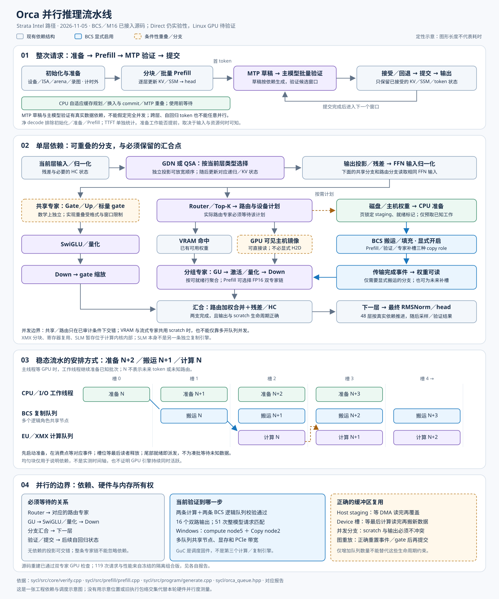

# Orca 并行推理流水线

下面按当前 Strata Intel 路径展示请求生命周期、单层依赖和批间流水。动态参数分流、共享 BCS 编码、M16 双专家和通用 FP16 M16 投影已接入源码；Direct 仍为实验后端，BCS 需显式开启，Linux GPU 待验证。图形长度不代表实测耗时。



[下载 SVG](media/orca-parallel-pipeline.svg) · [PNG](media/orca-parallel-pipeline.png)

CPU 可以准备后续已知批次，BCS 搬运已准备好的权重，EU/XMX 计算当前批次。这里的“批”指已知的数据／专家批，不代表可以提前获知未来 token 或未知的 Top-K 路由。主机镜像可直接由 GPU 读取的路径，也不一定有显式 H2D。

等待 GPU 时可以准备数据，但每类数据有不同的就绪点：

- 已知的 prompt：PLE 已用双缓冲提前读下一块；专家 Stager 在线程中提前读权重并放入固定页环形缓冲。
- Router 结果已回传：CPU 可先做专家分组、行表和 staging 计划，同时 GPU 继续共享专家分支；只等待 route event 即可开始这些准备。
- 环形槽位再利用：仍需等待上一笔 DMA 的完成序号，行表也需等上一层读完；数据准备完成不代表旧缓冲已经可以覆盖。

安排顺序采用“提交当前计算 → 启动已知数据的准备 → 在消费点等待对应事件”。prompt 双缓冲、Stager 与自适应缓存已有这类重叠；服务源码还默认提前预读下一窗口已知首 token 的 PLE，`STRATA_ORCA_PLE_ROW0=0` 可回退，重建后生效。等待线程可以阻塞，由现有 Stager／PLE 工作线程继续准备，不需要在 fence 轮询中塞入大块 CPU 工作。准备窗口耗尽后，就绪任务直接派发，不为凑批等待未知数据；这也是延迟敏感尾部应保留的边界。

[消费端已补齐预读前缀复用](../bench/results/a770/orca-ple-prefix-2026-11-05.md)：先提交新后缀，再 collect，消费前保留依赖，所有写者完成后才复用缓冲。首 token 已预读、随后消费4个 token 时，逻辑行请求从80降到64；未测物理SSD／PCIe流量或整模型提速。纯CPU检查覆盖每套reader的336项前缀／批次组合，旧gather搭配新检查器必须因重复请求失败；新gather及原生CMake／CTest目标通过。重编译完整generate Host TU并链接保留的U4依赖后，两个后端关闭／缺省开启的16次Code2K→8K→Prose2K→Short完整协议全部匹配。本组沿用HC128，未验证HC256叠加；生产EXE未替换，原Direct8K间歇故障仍保留。

| 等待期间可做的事 | 何时已知 | 当前状态 |
| --- | --- | --- |
| 下一块 prompt 的 n-gram 行与 PLE 数据读取 | prompt token 已到达 | 已有双缓冲预读 |
| 专家权重读取与固定页 staging | 专家任务列表已确定 | 已有 Stager 线程与环形缓冲 |
| 自适应专家缓存的规划与换入 | 当前窗口的路由统计可用 | 已有线程与 commit／MTP 草稿阶段重叠；下一窗口消费前等换入完成 |
| 路由分组、行表与专家搬运计划 | Router ID 回传完成 | 提前事件候选已验证，默认未采用 |
| MTP 窗口、追赶与后续草稿的命令图 | shape 与模型已知 | 常用图已在 READY 前缓存；概率门槛仍决定是否派发后续草稿 |
| 下一窗口首 token 的 PLE 数据 | 当前验证及采纳结果已确定 | 服务源码默认用已有 reader 私有缓冲／worker 预读，消费前 collect；[24项后续检查及保留的 Direct 8K 失败](../bench/results/a770/orca-ple-row0-source-2026-11-05.md)，部署 EXE 未替换 |
| 借用专家槽的归还复制 | 预填充不再使用对应槽，且来源镜像地址稳定 | Orca L0 服务源码默认批量回填持久镜像；`STRATA_ORCA_MIRROR_REFILL=0` 回退，重建后生效 |
| 固定 shape 的模块、命令模板与 arena 布局 | 初始化时 | 应在请求热循环前完成；实际数据绑定仍按依赖推进 |

当前 Short 对照使用 `STRATA_VERIFY_NO_HOST=1`／device-plan：每层专家计划在 GPU 上生成，CPU 无需逐层填表。可以提前建立固定布局和命令模板，但下一窗口的精确 token／PLE 行须等草稿和采纳结果确定。已有的重叠可直接核对 [PLE 双缓冲预读](../sycl/src/prefill/prefill.cpp#L1830)、[Stager 固定页环形缓冲](../sycl/src/prefill/prefill.cpp#L269)、[自适应缓存与 commit／draft](../sycl/src/program/generate.cpp#L8333)及 [Verifier 每窗口输入准备](../sycl/src/core/verify.cpp#L2209)。这条路径应先定位剩余准备成本与 GPU 阶段差异，再决定是否需要额外的准备线程。

当前对照还固定 `STRATA_WARM_GRAPHS=1`，启动日志确认 1～4 token 的窗口图、commit 和 draft 图均在 `READY` 前准备；设备初始化、权重加载和这部分录图不计入净 decode。

[Windows Direct 显存查询](../bench/results/a770/orca-direct-global-memory-2026-11-06.md)现已缓存适配器及本地段身份，只在容量检查时刷新全局驻留量；内核派发与成功分配路径不新增统计查询。独立 Sysman 校准、分配／错误负控及固定 5771 槽、1536 MiB 预留的 7 条 2K／8K／Short 协议检查已通过。这是记账补齐，没有建立新的并行或吞吐收益，也未关闭此前的驻留／8K 间歇故障。

[当前 Short 的真实重放计数](../bench/results/a770/orca-direct-state-domains-2026-11-06.md)覆盖两条完整协议：每请求67,271个walker、3,934次仅GRF改变、50次参数基址改变、28次scratch基址改变；列表内部没有systolic切换或不变SBA的重复编程。因此不新增该方向的精简候选。统计覆盖整请求并有侵入式日志，不是净decode或每token派发量；[补充审计](../bench/results/a770/orca-direct-state-domains-2026-11-06-audit.md)保留发布器的JSON键比较失败，独立复核原协议／命令与精确归档，没有重跑GPU。

[启动后重录窗口图的隔离对照](../bench/results/a770/orca-direct-scratch-recapture-2026-11-06.md)在scratch池扩容后重录Verifier窗口，四条诊断协议一致，每整请求scratch基址切换28→7、参数基址切换50→0，walker仍为67,271；录图地址布局也变了，不能只归因于scratch。随后同一无探针EXE的90次完整Short协议全部匹配，固定5771槽／1536MiB预留；正反顺序净decode为−0.352%／−0.582%，TTFT为−1.751%／+0.497%。控制漂移通过3%门，收益门失败，因此不按“小幅正收益”采用，不追加重复取通过；默认和部署均未改变。READY独立报告，未混入净decode。

[冻结整版的实际context普查](../bench/results/a770/orca-direct-queue-topology-2026-11-06.md)进一步匹配14条校准后的2K／8K／Prose2K／Short完整协议及28个阶段提交总数：净decode中L0始终使用1个计算＋1个复制context，Direct始终为3个计算＋1个复制context，长上下文没有消除这一结构差异。全进程创建数分别为4（2计算／2复制）与9（6计算／3复制），包含decode未使用的context；多个context也不代表更多物理引擎。L0的HostSynchronize本身可触发提交；首轮7条输出通过但API归属校验失败，补齐同步／reset／destroy观察后才通过，原失败保留。报告API handle列按`(API, 首参数handle)`调用身份计数，不是唯一handle或Stream数。日志及诊断锁有侵入性，不能换算切换耗时或吞吐；任何共享context候选仍须验证HostGate前进性、队列scratch／完成序号所有权及跨队列依赖，当前没有合并默认队列或增加Linux GPU结论。

[后续共享计算Queue的隔离实验](../bench/results/a770/orca-direct-shared-compute-2026-11-06.md)已在四次诊断中确认净decode实际从3计算＋1复制context变为1＋1。无观察器的120条完整协议全部匹配，控制漂移及TTFT／整请求非回退门通过，但Short净decode正反序分别 **−2.658%／+0.105%**，没有稳定改善，因此不改共享队列默认。BCS仍独立；该候选限制HostGate和未提交inline生产者，不能推广为任意多队列图的等价替换，也不能把context数减少换算成提速。

[MTP 图缓存](../sycl/include/strata/core/mtp.hpp#L59)已经把常用录图移出热循环。动态位置参数虽然可提前计算，但当前 [round 图](../sycl/src/core/mtp.cpp#L918)会读取 `2*T` 行映射元数据；其中可能包含后续草稿槽，不能在提交后直接写入这些槽。提前准备应使用已释放的缓冲或独立存储，保留置信度判断及最后读者的依赖，不能仅将 CPU 写操作挪到等待函数之前。

[隔离的 MTP 元数据前移检查](../bench/results/a770/orca-mtp-prestage-2026-11-05.md)已验证在首个 round 提交前准备后续位置，90 次完整协议匹配，Direct／L0 净 decode 变化 +0.223%／−0.024%，没有建立稳定收益。用户接受幅度较小的优化后，Orca L0 源码默认提前准备这些已知元数据，`STRATA_MTP_PRESTAGE=0` 可回退；它不提前执行未通过置信门槛的草稿。[采用与回退检查](../bench/results/a770/orca-preparation-defaults-2026-11-06.md)独立保留，旧实验门槛与结果不变。没有测量实际重叠时长，不能把调度顺序正确等同于必然提速。

[通过控制门槛的 100 请求对照](../bench/results/a770/orca-direct-argument-array-2026-11-06.md)中，Direct 相比 L0 的重复 2K／8K TTFT 少用 13.419%／6.566%，净 decode 却低 2.272%／1.690%；Short 的 TTFT 和 decode 则都落后。它没有证明 TTFT 优化导致 decode 退步：预填充的大矩阵与 decode 的小批量依赖链需要分别优化，缓存残留或预取争用仍只是未隔离的可能原因。此前同后端 HC128→HC256 已使 Direct Short decode 提高 3.571%、TTFT 少用 1.514%，说明可以同时改善。保留大 T 路径，decode 就绪即提交，后台准备只操作可安全复用的缓冲；验收同时检查 TTFT、净 decode 与整请求耗时。

[已完成依赖的后续隔离检查](../bench/results/a770/orca-direct-completed-dependencies-2026-11-06.md)只过滤缓存中已确认完成的跨队列序号，不新增查询或移除未完成等待。BCS demo 的24次重复驱动等待降为0，12次未完成尾部等待全部保留，原版／候选各36项完整快照和保护区通过；另有920次内存回放、64项HC及Linux四项CPU检查。100次模型协议全部匹配，但Short仅提高0.350%，控制漂移及首次长请求不回退门槛失败，候选未采用。它说明可以省掉已经满足的等待调用，也说明独立调用计数不能代替TTFT／decode验收；不从该失败窗口更新已确认的长上下文性能差距。

测试本身也将输入 ID、参考输出、配置和重放命令放在等待 GPU 锁之前准备。通用 M16 新默认的 Direct→L0→Direct 三个新进程，各自直接执行 2K→2K→8K，共九次请求完整匹配，未触发全零诊断。准备包通过独立 CPU 检查；设备初始化和上传仍在独占设备后执行。该冷历史检查不作为性能成绩，也不关闭既有间歇故障。

[完整 GEMM 接口的长历史检查](../bench/results/a770/orca-long-gemm-api-2026-11-05.md)补齐 2047→2047→7999 行及旧列表逆序回放：Direct／L0、M4／M16 共 96 项，逐元素核对 867,309,960 个有效输出，以及输入、行 padding 和调用方缓冲保护区。检查包含 FP16、BF16、Q8 反量化、beta=0/1 和改变输入／权重；没有计时，也未复现原 8K 全零故障。它不覆盖 workspace 换址、专家槽借还或真实模型的多队列状态交接。**冻结报告勘误**：其中“逐位数值相等”应为“逐元素数值相等”（代码未比较正负零位模式）；准备发生在取得实验锁之前，编译、GPU、重型哈希和归档才持锁。原报告及证据保持原样，独立归档检查已通过。

[后续工作区换址检查](../bench/results/a770/orca-rebind-gemm-2026-11-05.md)增加三个独立地址的 scratch／workspace：待批处理请求之后直接 rebind，查询已完成状态，再检查旧地址结果；保留三张旧列表，用不同输入／权重逆序回放，当前绑定指向另一工作区。Direct／L0、M4／M16 共 120 项通过，核对 873,501,576 个有效输出及非活动工作区的全部内容；240 次 rebind 完成查询、32 个 Host 已合并请求计数（含录制）均符合预期。没有计时，也未执行真实 ExpertCache 借还或驻留表交接；不能据此关闭原模型 8K 间歇故障。

[真实专家槽的批量回填](../bench/results/a770/orca-mirror-refill-2026-11-05.md)进一步发现 `fill_slot_queued` 每复制一槽仍立即等待。候选仅对持久 GGUF USM 镜像复用已有异步 `fill_slot`，保留每 256 笔和最终同步；临时环形来源及强制阻塞仍走原路径，避免下一次 miss 覆盖尚在读取的源槽。Direct／L0 的六次诊断逐字节核对 **8,016 槽、11,442,329,600 字节**及六张各 24,576 项的设备驻留表；另外 18 次无回读诊断的关／开／关请求也完整匹配。Direct 8K TTFT 少用 **1.788%**（控制漂移 +0.444%），L0 少用 **0.316%**（+0.037%）；两次 2K 没有一致改善。每请求位置每臂仅一次，候选保持隔离且默认关闭。回填计入 prefill／TTFT，不作为 decode 提速；没有测量实际准备／复制重叠，也未关闭原 8K 故障。普通 generate、弹性回填和生产 EXE／配置未改，Linux GPU 待测。

随后将同一持久镜像分支接入[服务源码](../sycl/src/program/generate.cpp#L7866)，初次接入时默认关闭；重新生成并编译两个完整 generate Host TU，Direct／L0 各以缺省和开启运行 2K→2K→8K→Short，**16 次协议全部匹配**。[源码接入校验记录](../bench/results/a770/orca-mirror-refill-source-2026-11-05.md)不把上段隔离版计时当作本次重建成绩；该历史检查使用冻结通用 M16 依赖。现已在 Orca L0 源码默认开启，`STRATA_ORCA_MIRROR_REFILL=0` 回退，开关在启动时读取一次；[本次采用记录](../bench/results/a770/orca-preparation-defaults-2026-11-06.md)单列重建验证，Direct 仍须显式开启。CLI generate 未接入，弹性显存模式在[当前 Intel 移植版](../sycl/src/core/expert_cache.cpp#L260)明确返回不支持，相关回填分支目前不可达。

环容量需要按用途判断，以下是当前源码边界，**不是满环次数实测**：

| 缓冲／任务队列 | 当前容量 | 满时行为／适用路径 |
| --- | ---: | --- |
| [HostTask SPSC 环](../sycl/orca_queue.hpp#L478) | 1,024 回调 | 生产者 yield 等空位；当前对照启用 device-plan／`STRATA_VERIFY_NO_HOST=1`，不走逐层 Host fetch |
| [专家源临时环](../sycl/src/core/gguf_expert_source.cpp#L58) | 512 专家 blob | miss 轮换覆盖旧槽；缓存命中的旧槽也可能被下一次 miss 覆盖，扩大容量不能替代源生命周期约束 |
| [Stager 固定页环](../sycl/src/prefill/prefill.cpp#L269) | 普通默认 16；文件源可设为 4×线程数；显式值 2～256 | 等 issued 序号及上一笔 DMA 完成；只有未固定的专家来源需要 staging |
| [GPU 专家 staging 环](../sycl/src/prefill/prefill.cpp#L111) | routed 路径 8 槽；stream-all 另选容量 | 持久镜像仍须使用；槽复用通过 GPU 事件等上一位使用者，routed 路径最多提前准备 8 个 order 项 |
| [FP16 反量化缓冲](../sycl/src/prefill/prefill.cpp#L204) | 2 槽 | GU／Down 的反量化结果复用，与 Host 描述符容量无关 |
| [DG2 复制描述符暂存](../sycl/orca_dg2_backend.hpp#L903) | 64 项 | 达到 `min(64, BATCH_OPS)` 即提交；不是等待 GPU 读完后覆盖一个正在用的槽 |
| [DG2 OwnerExecutor](../sycl/orca_dg2_backend.hpp#L30) | 无固定槽数的 MPSC 链表 | 每个调用者发布一个栈上请求并等完成；不能通过扩大固定环容量改变这种交接 |
| [DG2 待回收提交](../sycl/orca_dg2_backend.hpp#L893)／[录制列表池](../orca-l0/src/wddm/runtime.cpp#L215) | 动态 `deque`，不是固定容量环 | 完成后回收；`collect()` 的16项数组是查询前瞻上限，不是最多16个在途任务 |

本轮日志确认 24,576／24,576 个专家都有持久镜像，因此其 blob 读取及 prompt 权重准备绕过临时专家环和 Stager 环。通用 `STRATA_ORCA_DG2_BATCH_OPS` 可设 1～4096，但不会扩大 64 项复制描述符数组；阈值达到会提前提交，不能直接称为 GPU 等待。源码边界本身不证明占用、容量触发次数或等待时间。

同一[已录列表再次提交](../orca-l0/src/wddm/runtime.cpp#L618)要求上次执行已完成；新增列表槽也不能消除参数、输入和输出缓冲的读写依赖。Windows 通过 `D3DKMTSubmitCommand` 交给内核驱动，本库没有可直接调大的硬件命令环容量。突发任务仍可能产生排队，但需要分别观测可用槽、满容量触发、实际等待和设备空隙；只看到队列满，不能证明扩容会提速。

持久镜像不会绕过 GPU 专家 staging 环或 FP16 双缓冲。`STRATA_PREFILL_RING` 调的是 stream-all 容量；当非驻留比例等条件使 `stream_all_ok=false` 时，仍返回固定 `STAGE=8`。仅设置该变量不能扩大当前 routed 路径的 8 槽环；强制 stream-all 还会复制未被路由选中的专家，不能当作只改容量的公平对照。上述 GPU 缓冲尚未测占用与槽复用等待，不能由 Host 暂存统计排除它们的瓶颈。

后续[真实模型的复制暂存计数](../bench/results/a770/orca-copy-capacity-census-2026-11-05.md)在 2026-11-05 的 Windows A770 上匹配默认／异步镜像回填各 2K→2K→8K→Short，共 **8 次完整协议**。两组均为 **54,068 次 Host copy 调用**、相同字节参数总和；默认峰值 **32／64、容量触发 0 次**，异步镜像为 **64／64、62 次**，其中 8K 边界增量为 40 次。未观察到录图期间的新 Host copy 调用；已录列表的 GPU 重放不重新进入该接口。这说明异步路径能用满 Host 暂存，但没有测容量触发的阻塞时间，也不能推出扩容后的吞吐收益。八个 DONE 前快照分别守恒；服务 `_Exit(0)` 不执行全局析构，统计不包含退出清理。报告保留漏传 router 校准参数、错误预期 final 快照两次失败及独立审计；这是冻结通用 M16 的容量诊断，不是生产 U4 或性能成绩。

归档后，原发布检查因并行 U4 工作更新主启动 JSON 而失败，未改写失败或回滚配置。[补充归档审计](../sycl/orca/copy-capacity-census-a770-windows-2026-11-05-audit.json)及其独立复查核对全部 **1,003 个文件**、完整协议与边界，确认唯一生产差异为 `strata-iq2_xs.json`；实验直接使用冻结 argv／env，不读取该启动 JSON。原报告／源码归档未改。后续复核本机证据使用 `python -X utf8 build-orca-slm-async-20261104/check_copy_capacity_publication.py --check`；原发布检查仍保留严格的历史生产哈希条件。

随后[固定预留16槽的预取深度对照](../bench/results/a770/orca-routed-ring-depth-2026-11-05.md)按实际深度 **8→16→8** 运行，保持 routed 路径及相同借槽布局；12 次完整协议和三组双专家 pairs／leftover 数量全部匹配。16 槽相对两侧 8 槽均值的 TTFT 变化为两次 2K **−0.490%／+0.670%**、8K **+0.505%**、Short **−0.806%**；控制漂移分别为 −0.705%／+1.075%／−0.290%／−0.528%。单个包围窗口没有建立稳定收益，默认保留8槽。该试验只改变预取深度，未测槽复用等待或 GPU 占用；两臂共同多预留8槽，也不是生产8→16槽的完整资源变化测试。使用冻结M16依赖，不代表生产U4、L0或Short净decode的改善；Linux GPU与原8K间歇故障仍待处理。报告／42项原始证据的独立发布检查已通过。

因此需要区分容量触发与实际等待：默认 Host 暂存未触顶，GPU 预取深度加倍未建立稳定收益，异步镜像回填的 64 项暂存触顶仍值得测等待时间。FP16 的两个反量化槽目前在同一有序计算队列复用，单独增加槽数不会自动产生跨队列重叠；本轮未测试扩大该缓冲。

随后[Host复制暂存64→256→64对照](../bench/results/a770/orca-copy-depth-2026-11-05.md)保持GPU提交上限64、相同256项物理预留及冻结M16数学／运行库，只改变Host描述符的刷新阈值；三组均开启异步镜像回填。74个TU一致重编译、8次GPU检查及12次完整模型协议通过独立复核；521笔复制逐次检查两种容量的刷新及尾批次。256项相对两侧64项均值的TTFT，两次2K分别 **+1.780%／+0.450%**、8K **+0.352%**、Short **+0.082%**；对应控制漂移为−0.473%／+0.113%／−0.380%／+0.251%。没有建立提速，默认仍为64项。没有新增模型内层探针，也未测本轮模型的Host暂存峰值／容量提交次数或每次阻塞时间；不能把此前62次触顶当成本次新计数。这仍是冻结M16、异步回填的有限窗口，不是生产U4、L0或稳态Short吞吐对照。

该运行的原汇总校验器误把单组pair计数与三组集合比较，全部请求结束后以1退出；原脚本及带`AssertionError()`的结果保留。独立审计重解全部DONE、tokens、计数、90条成功命令与哈希，不重跑GPU，也不改写原失败。报告及1,028项原始证据的发布复核通过。[复测脚本快照](../sycl/orca/copy-depth-reproduction-a770-windows-2026-11-05.json)只更正这一处断言，保留原历史；已检查源码差异、语法及一项接受／两项拒绝条件，没有再次执行GPU。该JSON的`base64`字段可恢复至其`source_path`；本机已生成该文件。使用相同冻结构建与模型资产，在新名字下复测：

```powershell
python -X utf8 build-orca-slm-async-20261104/copy_depth_reproduce.py prepare repro-r1
python -X utf8 build-orca-slm-async-20261104/copy_depth_reproduce.py run repro-r1
python -X utf8 build-orca-slm-async-20261104/copy_depth_reproduce.py verify repro-r1
```

原`copy_depth_compare.py`保留已知汇总错误；已归档r1使用报告中的独立审计命令复核，复测入口使用上述修正副本。

[原二进制有界复查](../bench/results/a770/orca-legacy-zero-reprobe-2026-11-05.md)另以历史 M4 Direct 跑两个新进程，各直接执行2K→2K→8K，共 **6/6完整匹配**。复用原EXE、配置及1,516个数学目录文件，仅开启已有的全零后诊断；未触发额外GPU回读。初始专家profile与原失败记录一致，memory模块也匹配更早历史哈希。原先8K输出64个token ID 0、草稿0/0的失败随报告保留；成功重试没有定位故障，也不是环容量归因、故障率估计或性能成绩。实际运行是r2，r1仅准备后被替代；54项原始证据的独立归档复核已通过。源码、部署EXE与配置未由本复查修改。

[Short 等待与 CPU 对照](../bench/results/a770/orca-direct-hybrid-wait-2026-11-04.md)进一步检查 8／32 µs 有限自旋后转事件等待：两个反向顺序窗口的 210 次请求全部匹配，但没有建立吞吐收益，候选未采用。Direct 事件等待的每完整请求进程 CPU 为 45.29／46.77 ms，L0 为 2175.00／2259.38 ms，两个窗口均约少用 97.92%；范围排除启动和预热，包含预填充与 decode。Direct 的净 decode 仍比 L0 低 2.13%～4.40%。独立 30 请求／60 阶段诊断把 L0 保留段约 97.92% 的进程 CPU 定位到 `zeCommandListHostSynchronize` 调用内部，未拆解 driver 内部自旋／系统调用／锁；诊断耗时不作为性能成绩。默认等待保持原样，也不从 CPU 时间推算整机能耗。

[L1 WBP／WB 的 Short 对照](../bench/results/a770/orca-direct-l1-short-2026-11-04.md)使用独立重建的缓存策略运行库与相同 Host／数学 pack，28 项 CTest、240 个形状、1680 项双专家检查通过，两个反向顺序窗口的 150 次模型请求全部匹配。WB 吞吐变化为 +0.34%／+0.14%，低于 WBP 控制漂移绝对值 1.03%／0.62%，因此不采用。默认 Direct 在这两个窗口仍比 L0 低 1.83%／2.09%；不能用这项全局 SBA 字段试验排除其它缓存或派发差异。初版复用旧 CTest 目录改写两份临时记录，旧目录的全量 live 哈希检查因此失效，原始采样与源码未变；失败与后续独立重建均在新报告留痕。

[2026-11-05 的 Short 粗粒度诊断](../bench/results/a770/orca-direct-short-phases-2026-11-05.md)保留正常共享／路由交错与独立投影，仅在既有阶段边界插入时间戳，Direct→L0→Direct 的 45 次请求完整匹配，实际 T 序列相同。保留段的窗口输入准备约为 Direct 1.20／L0 0.80 ms／请求；GPU hc1／router／设备计划合计多用约 9.00 ms／请求，GDN／QSA 区间分别长 4.09%／4.43%，值得继续细分。总标记跨度差 +1.13%，Direct 控制漂移 −1.35%；插桩增加 barrier、回传和日志，区间含依赖空隙，不能据此发布稳定吞吐收益或把它视为独占 kernel 时间。初版编译命令和第二版时钟属性校验失败均留痕，新目录结果已独立校验；生产策略未变。

[后续 HC1／路由细分](../bench/results/a770/orca-direct-short-router-phases-2026-11-05.md)再匹配 45 次请求，每窗口增至 386 个标记。hc1 和路由投影＋量化区间分别合计多约 14.99／10.49 ms／请求，但总标记跨度差 +4.06%，Direct 控制漂移 −4.99%，增加标记后观察到的差异也改变。[空时间戳校准](../bench/results/a770/orca-direct-timestamp-cost-2026-11-05.md)另通过 120 项原始 tick／边界／重放检查：512 个密集标记时，GPU 每有序间隔约为 Direct 1.145／L0 0.552 µs。这仅量出空上下文的诊断成本，不能从模型时间直接扣除，也不能把细分区间当作真实 kernel 倍数。

随后把输入、模块、缓冲和命令列表全部提前准备，移除逐算子时间戳。[路由独立回放](../bench/results/a770/orca-direct-router-replay-2026-11-05.md)的两个反向后端顺序共通过 720 次完整输出／guard 检查；T=4 投影＋量化并行模式的 Direct 列表墙钟仍多用 5.59%～8.78%。[HC1 独立回放](../bench/results/a770/orca-direct-hc1-replay-2026-11-05.md)另通过 360 次回放与 CPU 参考，最大绝对误差约 7.62×10⁻⁷；融合 Q8 模式在 T=1 多用 19.18%～21.67%，T=4 则少用 1.56%～2.37%。这些计时仍包括提交、完成通知和唤醒，同权重重复读取及 HC1 分离输出也不同于整模型，不能当作独占 kernel 时间。它说明输入就绪后仍有随 shape 改变的后端差异，提前准备与 GPU／完成路径定位要同时推进。

[HC128 列表首尾诊断](../bench/results/a770/orca-direct-hc1-span-2026-11-05.md)进一步只加两个 GPU 标记，360次完整输出／边界／跨度检查通过。当时T=1融合Q8的Direct GPU跨度约多19%，差距也发生在列表内，不能只解释为完成通知。随后[单映像256 GRF对照](../bench/results/a770/orca-hc1-q8-grf-2026-11-05.md)去掉报告的2208字节溢出／4KiB scratch，参数ABI一致，960次完整输出／边界检查通过；T=1融合链用时在Direct少25.25%～30.66%、L0少9.13%～14.03%。仍有global private分配；这是当时隔离的热权重组件结果，不能单独外推生产U4、Linux或整模型收益。

后续[相同单映像的Short整模型对照](../bench/results/a770/orca-hc1-q8-grf-model-2026-11-05.md)使用同一EXE切换128／256 GRF，120次完整协议一致。正反顺序汇总的净decode为Direct 57.936→59.650 tok/s（+2.959%），L0 59.575→60.708（+1.901%）；128 GRF控制漂移分别为−0.168%／+0.031%。这次改善超过本窗口控制漂移，但只覆盖冻结通用M16的Short28，不是当前生产U4、长上下文或Linux成绩。两后端共享收益；相同256 GRF下Direct仍慢于L0，当时尚未设为内核默认。

[当前U4／M16上下文对照](../bench/results/a770/orca-hc1-production-contexts-2026-11-05.md)补上120次完整协议。Direct的HC128→HC256令Short净decode从45.494升至47.119 tok/s（+3.571%），TTFT从766.087降至754.491 ms（−1.514%）；L0的Short也同时改善：decode +2.479%、TTFT −1.485%。相同HC256下，Direct的Code2K／8K TTFT比L0短11.039%／7.462%，但净decode仍低2.211%／0.627%，Short低2.524%。长请求每进程仅一份保留样本，不能外推稳态；源码已默认设置这一kernel的large-GRF选项，主L0配置通过独立服务检查后选择HC256映像。原Direct8K故障和Linux GPU验证仍未关闭。

TTFT与decode没有必然的此消彼长：prefill受大矩阵吞吐及权重准备影响较多，decode更受小窗口kernel、依赖及提交／完成路径影响。跨后端两个指标方向不同，不能直接认定prefill优化损害了decode；同后端的HC对照已展示二者可以同时改善。就绪计算不为凑批延迟，准备工作使用独立／已释放缓冲，消费点才等自己的事件；性能验收分别报告TTFT和排除准备、初始化、prefill的净decode。

[固定T1／T4的HC后续试验](../bench/results/a770/orca-hc-fixed-t-2026-11-06.md)保持同一SG16／256GRF入口及参数ABI，不增加派发、复制或凑批等待。首版按值helper令声明private翻倍，改为只读引用后接近基线，但代码段仍从27840增至90880字节；两版共512项完整HC检查通过，精确IGA汇编保留。修正版180次Short协议全部一致，正反顺序净decode变化为Direct **+0.032%／−0.413%**、L0 **−0.887%／−0.441%**；控制漂移和时间非回退门通过，但两后端均未达到预设1%收益门。候选保持隔离，默认不变，不追加重复或长上下文测试取通过。该结果否定这次单入口专门化实现的采用价值，不能据此否定按shape调优或认定TTFT与decode必须互相牺牲。

[独立T1／T4入口后续对照](../bench/results/a770/orca-hc-split-t-2026-11-06.md)将捕获从616降为112／328字节，声明private从9728降为1792／5248字节／硬件线程；T1代码段缩小、T4仍增大，均零spill。原25入口的Host参数描述及部署原生映像保持，四份前端只有生成类型的数字名称后缀变化，其他指令／ID相同。256项完整HC检查和180次模型协议全部一致，但正反顺序净decode为Direct **−0.025%／−0.469%**、L0 **−2.275%／+0.061%**。资源减少没有转化为一致模型收益，即使采用后来用户认可的小幅正收益标准也不据此默认开启；两次检查器失败与修正均保留，不追加重复或长上下文取通过。

[2026-11-06同数学pack的全Host对照](../bench/results/a770/orca-direct-argument-array-2026-11-06.md)中，重复Code2K的L0／Direct TTFT为14.694／12.722秒，净decode为36.950／36.110 tok/s，但直接测得的整请求仍从18.119缩至16.227秒。这说明该历史下预填充节省超过了后续生成的损失；长请求每位置每臂仅一次，不能据此宣称跨日稳定性。后续优化应在同一运行时按实际T分别选择大矩阵与小窗口策略，同时限制预取使用的缓冲、专家驻留和带宽，避免准备工作进入decode关键路径。TTFT与引擎decode的首窗口重叠，整请求必须直接计时。

[缩小 HC 捕获＋SG16 融合 Q8 的隔离模型对照](../bench/results/a770/orca-hc-q8-sg16-2026-11-05.md)已经出现两项同时改善：L0 Short 的净 decode 从 **48.140 到 52.739 tok/s（+9.553%）**，TTFT 从 **751.007 到 720.765 ms（−4.027%）**；Direct 为 **47.237 到 49.730 tok/s（+5.278%）**、**750.560 到 736.125 ms（−1.923%）**。108 次完整协议一致，固定 5771 专家槽、1536 MiB 预留、MTP4、step／last min-p 0.5、累计门限 0；Short 丢弃前十次、保留后五次。同一后端内比较，不能将此收益全部归因于更换 API 层。这是保留 Host／pack 的隔离结果，完整当前源码重编及新 pack 的结果须单独报告。

首次长请求与重复长请求也要分列。上述同一 HC256 进程的 Code2K 首次／重复 TTFT，L0 为 25.798／15.101 秒，Direct 为 28.552／13.434 秒；decode 分别为 27.827／34.706 与 27.594／33.939 tok/s，输出及草稿计数相同。这是保留历史中的单进程观察，尚未拆分全部冷准备成本；不能混用首次与重复请求来计算版本收益，也不能把它当作新的稳定性能结论。

源码中仍有明确的冷准备：`Prefill::run` 首次创建 `model_u4::Cache`，加载 U4 专家权重；`STRATA_WARM_GRAPHS=1` 在 READY 前准备命令图，不会触发这批权重的加载。该加载位于 prefill 内、净 decode 计时之前。把它前移到 READY 前可改变首请求的等待分布，但应同步报告增加的启动耗时及启动加首请求总时间；不能把准备成本转移直接宣称为计算提速，也不能仅凭首次／重复请求差值认定全部来自加载。

当前初始化前移候选只在隔离生成的 `Prefill::init` 中复用同一个 U4 Cache 构造函数，保留原 `run` 数学及采样路径，默认关闭；尚未完成模型性能验证。验收同时记录 READY、首次及重复请求的 TTFT、READY＋首次 TTFT、READY＋首次完整请求和净 decode，并核对实际专家槽数及完整输出。只有 TTFT 降低而启动加首请求不变时，应标成等待前移；若显存预留或专家驻留减少、后台传输侵占 decode，则不能据此宣称两项共同优化。

2026-11-05 的 Windows A770 完整当前源码 L0／Direct／L0 对照随后通过 **60／60 完整协议**及预设 **3% 控制漂移门**。两后端全量重编，各通过 PLE CPU 检查和64项HC GPU检查；构建时的HC检查使用保留的匹配HC包，整模型对照使用同一套新烘焙的1254个ZEBIN，24个不支持的变体明确保留SPIR-V。每臂新进程依次2K→2K→8K→8K→Prose2K→Short×15，Short丢前十次、保留后五次中位数，固定5771槽及min-p0.5。下表按请求位置分列；长请求每位置每臂只有一次，首次8K的小幅正值也小于本组控制漂移绝对值，不能据此建立稳定优势。

| 新构建请求位置 | L0／Direct净decode tok/s | Direct吞吐变化 | L0／Direct TTFT ms | Direct TTFT变化 |
| --- | ---: | ---: | ---: | ---: |
| Code2K首次 | 28.233／28.063 | −0.605% | 26763／28094 | +4.971% |
| Code2K重复 | 35.626／35.164 | −1.298% | 15630／13052 | −16.496% |
| Long8K首次 | 28.427／28.758 | +1.163% | 34881／31939 | −8.435% |
| Long8K重复 | 33.198／32.806 | −1.181% | 34587／31899 | −7.772% |
| Prose2K | 32.687／32.010 | −2.069% | 14925／12636 | −15.341% |
| Short预热后 | 51.228／49.480 | −3.411% | 737／740 | +0.370% |

这组新构建显示长上下文的decode后端差距比Short小，重复长请求的Direct TTFT更短；首次冷2K则相反。它没有证明差距全部来自API，也没有关闭原Direct8K间歇全零故障。两臂采样门限相同、每场景草稿数一致，但不同场景的采纳率不同，不能从跨场景百分比直接推算固定派发成本。本组不替代此前52.739 tok/s的隔离成绩，也未由本次对照部署EXE或修改主配置；Linux GPU仍待测。

TTFT缩短、decode稍慢是两个阶段在同一次后端对照中的观察，尚未证明前者导致后者。prefill的大矩阵／专家批处理与decode的1～4行窗口需要分别调优；本组固定相同5771专家槽，也不能直接归因为prefill挤占了decode的槽位。重复Code2K中，Direct的TTFT少用2578.391 ms，净decode多用47.250 ms，完整请求为L0 19182.681／Direct 16651.810 ms（少用13.194%）。完整请求直接使用GEN发送到DONE的墙钟；净decode包含首窗口，TTFT也包含首次输出，因此不能将TTFT与decode简单相加。

两项同时改善已有上文HC隔离对照的证据，尚未证明最新完整Direct在两项上都超过L0。后续保留prefill的大T路径，单独优化decode的小T内核、提交和依赖；临时缓冲归还及必要的专家回填仍在decode计时前完成。把U4加载从首请求移到READY之前只能先视为启动时间前移，须同时核对READY、READY＋首次TTFT和READY＋完整首请求，不能仅凭请求TTFT下降宣布总等待缩短。

随后隔离的初始化前移试验已完成L0关／开／关的60次完整协议，原始tokens／DONE及启动合计独立核对通过，控制漂移和decode非回退均在预设3%界内。首次Code2K的TTFT为26.750／15.506秒，但READY为26.810／38.209秒；启动到首token为53.560／53.715秒（+0.289%，控制漂移−2.558%），没有建立总等待改善。Short净decode变化+0.144%，控制漂移−0.316%。Direct关闭组的20次及开启组前两次2K也匹配，但开启组的第一个8K在prefill结束检查报`U4 expert nonfinite activation`并以1退出；共82次匹配后停止，完整120次验收未完成，前移保持候选。这次失败沿用原当前数学pack；不能据此把故障归于加载时机，也不能用L0通过替代Direct验收。

另一个隔离的HC Q8候选仅将捕获参数数组索引改为常量。编译器的private分配从9728字节／SIMD16线程降到0，即每SIMT线程608→0；仍为256 GRF、零spill，静态SLM未新增，原动态SLM布局保留。显式Host参数布局不变，编译器删除的隐式private-base参数已单独核对。当前完整pack的对照／候选在L0、Direct各通过64项检查，共256项完整输出、CPU参考、源和边界检查，输出逐位一致。严格payload相等检查的首次失败仍保留；性能对照尚未完成，未采用为默认，也不能从分配量直接推算总显存或模型提速。

[HC256后重新检查GPU首尾跨度](../bench/results/a770/orca-hc1-post256-span-2026-11-05.md)，720次完整输出／边界／跨度检查和72份CPU参考通过。T=1／输入0融合链的Direct跨度在正反顺序分别比L0短4.917%／5.424%，原来多约19%的归因已不适用于这份HC256热回放；普通HC仍长4.699%／4.303%。后续应核对普通HC与提交边界在真实decode中的占比。该跨度包含依赖与调度空隙，不能与整模型百分比相加，也不能把墙钟减GPU跨度全部当作CPU开销。

[普通HC的寄存器对照](../bench/results/a770/orca-hc-plain-grf-2026-11-05.md)保持融合HC256不动，只将普通SG16 up改为256 GRF。720次完整输出／边界／跨度与72份CPU参考通过；Direct的T1普通链墙钟吞吐改善1.81%～5.23%，T4却退步7.55%～8.71%，L0也退步。预设联合门失败，普通up保留128 GRF。这两种普通up均无spill、每SIMT线程private分配仍为1256字节；不能只凭寄存器数或单一shape选择全局策略，也不能把组件增益当作模型decode增益。

[缩小捕获参数的整模型检查](../bench/results/a770/orca-hc-up-capture-2026-11-05.md)通过108次完整协议，但L0／Direct Short净decode分别变化−0.879%／−1.208%，TTFT也延长，候选保持隔离。[Q8分开量化／SG16子组后续对照](../bench/results/a770/orca-hc-q8-sg16-2026-11-05.md)保留前述失败，单列逐位检查、未通过的组件联合门和完整模型TTFT／净decode，不以组件改善替代实际请求结论；本实验未改默认。

[复用 HC1 已完成 Q8 的整模型试验](../bench/results/a770/orca-ffn-q8-reuse-2026-11-05.md)只在单组输入已就绪时，将两个双输出量化调用替换为已有 BF16 转换；其余情况保留原路径。两个后端各做关／开／关，90 次完整协议一致，但 Direct 净 decode 为 58.457→57.971 tok/s（−0.831%），L0 为 59.566→59.838（+0.457%），没有建立一致收益。候选保持隔离且默认关闭；它没有减少派发次数，不能把“少做一次量化”直接计作端到端提速。

[列表首尾时间戳诊断](../bench/results/a770/orca-direct-router-span-2026-11-05.md)随后通过 360 次完整输出／guard／原始 tick 检查。T=4 投影＋量化并行列表的 Direct GPU 跨度比 L0 短 2.31%／2.53%，但墙钟长 7.64%／4.44%；Direct GPU 控制漂移为 +0.219%／+0.276%。这让提交与完成通知／唤醒成为该 demo 的下一排查重点，不能把整段墙钟差都归到数学内核。这里只加列表首尾两个有序标记，仍会改变排序，GPU 跨度也含依赖空隙；同权重热缓存与单轮包围对照不能外推整模型成绩。

[反向复核与 Host 提交／等待拆分](../bench/results/a770/orca-direct-submit-wait-2026-11-05.md)累计通过 1,440 次输出／guard／原始 tick 检查，其中 720 次还逐次验证提交＋等待＝墙钟。原 EXE 的 L0→Direct→L0 复测继续观察到 T=4 的 Direct GPU 跨度短 2.34%～2.46%、墙钟长 4.73%～10.38%。另加一个 Host 中间时钟的两个顺序中，Direct 提交约 31.4～46.1 µs，L0 约 21.2～24.2 µs；等待阶段也有差异，但其中包含未完成的 GPU 工作，不能直接称为唤醒延迟。输入、模块与命令列表已在计时前就绪，因此提前准备仍可优化整条流水线，但不足以解释这项 ready-input 回放差距；提交交接和完成路径还需分别验证。

[由调用线程执行原生请求的试验](../bench/results/a770/orca-direct-caller-owner-2026-11-05.md)继续检查交接成本：保留 FIFO 与串行修改，省去专用 worker；Windows 和 Linux／WSL 各通过 98,304 次 CPU 并发工作，74 项重编译与三个 GPU 检查器通过。90 次整模型协议一致，但相对 worker 的净 decode 仅 +0.146%，小于 −0.599% 的控制漂移绝对值；另一窗口仍比 L0 低 2.128%。候选保持隔离，没有改生产默认。它检验的是已就绪原生调用的交接，不能代替数据准备流水；Linux sanitizer 因缺运行库链接失败，未宣称通过，Linux GPU 仍待测。

[实际模型的低密度窗口诊断](../bench/results/a770/orca-direct-window-span-2026-11-05.md)将标记减至每窗口首尾两个，32 字节回读随原有最终等待发布；保留正常交错与独立投影。Direct→L0→Direct 共 45 次请求、900 个窗口完整匹配，GPU 窗口跨度合计约为 Direct 1132.582／L0 1120.277 ms／请求（+1.098%），Host 提交至返回约 1140.052／1123.091 ms（+1.510%）；Direct GPU 控制漂移 +0.203%。Host 输入准备仅约 1.181／0.748 ms／请求，提交约 1.812／0.916 ms／请求，因此继续只优化等待不足以解释全部差距。区间含依赖空隙和标记排序，Host 返回含诊断回读，且不含 commit／MTP／窗口间工作；这不是无探针吞吐，也不将 CPU／GPU 时间域相减得出唤醒延迟。

[当前 U4／HC 的首尾窗口诊断](../bench/results/a770/orca-direct-current-window-2026-11-06.md)补齐了上段旧通用 M16 的范围限制：两种相反后端顺序共 90 次完整请求、2,610 个窗口全部匹配，每请求实际 29 窗口。Direct GPU 首尾跨度分别多用时 **2.513%／2.613%**，Host 提交至返回多 **2.874%／2.866%**，这两项的外侧漂移均低于 0.15%。Host 输入准备约为 Direct 1.21／L0 0.69 ms／请求，因此准备前移仍有意义，但不足以单独解释差距；应继续细分当前窗口的执行／依赖，以及窗口外 MTP／commit。首版诊断在队列创建前访问时钟而失败，修正版加了初始化顺序检查，失败原件保留。时间戳和回读改变调度，不作新吞吐成绩，不将 CPU／GPU 时钟相减推算唤醒延迟；旧 M16 的阶段排行也不直接作为当前归因。

[同组日志的离线 Host 拆分](../bench/results/a770/orca-direct-current-host-split-2026-11-06.md)进一步区分窗口内外：以算术均值保持分段可相加，两个顺序的 Direct 多用时约为 Verifier 调用 33.640／32.654 ms、草稿区域 11.687／11.397 ms、commit／输出各 2.987 ms／请求。90 条原始协议及日志重新校验，无新 GPU 采样。草稿区域含 PLE／历史准备和等待，commit 含自适应线程启动；这些 Host 段包含 GPU 工作，且 GPU 上可能重叠。旧日志两位小数带来每分项每请求 ±0.145 ms 舍入界，不能当作纯 CPU 成本或与父报告中位数直接拼接。

[当前v14／M16的GRF状态对照](../bench/results/a770/orca-direct-current-grf-2026-11-05.md)复查GPU执行阶段的重复命令：纯GRF切换只省去不变的CFE／抢占寄存器／流水线选择，保留屏障和其它状态更新。28个CTest、240种形状、1680项双专家检查及150次完整模型协议通过。相反顺序窗口的净decode变化为 **+0.139%／+0.204%**，第二轮默认控制漂移为−0.490%；候选仍比各自窗口L0低2.075%／2.466%，不足以改变默认。该运行库源与当前v14一致，Host／数学仍为冻结通用M16，非生产U4。候选隔离、默认关闭；启动模型前的路径哈希错误与修正脚本一并归档，没有新长上下文／PPL／Linux GPU结论。

[当前U4／HC的同策略复查](../bench/results/a770/orca-direct-current-grf-u4-2026-11-06.md)补上新内核包：两版各记录14,879次kernel追加、1,202次纯GRF切换，每处减少3条命令／40字节；完整kernel／状态／字数直方图除这些字节外一致。4次统计版及150次无统计版请求全部匹配，28项原生CTest、128项HC与Linux/WSL五项CPU检查通过。正反顺序的Short净decode仅变化 **−0.007%／−0.053%**，控制漂移通过、至少+1%的收益门失败，候选仍默认关闭。计数包含初始化／录图／请求准备，未按重放次数加权；本次保留GRF切换和依赖屏障，不能据此排除切换本身的代价。未新增长上下文、PPL或Linux GPU结果。

[相邻GRF屏障合并](../bench/results/a770/orca-direct-grf-barrier-2026-11-06.md)只省去已跟踪命令边界上第二条完全相同的24字节PIPE_CONTROL，保留GRF模式切换和其它状态命令。两版捕获各有14,879次kernel追加、1,097处可合并屏障，不是按重放次数加权的每token计数。4次统计版和150次干净模型协议全部一致，28项原生CTest、128项HC及Linux/WSL五项CPU检查通过；正反顺序净decode变化 **−0.050%／+0.160%**，控制漂移及TTFT门通过、至少+1%的收益门失败，因此保持隔离、默认关闭。这没有建立TTFT与decode的取舍关系，也未补充长上下文或Linux GPU结论；初版CPU预期命令头错误及修正版均保留。

[当前SG16 HC Q8的128／256 GRF对照](../bench/results/a770/orca-hc-sg16-grf-2026-11-06.md)只改变融合映像的large-register编译选项；两版均为SIMD16、零spill、每硬件线程private9728字节，payload ABI相同，机器码也有变化，不能单独归因于占用率。256项完整HC检查和180次Short协议全部一致。正反顺序Direct净decode为 **+1.142%／+0.743%**，TTFT为 **−0.237%／−0.385%**，整请求为 **−0.803%／−0.686%**；L0净decode为 **+0.070%／+0.059%**。两后端均通过质量、漂移与时间不回退门，原两顺序至少+1%的收益门保留失败记录。用户随后接受小幅正收益，已[采用Direct的128 GRF源码默认值](../bench/results/a770/orca-hc-sg16-grf-adoption-2026-11-06.md)，L0保留256；两套生成构建命令及当前数学源码等价检查通过，重编／重烘焙后生效，现有部署程序与配置未变。不追加重复取通过。这些同向观察不支持TTFT与decode必须取舍；未新增PPL或Linux GPU结果，也不关闭Direct间歇故障。

[随后完整重编当前源码的正反对照](../bench/results/a770/orca-direct-full-current-2026-11-06.md)使用共同尾部裁剪、Direct128／L0256，120次完整协议及草稿计数全部匹配。Direct重复2K／8K的TTFT分别少用16.630%／7.154%（正序）、13.509%／6.765%（反序）；Short净decode仍低2.479%／2.598%，重复8K低1.374%／2.964%，差距未随上下文一致缩小。最大控制漂移5.866%，超过3%门槛，全部观察保留，不能宣布稳定全面提速或单一根因。首次Direct在READY前因7.74 GiB缓存不完全驻留而退出，没有性能样本；原失败保留。后续仅补充分配失败诊断，受控拒绝／释放／重试检查通过，并完成新六臂；未改成功路径、驻留要求、容量或预留，首次失败仍未定位。源码默认的小幅改善保留其独立同后端采用依据，不据跨后端两列反向变化认定TTFT与decode必须取舍；生产EXE／配置及Linux GPU状态未变。

[当前pack的持续CPU活动隔离](../bench/results/a770/orca-direct-cpu-activity-2026-11-06.md)保持同一Direct EXE、事件等待和数学内核，仅在READY后为自己的辅助进程选择idle／busy。两个预定相反顺序共150次完整协议一致，Short净decode分别变化 **+0.632%／+0.377%**，TTFT变化 **−0.228%／−0.886%**，控制漂移门通过、两顺序均至少+1%的收益门失败。busy固定在CPU43、低于正常优先级并有180秒上限，每完整请求额外消耗辅助CPU约2.122～2.141秒；该CPU计量包含prefill与decode，不是功耗。引擎亲和性未变，没有测量C-state／uncore或证明因果；辅助活动未采用，生产配置保持。此组仅覆盖Short，不替代长上下文或Linux GPU验证。

[MTP 的 Q8 Q／K／V 独立分组](../bench/results/a770/orca-mtp-ready-projections-2026-11-05.md)继续利用已就绪输入：投影读取同一份量化数据，在归一化、KV 写入及 scratch 复用前汇合，K/V-only 分支不计算 Q。两个相反后端／开关顺序共 180 次模型协议全部一致，min-p 保持 0.5；Direct 净 decode 变化为 +0.273%／−0.223%，L0 为 +0.280%／+0.268%。Direct 收益方向随顺序改变，未建立稳定提升或缩小后端差距，候选保持隔离、默认关闭。常用图已在 READY 前缓存，不在等待中覆盖仍被 GPU 读取的映射槽。该对照使用历史冻结的通用 M16 pack，不是新生产 U4 测试。

[MTP RMSNorm＋RoPE 融合](../bench/results/a770/orca-mtp-norm-rope-2026-11-05.md)进一步减少已就绪数据的后续操作：K 原地融合，Q 直接从交错的 Q/gate 读取，省去拆分复制。Direct／L0 共 192 项完整输出逐位与缓冲边界检查通过，两种相反顺序的 180 次模型协议全部一致，min-p 保持 0.5。Direct 净 decode 变化为 +0.443%／+0.127%，两侧漂移 −0.421%／+0.501%；L0 为 +0.252%／−0.083%。小幅变化尚未建立稳定端到端收益，候选保持隔离且默认关闭。该试验复用历史冻结的 M16 pack，不是新生产 U4 对照；未新增准备线程。

[SG16 GRF后续五臂长历史对照](../bench/results/a770/orca-hc-sg16-grf-contexts-2026-11-06.md)的100次完整协议全部匹配，同一Direct EXE仅切换128／256包，仍固定5771槽及原策略。128对256的净decode为Short **+1.320%**、重复2K **+3.010%**、重复8K **+2.440%**，TTFT分别 **−1.126%／−2.368%／−2.032%**；整请求也缩短，支持两阶段可以同时改善。但原3%漂移门失败：L0重复8K的decode漂移+5.145%，Direct Short为−3.211%，因此本轮仅作支持性观察，不改写此前双向Short的失败收益门或将本轮算为稳定新成绩。128对L0的Short仍低1.359%，重复2K／8K高1.591%／0.719%；长请求每位置每臂仅一次，不能据此宣布所有场景已反超，也不能单独归因于去除API。没有追加复测取通过或改部署程序，历史Direct8K间歇故障仍未关闭。

[相同融合Q8 GRF128包的HC1／路由拆分](../bench/results/a770/orca-direct-hc-route-split-2026-11-06.md)完成90次协议及2610个窗口，实际T／位置与输出全部一致。正反顺序中，Direct的HC1区间比L0多用 **10.706%／9.639%**，路由／设备计划多用 **2.891%／2.279%**；HC1的T4差距 **11.727%／10.834%**，T1为 **7.623%／6.958%**。主指标漂移低于0.65%、HC1和路由总体分项漂移低于0.5%，通过原3%主门；T1子组漂移可超过0.5%。下一步应优先检查HC1的私有寻址及生成代码；这还不能单独证明private内存策略是根因。每层三标记、每窗口共146个排序边界会改变排程，区间包含依赖空隙，不能叫纯kernel时间，也不能与旧98标记探针相减作精确贡献。本诊断不改默认或部署，Linux GPU与旧8K故障仍未关闭。

[随后 getter128 的无探针模型对照](../bench/results/a770/orca-hc-q8-getter128-model-2026-11-06.md)完成90次相同Short协议，输出全部一致。声明private从9728降至0字节后，第一个稳定顺序的净decode仍为 **−0.364%**，TTFT **−0.105%**，整请求 **+0.303%**。反向顺序decode为−3.152%，但自身decode／TTFT控制漂移为−4.289%／+5.970%，不能把该幅度视为因果回退。原漂移、收益与时间门均保留失败；没有建立小幅正收益，因此getter保持隔离，已采用的Direct GRF128默认值继续保留。这也说明声明资源减少不能直接记作内存流量减少或模型提速；本轮不追加重复或长上下文取通过。

[MTP greedy／概率的一次派发](../bench/results/a770/orca-mtp-fused-head-2026-11-05.md)把已有两段计算用 workgroup barrier 合并，仍扫描两次词表，保留概率归约顺序与 min-p0.5。216 项功能与 288 项计时回放检查通过，90 次完整模型协议一致。T=4 的独立列表耗时少 2.96%～4.27%；整模型 Direct 为 58.435→58.601 tok/s（+0.285%，控制漂移 −0.261%），L0 为 +0.004%，尚未建立稳定整模型改善。实际 zebin 仍为 128 GRF／SIMD32、SLM384 字节；这不代表运行时占用率测量。候选保持隔离、默认关闭，原始 tuple/list 归档校验失败及后续独立审计完整保留。

[MTP 已知位置元数据提前准备](../bench/results/a770/orca-mtp-prestage-2026-11-05.md)把后续草稿的位置一次填入已有映射槽，放在首个 round 提交前，省去后续逐步填表与发布屏障；GPU 拷贝和结果等待次数不变。Direct／L0 关→开→关共 90 次完整协议一致，min-p 保持 0.5。Direct 净 decode 为 58.412→58.543 tok/s（+0.223%），L0 为 −0.024%，没有建立稳定提速，候选保持隔离、默认关闭。准备时 commit 可能仍在另一队列执行，但本次没有测量重叠时长；不能在 round 读取 `2*T` 行映射数据期间覆盖这些槽。

[下一窗口首 token 的 PLE 预读](../bench/results/a770/orca-ple-row0-2026-11-05.md)先做了90次隔离协议检查；每个开启请求预读19次，Short净decode变化为Direct +0.165%／L0 +0.071%，没有建立稳定收益。随后已[接入实际服务源码并默认开启](../bench/results/a770/orca-ple-row0-source-2026-11-05.md)，复用已有worker，不增加GPU输入写入；下一窗口gather仍等待并按需重新组批。当前源码构建的长历史检查保留了Direct 8K全零失败，后续同一EXE的开／关结果见报告，原故障仍未关闭。旧隔离成绩不能标成新源码构建或生产U4成绩。首次候选准备的target替换失败及EOS计数校验失败仍随原归档保留。

[提前路由准备实验](../bench/results/a770/orca-direct-early-route-2026-11-04.md)已用人为阻塞的 GPU 尾部验证上述 CPU 准备能先完成：48 项事件检查、68 次模型请求全部通过。Direct 同一 EXE 的关／开／关对照中，2K／8K 预填充耗时变化为 +0.416%／−0.266%，尚未超过控制漂移，因此此事件拆分仍是隔离候选，默认关闭。这里验证了正确的重叠机会，未建立稳定提速或实际引擎利用率结论。

[分阶段时间线](../bench/results/a770/orca-direct-prefill-phases-2026-11-04.md)解释了为什么上下文增长后，专家链的收益没有等比例反映到总时间。以下为 2026-11-04、Windows 10／A770 16 GB／驱动 32.0.101.9034 的诊断数据；Direct 减去两侧 L0 的算术均值，负值代表更短：

| 诊断区间 | 2K | 8K |
| --- | ---: | ---: |
| 聚集／专家链时间差 | −4.614 s | −5.802 s |
| GDN 输入／输出、QSA 三段投影合计时间差 | +0.620 s | +2.747 s |
| 三段投影占 L0 总时间线的比例 | 36.33% | 54.02% |

51 次请求的输出全部匹配。时间戳增加了 barrier，并启用了两次已有等待；区间包含 GPU 工作及可能的 Host／复制／依赖空隙，表中只列部分阶段，不能当作独占 kernel 时间或新的端到端成绩。它将排查重点收敛到大投影的执行差距；[相同内核的独立投影试验](../bench/results/a770/orca-direct-projection-parameters-2026-11-04.md)也在 GPU 标记之间复现了差距。

[大投影分配／地址对齐试验](../bench/results/a770/orca-direct-projection-alignment-2026-11-04.md)进一步保留相同 Host、M4 内核、同步和参数位置，只切换已校准的 2 MiB 描述符／GPU VA 策略。28 项 CTest、80 次改变输入的分配重放及正反顺序的 180 个采样、120 项数据检查通过，但没有稳定收益；反向对照中开启后的 2K／8K 代表形状仍比 L0 多用时 3.659%／5.309%。这项策略未采用，也未测量实际 GPU 页表页大小，不能据此解释全部大投影差距。Linux 的统一 CPU 检查入口已补上共享 BCS，WSL 构建、四项检查与依赖审计通过；Linux GPU 仍待测试。

后续[通用 FP16 M16 投影](../bench/results/a770/orca-generic-projection-m16-2026-11-04.md)通过寄存器复用处理这一大计算区间，不增加 SLM 或屏障。Direct／L0 各用同一 EXE、同一 pack 做关／开／关，102 次请求完整匹配；Direct 的 2K／8K TTFT 为 23.676→15.754 s／67.963→38.362 s，L0 为 27.071→19.917 s／71.359→43.575 s。相同 M16 数学下，Direct TTFT 比 L0 短 20.90%／11.96%；Short 仍为 58.30／59.37 tok/s，未建立 Short 提速。长请求每进程仅一次。这是两种后端共享的数学优化，不归因于 API 层，也不与其他独立实验百分比相加。源码对满足门限的 FP16 默认启用，M4 处理尾行与回退；采用时须同时重建原生后端和 XMX pack，部署 EXE 未替换。

共享专家与路由专家读取相同 FFN 输入，数学上存在独立部分；现有交错调度受格式、窗口大小、scratch 和输出所有权限制。GU→激活→Down、分支合并→下一层、验证／提交→后续自回归状态的依赖均需保留。EU 和 XMX 共享计算资源，SLM 是 workgroup 内部暂存，GuC 是调度固件。

Windows BCS 校准路径使用 compute node5 和 Copy node2。隔离验证中，两条计算、两条 BCS **逻辑队列**的 16 个完整输出／源／边界检查通过；同一 EXE 按 **关／开／关** 对照，51 次模型输出和草稿全部匹配。多个逻辑队列共享这些节点，不代表已验证多个物理复制引擎或持续同时活跃。

冻结的隔离组合版通过 840 项双专家检查，七组对照的 119 次整模型请求全部匹配。其 2K／8K 预填充比原 L0 少用时 8.92%／6.97%，相同 wide 数学 pack 下少用时 7.84%／1.55%；Short 净 decode 仍慢 1.90%。长请求每进程仅一次，未建立稳态或重复性；完整绝对值与控制漂移见[组合版报告](../bench/results/a770/orca-direct-combined-2026-11-04.md)。这些不是新源码重建程序的性能成绩，不把独立实验收益相加。已有的短历史 Direct 8K 间歇性异常仍未关闭。

源码重建的 Direct 和 L0 各通过 840 项双专家完整输出检查，各自冷历史“2K→2K→8K”共六次完整模型请求全部匹配；Linux/i915 从仓库源码编译并通过四项 CPU CTest，Linux GPU 尚未测试。当前行为、构建与完整模型校验见[源码接入报告](../bench/results/a770/orca-source-adoption-2026-11-04.md)。生产配置和部署 EXE 未替换。

[实际HC1内部五点诊断](../bench/results/a770/orca-direct-hc-internal-2026-11-06.md)复用数学Host已有的可选标记，仅在Verifier的half==1打开归一化后、down后两个时间点；两后端用相同GRF128包，保留正常独立投影与共享／路由交错。正反顺序90次完整协议、2610个窗口全部一致。Direct相对L0的归一化区间多用 **95.162%／96.302%**，down少用 **2.586%／2.866%**，up多用 **5.842%／5.011%**；整个HC1区间多用 **13.785%／13.660%**，整窗口与Host墙钟控制漂移均低于0.20%。

这把下一步检查目标收敛到归一化及其前后依赖，但不是“归一化纯计算慢95%”的结论：每窗口242个有序标记、1952字节回读会改变排程，[空标记校准](../bench/results/a770/orca-direct-timestamp-cost-2026-11-05.md)也已显示两后端成本不同，不能固定相减校正。需要无逐算子标记的独立归一化重放复核。源码默认仍Direct128／L0256，部署未改；没有新增干净吞吐、长上下文或Linux GPU结果，也不关闭旧Direct8K间歇故障。

[无逐算子标记的独立归一化重放](../bench/results/a770/orca-direct-hc-norm-replay-2026-11-06.md)得到相反方向：相同原生zebin／392字节生成ABI，每列表128／512次连续归一化，仅首尾两个标记。72项CPU参考／源／guard检查、1440次完整重放均通过，两种顺序全部T1／4／8分例的Direct GPU单次耗时降低 **13.029%～16.669%**，最大GPU控制漂移 **0.181%**。残差开启T4／输入0／512次时，正序Direct／L0为3.882904／4.488322µs，反序3.882650／4.486694µs；同例Host重放等待降低9.130%／10.401%，但较短列表Host噪声更大。单套权重与缓冲的热缓存重放未复现模型中的归一化慢段，后续应区分层间工作集、周围状态／依赖与标记边界；不能把组件耗时改善计为模型提速。未重编数学内核；四次构建／审计失败均在GPU执行前，原始记录保留，默认与部署未改。

[独立缓冲轮转诊断](../bench/results/a770/orca-direct-hc-norm-banks-2026-11-06.md)保持同一zebin／392字节ABI、local256和首尾两个标记，改为1／48／192套不同数据及地址；残差开启T1／4／8、两种输入、192／768次launch。108项CPU／eager／源／guard检查、2160次完整重放均通过。T4／输入0／768次时，单套Direct相对L0少用 **15.205%／14.065%** GPU时间；48套、逻辑活跃工作集18.756MiB时少用 **7.356%／4.028%**，四项控制漂移均在此前3%参考以内。扩大独立工作集使两后端变慢，Direct优势收窄，但未复现模型内近两倍的归一化区间。

全部72个GPU比较仍保留：Direct耗时变化 **−19.876%～+3.096%**，最大绝对控制漂移 **11.970%**，23项超过此前3%漂移参考；部分方向反转，不作为全局稳定收益或新的通过门。192套T4／输入0／768次的正序控制漂移为−4.108%，不能报成稳定双向收益。该独立轮转不复现真实层间算子、缓存与依赖，逻辑工作集也不是物理流量；下一步隔离周边内核状态切换／依赖及探针边界，不能据此排除模型缓存效应。本轮未改源码默认、运行库策略或部署，没有新增模型吞吐／PPL／Linux GPU结论，也不关闭旧Direct8K故障。

[有序探针密度对照](../bench/results/a770/orca-direct-hc-norm-density-2026-11-06.md)进一步保持同一zebin、ABI、数据及1／48套缓冲，只改变标记周期0／8／1：首尾两个、每8次norm一个、每次norm一个。72项CPU／eager／源／guard检查、4320次完整重放均通过，每个原始标记均保存并独立核对数量、顺序、回绕及区间和；对应形状的完整参考hash也与前一轮缓冲诊断相同。

T4／单套／输入0／768次时，Direct相对L0的GPU耗时变化从首尾计时的 **−13.493%／−13.499%**，变为每8次标记的 **−2.381%／−2.857%**，再变为每次标记的 **+60.818%／+61.338%**；这六项控制漂移均在2.906%以内。同一数学工作会因有序探针改变后端排序，不能把先前模型五点诊断的+95%当作norm纯计算成本。该组件对照不精确解释模型中的全部差距；部分多套缓冲连每8次打点也受明显影响，不能固定扣除旧空标记常数。

144个GPU比较全部保留，耗时变化 **−14.707%～+66.986%**，最大控制漂移8.259%，10项超过此前3%诊断参考，不作为新的收益门通过。后续模型复核优先使用无内层标记的端到端结果和整窗口首尾，再在相同探针密度下隔离周边状态／依赖。本轮不改运行库、数学默认或部署，没有新增整模型吞吐／PPL／长请求／Linux GPU结论，旧Direct8K故障仍保留。

实现依据与实测范围：

- [验证图、路由计划和 arena](../sycl/src/core/verify.cpp#L859)
- [预填充权重 staging、DQ 双槽与 FP16 pair](../sycl/src/prefill/prefill.cpp#L200)
- [队列的独立操作约束](../sycl/orca_queue.hpp)
- [源码接入与校验范围](../bench/results/a770/orca-source-adoption-2026-11-04.md)
- [当前 BCS 接入、校验与对照数据](../bench/results/a770/orca-direct-current-bcs-2026-11-04.md)
- [寄存器复用 FP16 双专家与真实模型对照](../bench/results/a770/orca-fp16-pair-tiles-2026-11-04.md)
